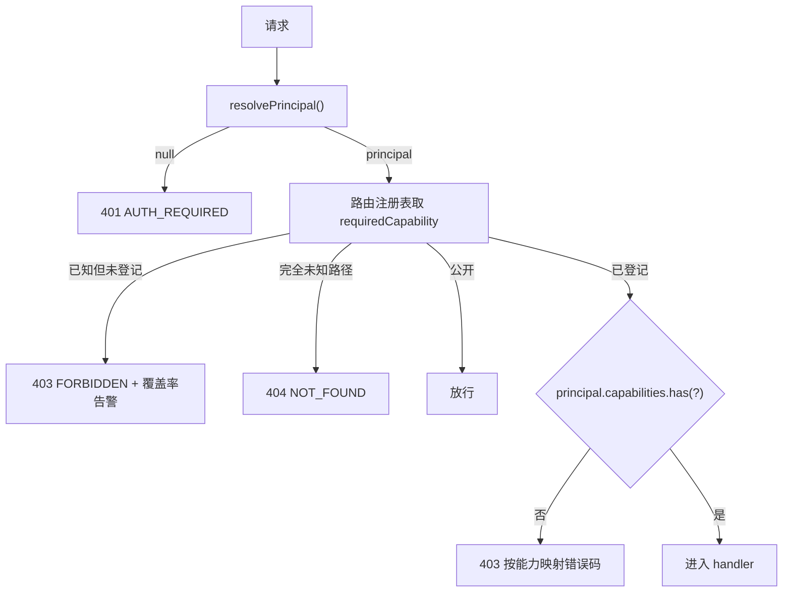

# S-03 能力矩阵与门禁

> 父设计：[DESIGN.md](./DESIGN.md)
> 依赖：S-02（登录会话与 Principal）
> 关联需求：[requirement.md](../requirement.md)

## 1. 术语

| 术语 | 含义 |
|---|---|
| Capability | 一个可判定的动作许可，如 `knowledge.write`、`datasource.delete` |
| 路由注册表 | `method + path → capability`；未登记 = 默认拒绝 |
| 工具注册表 | MCP / chat 工具名 → capability；未登记 = 默认拒绝 |
| 默认拒绝 | 没有声明能力的接口/工具一律 403，而不是默认放行 |
| 负向测试 | 对每个高风险能力构造越权请求，断言 403 |

## 2. 现状（AS-IS）

- `/api/*` 是长 `if` 链（`src/lib/mcp-http-api.ts:805-840`），写接口各自做 scope 校验；没有统一的动作权限层。
- Token 的 `readOnly` 只作用于 `/mcp` 工具（`src/lib/mcp-tools/tool-access.ts:21-32`），`/api/*` 与 chat 通道仍可写（`docs/mcp-http.md:96`）。
- AI 对话工具循环从 `enabledChatToolEntries()` 取工具（`src/lib/chat/mcp-tool-registry.ts:809-811`），**不按用户动作权限过滤**；8 个写工具可被模型自主调用。
- Web 前端直连 `/mcp` 做检索/写入（`web/src/api/mcpClient.ts:116`），所以只堵 `/api` 会被绕过。
- 数据源路由集中在 `src/lib/mcp-http-api.ts:824-832`；删除相关是 `remove` / `prune` / `import/prune`。

## 3. 方案（TO-BE）

### 3.1 能力枚举

```ts
export type Capability =
  | 'knowledge.read' | 'knowledge.write'
  | 'chat.use' | 'chat.writeTools'
  | 'datasource.read' | 'datasource.write' | 'datasource.delete'
  | 'tasks.read' | 'tasks.cancel' | 'tasks.delete'
  | 'users.manage'
  | 'ops.write';
```

`knowledge.write` 包含关系/Group 的创建、编辑、删除（用户只明确禁止数据源删除与任务删除，未禁止知识删除）。

### 3.2 角色 → 能力

```ts
export const ROLE_CAPABILITIES: Record<Role, ReadonlySet<Capability>> = {
  admin: new Set([
    'knowledge.read', 'knowledge.write', 'chat.use', 'chat.writeTools',
    'datasource.read', 'datasource.write', 'datasource.delete',
    'tasks.read', 'tasks.cancel', 'tasks.delete', 'users.manage', 'ops.write',
  ]),
  editor: new Set([
    'knowledge.read', 'knowledge.write', 'chat.use', 'chat.writeTools',
    'datasource.read', 'tasks.read',
  ]),
  viewer: new Set(['knowledge.read', 'chat.use', 'tasks.read']),
};

/**
 * 既有 MCP Token 的能力集合：保留既有范围，**不新增** users.manage / tasks.delete。
 * Token 仍受 scope 约束；本表只防止能力白名单给 Token 扩权。
 */
export const TOKEN_CAPABILITIES = new Set<Capability>([
  'knowledge.read', 'knowledge.write', 'chat.use', 'chat.writeTools',
  'datasource.read', 'datasource.write', 'datasource.delete',
  'tasks.read', 'tasks.cancel', 'ops.write',
]);
```

`viewer` 默认没有 `datasource.read`；`editor` 可以看数据源列表/详情，但不能写/删。

### 3.3 路由能力注册表

| 方法 + 路径 | 能力 | 说明 |
|---|---|---|
| `POST /api/auth/login` | 公开 | 登录 |
| `GET /api/auth/me` | 公开 | 身份探测；匿名返回 `authenticated:false` |
| `POST /api/auth/logout` | 公开 | 幂等登出 |
| `POST /api/auth/password` | 已登录（仅 session） | 任意角色可改自己密码；local-admin 无密码 |
| `GET /api/health` | `knowledge.read` | 健康诊断 |
| `GET /api/search-config` | `knowledge.read` | 检索配置 |
| `GET /api/tags` | `knowledge.read` | tag 列表 |
| `GET /api/doc/list` / `doc/get` / `doc/edit` | `knowledge.read` | 文档读取 |
| `GET /api/asset` | `knowledge.read` | 附件读取 |
| `GET /api/import/config` / `upload-status` / `status` / `incomplete` | `knowledge.read` | 导入读侧 |
| `GET /api/vector/status` / `embedding/summary` | `knowledge.read` | 向量/配置摘要 |
| `POST /api/vector/status/refresh` | `knowledge.read` | 只读派生刷新 |
| `POST /api/doc/edit` | `knowledge.write` | 文档保存 |
| `POST /api/import/upload` / `run` / `preflight` / `retry-incomplete` | `knowledge.write` | 导入写侧 |
| `GET /api/tasks` / `tasks/:id` / `tasks/:id/log` | `tasks.read` | 任务读取 |
| `GET /api/restore/status` | `tasks.read` | 还原任务状态 |
| `POST /api/import/cancel` / `restore/cancel` | `tasks.cancel` | 取消任务 |
| `DELETE /api/tasks/:id` | `tasks.delete` | 预留；当前无此路由 |
| `GET /api/datasource/list` / `detail` | `datasource.read` | 数据源只读 |
| `POST /api/datasource/sync` / `schedule` / `add-remote` / `update` | `datasource.write` | 数据源写 |
| `POST /api/datasource/remove` / `datasource/prune` / `import/prune` | `datasource.delete` | 数据源删除/待删文档删除 |
| `POST /api/restore/run` | `ops.write` | 还原 |
| `POST /api/vector/optimize` | `ops.write` | 索引整理 |
| `GET /api/users` / `POST /api/users` | `users.manage` | 用户列表 / 创建 |
| `PATCH /api/users/:id` / `DELETE /api/users/:id` | `users.manage` | 改角色/禁用/重置/删除 |
| `GET /api/chat/config` / `config/ack` / `prompt-config` | `chat.use` | 对话读侧 |
| `GET/POST/PATCH/DELETE /api/chat/conversations*` | `chat.use` | 自己的会话读写（含删除自己的会话） |
| `POST /api/chat/conversations/:id/images` | `chat.use` | 会话图片 |
| `PUT /api/chat/prompt-config` | `ops.write` | 全局提示词配置，admin-only |
| 其他 `/api/*` | 默认拒绝 | 未登记 = 403，并由覆盖率测试报警 |
| `/healthz` / 静态文件 | 公开 | 探活与页面资源 |

> 动态路径用精确模式匹配（如 `/api/tasks/:id`），禁止用 `startsWith('/api/tasks/')` 直接放行，避免未来子路由被误放。
> `public` / `authenticated` 是特殊权限：前者免登录，后者要求任意 session principal（`local-admin` / `token` 调用 `POST /api/auth/password` 返回 400）。
> `/api/chat/*` 的精确路由表在 `src/lib/chat/chat-routes.ts`；覆盖率测试按该文件的 `segs` 分支逐项断言，上表只做能力归类，不是穷举。

### 3.4 工具能力注册表

| 工具 | 能力 |
|---|---|
| `ki_search` / `ki_get_module_info` / `ki_group_list` / `ki_scope_list` / `ki_tag_list` | `knowledge.read` |
| `ki_store` / `ki_bulk_store` / `ki_sync_relation` / `ki_bulk_sync_relation` / `ki_edit_relation` / `ki_group_create` / `ki_delete_relation` / `ki_group_delete_empty` | `knowledge.write` |
| 未来新增 MCP 工具 | 未登记 = 拒绝；覆盖率测试报警 |

- `/mcp`：会话 principal 的能力集合用于工具注册与 `tools/call` 校验；viewer 只注册 5 个读工具；editor 注册 13 个；admin 全量。
- AI 对话：`runToolLoop` 接收当前 principal 的能力集合，`resolveRuntime().toolEntries` 按工具能力过滤；viewer 只剩读工具，editor 保留写工具。
- 数据源不在 MCP 工具面，无需工具级数据源能力。

### 3.5 请求判定流程



`matchRoute(method, path)` 返回四态：`public` / `permission` / `known-unregistered` / `unknown`。`known-unregistered` = 路由存在但注册表漏项（覆盖率测试应阻止合入），运行时 403 + stderr 告警；`unknown` = 完全不存在路径，保持 404，不把“路径写错”误报成“无权”。

错误码映射：

| 缺失能力 | 错误码 | 文案方向 |
|---|---|---|
| viewer 的任意写能力 | `USER_READONLY` | 当前账号为只读，不能执行写操作 |
| `datasource.write` / `datasource.delete` | `DATA_SOURCE_FORBIDDEN` | 当前账号无权管理数据源 |
| `ops.write` / `users.manage` / `tasks.cancel` / `tasks.delete` | `OPS_FORBIDDEN` | 当前账号无权执行该管理操作 |
| 未登记路由 / 工具 | `FORBIDDEN` | 当前账号无此操作权限 |
| 未登录 | `AUTH_REQUIRED` | 请先登录 |

**与 scope readonly 正交**：能力门禁只回答「这个账号能不能做这类动作」；`scope readonly` 回答「这个库能不能写」。两者必须同时通过：admin 有能力，但写入只读 scope 仍被 `assertHttpChannelWritable` / `withScopeWriteLock` 拒绝。

### 3.6 前端能力

- `/api/auth/me` 返回 `permissions: Capability[]`；前端 `AuthProvider` 提供 `can(capability)`。
- 页面/按钮只判 `can()`，禁止写 `role === 'editor'`。
- 能力缺失时：导航项隐藏或禁用、按钮 `disabled` + `title`、页面顶部解释原因；不出现“点了没反应”。
- 403 响应统一由 `httpApi.req` 抛出 `{ code, error }`，页面显示可操作提示（联系管理员 / 换账号）。
- **聊天会话归属**：当前 `chat-store` 没有 owner 字段，多用户下会共享。v1 必须新增 `ownerUserId`：session 用户写 `userId`；local-admin/token 写 `null`；admin 可看/管全部；editor/viewer 只看/改自己的；旧会话无 owner 仅 admin 可见。`resolveConversationInScopes` 必须在 **所有子路由**（GET/PATCH/DELETE/archive/compact/images/messages）统一校验 owner，不能只在列表过滤。否则 `chat.use` 的「自己的会话」承诺不成立，viewer 可读/删他人会话。

### 3.7 数据源与删除边界

- `editor`：`datasource.read` ✅；`datasource.write` / `datasource.delete` ❌。
- 数据源页对 editor：保留入口与列表/详情，隐藏/禁用「添加 Git 数据源」「同步」「编辑」「移除」「定时」「删除待删文档」。
- 删除相关：
  - `POST /api/datasource/remove` → `datasource.delete`（admin-only）。
  - `POST /api/datasource/prune` → `datasource.delete`（admin-only，删除待删文档）。
  - `POST /api/import/prune` → `datasource.delete`（同一删除流程的另一入口）。
  - 任务详情页当前没有任务记录删除接口；`tasks.delete` 预留，未来新增默认 admin-only。
- 服务端是唯一权威：UI 隐藏/禁用只是体验，接口必须 403。
- **任务详情脱敏**：任务参数可能含数据源路径/远端 URL。没有 `datasource.read` 的账号（viewer）查看任务详情时，服务端返回的参数应剔除 `source` / `remoteUrl` / `subdir` 等数据源字段，只保留操作、scope、操作者、结果与时间；不能一边禁 `datasource.read` 一边在任务详情里泄露数据源。

### 3.8 覆盖率与回归测试

- **路由覆盖测试**：枚举 `handleApiRequest` 中的路径字面量 + 动态模式，断言每个都在 `ROUTE_PERMISSIONS` 中；新增路由漏登记 → 测试红。
- **工具覆盖测试**：枚举 `MCP_TOOL_NAMES` / `CHAT_MCP_TOOLS`，断言每个都有能力；新增工具漏登记 → 测试红。
- **负向测试**：viewer 对每个写能力、editor 对 datasource.write/delete/ops/users/tasks.cancel 逐一断言 403；admin 断言 200。
- **正向回归**：editor 的导入/编辑/聊天写工具必须成功；viewer 的浏览/检索/聊天只读必须成功。
- **Token 回归**：Bearer 客户端行为不变（scope 越权 403、`/mcp` readOnly 仍只读）。

### 3.9 关键决策

| 决策 | 采用 | 被否决方案 | 否决理由 |
|---|---|---|---|
| 权限模型 | 能力白名单 + 默认拒绝 | URL 黑名单 | 新增写接口漏登记就放行；Token readOnly 只堵 `/mcp` 就是前车之鉴 |
| 默认策略 | 未登记 = 403 | 未登记 = 放行 | 安全面必须 fail-closed |
| 删除能力 | 单独 `datasource.delete` / `tasks.delete` | 合并进 `datasource.write` | 删除是高风险动作，需要单独负向测试与审计 |
| Token readOnly | 保持只作用于 `/mcp` | 扩展到 `/api` | 会改变既有 Token 行为，属 breaking change，不在本期 |
| 聊天写历史 | `chat.use` 允许所有角色写自己的会话 | 只读账号禁止聊天 | 用户已确认 viewer 可聊天，工具只读 |
| 聊天会话归属 | 新增 `ownerUserId` 隔离；admin 看全部，editor/viewer 只看/改自己的；旧会话无 owner 仅 admin | 按 scope 共享 | viewer/editor 可读/删他人会话，隐私不可接受 |

### 3.10 影响范围

| 文件 | 变更 |
|---|---|
| `src/lib/auth/capabilities.ts` | 新增：能力枚举、角色映射、`hasCapability` |
| `src/lib/auth/route-permissions.ts` | 新增：路由注册表、匹配器、错误码映射 |
| `src/lib/auth/tool-permissions.ts` | 新增：MCP/chat 工具能力表 |
| `src/lib/mcp-http-api.ts` | 入口统一门禁；逐路由移除散落判断 |
| `src/lib/mcp-http.ts` | `/mcp` principal 与工具过滤 |
| `src/lib/chat/chat-routes.ts` / `retrieval/tool-loop.ts` | 传入能力集合并过滤工具；会话按 owner 过滤 |
| `src/lib/chat/chat-store.ts` | 新增 `ownerUserId`，列表/读取/删除按 owner 校验 |
| `web/src/lib/authContext.tsx` | `can()` 与权限态 |
| `test/capability-coverage.test.ts` / `test/capability-negative.test.ts` | 新增 |

### 3.11 验收标准

- 未登记的新 `/api` 路由返回 403，且覆盖率测试失败并指出路径。
- viewer：`POST /api/import/upload`、`/api/doc/edit`、`/api/datasource/sync` 全部 403；浏览/检索/聊天正常。
- editor：导入/编辑/聊天写工具成功；`/api/datasource/*` 写与删除全部 403；`/api/users` 403；`/api/restore/run`、`/api/vector/optimize`、`/api/import/prune` 403。
- admin：全部接口通过（仍受 scope readonly 约束）。
- `/mcp` tools/list：viewer 5 个读工具、editor 13 个、admin 13 个；构造越权 `tools/call` 返回 403。
- 前端按钮显隐与接口 403 一致；无“按钮可点但请求失败”的死操作。
