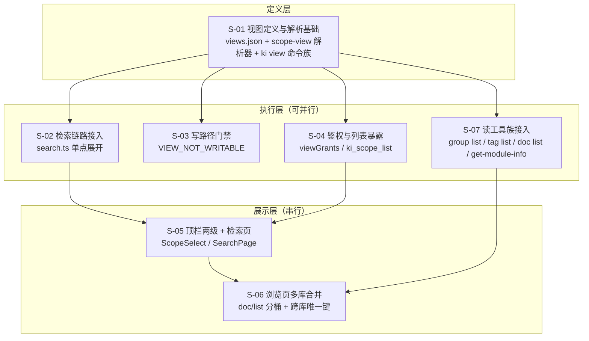

# 设计：知识视图（跨 scope 只读聚合）

- 需求：`REQ-20261104-003`（`../requirement.md`）
- 证据：🟢 代码直读（所有 `file:line` 均现场核对）+ 专家包约束（`存储与配置基础专家` / `MCP服务专家` / `检索与向量客户端专家`）
- 默认假设：单机、视图数量 ≤ 数十、成员 ≤ 20、成员变更频率低。超出需在实施前确认。
- 版本：v2（采纳 `design/design-review.md` 与 `review/challenge-report.md` 的全部阻断/重要项）

---

## 1. 需求背景 & 目标

**问题**：一个项目往往拆成多个 scope（`kisearch` / `kisearch-memory` / 团队共享库…）。跨库检索今天靠手写逗号串（`--scope a,b`），无法固化、无法在 Web 上一键切换、无法给 Agent 授权一个"逻辑单位"。

**目标**：引入**知识视图（view）**——一个带名字的、有序的 scope 列表，**在所有读路径上可当 scope 使用**，写路径显式拒绝。

### 1.1 兼容性承诺与落差声明

> 需求原话是"对用户来说是无感的"。工程上必须把这句话拆成三档，否则对接方会按"零成本"排期。

| 对象 | 承诺 | 依据 |
|---|---|---|
| **终端用户** | 无感。顶栏选视图即用，不需要知道 scope 概念 | S-05 / S-06 |
| **单库模式的调用方**（CLI / 脚本 / MCP 客户端） | **逐字节零变化**。响应不多字段、错误码不新增、`ki scope list` 文本输出不变 | 验收 B4 / E2 / F6 / D12 |
| **视图模式的调用方** | **有感知**：需处理 `views[]`（`ki_scope_list`）、`buckets`（`doc/list`）、`matchedViews`（检索）、`member`（深链）、6 个新错误码、`mode` 概念 | 各子需求契约 |

### 1.2 不在范围内

| 不做 | 理由 |
|---|---|
| 写入 / 导入 / 数据源 支持视图 | 落点、冲突策略、克隆缓存全是 per-scope，视图上无唯一解 |
| `export` / `backup` / `restore` / `wiki-sync` / `markdown-gen` | 产物是 per-scope 磁盘目录，合并契约需单独立项（本期 fail-loud 给出逐库命令） |
| Chat 跨库会话 | 会话目录按 `<chatDir>/<scope>/` 分，需新布局 |
| 视图嵌套视图 | 环检测 + 深度 + 权限传递，收益远低于成本 |
| 视图改名 | 会断裂 token 白名单、localStorage、深链 |
| 页面创建 / 编辑视图 | 仅 CLI（这条同时是 §4 R2 鉴权结论成立的前提） |

### 1.3 为何不用通配 scope（`--scope 'team-*'`）

`team-*` 听起来能覆盖 80% 场景且零新概念，被否决的理由是**集合不确定**：新建一个 `team-docs` 库会自动进入集合，导致 ① 检索结果与耗时随新建库无预警变化 ② token 授权范围被动扩张（同一个通配在不同时间覆盖不同库）③ 无法表达"有序成员"与"成员缺失可见"。视图是**显式枚举**，这三条都不存在。

---

## 2. 关键环节一览图



> `S-07 → S-06`：`src/lib/doc-list.ts`（payload 组装 + 分桶）由 S-07 在批次 2 新建，S-06 在批次 3 只把 HTTP handler 改成调用它。

**依赖 DAG 与分批**

| 批次 | 子需求 | 并行性 | 说明 |
|---|---|---|---|
| 第 1 批 | S-01 | — | 全部下游的基础 |
| 第 2 批 | S-02 ∥ S-03 ∥ S-04 ∥ S-07 | 四者可并行 | 文件互斥，见 I8 |
| 第 3 批 | S-05 → S-06 | **串行** | S-06 依赖 S-05 的 `lastView` 与 `member` 约定；且两者都要动 `ki.css` |

> **第 3 批为什么不能并行**（v2 修正）：S-05 与 S-06 都改 `web/src/styles/ki.css`；且 S-06 的「进入 → 回到视图」要用 S-05 新建的 `lastView.ts`。并行的协调成本高于串行节省。

---

## 3. 总体方案设计

### 3.1 核心结构：视图只在一层被展开

```
用户输入 --scope team
      │
      ▼
┌─────────────────────────────────────────┐
│ scope-view.resolveScopeTargets(config)   │  ← 唯一展开点
│   逐段 validateScope → 视图名 → 成员列表   │
└─────────────────────────────────────────┘
      │  string[]（真实 scope）
      ▼
┌─────────────────────────────────────────┐
│ 下游各模块：只认真实 scope，不感知视图     │
│   检索 fan-out / doc-list 分桶 / 目录树    │
└─────────────────────────────────────────┘
```

**铁律**：`getKbDir` / `getScopeDataDir` / `getScopeCollectionPath` 等路径派生函数**永远只收到真实 scope**。视图名若漏到这些函数，会凭空创建 `dataDir/team/` 目录——这是本设计最严重的一类失败，故 S-03 必须在写入口挡住。

### 3.2 视图的存放位置（v2 变更）

```
~/.ki/views.json          # 与 config.yaml 同目录；config 在别处时跟随 config 所在目录
{
  "version": 1,
  "views": {
    "team": { "members": ["kisearch", "kisearch-memory", "team-docs"] }
  },
  "updatedAt": "2026-11-04T10:00:00.000Z"
}
```

**为什么不用 `config.yaml`**（推翻 v1 的 D1）：

| 理由 | 说明 |
|---|---|
| **回滚不停服** | `config-schema.ts:9-12` 对**未知字段是"错误"而非告警**。视图写进 config 后，回滚到任何旧版本 → `loadConfig` 抛 `CONFIG_FIELD_INVALID` → **`ki` 全命令不可用**。独立文件对旧版本完全不可见，回滚后视图功能静默失效即可 |
| **并发不丢更新** | 配置写回无文件锁（`atomicWriteConfig` 只防半写）。独立文件可套 `withViewsLock`（抄 `mcp-token.ts:104-140`） |
| **与 Token 同位** | 视图是"管理员级对象"，与 `mcp-tokens.json` 同类；同位便于审计与打包 |

**代价**：`scopeMode: strict` 的白名单要读两处；`ki config init` 不生成 `views.json`（首次 `ki view create` 时惰性创建）。**净工作量下降**（原方案的 YAML 注释保留逻辑全部作废）。

### 3.3 视图与 scope 的关系（不变量）

| # | 不变量 | 保证方式 |
|---|---|---|
| I1 | 视图名与 scope 名**共用同一命名空间且唯一** | S-01 创建时双向查冲突 |
| I2 | 视图成员**必须是真实 scope**，不得是视图（含自身） | S-01 `validateViewMembers(config, members, selfName)` 显式排除 `selfName` 与全部视图名 |
| I3 | 视图**至少一个成员** | S-01 创建/删除成员后校验 |
| I4 | 视图成员可以暂不存在（前向声明） | `default` 模式允许；**`strict` 模式必须已注册**（S-01 D4-v2） |
| I5 | 视图**不落任何磁盘实体** | 纯 JSON 配置，无目录、无 Collection |
| **I6** | 展开前**必须逐段 `validateScope`** | `resolveScopeTargets` 内部承接原 `parseScopes` 的字符校验。**安全不变量**：漏掉则 `--scope ../etc` 绕过校验直入路径派生 |
| **I7** | 跨库键必须**库内唯一**而非全局唯一 | 浏览页一切按 `group` 索引的结构改为 `(scope, group)`，见 S-06 §3.8 |
| **I8** | 第 2 批四砖头文件互斥 | S-02：`search.ts` + `mcp-tools/search.ts`；S-03：`scope-policy.ts` + `scope-write-lock.ts` + 7 个命令入口（**不含 `src/scope.ts`**）；S-04：`mcp-token.ts` + `mcp-server.ts` + `src/scope.ts` + `mcp-tools/scope-list.ts`；S-07：`group.ts`/`tag.ts`/`doc.ts`/`get-module-info.ts` + 对应 3 个 MCP 工具 |

### 3.4 共享术语速查

| 术语 | 定义 | 定义者 |
|---|---|---|
| **视图 / view** | 带名字的有序 scope 列表，读路径可当 scope 用 | S-01 |
| **成员 / member** | 视图里的一个真实 scope 名 | S-01 |
| **展开 / expand** | 视图名 → 成员列表的过程 | S-01 |
| **`mode`** | 前端语境：当前选择是 `scope` 还是 `view` | S-05 |
| **分桶 / buckets** | `doc/list`、`group list`、`doc list` 对视图按成员分组返回的结构 | S-06 / S-07 |
| **来源库** | 某条检索命中实际所属的真实 scope | S-02 / S-05 |
| **文档引用 / DocumentRef** | `{ scope, group, relation }` 三元组。**视图模式下文档的唯一标识** | S-06 |
| **库节点 / library node** | 视图模式下浏览树顶代表一个成员库的节点 | S-06 |

### 3.5 全局错误码

| 错误码 | 触发 | 出口 |
|---|---|---|
| `INVALID_VIEW_NAME` | 名字含非法字符 | CLI 退出 1 |
| `RESERVED_VIEW_NAME` | `all` / `default` / `__global__` / `__root__` | 同上 |
| `VIEW_NAME_CONFLICT` | 与已有 scope 或视图同名 | 同上 |
| `VIEW_NOT_FOUND` | 查/改/删不存在的视图 | 同上 |
| `VIEW_EMPTY` | 视图无成员 | 同上 |
| `VIEW_MEMBER_IS_VIEW` | 成员是视图名（含自引用） | 同上 |
| `VIEW_MEMBER_NOT_REGISTERED` | `strict` 下成员未在 `config.scopes` 注册 | 同上 |
| `INVALID_VIEW_MEMBER` | `doc/get`、`get-module-info` 的 `member` 参数不在该视图成员内 | HTTP 400 |
| `VIEW_NOT_WRITABLE` | 写路径收到视图名 | CLI 1 / MCP `isError` / HTTP 409 |
| `VIEWS_FILE_LOCKED` | `views.json` 被占用超时 | CLI 1 |
| `INVALID_SCOPE`（既有） | `--scope` 段含非法字符 | **必须保持**，见 I6 |

---

## 4. 全局风险 & 跨子需求依赖

| 风险 | 说明 | 缓解 |
|---|---|---|
| **R1 视图名漏进路径派生** | 会凭空建出 `dataDir/<视图名>/`，后续"搜不到/写出错库"极难定位 | S-03 写入口全拦（含 `import` / `datasource` / `export` / `backup`） |
| **R2 token 授权视图的动态跟随** | 成员变更即时扩权一批 token | 前提是「视图仅 CLI 可改」= 管理员动作。**一旦开放页面编辑视图，本结论失效**，必须改回授权快照。同时 `viewGrants` 独立字段保证届时可无损迁移（S-04 D1-v2） |
| **R3 `SCOPE_LESS_TOOLS` 白名单漂移** | 新增无 scope 参数的工具漏登记会被 403 误伤 | 本设计**不新增工具**；`ki_scope_list` 仅扩返回值 |
| **R4 `config-schema` 未知字段 fail-loud** | —— | 已通过 §3.2 改独立文件**彻底规避** |
| **R5 前端首屏 `mode` 未定** | scopeList 异步加载，首帧不知道是视图 | 乐观按 `'scope'` + 写页面在 `isLoading` 期间禁用提交（S-05 D5） |
| **R6 深链在视图下丢成员上下文** | `group/relation` 属成员内路径 | S-05 改用 `r.scope`；S-06 新增 `member` 参数 |
| **R7 单篇正文读取漏传成员 scope** | `doc/get` 只带一个 scope 字符串，视图名会静默读到空；`useScopeReadonly` 同理会把只读库显示成可写 | S-06 §3.6 统一「当前文档上下文 scope」；S-05 补 `openDocument`（challenger 意见 3） |
| **R8 回滚锁死停服** | 旧版本遇未知字段即 fail-loud | 已通过 §3.2 独立文件规避 |
| **R9 跨库键不唯一** | 浏览页一切按 `group` 索引的缓存/查找/过滤在视图下串库、打开错文档 | S-06 §3.8 全部改 `(scope, group)` + `DocumentRef` |
| **R10 `views.json` 被外部改坏** | 手工编辑导致 JSON 损坏 | 读取侧 fail-loud（`VIEWS_CORRUPT`）并给恢复指引；写侧先读后改，损坏时拒绝写入 |

---

## 5. 子需求文档

| 编号 | 文档 | 一句话 |
|---|---|---|
| S-01 | `S01_视图定义与解析基础_DESIGN.md` | `views.json` + 解析器 + `ki view` 命令族 |
| S-02 | `S02_检索链路接入视图_DESIGN.md` | `search.ts` 单点展开，下游零改动 |
| S-03 | `S03_写路径门禁_DESIGN.md` | `VIEW_NOT_WRITABLE` + 给出路文案 |
| S-04 | `S04_视图鉴权与列表暴露_DESIGN.md` | `viewGrants` 授权 + 可见性 |
| S-05 | `S05_顶栏与检索页_DESIGN.md` | 两级选择器 + 来源标记 + 抽屉成员 scope |
| S-06 | `S06_浏览页多库合并_DESIGN.md` | 分桶 + 合并树 + 跨库唯一键 |
| S-07 | `S07_读工具族接入视图_DESIGN.md` | `group list` / `tag list` / `doc list` / `get-module-info` |
