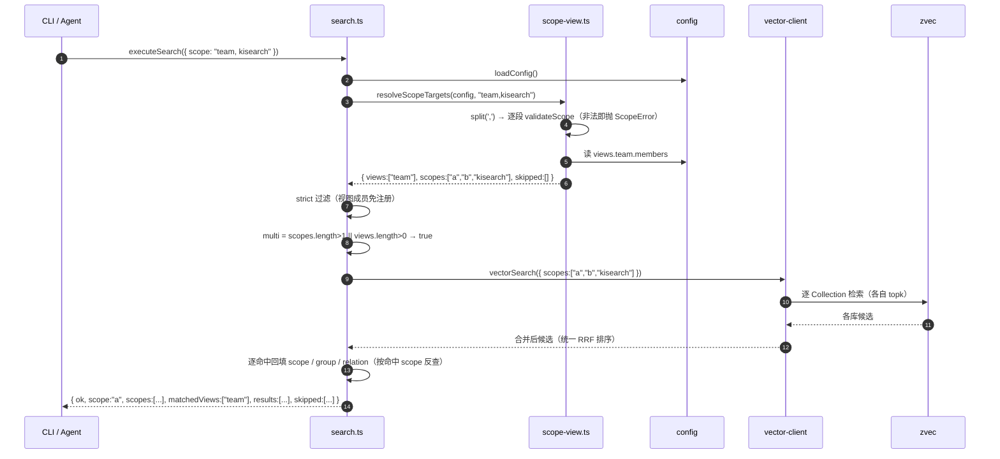

# S-02 检索链路接入视图

- 父文档：`DESIGN.md` §3
- 前置依赖：S-01（`resolveScopeTargets`）
- 证据：🟢 代码直读（`src/search.ts`）

---

## 1. 术语

| 术语 | 定义 |
|---|---|
| 展开点 | `src/search.ts::executeSearchLocal` 的 scope 解析段（`:189-226`） |
| 来源库 | `SearchHit.scope`，仅在 `multi` 时填充（`src/search.ts:57-59, 421`） |
| `multi` | 判定是否走"多库聚合"分支的开关 |

---

## 2. 现状（AS-IS）

```
executeSearchLocal(params)                        src/search.ts:177
  ├─ parseScopes(params.scope)                    :192    逗号拆分 + 字符集校验
  ├─ multi = parsed.length > 1                    :193
  ├─ if !multi → resolveScope → validateScope     :202-208  单库：缺省回退 default
  │  else      → strict 过滤 + 跳过上报            :209-226  多库：未注册则 skip
  ├─ ensureVectorAvailable(scopes[0])             :236
  ├─ findMissingScopeCollections(scopes) → skipped :255-260
  ├─ hiddenByScope / fan-out                      :267-322
  └─ 逐命中：hitScope = r.scope ?? (单库兜底)      :416-422
             if (multi && hitScope) hit.scope     :421     ★ 只在此填充来源库
```

**已就绪**：`vectorSearch({ scopes })` / `fullTextSearch({ scopes })` 的 fan-out、跨库统一排序、`skipped` 上报、按命中 scope 反查 relations-cache 与原文，全部已实现（`src/lib/vector-client.ts:988-1095`、`src/search.ts:400-460`）。

**缺口**：`parsed.length > 1` 是唯一的 `multi` 判据。视图名是**单段**，走进去会被当成一个真实 scope，然后 `collections/<视图名>` 不存在 → 静默 skipped，返回 0 条。

---

## 3. 方案（TO-BE）

### 3.1 改动点（单函数、单段落）

```ts
// src/search.ts::executeSearchLocal  替换 :189-226

const config = loadConfig();
const targets = resolveScopeTargets(config, params.scope);   // ← S-01
const skipped: { scope: string; reason: string }[] = [...targets.skipped];

// strict 过滤：展开后的每个成员**与普通 scope 同等对待**（无特权，见 D2）
const strict = getScopeMode(config) === 'strict';
const scopes: string[] = [];
for (const s of targets.scopes) {
  if (strict && !Object.prototype.hasOwnProperty.call(config.scopes, s)) {
    skipped.push({ scope: s, reason: '未注册（scopeMode=strict，不在配置 scopes 白名单）' });
    continue;
  }
  scopes.push(s);
}
if (scopes.length === 0) {
  return { ok: false, error: `无可检索的 scope：${formatSkipped(skipped)}` };
}

/** 用了视图就进入多库语义（即使只有 1 个成员）——前端据此决定是否标来源库 */
const multi = scopes.length > 1 || targets.views.length > 0;
const expandStartedAt = Date.now();
```

> ★ **安全前置**：上面替换掉的 `parseScopes` 原本承担 `validateScope` 逐段字符校验（`src/lib/scope.ts:68-84`）。
> `resolveScopeTargets` **必须在展开前对每个原始段调用 `validateScope`**（S-01 §3.3 已定为不变量），否则 `--scope ../etc` 会绕过字符校验直接进入路径派生。本子需求不重复实现该校验，只依赖并验收（B10）。

### 3.2 `multi` 语义变更

| 场景 | 现状 `multi` | 新 `multi` | 影响 |
|---|---|---|---|
| `--scope a` | false | false | 完全不变 |
| `--scope a,b` | true | true | 不变 |
| `--scope team`（3 成员） | false（错误） | **true** | 修复 |
| `--scope team`（1 成员） | false（错误） | **true** | 单成员视图也标注来源库，便于确认"我确实在视图里" |

### 3.3 响应契约（增量，不破坏）

```ts
export type SearchResult = {
  ok: true;
  scope: string;              // 保持：scopes[0]（真实 scope），不改成视图名
  scopes?: string[];          // 保持：multi 时返回
  matchedViews?: string[];    // 【新增】本次请求涉及的视图名；缺省 = 纯 scope 请求
  results: SearchHit[];
  skipped?: { scope: string; reason: string }[];
  degraded?: boolean;
  degradedReason?: string;
};
```

> **为何叫 `matchedViews` 而不是 `views`**：S-04 的 `ki_scope_list` 响应里已有一个 `views: ViewInfo[]`（对象数组）。两处同名不同类型，实现时极易混用，故检索侧改用 `matchedViews`。

**为何 `scope` 不改写成视图名**：MCP 客户端与 CLI 都可能在收到结果后回显/复用该字段做下一次请求。改写成视图名会让"视图 → 视图"绕一圈，而 `views[]` 已足够表达意图。同时保留既有语义 = 零回归。

```json
// Demo 返回示例（仅示意格式）
{
  "ok": true,
  "scope": "kisearch",
  "scopes": ["kisearch", "kisearch-memory"],
  "matchedViews": ["work"],
  "results": [
    {
      "scope": "kisearch-memory",
      "group": "专题记忆",
      "relation": "订单落库顺序约定",
      "score": 0.83
    }
  ],
  "skipped": [
    { "scope": "team-docs", "reason": "视图 team 的成员 scope 尚不存在" }
  ]
}
```

### 3.4 MCP 工具参数描述同步

`src/lib/mcp-tools/search.ts:12` 的 `scope` 描述改为：

> 知识库名或视图名（多个用逗号分隔聚合检索，视图会自动展开为成员库；结果按来源库标注；省略则用 default）

**不改 zod schema**（仍是 `z.string().optional()`）——视图名与 scope 名同形，类型层面无需变化。

### 3.5 跳过原因分流：KB 存在但无向量索引

现状 `findMissingScopeCollections` 只检测**向量 Collection 目录**，不看 KB 目录。因此"有 KB、无向量"（`import --no-vector` 的库）与"完全没导入"会得到**同一条原因文案**，对视图场景尤其误导（用户会以为库还没导）。

```ts
// search.ts 跳过原因分流（仅文案，不改变跳过与否的判定）
const hasKb = fs.existsSync(getKbDir(missing));
const reason = hasKb
  ? '该知识库只有全文索引、没有向量索引（导入时用了 --no-vector）；请改用 --mode fulltext，或 ki restore <scope> --rebuild-vector 重建'
  : `${MISSING_COLLECTION_REASON_PREFIX}（尚未导入，或仍是旧版单 Collection 布局）；当前不支持旧布局迁移，请执行 ki import 重新导入`;
```

> 该文案分流**同时修好单库场景**，不是视图专属；判定逻辑（跳不跳过）保持原样，风险为零。

### 3.6 关键时序



---

## 4. 关键决策点

| # | 决策 | 被否决方案 | 否决理由 | 重新评估触发条件 |
|---|---|---|---|---|
| **D1** | 展开放在 `executeSearchLocal` 内部 | 放在 MCP/CLI 入口层 | 三条调用路径（CLI/MCP/HTTP-daemon）各写一遍必然漂移；放内部则一处生效 | 无 |
| **D2** | `strict` 下视图成员**与普通 scope 同等对待**（不享"免注册"特权） | 让视图成员免注册 | `strict` 的语义是"未注册即不可用"，是**运行时兜底**；而视图创建时的成员校验（S-01 D4-v2）是**编辑期质量闸**，两者职责不同。若让视图成员在运行时免注册，则"从 `config.scopes` 移掉一个库"这个动作对视图失效——`strict` 会因此出现一条不为人知的绕过路径，且被跳过的成员不再上报 | 无 |
| **D3** | `multi` 改为 `scopes.length > 1 \|\| views.length > 0` | 保持 `scopes.length > 1` | 单成员视图不会标来源库，用户无法判断自己是否在视图内 | 无 |
| **D4** | 响应 `scope` 字段仍是真实库 | 改成视图名 | 会破坏既有消费者的回显/复用逻辑 | 无 |
| **D5** | 未知成员保留在 `scopes` 里交给下游 | 在视图层剔除 | `findMissingScopeCollections` 已有精确的「Collection 缺失」原因，视图层重复判断会双口径漂移 | 无 |

---

## 5. 异常处理

| 场景 | 行为 | 是否对外暴露 |
|---|---|---|
| 视图为空（手改配置删空） | `resolveScopeTargets` 抛 `VIEW_EMPTY` → 被 `catch` 转 `ok:false` | 是，`error` 含「视图 X 没有成员」 |
| 全部成员被 strict 跳过 | `ok:false` + 逐个列出成员与原因 | 是 |
| 视图成员无向量 Collection | 非全文模式：`skipped` 携带现有 `MISSING_COLLECTION_REASON_PREFIX` 原因 | 是 |
| 部分成员不存在 | 同上（走 Collection 缺失分支） | 是 |
| 向量服务不可用 | 沿用既有降级：切全文 + `degradedReason` | 是 |
| `views` 配置损坏 | `loadConfig` 阶段已 fail-loud（`CONFIG_FIELD_INVALID`） | 是 |

---

## 6. 影响范围

| 文件 | 改动 |
|---|---|
| `src/search.ts` | 替换 `:189-226` 解析段；`multi` 计算；响应加 `views` |
| `src/lib/mcp-tools/search.ts` | 仅参数描述文案 |
| `src/lib/scope-view.ts` | **无需新增**：v2 起 strict 下视图成员与普通 scope 同等对待（D2），只用 S-01 的 `getViewMembers` / `resolveScopeTargets` |
| `docs/cli.md` · `docs/query-kb.md` | `--scope` 说明补"可传视图名" |

**不影响**：`vector-client`（`scopes?: string[]` 接口不变）、MCP 传输层、鉴权、前端。

---

## 7. 验收标准

| # | 验收项 | 可执行形式 |
|---|---|---|
| B1 | 视图跨库检索 | 视图 `team`=[a,b]，`ki search "x" --scope team` → 结果同时含 a、b 的命中 |
| B2 | 来源库标注 | 同上，每条结果带 `scope` 字段（多成员时） |
| B3 | 单成员视图也标注 | 视图 `solo`=[a]，`ki search "x" --scope solo` → 响应含 `scopes:['a']`、`matchedViews:['solo']`，命中带 `scope:'a'` |
| B4 | 单库零回归 | `ki search "x" --scope a` → 响应无 `views` 字段、命中无 `scope` 字段（与改造前逐字节一致） |
| B5 | 混写 | `--scope team,kisearch` → 成员与 `kisearch` 去重合并 |
| B6 | 成员缺失可见 | 视图含未导入的 `team-docs` → `skipped` 出现该项，其余成员正常返回 |
| B7 | **strict 无特权** | `scopeMode=strict` + `config.scopes` 只有 `a`，视图 `team`=[a,b] → 检索成功，**`b` 进入 `skipped` 并上报原因**（不静默通过） |
| B8 | 空视图 | 视图成员被清空 → `ok:false`，`error` 含 `VIEW_EMPTY` 语义文案 |
| B9 | 全文模式 | `--mode fulltext --scope team` → 两份 FTS 索引合并，行为同 B1 |
| B10 | **非法字符仍被拒** | `ki search "x" --scope '../etc'` → 退出码 1 + `INVALID_SCOPE`（与改造前一致） |
| B11 | **KB-only 成员文案** | 视图含 `--no-vector` 导入的库 → `skipped.reason` 指向"只有全文索引"并给出 `--mode fulltext`，不再是"尚未导入" |
| B12 | 字段命名 | 响应中的视图字段为 `matchedViews`，不存在 `views` 键 |
| **B13** | **展开可观测** | 视图检索时 stderr 输出一行：`[view] team → 5 个成员（展开 3ms，跳过 1）`；成员数 ≥ 10 或展开 > 50ms 时 **warn 级**。用于区分"慢在展开还是慢在 fan-out"（challenger 意见 11） |
