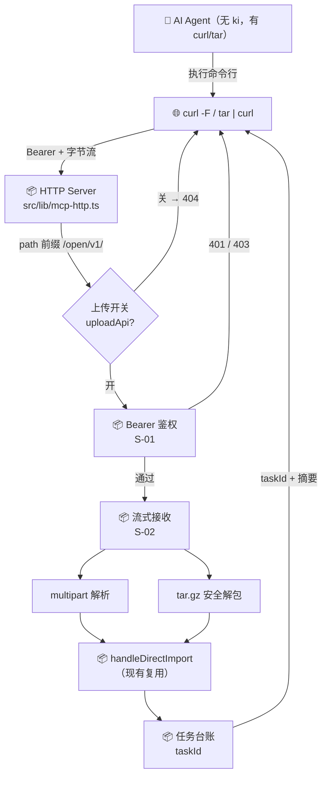
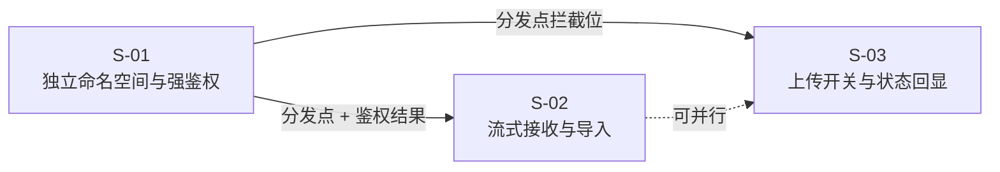

# 第三方 HTTP 上传 API 与开关 · 总体设计

> 需求：REQ-20261105-001
> 版本：v1（2026-11-05）
> 角色：standalone

## 1. 需求背景 & 目标

**现状痛点（均有代码证据）**

| # | 痛点 | 证据 |
|---|---|---|
| P1 | AI Agent 所在机器**没有 ki CLI**，只有 shell（curl/tar）与文件系统 | 用户明确约束 |
| P2 | 现有唯一上传接口只吃 JSON+base64，`readJsonBody` 是 `JSON.parse` → `curl -F` 不可用 | `src/lib/mcp-http-api.ts:415-440`、`:2186-2193` |
| P3 | 请求体 16MB 硬上限、单文件默认 1MB，大文档/目录传不进 | `src/lib/mcp-http-api.ts:156`、`src/lib/import.ts:440` |
| P4 | MCP 13 个工具无「导入文件/目录」能力；`sync_relation` 逐篇写且不切分 | `src/lib/mcp-tools/*`、`src/sync-relation.ts:1373-1377` |
| P5 | 「要有 token 验证」但本机回环被 `local-admin` 短路 | `src/lib/web-auth.ts:169-171` |

**目标**

1. 提供**标准 HTTP**（`curl` 可直接用）的上传通道，支持「一份大文档」与「一个目录（保留层级）」。
2. 该通道**强制 Bearer Token**：无 Cookie、无 local-admin 短路、无匿名。
3. 默认开启，`--no-upload-api` 可关闭。
4. **前端 `/api/*` 零改动**。

**⛔ 不在范围内**

- Web UI 任何改动（前端 API 不动）
- 新增 MCP 工具
- Token 生命周期（过期 / `lastUsedAt` / 吊销）
- `sync_relation` 大文档 chunk 切分
- 上传进度 SSE 推送

**验收锚点（冻结点请重点确认这张表是否覆盖了你真正想要的）**

| # | 验收标准（用户语言） | 可执行验证 | 归属 |
|---|---|---|---|
| A1 | Agent 只靠 `curl` 就能把一份大文档推给远端 ki | `curl -F "files=@big.md"` → 200 + `taskId`，随后能被 `ki_search` 命中 | S-02 |
| A2 | Agent 只靠 `tar` + `curl` 就能把整个目录推过去，层级保留 | `tar czf - -C ./docs . \| curl --data-binary @-` → group 树与 `ki import` 逐项一致 | S-02 |
| A3 | **不装 ki 也能用** | 验证机不装 ki，仅用 curl/tar | S-02 |
| A4 | 没有 token 一律进不来（含本机） | 无 token → 401；本机 127.0.0.1 无 token 也 401 | S-01 |
| A5 | 越权进不来 | token 授权不含目标 scope → 403 | S-01 |
| A6 | 只读 token 不能上传 | 只读 token POST → 403 `OPEN_API_TOKEN_READONLY` | S-01 |
| A7 | 能关掉 | `--no-upload-api` 后 `/open/v1/import/*` → 404 | S-03 |
| A8 | 关掉后前端与 MCP 全不受影响 | Web 导入页、IDE MCP 工具照常工作 | S-03 |
| A9 | 关掉后重启不会自己开回来 | `ki mcp restart` 后仍为关闭 | S-03 |
| A10 | 大目录不会静默半成功 | 部分文件失败时响应含 `files.skipped` + 原因样本（≤10 条） | S-02 |

## 2. 关键环节一览图



## 3. 总体方案设计

**核心思路：三条命名空间分离，互不影响。**

```
同一 HTTP server（:7423）· 同一进程（daemon 即 HTTP 进程）
├─ /mcp             MCP 协议（IDE 用）              现有，永远开
├─ /api/*           前端 Web 对接（浏览器语义）       现有，永远开（零改动）
├─ /open/v1/*       第三方程序 API（Bearer-only）    ★新增，默认开，可关
├─ /healthz         健康检查                        现有，永远开
└─ 静态页（--web）   前端资源                        现有
```

**子需求节点图**



**子需求清单**

| 编号 | 子需求 | 触发场景 | 独立验证方式 |
|---|---|---|---|
| S-01 | 独立命名空间与强鉴权 | 任意 `/open/v1/*` 请求 | 无 token→401；本机回环无 token 也 401；Cookie 无效 |
| S-02 | 流式接收与导入 | `POST /open/v1/import/upload` | `curl -F` 三文件上传 → 产物与 CLI 导入逐项一致 |
| S-03 | 上传开关与状态回显 | 启动参数 `--no-upload-api` | 关闭后 404；`ki mcp status` 可见 |

**共享术语速查**

| 术语 | 定义 | 定义方 |
|---|---|---|
| OpenAPI 命名空间 | URL 前缀 `/open/v1/`，面向程序调用，只认 Bearer | S-01 |
| Bearer-only | 仅接受 `Authorization: Bearer <token>`，不读 Cookie、不做 local-admin 判定 | S-01 |
| uploadId | 一次上传会话的 UUID，落点 `~/.ki/import-uploads/<uploadId>/` | S-02 |
| 一步式 | 上传完成后直接创建导入 job 并返回 `taskId`，不需二次调用 | S-02 |
| uploadApi | 上传接口开关状态（true=开，默认 true） | S-03 |
| relPath | 文件相对路径（posix 风格），决定 group 落点与 `sourcePath` | S-02 |

## 4. 全局风险 & 跨子需求依赖

**红线（设计不可违反）**

| # | 红线 | 原因 |
|---|---|---|
| R1 | **不得跳过 `httpServer.listen()`** | daemon 即 HTTP 进程；stdio MCP 桥接依赖 `http://host:port/mcp`（`src/lib/daemon-bridge.ts:43-46`） |
| R2 | **不得修改全局 `MAX_BODY`** | 被所有 `/api` 写接口共用（`src/lib/mcp-http-api.ts:156`） |
| R3 | **不得修改 `/api/*` 的鉴权链路** | 前端 Web 与 MCP 通道都走 `resolveWebPrincipal` |
| R4 | **不得二次实现导入内核** | 切分/附件/group/`__root__`/批量向量化只有 `handleDirectImport` 一处真相 |
| R5 | tar 条目越界必须**整包拒收且零落盘** | 复用 `src/lib/safe-tar.ts:40-67` 的校验口径 |

**跨子需求共享面**

| 共享面 | 内容 | 归属 | 其他子需求 |
|---|---|---|---|
| 路由前缀 | `/open/v1/` 常量（单一来源） | S-01 | S-02 / S-03 只引用 |
| 错误码分段 | S-01 用 `OPEN_API_1000-1099`；S-02 用 `1100-1199`；S-03 用 `1200-1299` | S-01 定义分段规则 | S-02 / S-03 |
| 鉴权结果类型 | `OpenApiPrincipal { tokenId, scopes, readOnly }` | S-01 | S-02 消费 |
| 上传会话目录结构 | `<uploadId>/{.scope,.upload-session.json,<relPath>}` | S-02 | S-03 不触碰 |

**全局风险**

| 风险 | 影响 | 缓解 |
|---|---|---|
| 反向代理 `client_max_body_size` 默认 1MB | tar/大文件在代理层被拒，应用层看不到请求 | 文档写明需调代理；启动日志打印本服务上限 |
| 磁盘被上传填满 | 服务不可用 | 流式落盘时累计字节计数，超 `uploadMaxBytes` 立即中断 + 清理 |
| 大包解析占内存 | OOM | 全程流式，不 `Buffer.concat` 全量 |
| **zip-bomb**：传输字节小、解包后极大 | 磁盘打满 | `uploadMaxBytes` 只约束传输字节；S-02 §3.5 追加「解包条目数 ≤20k、解包总量 ≤ min(uploadMaxBytes×10, 4GiB)、压缩比 >10 判可疑」三重闸门 |
| 两分支 sourceDir 不一致 | 同一目录两种上传方式得到不同 group / sourcePath，`prune` token 恒失配 | S-02 §3.4 统一为 `<uploadId>/content/`，元数据放上层 |
| 上传会话与 `/api` 会话口径漂移 | `prune` 的 token 恒失配 | 复用同一 `bindUploadScope` 与 `.scope` 文件 |
