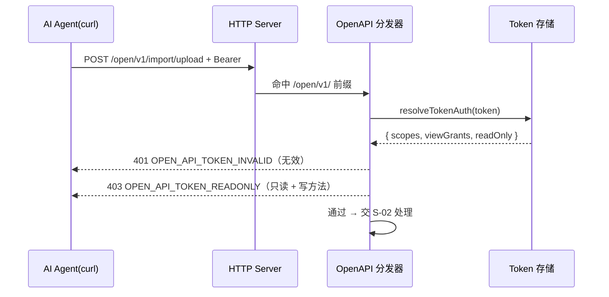

# S-01 独立命名空间与强鉴权

> 父需求：REQ-20261105-001 ｜ 依赖：无 ｜ 被依赖：S-02、S-03

## 1. 术语

| 术语 | 定义 |
|---|---|
| OpenAPI 命名空间 | URL 前缀 `/open/v1/`，面向程序调用；与前端 `/api/*`、MCP `/mcp` 平级隔离 |
| Bearer-only | 只从 `Authorization: Bearer <token>` 取身份；**不读 Cookie、不做 local-admin 判定、不支持匿名** |
| OpenApiPrincipal | 鉴权结果：`{ tokenId?, scopes, readOnly }`，`scopes` 已合并 `viewGrants` |
| 错误码号段 | S-01 `OPEN_API_10xx`；S-02 `OPEN_API_11xx`；S-03 `OPEN_API_12xx`（防撞码） |

## 2. 现状（AS-IS）

```
HTTP 请求进入 createMcpHttpServer 的 handler（src/lib/mcp-http.ts:534 起的请求回调）
├─ /healthz          免鉴权                                    mcp-http.ts:611
├─ /api/*            → getApiHandler().handleApiRequest        mcp-http.ts:730-745
│      └─ 内部：resolveWebPrincipal → matchRoute → capability    mcp-http-api.ts:951-1015
├─ /mcp              鉴权后转 MCP transport                     mcp-http.ts:757-781
└─ 其它              --web 静态页 / JSON 404                   mcp-http.ts:747-755
```

| 关键事实 | 证据 |
|---|---|
| `/api/*` 与 `/mcp` 共用一个 server、一个端口 | `src/lib/mcp-http.ts:730`、`:747` |
| 身份解析优先级：local-admin → Bearer → Cookie → 匿名 | `src/lib/web-auth.ts:164-222` |
| **本机回环请求在第一步就返回 local-admin，Bearer 被跳过** | `src/lib/web-auth.ts:169-171` |
| `/api` 路由能力白名单，未登记 = 404 | `src/lib/auth/route-permissions.ts:102-113` |
| 只读 Token 的写工具限制**仅作用于 MCP 通道** | `src/lib/mcp-http.ts:739` 注释 |
| 写方法带 body 时 Content-Type 必须 JSON（仅当请求带 Origin） | `src/lib/auth/request-security.ts:100-102` |

**专家资产提示**：新增带 `scope` 参数的 `/api` 接口必须同步加入 query scope 越权校验列表，否则不受拦截（`.module-experts/知识索引导入专家/C1:166`）。本子需求**不受此约束**，因为 `/open/v1/*` 走独立鉴权链路，不复用该列表。

## 3. 方案（TO-BE）

### 3.1 目录结构

```
src/lib/open-api/
├── constants.ts     # [新增] 路径前缀、错误码、默认上限（单一真相）
├── auth.ts          # [新增] Bearer-only 身份解析
├── index.ts         # [新增] /open/v1/* 分发器
└── routes/
    ├── ping.ts      # [新增] GET /open/v1/ping
    └── import.ts    # [S-02 实现] POST /open/v1/import/upload、GET .../status
```

### 3.2 分发器接入点

在 `src/lib/mcp-http.ts` 的请求回调中，**`/api/` 分支之前**插入：

```ts
// /open/v1/*：第三方程序 API（Bearer-only，独立于前端 /api 与 MCP 通道）
if (url.pathname === OPEN_API_PREFIX || url.pathname.startsWith(OPEN_API_PREFIX + '/')) {
  await handleOpenApiRequest(req, res, url, {
    resolveTokenAuth,
    uploadApi,
    uploadMaxBytes,
    config: requestConfig ?? loadConfig(),
    // 注意：createJob / runImportJob 等导入内核符号由 routes/import.ts 直接 import，
    // 不经由 ctx 透传 —— 让 mcp-http.ts 只承担"前缀分发"，不理解 open-api 内部路由。
  });
  return;
}
```

**位置要求**：必须在静态页 fallback（`mcp-http.ts:747`）之前，否则 GET 请求会被 SPA fallback 成 `index.html`。

### 3.3 鉴权实现

```ts
// src/lib/open-api/auth.ts
export interface OpenApiPrincipal {
  tokenId?: string;
  scopes: string[];      // 已合并 viewGrants
  readOnly: boolean;
}

export type OpenApiAuthResult =
  | { ok: true; principal: OpenApiPrincipal }
  | { ok: false; status: 401 | 403; code: OpenApiErrorCode; message: string };

export function resolveOpenApiPrincipal(
  req: http.IncomingMessage,
  deps: { resolveTokenAuth: (token: string) => TokenAuth | undefined },
): OpenApiAuthResult;
```

判定顺序（**顺序即语义，不可调整**）：

```
① 取 req.headers.authorization
   └─ 非 "Bearer " 前缀或空 → 401 OPEN_API_TOKEN_REQUIRED
② deps.resolveTokenAuth(token)
   └─ undefined → 401 OPEN_API_TOKEN_INVALID（不区分"不存在"与"owner 被禁用"）
③ principal.readOnly === true 且 method ∉ {GET, HEAD, OPTIONS}
   └─ → 403 OPEN_API_TOKEN_READONLY
④ 通过 → { ok: true, principal }
```

**不做的事（显式声明）**：
- 不调 `isLocalAdminRequest` —— 本机回环也必须带 token
- 不调 `getSessionIdFromRequest` —— 第三方接口不接受浏览器 Cookie
- 不调 `checkRequestSecurity` —— 不依赖 Cookie，天然免疫 CSRF；且它强制 JSON Content-Type，会挡掉 multipart

### 3.4 路由清单（本期）

| 方法 | 路径 | 职责 | 实现方 |
|---|---|---|---|
| GET | `/open/v1/ping` | 连通性 + 鉴权自检，回显 token 身份与上限 | S-01 |
| POST | `/open/v1/import/upload` | 上传文件/目录并一步式启动导入 | S-02 |
| GET | `/open/v1/import/status` | 按 `taskId` 查进度与结果 | S-02 |

### 3.5 接口设计 · `GET /open/v1/ping`

请求

```
GET /open/v1/ping HTTP/1.1
Authorization: Bearer 8f3c...e21
```

响应 200（Demo，非最终数据）

```json
{
  "ok": true,
  "api": "open/v1",
  "tokenId": "8f3c2a1b",
  "scopes": ["proj-a", "team"],
  "readOnly": false,
  "uploadApi": true,
  "limits": {
    "maxRequestBody": 536870912,
    "maxFileSize": 1048576,
    "maxAssetSize": 5242880
  }
}
```

异常

| HTTP | code | 场景 |
|---|---|---|
| 401 | `OPEN_API_TOKEN_REQUIRED` | 无 Authorization / 非 Bearer |
| 401 | `OPEN_API_TOKEN_INVALID` | token 不存在、owner 被禁用或过期 |
| 404 | `OPEN_API_NOT_FOUND` | 路径拼错（如 `/open/v1/pin`） |

> **`/ping` 不受 `uploadApi` 开关影响**（见 S-03 §3.3）：它是诊断入口，关闭上传后仍需可用，用于确认 token 与服务存活。开关只拦 `/open/v1/import/*`。

### 3.6 错误码（S-01 号段）

| HTTP | code | 含义 | 是否对外暴露细节 |
|---|---|---|---|
| 401 | `OPEN_API_TOKEN_REQUIRED` | 缺少 Bearer | 是 |
| 401 | `OPEN_API_TOKEN_INVALID` | token 无效 | 是（不细分原因，防枚举） |
| 403 | `OPEN_API_TOKEN_READONLY` | 只读 token 调写接口 | 是 |
| 403 | `OPEN_API_SCOPE_FORBIDDEN` | scope 越权（S-02 抛出） | 是（脱敏） |
| 404 | `OPEN_API_NOT_FOUND` | 未知子路径 / 开关关闭 | 是（与未匹配路由同语义） |
| 405 | `OPEN_API_METHOD_NOT_ALLOWED` | 路径存在但方法不支持 | 是 |

响应统一形状：

```json
{ "ok": false, "code": "OPEN_API_TOKEN_REQUIRED", "error": "需要 Authorization: Bearer <token>" }
```

### 3.7 时序



> **`scopes` 与 `viewGrants` 的合并已经发生在 `findTokenAuth` 内部**（`src/lib/mcp-token.ts:613-616`：`merged = scopes.includes('all') ? ['all'] : [...scopes, ...viewGrants]`），返回的 `TokenAuth.scopes` 就是合并结果。**S-01 不得再合并一次** —— 重复合并会掩盖 viewGrants 的语义，且改动 token 模块时两处口径必然漂移。

## 4. 关键决策点

| # | 决策 | 选中方案 | 被否决方案 | 否决理由 |
|---|---|---|---|---|
| D-01 | 身份解析 | 新写 `resolveOpenApiPrincipal` | 复用 `resolveWebPrincipal` | 它把 local-admin 放第一优先（`web-auth.ts:169-171`），本机回环会短路 token，与"必须有 token 验证"直接冲突；且它会读 Cookie，让程序接口意外接受浏览器会话 |
| D-02 | 部署形态 | 同端口新前缀 | 新开独立端口（如 7424） | daemon 单端口是既有架构；第二端口要改 lock/探活/防火墙/代理，收益为零 |
| D-03 | 挂载位置 | 顶层 `/open/v1/` | 挂在 `/api/open/*` 下 | 会被 `--no-upload-api` 的前端影响面牵连；且 `/api/` 的路由能力表与 CSRF 基线是浏览器语义 |
| D-04 | CSRF 基线 | 不接入 `checkRequestSecurity` | 接入 | 它的 JSON-only 规则会挡掉 multipart（`request-security.ts:100-102`）；而不依赖 Cookie 本就不产生 CSRF 面 |

## 5. 影响范围

| 文件 | 改动类型 | 内容 |
|---|---|---|
| `src/lib/open-api/constants.ts` | 新增 | `OPEN_API_PREFIX='/open/v1'`、错误码枚举、默认上限常量 |
| `src/lib/open-api/auth.ts` | 新增 | `resolveOpenApiPrincipal` + `OpenApiPrincipal` 类型 |
| `src/lib/open-api/index.ts` | 新增 | `handleOpenApiRequest`，路由表 + 统一错误响应 |
| `src/lib/open-api/routes/ping.ts` | 新增 | ping 处理器 |
| `src/lib/mcp-http.ts` | 修改 | 新增 `/open/v1/` 分发分支（在 `/api/` 之前、静态页之前）；`createMcpHttpServer` 选项加 `uploadApi` |
| `src/lib/auth/route-permissions.ts` | **不改** | `/open/v1/*` 不走该表 |
| `src/lib/web-auth.ts` | **不改** | 前端与 MCP 链路不受影响 |

## 6. 异常处理

| 场景 | 行为 | 是否对外暴露 |
|---|---|---|
| 无 Authorization | 401 `OPEN_API_TOKEN_REQUIRED` | 是 |
| Authorization 非 Bearer（如 Basic） | 401 `OPEN_API_TOKEN_REQUIRED` | 是 |
| token 不存在 | 401 `OPEN_API_TOKEN_INVALID` | 是（不区分原因） |
| owner 被禁用 / 过期 | 401 `OPEN_API_TOKEN_INVALID`（`effectiveTokenAuth` 返回 undefined） | 是 |
| token 存储文件损坏 | 401 `OPEN_API_TOKEN_INVALID`，服务端 stderr 记原因 | 否 |
| 只读 token 调 POST | 403 `OPEN_API_TOKEN_READONLY` | 是 |
| 未知子路径 | 404 `OPEN_API_NOT_FOUND` | 是 |
| 方法不支持 | 405 `OPEN_API_METHOD_NOT_ALLOWED` | 是 |
| handler 抛未捕获异常 | 500 `OPEN_API_INTERNAL`，只回通用文案 | 否 |

## 7. 待定问题

无。
