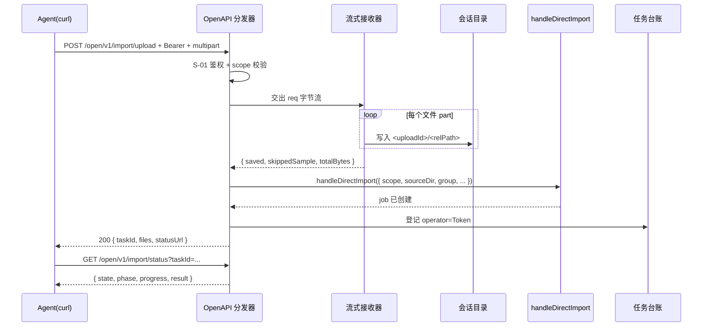

# S-02 流式接收与导入

> 父需求：REQ-20261105-001 ｜ 依赖：S-01 ｜ 被依赖：无

## 1. 术语

| 术语 | 定义 |
|---|---|
| relPath | 文件相对路径（posix 风格，如 `sub/a.md`），决定 group 落点与 `sourcePath` |
| uploadId | 一次上传会话的 UUID，落点 `~/.ki/import-uploads/<uploadId>/` |
| 一步式 | 上传收完立即创建导入 job 并返回 `taskId`，不需要第二次 `/run` 调用 |
| 干净目录 | tar 包解包后的内容目录 `<uploadId>/content/`，作为 `handleDirectImport` 的 `sourceDir` |
| 跳过样本 | `skippedSample`，最多 10 条被拒文件明细，全量走 `ki log` |

## 2. 现状（AS-IS）

```
现有上传链路（浏览器专用）
POST /api/import/upload
├─ readJsonBody 全量缓冲 + JSON.parse           src/lib/mcp-http-api.ts:415-440
├─ body = { scope, uploadId?, batchIndex?, batchCount?, finalize?, files[] }   :2186-2193
├─ Buffer.from(content,'base64')                :2291
├─ 扩展名白名单校验                              :2285-2289
├─ 单文件大小校验（默认 1MB / 附件 5MB）          :2292-2295、src/lib/import.ts:440,446
├─ sanitizeFileName + 越界检查                   :2296-2303
├─ 落盘 <uploadId>/<relPath>                    :2304-2313
├─ 写 .scope（bindUploadScope）                  :284、:2255
└─ finalize → createJob + runImportJob          :2351-2375
```

| 关键事实 | 证据 |
|---|---|
| 请求体上限 16MB（全局共用） | `src/lib/mcp-http-api.ts:156` |
| 上传根目录 `~/.ki/import-uploads/` | `:183-186` |
| 会话文件名 `.scope` / `.upload-session.json` | `:188-189` |
| 空闲 TTL 24h，惰性清理 | `:190`、`:246` |
| uploadId 必须 UUID v4/v5 | `:191` |
| `handleDirectImport` 要求 `sourceDir` 为**本地绝对路径** | `src/lib/import.ts:720`、`:802-804` |
| 导入内核一次处理 20k 文件 / 4GiB / 300k chunk，单锁 + 批量向量化 + 批量 FTS + 单次落盘 | `src/lib/import-budget.ts:37-39`、`src/lib/import.ts:712`、`:1513-1519`、`:2505-2507` |
| tar 条目校验要求所有条目在同一 `expectedRoot` 下 | `src/lib/safe-tar.ts:53-63` |
| tar 校验拒绝链接条目（`l` / `h` 开头） | `src/lib/safe-tar.ts:64-66` |

**与 `/api` 的差异必须显式保留**：本链路不 `Buffer.concat` 全量、不 base64、不吃 16MB 全局上限。

## 3. 方案（TO-BE）

### 3.1 请求契约

```
POST /open/v1/import/upload?scope=<s>&group=<g>&tags=<t>&vector=1
Authorization: Bearer <token>
Content-Type: multipart/form-data; boundary=----ki
```

**Query 参数**

| 参数 | 类型 | 默认 | 说明 |
|---|---|---|---|
| `scope` | string | `default` | 目标知识库；不在 token 授权集合 → 403 `OPEN_API_SCOPE_FORBIDDEN` |
| `group` | string | 由 relPath 推导 | 落点；须过 `isUserAssignableGroup`（拒 `__root__` 等保留名） |
| `tags` | string | — | 逗号分隔，叠加在默认 tag 之上 |
| `vector` | `1\|0` | `1` | `0` 等价 CLI `--no-vector` |
| `conflictMode` | enum | `incremental` | `incremental\|overwrite\|skip\|suffix` |
| `conflictSuffix` | string | — | `conflictMode=suffix` 时的后缀 |
| `chunkSize` | number | 配置值 | 100–4000，越界 → 400 `OPEN_API_INVALID_CHUNK` |
| `chunkOverlap` | number | 配置值 | 0–500 且 < `chunkSize` |
| `archive` | `tar.gz` | — | 显式声明整包模式（与 Content-Type 双判） |

> **刻意不支持的参数**：`pruneStale` / `pickMode` / `preserveRels` / `skipDuplicates` / `onlyRelPaths`。
> 原因：`/api/import/prune` 的重扫逻辑假定暂存目录形如 `<uploadId>/<rel>`，而本设计内容落在 `<uploadId>/content/<rel>`。一旦 open-api 触发 prune 候选计算，`scannedRels` 会多出一层 `content/`，与库中 `sourcePath` 对不上 → token 恒失配（`409 PRUNE_TOKEN_STALE`）。
> 因此本期 open-api **不提供清理能力**；需要清理时走 Web 导入页或 `ki` 侧操作。

**Content-Type 分支**

| Content-Type | 分支 |
|---|---|
| `multipart/form-data; boundary=<b>` | 多文件解析（缺 boundary → 400 `OPEN_API_BAD_MULTIPART`） |
| `application/gzip` / `application/x-gzip` / `application/x-tar` | tar 整包流式 |
| 其他 | 415 `OPEN_API_UNSUPPORTED_CONTENT_TYPE` |

### 3.2 目录结构

```
src/lib/open-api/
├── multipart.ts     # [新增] 手写 multipart 流式解析状态机
├── upload-stream.ts # [新增] multipart / tar 两条落盘路径 + 会话复用
└── routes/
    └── import.ts    # [新增] upload + status 两个 handler
src/lib/safe-tar.ts  # [修改] 抽出通用越界校验（不改 restore 行为）
src/lib/mcp-http-api.ts # [修改] 导出 createJob / runImportJob / bindUploadScope / sanitizeFileName
```

### 3.3 multipart 流式解析（手写，零依赖）

```ts
// src/lib/open-api/multipart.ts
//
// 责任划分：解析器只负责「切边界 + 解析 part 头」，不碰文件系统。
// 文件句柄、大小校验、路径清洗全部由 sink 实现方（upload-stream.ts）负责：
//   · onFileStart 返回 accept（含 absPath 与 maxBytes）时，解析器把后续 body 交给 onFileChunk
//   · onFileStart 返回 reject 时，解析器**继续消费该 part 的 body 直到下一个边界**（只是不回调 chunk），
//     这是「跳过该文件但不断整包」的实现前提
//   · sink 需自行维护 relPath → 文件句柄 的映射（解析器保证同一时刻只有一个 part 在写）

export type FileStartDecision = { accept: { absPath: string; maxBytes: number } } | { reject: string };

export interface MultipartSink {
  onFileStart(relPath: string): FileStartDecision;
  onFileChunk(relPath: string, chunk: Buffer): void;
  onFileEnd(relPath: string, size: number): void;
  onFileRejected(relPath: string, reason: string): void;
}

export interface MultipartLimits { maxTotalBytes: number; }

export async function parseMultipart(
  req: http.IncomingMessage,
  boundary: string,
  sink: MultipartSink,
  limits: MultipartLimits,
): Promise<{ totalBytes: number; rejectedAll: boolean }>;
```

**状态机四态**

```
PREAMBLE ──找到首个 --boundary──▶ HEADERS ──空行──▶ BODY ──下一个 boundary──▶ HEADERS|EPILOGUE
```

**必须处理的边界情况（逐条覆盖，缺一即为缺陷）**

| # | 情况 | 处理 |
|---|---|---|
| 1 | boundary 跨 chunk 被截断 | 每轮只 flush 到 `buf.length - (boundary.length + 4)`，尾部保留 |
| 2 | part header 跨 chunk | HEADERS 态累积到 `\r\n\r\n` 才解析 |
| 3 | `filename` 含目录（`sub/a.md`） | 作为 relPath 保留（这是目录上传的唯一载体） |
| 3b | `filename*=UTF-8''<pct-encoded>`（RFC 5987，curl 对非 ASCII 文件名会这样发） | **优先取 `filename*`** 并按 `charset''pct-encoded` 解码；缺失时才回退 `filename`。不实现会导致中文文件名变成百分号串 |
| 4 | `filename` 缺失或为空 | 调 `onFileRejected`，跳过该 part |
| 5 | relPath 含 `..` / 绝对路径 / 空段 | `onFileStart` 返回 `{reject}`，跳过该 part |
| 6 | 单文件超 `maxBytes` | 停止写入、`onFileRejected`、**继续读到下一个 boundary**（不中断整包） |
| 7 | 累计超 `maxTotalBytes` | 立即 `req.destroy()` + 清理会话目录 + 抛 413 |
| 8 | 非 `name="files"` 的 part | 丢弃内容，记 warning（文本参数一律走 query） |
| 9 | 结尾 `--boundary--` | 结束解析 |
| 10 | 客户端中途断开 | `req.on('aborted')` → 清理半包目录，不创建 job |

### 3.4 会话目录的统一约定（两个分支必须完全一致）

```
<uploadId>/
├── .scope                  ← scope 绑定（bindUploadScope，两分支都写）
├── .upload-session.json    ← 会话状态（两分支都写）
├── content/                ← ★ 唯一的 sourceDir（两分支都落这里）
│   ├── a.md
│   └── sub/b.md
└── .upload.tar.gz          ← 仅 tar 分支解包期间的临时文件，解包后立即删除
```

**为什么必须统一为 `content/`（三条理由，第三条是白捡的）**

1. `sourceDir` 决定 `handleDirectImport` 的 relPath 基准，进而决定 `group` 推导与 `sourcePath`。multipart 用 `<uploadId>/` 而 tar 用 `<uploadId>/content/` 会让同一份目录得到**不同的 group 与服务端 sourcePath**，`/import/prune` 的同源约束（`docs/mcp-http.md:173`）恒失配。
2. 元数据文件（`.scope` / `.upload-session.json`）若与内容同层，会被 `collectMarkdownFiles` 之外的其他扫描逻辑误当内容；上层隔离最干净。
3. **★ 让 sourceDir 永远是「目录」** —— 这是幂等的关键。`src/lib/import.ts:2224` 显示：`sourcePath = sourceIsFile ? sourceDir : path.resolve(sourceDir, rec.rel)`。即
   - 若 `sourceDir` 是**单个文件** → `sourcePath` = 绝对路径 = 含 uploadId → **每次重传都是新 sourcePath → 产生副本**
   - 若 `sourceDir` 是**目录** → `sourcePath` = `rel`（`:1166`、`:1339`）→ 与 uploadId 无关 → **重传同结构目录幂等覆盖**

   本设计强制 `sourceDir = <uploadId>/content/`（永远目录），因此**即使只上传 1 个文件，也走目录语义**，`sourcePath` 退化为 `文件名`，agent 重试不会堆副本。这一点比现有 `/api` 单文件上传路径更稳（后者 `sourceIsFile` 为真，依赖 preflight 提示重复）。

### 3.5 tar.gz 分支

```
① 流式落盘到 <uploadId>/.upload.tar.gz（边收边计「传输字节」，超 uploadMaxBytes 即断）
② validateTarEntriesGeneric(tarPath)      ← 抽出的通用校验（拒 .. / 绝对路径 / 链接条目）
③ 预检解包规模（zip-bomb 防护，见下）
④ fs.mkdirSync(<uploadId>/content, { recursive: true })
⑤ tar -xzf <uploadId>/.upload.tar.gz -C <uploadId>/content/
⑥ validateTree(<uploadId>/content, realpath(content))   ← 复检符号链接越界
⑦ 删除 .upload.tar.gz
⑧ sourceDir = <uploadId>/content/
```

**zip-bomb 防护（`uploadMaxBytes` 只约束传输字节，不约束解包后体积）**

| 检查 | 判据 | 超限行为 |
|---|---|---|
| 条目数 | `tar -tzf` 行数 ≤ 20,000（对齐 `import-budget.ts:37-39` 的默认文件数） | 400 `OPEN_API_ARCHIVE_TOO_LARGE` |
| 解包后总量 | `tar -tvzf` 各条目的 size 之和 ≤ `uploadMaxBytes × 10` 且 ≤ 4GiB | 400 `OPEN_API_ARCHIVE_TOO_LARGE`（含实测值） |
| 单条目大小 | 任一条目 ≤ `importConfig.maxFileSize` | 该条目跳过（记 `skippedSample`），其余继续 |

> 压缩比上限取 10 倍：正常 markdown + 图片的 tar.gz 压缩比通常 < 5。超过 10 倍视为可疑（重复填充的 bomb）。

**临时磁盘占用**：tar 分支峰值 = 包体积 + 解包体积（≤ 512MB + 4GiB）。解包完成即删包；失败时 `finally` 清理整个 uploadId 目录。

**打包方式约定（决定 group 层级，必须写进文档示例）**

`relPath` 就是解包后相对 `content/` 的路径，因此**打包的根目录 = 知识库的根目录**。

| 命令 | 解包后路径 | group 结果 | 结论 |
|---|---|---|---|
| `tar czf - -C ./docs .` | `content/a.md`、`content/sub/b.md` | `a` → 根、`sub/b` → `sub` | ✅ **推荐**，与 `ki import --source ./docs` 完全一致 |
| `tar czf - docs/` | `content/docs/a.md` | 多出一层 `docs/` | ⚠️ group 全部下沉一级 |
| `tar czf - -C ./docs sub/` | `content/sub/b.md` | 只含子目录 | ✅ 合法（只导部分子树） |

文档必须给出第一条的完整可复制命令，并解释「根目录即知识库根」。

**对 `src/lib/safe-tar.ts` 的改造（最小侵入）**

现状 `validateTarEntries(snapshotPath, expectedRoot)` 在 `:59` 强制所有条目位于 `expectedRoot/` 下，而上传包（`tar czf - -C ./docs .`）条目为 `./`、`a.md`、`sub/b.md`，没有统一顶层。

```ts
// 新增
export function validateTarEntriesGeneric(tarPath: string): void {
  // 仅校验：拒 normalized === '..' / startsWith('../') / startsWith('/')
  // 以及 verbose 列表含 l/h 链接条目
}
// 改造（行为不变）
function validateTarEntries(snapshotPath: string, expectedRoot: string): void {
  validateTarEntriesGeneric(snapshotPath);
  // 保留原有 expectedRoot 根限定逻辑
}
```

**回归约束**：`extractScopeSnapshot`（`safe-tar.ts:14`）行为必须逐字不变，`ki restore` 测试保持全绿。

### 3.6 落盘与安全

| 项 | 规则 | 复用来源 |
|---|---|---|
| 会话根目录 | `~/.ki/import-uploads/<uploadId>/`，UUID 由服务端生成 | `mcp-http-api.ts:183-186`、`:191` |
| 内容落点 | `~/.ki/import-uploads/<uploadId>/content/<relPath>`（**两个分支统一**） | 见 §3.4 |
| scope 绑定 | 写 `<uploadId>/.scope`；不匹配 → 400 | `bindUploadScope` `:284` |
| 文件名清洗 | `sanitizeFileName` + 拒绝 `..`/绝对/空段 | `:457` |
| 越界检查 | `abs.startsWith(uploadDir + path.sep)` | `:2301` |
| 权限 | 目录 0700、文件 0600 | 新增 |
| 单文件上限 | `scopes.<scope>.import.maxFileSize`（默认 1MB）；附件走 `maxAssetSize`（默认 5MB） | `src/lib/import.ts:440,446` |
| 总字节上限 | `mcp.http.uploadMaxBytes`，默认 512MB | 新增配置 |
| 幂等 | 同 uploadId + 同内容重试幂等；同名不同内容 → 400（与 `/api` 同口径） | `:2305-2313` |

> **⚠️ 开箱默认值与头号场景冲突（必须写进部署文档）**
> `scopes.<scope>.import.maxFileSize` 默认 **1MB**（`src/lib/import.ts:440`），而本需求的头号场景正是「一份大文档」。因此：
> 1. 部署时必须按目标文档体积调大（如 `maxFileSize: 20971520` = 20MB）；
> 2. agent 应在上传前先 `GET /open/v1/ping` 读 `limits.maxFileSize` 自检，避免拿着 5MB 文件撞 1MB 上限；
> 3. 超限响应必须同时给出「实际值 + 上限值 + 调整方法」，不能只说"超过大小上限"。

### 3.7 一步式导入

**需要从 `src/lib/mcp-http-api.ts` 导出的四个符号**（当前均为模块私有）：

```ts
// 需新增 export（签名取自现有实现，不改语义）
export interface ImportJob { /* 见现实现 :199 起 */ }
export function createJob(
  scope: string,
  operation: 'import',
  config: KiConfig,
  extra: { operator: TaskOperator },
): ImportJob;                              // mcp-http-api.ts:339

export function runImportJob(
  job: ImportJob,
  args: RunImportArgs,                     // 含 scope/sourceDir/group/tags/vector/conflictMode/...
  config: KiConfig,
): Promise<void>;                          // mcp-http-api.ts:4196

export function getJobById(id: string): ImportJob | undefined;   // 新增，供 status 读取
export function bindUploadScope(dir: string, scope: string): boolean;  // :284
```

**`jobs` Map 必须单例复用**：`/api/import/status`、`/open/v1/import/status`、任务台账三者必须看到同一个 job。因此**不新建 Map，只用 `getJobById` 访问现有 Map**（D-07 的落地要求）。

**循环依赖检查**：`mcp-http.ts` → `open-api/index.ts` → `mcp-http-api.ts`，而 `mcp-http-api.ts` 不 import `mcp-http.ts`（它由 `mcp-http.ts` 动态 import），无环。

调用：

```ts
const operator: TaskOperator = {
  type: 'token',
  label: principal.tokenId ? `Token ${principal.tokenId}` : 'Token 临时',
  ...(principal.tokenId ? { tokenId: principal.tokenId } : {}),
};
const job = createJob(scope, 'import', requestConfig, { operator });
void runImportJob(job, {
  scope, sourceDir, group, tags, vector, conflictMode, conflictSuffix,
  chunkSize, chunkOverlap,
}, requestConfig);
return { ok: true, taskId: job.id, ... };
```

### 3.8 接口设计

#### `POST /open/v1/import/upload`

响应 200（Demo，非最终数据）

```json
{
  "ok": true,
  "uploadId": "3f1c9a2e-8b4d-4c11-9f6a-2d7e5b8c1a30",
  "taskId": "9a2b7c41-...",
  "scope": "proj-a",
  "group": "wiki",
  "files": {
    "saved": 30,
    "skipped": 2,
    "skippedSample": [
      { "rel": "cover.txt", "reason": "扩展名不支持（.txt），文档仅允许 .md/.mdx" },
      { "rel": "big.pdf", "reason": "超过单文件上限 1MB" }
    ]
  },
  "totalBytes": 1843200,
  "statusUrl": "/open/v1/import/status?taskId=9a2b7c41-..."
}
```

#### `GET /open/v1/import/status?taskId=<id>`

**鉴权要求（防跨 token 窥探）**：先按 `taskId` 取 job → 读出该 job 的 `scope` → 用 `principal.scopes` 校验；不在授权集合 → 403 `OPEN_API_SCOPE_FORBIDDEN`（**不是 404**：任务确实存在，只是无权看）。这一步不能省，否则任意有效 token 都能枚举别人的导入进度与结果。

**进程重启后的降级（不可省，否则 agent 无法判断任务去向）**

job 存在进程内 `jobs` Map，daemon 重启即丢。此时 status 若直接 404，agent 无法区分「任务从未开始」与「任务曾开始但状态已丢」——两者对 agent 的下一步动作完全不同。

三级回落：

| 优先级 | 数据源 | 返回 `state` | 说明 |
|---|---|---|---|
| 1 | 进程内 `jobs` Map | `queued` / `running` / `done` / `failed` / `cancelled` | 正常路径 |
| 2 | 任务台账 `getTaskRecord(taskId)`（1h TTL） | 台账中的终态 + `stale: true` | 进程重启但台账还在 |
| 3 | 任务日志 `readTaskLog(taskId)` 头行 | `unknown` + `hint` | 台账已过期但日志还在（7 天）；`hint` 指向 `ki log <taskId>` |
| 4 | 全部缺失 | 404 `OPEN_API_TASK_NOT_FOUND` | 只有确实查不到才 404 |

响应中统一带 `"source": "memory" | "ledger" | "log"` 字段，让 agent 知道这个状态有多可信。

响应 200（运行中）

```json
{
  "ok": true,
  "taskId": "9a2b7c41-...",
  "state": "running",
  "phase": "vectorize",
  "progress": 0.62,
  "waitingForScopeLock": false,
  "cancelRequested": false,
  "source": "memory",
  "result": null
}
```

**必须区分「等 scope 写锁」与「在执行」（推演发现）**

`handleDirectImport` 用 `withScopeWriteLock(scope,'import')` 串行化（`src/lib/import.ts:712`）。当两个 agent 同时导入同一 scope 时，第二个 job 会**在锁上排队**，而它的 `phase/progress` 停在初始值不动。

若不区分，agent 会把「排队」误判为「卡住」，进而取消或重复提交。因此：

| 字段 | 值 | 含义 |
|---|---|---|
| `waitingForScopeLock` | `true` | job 已创建但尚未拿到 scope 写锁；`phase` 固定为 `waiting`，`progress` 为 0 |
| `waitingForScopeLock` | `false` | 已拿到锁，`phase` 进入 `scan`/`vectorize`/`persist` |

实现上，job 创建后先置 `phase='waiting'` / `waitingForScopeLock=true`，拿到锁的回调里翻转为 `false` 再进入 `scan`。

响应 200（完成）

```json
{
  "ok": true,
  "taskId": "9a2b7c41-...",
  "state": "done",
  "phase": "persist",
  "progress": 1,
  "result": {
    "total": 30,
    "vectorized": 30,
    "skipped": 0,
    "errors": 0,
    "groups": ["wiki", "wiki/sub"],
    "vectorStored": true
  }
}
```

### 3.9 时序



## 4. 关键决策点

| # | 决策 | 选中 | 被否决 | 否决理由 |
|---|---|---|---|---|
| D-01 | multipart 解析 | 手写状态机（~200 行） | 引入 `busboy` / `multer` / `formidable` | 项目仅 6 个依赖（sdk/zvec/commander/jiti/yaml/zod），且这些库偏 Express 生态，只为一个接口引入会打破依赖风格 |
| D-02 | 请求体读取方式 | 流式边收边写 | `Buffer.concat` 后整体解析 | 目录/tar 包动辄几十 MB，全量缓冲会在并发上传时打爆内存 |
| D-03 | tar 模式判定 | Content-Type + `archive` query 双判 | 嗅探首块魔数 | gzip 与裸 tar 需二次判断，且要缓冲首块，破坏纯流式 |
| D-04 | 文本参数载体 | query string | multipart 普通字段 | 字段少、无敏感信息；query 对 curl 与 agent 都更易写、更可读 |
| D-05 | 与现有 upload 会话关系 | 复用同一目录结构与 `.scope` | 新起一套暂存根 | `/import/prune` 的候选集依赖同一会话快照（`docs/mcp-http.md:173`），两套会导致 token 恒失配 |
| D-06 | 一步式 vs 两步 | 一步式 | 上传后再调 `/run` | 减少 agent 往返与状态管理成本；现有 `finalize` 参数已是这个语义，只是没暴露给第三方 |
| D-07 | job 状态来源 | 复用 `mcp-http-api.ts` 的 `jobs` Map | 新建独立 job 表 | 两份状态必然分裂，且 `/api/tasks/:id`、`ki log` 看不到 open-api 的任务 |
| D-08 | 单文件超限的处理 | 跳过该文件，其余继续 | 整包拒收 | 目录里混一个超大文件就全废，体验过差；「部分成功 + 明示跳过」更可诊断 |

## 5. 影响范围

| 文件 | 改动类型 | 内容 |
|---|---|---|
| `src/lib/open-api/multipart.ts` | 新增 | multipart 状态机 + `MultipartSink` 接口 |
| `src/lib/open-api/upload-stream.ts` | 新增 | multipart / tar 两条落盘路径、会话创建与清理 |
| `src/lib/open-api/routes/import.ts` | 新增 | `handleOpenApiImportUpload`、`handleOpenApiImportStatus` |
| `src/lib/safe-tar.ts` | 修改 | 抽出并 `export` `validateTarEntriesGeneric`；`export` `validateTree`（当前是私有函数 `:69`）；`validateTarEntries` 改为复用前者（**行为不变**） |
| `src/lib/mcp-http-api.ts` | 修改 | `createJob`（`:339`）/ `runImportJob`（`:4196`）/ `bindUploadScope`（`:284`）/ `sanitizeFileName`（`:457`）加 `export`；**新增 `getJobById`** 供 status 读取现有 `jobs` Map |
| `src/lib/config-schema.ts` | 修改 | 新增 `mcp.http.uploadMaxBytes` |
| `src/lib/config.ts` | 修改 | 解析 `uploadMaxBytes`（**必须与 schema 同批**，防静默失效） |
| `docs/mcp-http.md` | 修改 | 新增 `/open/v1/*` 章节与 curl 示例 |

**不受影响（显式声明）**

| 对象 | 为什么不受影响 |
|---|---|
| `/api/import/*` 全部路由 | 走自己的 handler 与 `<uploadId>/` 直下结构，本设计不改其代码路径 |
| `/api/import/prune` | open-api 不提供 `pruneStale` / `pickMode`，不产生 prune 候选（见 §3.1 注） |
| Web 导入页 | 前端零改动 |
| `ki import` CLI | 不经 HTTP |
| `ki restore` | `extractScopeSnapshot` 行为不变，`validateTarEntries` 改造后语义等价 |

## 6. 异常处理

| 场景 | 行为 | 是否对外暴露 |
|---|---|---|
| Content-Type 缺失或不支持 | 415 `OPEN_API_UNSUPPORTED_CONTENT_TYPE` | 是（列出支持的两种） |
| multipart 无 boundary | 400 `OPEN_API_BAD_MULTIPART` | 是 |
| relPath 越界（`..` / 绝对路径） | 该文件跳过 + `skippedSample` 记原因 | 是 |
| relPath 为空 | 该 part 跳过 | 是（`skippedSample`） |
| 单文件超上限 | 该文件跳过，其余继续 | 是（含实际值与上限值） |
| 总字节超 `uploadMaxBytes` | 立即中断 → 清理会话目录 → 413 `OPEN_API_PAYLOAD_TOO_LARGE` | 是（含 `{limit, actual}`） |
| 所有文件都被拒 | 400 `OPEN_API_NO_VALID_FILE` + 原因清单 | 是 |
| tar 含越界条目或链接 | 400 `OPEN_API_ARCHIVE_UNSAFE` + 违规条目名 | 是 |
| tar 解包后条目数 / 总量超限（zip-bomb） | 400 `OPEN_API_ARCHIVE_TOO_LARGE` + `{entries, unpackedBytes, limits}`；清理整个 uploadId | 是 |
| tar 损坏 / 解包失败 | 400 `OPEN_API_ARCHIVE_BROKEN` | 是 |
| `status` 查询不属于自己的任务 | 403 `OPEN_API_SCOPE_FORBIDDEN`（先取 job 的 scope 再校验） | 是 |
| `status` 的 taskId 不存在或已过期 | 404 `OPEN_API_TASK_NOT_FOUND` | 是 |
| 磁盘写失败 | 500 `OPEN_API_STORAGE_FAILED` + 清理 | 否（仅服务端日志） |
| 客户端中途断开 | 清理半包目录，不创建 job，不写台账 | — |
| scope 越权 | 403 `OPEN_API_SCOPE_FORBIDDEN`（脱敏，scope 名只进 stderr） | 是 |
| scope 为只读 | 403 `OPEN_API_SCOPE_READONLY`（上传阶段就拒，避免残留） | 是 |
| 向量服务不可用 | 导入仍写 KB，`result.vectorStored=false` | 是（status 中） |
| 同 uploadId 同名不同内容 | 400 `OPEN_API_DUPLICATE_CONTENT` + 提示换 uploadId | 是 |

## 7. 非功能性假设（默认假设，需显式标注）

| 维度 | 默认假设 | 若不成立的影响 | 升级触发条件 |
|---|---|---|---|
| 数据量级 | 单次上传 ≤ 200 文件 / ≤ 512MB；库总量不因此翻倍 | `handleDirectImport` 的预算会 fail-loud（20k 文件 / 4GiB / 300k chunk） | 单次 > 2000 文件时需评估是否改批量接口 |
| 并发 | **单机低并发**：同时进行中的上传 ≤ 3 | 每条上传独占一个 HTTP 连接 + 一个临时目录；无全局上传并发闸门 | 出现并发 > 5 的场景时需加信号量 |
| 延迟容忍 | 上传阶段秒级~分钟级；**导入阶段异步**，客户端轮询 | 客户端不能同步等待 import 完成 | — |
| 可用性 | 允许单点；daemon 重启时上传中断可由客户端重试（幂等靠 uploadId + 内容比对） | 进程内 `jobs` Map 重启即丢，需靠任务台账兜底 | — |
| 磁盘 | 上传目录 `~/.ki/import-uploads/` 有足够空间；24h 惰性清理 | 磁盘打满会让服务不可用 | 部署侧加监控告警 |

**说明**：本方案默认单机低并发。若需支持高并发上传（如多租户网关场景），需在阶段 3 前重新确认，届时要在 S-02 增加全局上传并发闸门与配额。

## 8. 待定问题

| # | 问题 | 影响 | 建议默认 |
|---|---|---|---|
| Q-01 | `uploadMaxBytes` 默认取 512MB 是否合适 | 影响大目录能否一次传完 | 512MB；可配置 |
| Q-02 | tar 解包用 `tar` 子进程（与 restore 一致）还是纯 Node 实现 | 纯 Node 需自写 tar 解析（数百行），`tar` 子进程与项目现状一致 | 用 `tar` 子进程（`tar-compat.ts` 已处理跨平台） |
| Q-03 | 是否需要在 status 中回传 `groups` 列表（大目录可能上千条） | 影响 agent 上下文 | 只回 `groups` 前 20 条 + `groupsTotal` |
