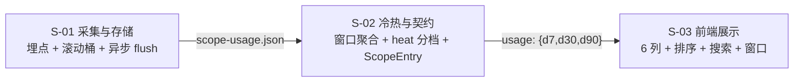

# 总览 scope 冷热与调用量 · 设计（父文档）

> 需求：`REQ-20261112-001`（需求文档见同级 `../requirement.md`）
> 子文档：`S01_调用量采集与存储_DESIGN.md` / `S02_冷热分区与列表契约_DESIGN.md` / `S03_总览列表展示_DESIGN.md`

## 1. 需求背景 & 目标

总览页现有 162 个 scope 只显示「层状态 / 文档数」，无法判断谁在用、用多少，清理决策无依据（`web/src/pages/DashboardPage.tsx:643-683`）。目标：为每个 scope 显示冷热档位与近 N 天查询/写入次数，支持排序、搜索、窗口切换。

**不在范围内**：Web 端 scope 删除/清空入口（需求 R8，独立立项）、成功/失败调用的分列展示、跨实例统计合并。

## 2. 关键环节一览图

> 节点上的 `S-0x` 是子需求编号；① ② 是用户视角步骤（用户发起请求 → 看结果做决策）。

## 3. 总体方案设计

**四条跨子需求约定（定稿后只读）**

| 约定 | 内容 | 理由 |
|---|---|---|
| C1 窗口同源 | 存储保留 90 天日桶；一次算出 `d7 / d30 / d90` 三档，**冷热与数字来自同一次聚合** | 避免「切窗口后数字变、冷热不变」的自相矛盾（需求负向 11） |
| C2 异步累加 | 请求路径上只做内存 `Map` 自增（O(1)、不落盘），定时 flush 落盘 | coordinator 与引擎任务串行，同步磁盘写会放大队列积压（历史案例：`/api/doc/list` 25s 挂死） |
| C3 单文件聚合 | 全部 scope 存**一个** JSON，`ki_scope_list` 一次读全量 | `src/scope.ts:125-139` 明确读路径不引入 per-scope IO |
| C4 缺数据即 null | 统计不可用 → `usage: null`；**不返回 0** | 0 会被读成「确实没人用」（需求 R5） |
| C5 三态归类 | 埋点判定是 `read` / `write` / **`null`（不计）**：管理类读与运维类 engine-only 一律不计 | 把 `/api/doc/list` 算成查询，会让「在页面翻过」被记成「被检索」，冷热直接失真 |
| C6 覆盖天数可辨 | `ScopeUsageWindow` 带 `coveredDays`，前端对未填满窗口的数字加角标 | 新接入的库数字天然偏小，不加标记会被读成「更冷」 |

**非功能性默认假设（若与实际不符需重评）**

| 维度 | 假设 | 越界后果 |
|---|---|---|
| 部署形态 | 单机、单 `dataDir`、**daemon 为统计主写者** | 多实例共享 `dataDir` 时 flush 合并会互相覆盖 |
| 规模 | scope 数 ≤ 500、每 scope 日桶 ≤ 90 天 | 统计文件 > 1MB 时单次 flush 超过 1ms 预算 |
| 统计精度 | 允许丢最近 ≤30s 的计数（非账本） | 若要「精确计数」，需改为同步写 + 追加日志 |
| 并发 | 请求路径无锁；flush 用文件锁串行 | — |

**共享术语速查**

| 术语 | 定义 | 归属 |
|---|---|---|
| 调用事件 | 一次请求对**一个** scope 的一次读或写 | S-01 |
| 查询 | **仅检索类**调用（`search` / `group-list` / `get-module-info` 等，见 S-01 §3.2 的 `SEARCH_MCP_TOOLS`）；管理类读（doc 列表 / tag 列表 / export）**不计** | S-01 |
| 写入 | 产生或删除数据的调用；`vector-optimize` / `datasource-add-remote` 等运维动作**不计** | S-01 |
| 日桶 | 以本地时区日期为 key 的 `[read, write]` 二元计数 | S-01 |
| flush | 把内存累加合并写入统计文件 | S-01 |
| 窗口 | `d7 / d30 / d90` 三个固定档 | S-02 |
| heat | `hot / warm / cold / unused` 四档；`unused` = 窗口内 0 调用 | S-02 |
| 视图摊分 | 视图名调用摊到成员库各 +1（视图名本身不展示） | S-02 |

## 4. 全局风险 & 跨子需求依赖

| # | 风险 | 影响 | 处置 |
|---|---|---|---|
| G1 | coordinator 与同 scope 引擎任务串行，导入收尾期队列积压 | 同步写统计会拖慢请求，重演 `doc/list` 超时 | C2：内存累加 + flush；flush 单次 ≤1ms |
| G2 | 多进程写统计 | 计数丢失 | 双保险：①**只有调用过 `initScopeUsage()` 的进程才写**（daemon；CLI 直连与单测不初始化 ⇒ 静默不写）；②复用 `src/lib/wal.ts:134 walWrite`（自带跨进程锁）+ 读-改-写合并 |
| G3 | 视图摊分口径 | ①成员变更 → 历史数据口径漂移；②按**当前完整成员**展开，与请求当时的授权范围不一致（strict 会 skipped 部分成员） | 两者都按「聚合时完整成员」摊分并显式声明；**不泄露**（`ki_scope_list` 已按 RBAC 裁剪行），仅表现为数字偏差 |
| G4 | 老 daemon 不返回 `usage` 字段 | 新前端显示 undefined | 前端一律 `usage?.d7`，缺失显示 `—` |
| G5 | 进程被 `kill -9` | 丢失最近一次 flush 前的计数（≤ 5s） | 可接受，统计非账本；文档显式声明 |

**子需求依赖**：S-01 → S-02 → S-03（严格链，接口契约单向）。
**跨子需求接口**：仅一处 —— 统计文件的读取函数 `readScopeUsage()`（S-01 提供，S-02 消费），签名见 S-01。
