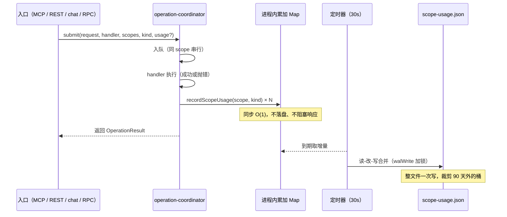

# S-01 调用量采集与存储

> 父文档：`DESIGN.md` ｜ 下游：S-02（消费 `readScopeUsage()`）

## 1. 术语

| 术语 | 定义 |
|---|---|
| 调用事件 | 一次请求对**一个** scope 的一次读或写，记 +1（batch 内同 scope 多工具也只 +1） |
| 日桶 | 以**本地时区**日期（`YYYY-MM-DD`）为 key 的 `[read, write]` 二元计数 |
| flush | 把内存累加增量合并写入统计文件 |
| 原始 scope 名 | 请求参数里的字面量，**可能是视图名**；摊分在 S-02 做 |

## 2. 现状 AS-IS

| 事实 | 位置 |
|---|---|
| 四类入口最终都进 `coordinator.submit(request, handler, scopes, kind)` | `src/lib/operation-coordinator.ts:220` 附近；chat 经 `submitScoped`（`src/lib/chat/mcp-tool-registry.ts:242`），daemon RPC 经 `src/lib/daemon-rpc.ts:483` |
| 已有 `scopes[]`、`kind`（`read / write / engine-only`） | `kindForOperation()` `src/lib/operation-coordinator.ts:100-115`；`kindForMcpToolNames()` `:131-141` |
| MCP HTTP 在 `handleMcpPost` 里已有 `calledTools` / 队列 scope | `src/lib/mcp-http.ts:944-964` |
| 无任何调用量统计 | 全仓 `hitCount|callCount|stats.json|usage.json` 0 命中 |
| 跨进程原子写已具备 | `src/lib/wal.ts:134 walWrite()`（自带文件锁 + tmp 重命名） |

**关键缺陷（本设计必须修）**：`kindForMcpToolNames` 是**整批**判定——一个 MCP batch 里混入写工具，整批回退 `write`。若直接按「scopes × 整批 kind」记账，`ki_search(a)` + `ki_store(b)` 会把 a 的**查询记成写入**。

## 3. 方案 TO-BE

### 3.1 新增模块 `src/lib/scope-usage.ts`

```ts
export type UsageKind = 'read' | 'write';

/** 窗口聚合结果（S-02 消费） */
export interface ScopeUsageSnapshot {
  read: number;
  write: number;
  /** 窗口内最近一次调用（毫秒）；0 = 窗口内无调用 */
  lastUsedAt: number;
  /** 该 scope 首次被统计到的本地日期 `YYYY-MM-DD`；**与窗口无关**，供 S-02 算 `coveredDays` */
  firstSeen: string;
}

/**
 * 启动时注入配置并拉起 flush 定时器（幂等）。
 *
 * ★ 调用点必须是 **daemon 进程的唯一启动点**：`src/mcp-server.ts:1321`
 *   的 `startDaemonRpcServer()` **之前**（已核实 RPC 与 HTTP 同进程、先起 RPC 再起 HTTP）。
 *
 * ★ 刻意**不**放在 `src/lib/mcp-http.ts` 的 `createMcpHttpServer()` 内：
 *   它是导出函数，单测与嵌入式调用也会创建它 —— 放在那里会让每次跑 HTTP 层测试
 *   都在 `dataDir` 下真实生成统计文件并拉起 30s 定时器，「只有 daemon 是写者」
 *   这条前提当场失效，后续所有并发假设（文件锁、读-改-写合并）都失去依据。
 */
export function initScopeUsage(config: Pick<KiConfig, 'dataDir'>): void;

/** 请求路径上调用：仅内存自增，O(1)、不落盘、不抛错；未初始化时静默丢弃 */
export function recordScopeUsage(scope: string, kind: UsageKind, at?: number): void;

/** 立即落盘（定时器 / 事件阈值 / 进程退出时调用）；未初始化时为 no-op */
export function flushScopeUsage(): void;

/**
 * 读取并聚合窗口；null = 统计不可用（文件缺失 / 损坏 / 读失败）
 * 进程内按 mtime+size 缓存，重复调用不重复解析
 */
export function readScopeUsage(
  config: Pick<KiConfig, 'dataDir'>,
  windowDays: number
): Map<string, ScopeUsageSnapshot> | null;

export function getUsageStorePath(config: Pick<KiConfig, 'dataDir'>): string;
```

### 3.2 埋点位置（唯一一处）

在 `operation-coordinator` 的 `run()` **`finally` 块**记录（`src/lib/operation-coordinator.ts:366` 附近的执行函数）：

- 放在 `finally` 才能保证 handler 抛错、超时、中止三种情况都计入（需求 D7：失败也计入）。
- 入队前被拒绝的请求（鉴权失败 / 只读 Token 拒绝 / scope 越权）**不计数**——它们没有进入调度器，不算一次「对 scope 的调用」。此边界需在文档声明。

`submit()` 新增第 5 个可选参数，向后兼容 3 个既有调用方：

```ts
export interface UsageTarget { scope: string; kind: 'read' | 'write' }

submit(
  request: OperationRequest,
  handler: Handler,
  scopes: string[] | readonly string[],
  kind?: TaskKind,
  /** 精确的 (scope, 读/写) 对；省略时按 scopes × kind 推导 */
  usage?: readonly UsageTarget[]
): Promise<OperationResult>
```

**分档口径：只记「检索」与「写入」，管理类读不计（三态判定）**

统计只有两个桶，但**不等于「所有 read 都算查询」**。`READ_OPERATIONS` 覆盖 `/api/doc/list`、`/api/tags`、`/api/datasource/list` 这类浏览类读操作——把它们算进「查询」，管理员在页面翻几次就能把一个库刷成「热」，而它可能一次 AI 检索都没有。因此判定是**三态**：`read` / `write` / **`null`（不计）**。

```ts
/** 检索类 MCP 工具（计入「查询」）；其余 read 类工具（doc 列表 / tag 列表等）不计 */
const SEARCH_MCP_TOOLS = new Set(['ki_search', 'ki_group_list', 'ki_get_module_info']);
// 实现时按 src/lib/mcp-tools/ 现存注册名核对补充（若存在批量读取工具，一并列入）

/** 检索类 daemon / REST operation（与上面同口径） */
const SEARCH_OPERATIONS = new Set([
  'search', 'group-list', 'query-group', 'get-module-info', 'get-module-info-batch',
]);

/** 真正产生数据的 engine-only 操作；vector-optimize / datasource-add-remote 等运维动作不计 */
const ENGINE_WRITE_OPERATIONS = new Set([
  'import', 'datasource-sync', 'restore', 'rebuild-vector',
]);
```

推导规则（省略 `usage` 时）：

| operation 形态 | 判定 |
|---|---|
| `chat-mcp-<tool>` | 工具 ∈ `SEARCH_MCP_TOOLS` → `read`；否则 `write` |
| `READ_OPERATIONS` 中的**检索类**（`SEARCH_OPERATIONS`） | `read` |
| `READ_OPERATIONS` 中的**管理类**（`doc-list` / `tag-list` / `backup-list` / `export` / `scope-list`） | **`null`（不计）** |
| `engine-only` 且 ∈ `ENGINE_WRITE_OPERATIONS` | `write` |
| `engine-only` 其余（`vector-optimize` / `datasource-add-remote`） | **`null`（不计）** |
| 其他（store / sync-relation / delete / edit / group-* / 导入类） | `write` |

各通道精确性：

| 通道 | kind 精度 | 是否需要传 `usage` |
|---|---|---|
| daemon RPC（CLI） | 一请求一 operation，精确 | 否 |
| chat（`chat-mcp-<tool>`） | 一请求一工具，精确 | 否 |
| Web REST `/api/*` | 一请求一 handler，精确 | 否 |
| **MCP HTTP（可批量）** | **整批判定，不精确** | **是** |

`src/lib/mcp-http.ts` 在 `:945-964` 的消息循环里同步生成（**先去重再转数组**）：

```ts
const usageMap = new Map<string, 'read' | 'write'>();   // 同 scope 去重
for (const message of messages) {
  if (readMethod(message) !== 'tools/call') continue;
  const name = (message as any).params?.name;
  if (typeof name !== 'string' || SCOPE_LESS_TOOLS.has(name)) continue;   // 枚举工具不计

  // 读/写判定复用既有函数（避免依赖 READ_MCP_TOOLS 是否导出、也避免两处白名单漂移）
  const isRead = kindForMcpToolNames([name]) === 'read';
  const kind = SEARCH_MCP_TOOLS.has(name) ? 'read'
             : isRead                       ? null     // 管理类读：不计
             : 'write';
  if (kind == null) continue;

  const raw = (message as any).params?.arguments?.scope;
  const list = (typeof raw === 'string' ? raw : '').split(',').map(s => s.trim()).filter(Boolean);
  for (const s of list.length ? list : ['default']) {
    // 同批同 scope 多工具：write 优先（写是更重的事件，记成读会掩盖一次真实写入）
    if (usageMap.get(s) !== 'write') usageMap.set(s, kind);
  }
}
const usageTargets: UsageTarget[] = [...usageMap].map(([scope, kind]) => ({ scope, kind }));
```

同一批内同一 scope 出现多次 → **去重后只记一次**（需求负向 5）。

### 3.3 写入策略

- `recordScopeUsage`：写进程内 `Map<string, { days: Map<string, [number, number]>; lastUsedAt: number }>`

- **入参校验（必做）**：埋点取的是 `args.scope` 的**原始字面量**（与 `mcp-http.ts:959` 的 `queueScopes` 同源，注释写明「不经过 `resolveScope`」），而失败调用也计入（D7）⇒ 拼错的名字、随便造的字符串都会建 key。90 天保留期内，只要名字不断变化，`scopes` 对象就无界膨胀。因此 `recordScopeUsage` 入口必须过滤：

```ts
const SCOPE_NAME_RE = /^[A-Za-z0-9_-]{1,64}$/;   // 与 validateScope 的字符集对齐
const MAX_USAGE_SCOPES = 2000;                    // key 数硬上限
// 非法字符 / 超长 → 直接丢弃；超出 key 上限 → 丢弃新建并 stderr 告警一次（10 分钟节流）
```

  视图名同样走这条校验（视图名与 scope 名共享命名空间，字符集一致）。
- flush 触发三条件：① 定时 30s（timer `unref()`，不阻止进程退出）② 累计事件 ≥ 500 立即 ③ 进程退出 / daemon 优雅关闭
- flush 语义：**读-改-写合并**（先读磁盘现有内容，把内存增量累加进去，再整文件 `walWrite`），多进程共存时只丢「读取到写入之间」的窗口
- 裁剪：flush 后删除 `date < today - 89d` 的**日桶**；`firstSeen` / `lastUsedAt` **不随日桶裁剪**。仅当 `days` 为空（⇒ 已 90 天无调用）时整条删除该 scope 条目——死 scope 不该永久占位，若它之后复活，`firstSeen` 从复活当天重新开始，语义正确

## 4. 数据模型

文件：`{config.dataDir}/.ki-usage/scope-usage.json`（目录 `mode 0o700`，与 `.ki-tasks` 同风格，见 `src/lib/task-registry.ts:249-257`）

```json
{
  "v": 1,
  "updatedAt": "2026-11-12T10:12:00.000Z",
  "scopes": {
    "ai-docs": {
      "firstSeen": "2026-08-14",
      "lastUsedAt": 1762934400000,
      "days": {
        "2026-11-12": [12, 3],
        "2026-11-11": [40, 1]
      }
    },
    "bkmontest": {
      "firstSeen": "2026-10-21",
      "lastUsedAt": 1761000000000,
      "days": { "2026-10-21": [2, 0] }
    }
  }
}
```

| 字段 | 类型 | 含义 |
|---|---|---|
| `v` | number | schema 版本，当前 1；读到更高版本按「不可用」降级 |
| `updatedAt` | string | 最近一次 flush 的 ISO 时间（排障用） |
| `scopes` | object | key = **原始 scope 名**（含视图名），只保留 90 天内有过调用的条目 |
| `scopes[*].firstSeen` | string | 该 scope **首次被统计到**的本地日期。**永不裁剪**——它是 S-02 `coveredDays` 的来源 |
| `scopes[*].lastUsedAt` | number | 最近一次调用毫秒时间戳；0 = 未知 |
| `scopes[*].days` | object | key = 本地日期 `YYYY-MM-DD`，value = `[read, write]` |

> ★ **为什么必须有 `firstSeen`**：`coveredDays` 如果取「`days` 里最早那个 key」，会被 90 天裁剪不断推后 —— 一个用了两年的老库在第 91 天会突然"变成新库"，数字凭空多出角标。`firstSeen` 独立存储且不参与裁剪，才能稳定表达「这个库从何时开始有统计」。

**为什么用二元数组而非对象**：162 scope × 90 天，对象键（`{"read":1,"write":2}`）膨胀约 3 倍；数组序列化后约 200KB → 约 70KB。

## 5. 时序



## 6. 异常处理

| 场景 | 行为 | 是否对外暴露 |
|---|---|---|
| 统计文件不存在 | 首次 flush 创建 | 否 |
| 文件 JSON 解析失败 / `v` 超版本 | 重命名为 `.corrupt-<ts>.bak`，从空开始；`readScopeUsage` 返回 `null` | 否（列表显示 `—`） |
| flush 写盘失败（磁盘满 / 权限） | 保留内存增量下次重试；`process.stderr` 告警**每 10 分钟最多一次** | 否 |
| `recordScopeUsage` 内部异常 | 全量 `try/catch` 吞掉，绝不影响 handler 结果 | 否 |
| 进程被 `kill -9` | 丢失最近 ≤30s 计数 | 否（文档声明） |
| 单测 / 嵌入式调用旁路 coordinator | 不计数 | 否（设计边界，文档声明） |
| scope 名非法（字符集/长度不符） | 丢弃该次计数，不建 key | 否 |
| 统计 key 数超上限（2000） | 拒绝新建 key，`stderr` 告警（10 分钟节流）；已有 key 继续累加 | 否 |
| 管理类读 / 运维类 engine-only | 按三态判定返回 `null`，不计 | 否 |
| 时钟回拨 | 日桶 key 可能覆写前一天，计数偏大 | 否（可接受） |

**绝不出现**：统计异常导致检索/写入失败、统计异常导致 `ki_scope_list` 报错。

## 7. 性能安全

| 项 | 约束 |
|---|---|
| 请求路径增量成本 | 一次 `Map.get` + 两次自增，无 IO、无分配大对象 |
| flush 成本 | 本地盘典型 ≤ 1ms（100KB 序列化 + 一次 `walWrite` 同步写）；慢盘 / NFS 可能到 10ms 量级。30s 一次 ⇒ 平均写入 < 4KB/s。若实测超预算，降级手段是降低 flush 频率而非改回同步写 |
| 长任务的统计粒度 | 长任务（import / datasource-sync / restore / rebuild-vector）**只统计 HTTP 提交这一次调用**，任务内部不再逐次计数。理由：用户视角「导入了一次」就是一次写入；且后台任务不经 `coordinator.submit`，逐次计数会漏 |
| 内存占用 | 162 scope × 90 天 × 2 数字 ≈ 3 万整数，< 1MB |
| 读路径成本 | `ki_scope_list` 一次文件读 + mtime/size 缓存；**不得** per-scope 读文件 |
| 并发 | `walWrite` 自带跨进程锁；多进程 flush 串行化，不产生半截文件 |

## 8. 关键决策点

| 决策 | 结论 | 被否决方案 | 否决理由 | 重新评估触发条件 |
|---|---|---|---|---|
| 埋点位置 | coordinator 单一收口 | ① 四个入口分别埋 ② 只埋 `mcp-http` | ①重复实现易漂移、漏一处就少一个通道；②漏掉 chat（进程内直调）、CLI（daemon RPC）、REST | 出现第 5 类不经过 coordinator 的入口（如新增独立 SDK 直连）时 |
| 查询口径 | 只算**检索类**（`SEARCH_MCP_TOOLS` / `SEARCH_OPERATIONS`），管理类读不计 | 全部 `read` 都算查询 | `READ_OPERATIONS` 含 `/api/doc/list`、`/api/tags`——管理员在浏览页翻几次就能把库刷成「热」，而它可能一次 AI 检索都没有 | 产品需要单独的「浏览热度」指标时（届时加第三列，不与查询合并） |
| 存储形态 | 单 JSON 全量聚合 | ① 按天 JSONL 追加 ② SQLite | ①查询要全扫全部文件，与「一次读」约束冲突；②项目零 DB 依赖，引入即不可接受 | 统计文件 > 5MB 或 scope 数 > 1000 时 |
| 写入时机 | 内存累加 + 30s flush | 请求路径同步写 | 同步写会加剧 coordinator 与引擎任务的串行队列，历史已发生 `/api/doc/list` 25s 挂死 | 需要「精确到次」的合规审计时 |
| 失败调用 | 计入（D7） | 仅成功计入 | 需求要求体现真实流量；成功/失败拆分会导致额外埋点维度，本期不做 | 用户需要按成功率做 SLA 看板时 |

## 9. 影响范围

| 文件 | 变更 |
|---|---|
| `src/lib/scope-usage.ts` | **新增**（约 220 行） |
| `src/lib/operation-coordinator.ts` | `submit()` 增可选参数 `usage`；`run()` 的 `finally` 埋点（约 20 行） |
| `src/mcp-server.ts` | `initScopeUsage(config)` 在 `startDaemonRpcServer()` **之前**调用（约 3 行，daemon 进程唯一启动点） |
| `src/lib/mcp-http.ts` | 生成 `usageTargets`（检索口径三态判定 + 同批去重）并在 submit 时传入（约 25 行） |
| `src/lib/constants.ts` | 新增 `USAGE_FLUSH_INTERVAL_MS = 30_000`、`USAGE_FLUSH_THRESHOLD = 500`、`USAGE_RETENTION_DAYS = 90` |

> CLI 直连（daemon 未启动）路径不会经过 `src/mcp-server.ts` 的启动流程 ⇒ `recordScopeUsage` 静默丢弃、不创建文件、不报错。这是刻意的：统计只由 daemon 写入，避免多写者。
> 同理，任何单测只要不显式调用 `initScopeUsage` 就不会产生副作用——这也是「不把 init 放进 `createMcpHttpServer`」的直接目的。

## 10. 待定问题

| # | 问题 | 处理 |
|---|---|---|
| U1 | 是否需要 `ki usage --scope <s>` CLI 命令暴露原始数据 | 本期不做（超出需求），预留 `readScopeUsage` 可复用 |
| U2 | 是否给统计文件加 `ki doctor` 校验 | 下一版，本期仅在 flush 时自愈 |
