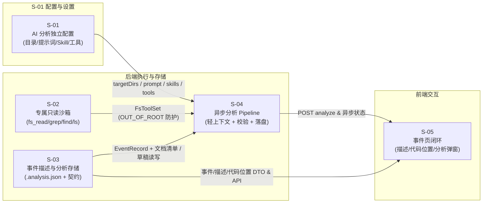
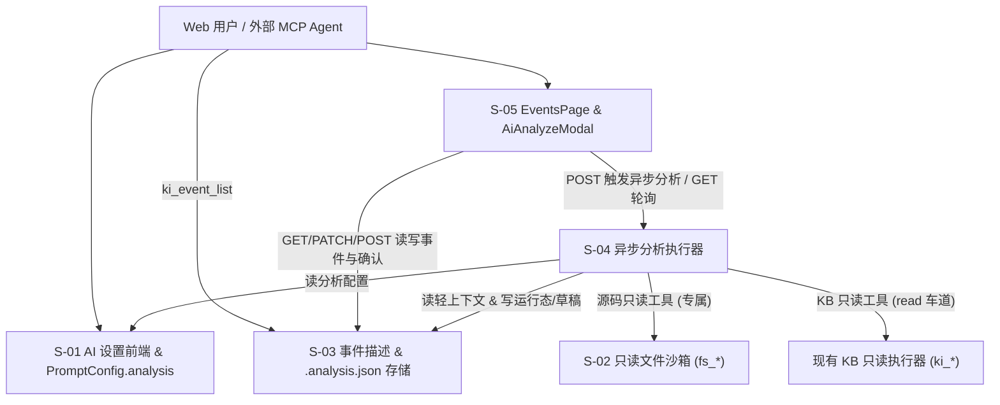

# 技术设计（父文档）：事件源码分析（只读）

## 1. 需求背景 & 目标

- **全局背景**：事件模块（`REQ-20261113-004`）已落地，但「AI 分析」仍为占位弹窗（`EventsPage.tsx:1098`），「AI 设置 → AI 分析」仅预留了单张提示词卡（`AiSettingsPage.tsx:30`），且事件缺少「事件描述」区与代码位置持久化。
- **整体目标**：
  1. 在「AI 设置 → AI 分析」建立与「AI 对话」隔离的独立配置域（按 scope 映射 + 默认目标目录、提示词、Skill、预算、思考级别、专属只读工具开关）；
  2. 为事件补齐可选 `description`，提供基于 `realpath` 沙箱的只读文件工具与异步分析 Pipeline（轻量上下文 + LLM 自主调 `ki_get_module_info` 读正文）；
  3. 落地 `.events/{eventId}.analysis.json` 草稿与确认机制，将已确认代码位置透出给详情页与 `ki_event_list`。
- **非功能假设**：默认单机低并发、单仓库 ≤1 万文件、`fs_grep` <1s、异步预算 90s（不阻塞 KB 写锁）。
- **不在范围内**：写/改/删源码、执行 shell/测试、代码向量化建库、将 `fs_*` 暴露给「AI 对话」或外部 `/mcp`、多仓库联合分析（二期）。

---

## 2. 关键环节一览图

---

## 3. 总体方案设计

- **配置隔离**：`PromptConfig` 新增 `analysis` 域（`S-01`），与对话配置共享文件与保存队列，但提示词/Skill/工具开关物理隔离；权限沿用 `ops.write`（并对齐 `AiSettingsPage` 前端按钮门禁）。
- **工具边界**：`fs_*` 仅注入 `S-04` 内部工具表（`S-02`），严禁写入 `CHAT_MCP_TOOLS` 与 `/mcp`；KB 只读调用走 `OperationCoordinator` `'read'` 车道，绝不占 KB 写锁。
- **数据落点**：`description` 存 `{eventId}.json`（`S-03`），运行态/草稿/已确认位置存 `{eventId}.analysis.json`，避免状态流转与后台写草稿互相覆盖。
- **跨子需求共享术语**：`AnalysisTargetConfig`、`AnalysisToolName`、`EventAnalysisDoc`、`AnalysisDraft`、`ConfirmedCodeLocation`、`AnalysisStepRecord`（定义见 §4.3）。

---

## 4. 全局风险 & 跨子需求依赖

### 4.1 全局风险矩阵

| 风险 | 涉及子需求 | 影响 | 缓解措施 |
|---|---|---|---|
| **旧前端 `PUT` 覆盖新配置字段** | S-01 | 丢失已配的目标目录/分析 Skill | 后端按 `rawInput.analysis === undefined` 保底沿用磁盘值；前端 `clonePromptConfig` 显式白名单深拷（`prompt-config-clone.test.mjs` 守卫） |
| **前后端 DTO 与错误码号段漂移** | S-03, S-04, S-05 | `governance-contract.test.ts` 失败或前端误判码 | 同步修改 `src/lib/governance-contract.ts` 与 `web/src/api/governanceContract.ts`；在 `GOVERNANCE_CODE_NUMBERS` 开 `1600–1699` 专段给 AI 分析并更新测试区间 |
| **配置与运行态鉴权口径分裂** | S-01, S-04, S-05 | editor 账号在设置页看不到只读提示却 403 | 统一明确：全局 AI 配置写需 `ops.write`（admin），事件分析触发/确认/描述编辑需 `knowledge.write`（admin/editor） |
| **进程异常重启遗留 `running` 死锁态** | S-03, S-04 | 重启后该事件永远提示"分析中"无法重跑 | 内存 `activeRuns` 集合 + `AnalysisDraft.bootId` 进程实例标识（重启后 `bootId !== CURRENT_BOOT_ID` 立即识别为 `failed(INTERRUPTED)`）+ 120s 超时兜底 |
| **大仓 `fs_grep` 同步 IO 阻塞 Node 主线程** | S-02, S-04 | 扫描仓库期间卡死 daemon 其他 HTTP/MCP 请求 | `fs_grep`/`fs_find` 强制使用 `fs.promises` 异步遍历并定期让出事件循环，单文件 > 2MB 跳过，命中即停 |
| **LLM 幻觉路径与代码 Prompt 注入** | S-02, S-04 | 错误位置写入草稿或被恶意注释劫持指令 | 代码/文档正文按数据围栏注入；汇总后后端强制用 `S-02` `realpath` + 行数校验每条候选，无效项剔除进 `unconfirmed` |

### 4.2 跨子需求契约变更总表

| 变更类型 | 接口 / 契约 | 变更内容 | 影响子需求 |
|---|---|---|---|
| 修改 | `GET/PUT /api/chat/prompt-config` | 新增 `config.analysis`、`defaults.analysis`、`limits.analysis*`、`analysisToolGroups`、`analysisReasoningEffort*`、`datasourceDirs`（快捷路径提示） | S-01, S-04 |
| 修改 | `EventRecord` & `PATCH /api/governance/events/:id` & `POST .../events` | 新增可选 `description?: string`（上限 4000 字符）；PATCH 支持同步修改 `title` / `description` | S-03, S-04, S-05 |
| 新增 | `POST /api/governance/events/:id/analyze` | 前置门禁校验并异步启动分析任务，返回 `{ analysis }` | S-04, S-05 |
| 新增 | `GET /api/governance/events/:id/analysis` | 读取运行态/草稿/已确认位置（供详情页初始化与轮询） | S-03, S-04, S-05 |
| 新增 | `POST /api/governance/events/:id/analysis/confirm` | 勾选确认候选代码位置写入 `confirmed`（带 `expectedRunId` 防并发误确认，可选清除草稿） | S-03, S-05 |
| 新增 | `DELETE /api/governance/events/:id/analysis/draft` / `.../confirmed/:locId` | 丢弃未确认草稿 / 删除单条已确认代码位置 | S-03, S-05 |
| 修改 | `GET /api/governance/events/:id` & `ki_event_list` | 详情返回 `analysis` 摘要；`ki_event_list` 返回 `codeLocationsPreview` + `codeLocationTotal` | S-03, S-05 |

### 4.3 共享术语速查

| 术语 | 精确定义 | 权威落点 |
|---|---|---|
| `AnalysisTargetConfig` | `{ defaultDir?: string; byScope: Record<string, string> }`：全局兜底目录与按 scope 映射的目标代码目录配置 | S-01 (`prompt-config.ts`) |
| `AnalysisToolName` | 专属工具白名单 8 项：`fs_read \| fs_grep \| fs_find \| fs_ls \| ki_get_module_info \| ki_search \| ki_group_list \| ki_tag_list` | S-01 / S-02 |
| `EventAnalysisDoc` | `.events/{eventId}.analysis.json` 持久化根结构，含 `draft`（可选）与 `confirmed[]` | S-03 (`events/types.ts`) |
| `AnalysisDraft` | 单次分析运行态与草稿：`status ('running' \| 'ready' \| 'partial' \| 'failed')`、候选列表、未确认点、步骤记录、统计 `stats` | S-03 / S-04 |
| `ConfirmedCodeLocation` | 经人工确认写入事件的事实代码位置：`id / file / line / endLine? / snippet / why / confidence / targetDir / commit? / confirmedAt` | S-03 / S-05 |
| `AnalysisStepRecord` | 过程时间线单步记录，直接对齐前端 `AiProcessPanel` 消费形状（真实 `calls[]` + `metrics` + `ms`） | S-04 / S-05 |
