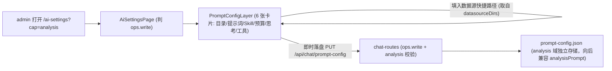

# S-01：AI 分析独立配置与设置页设计

## 1. 术语

跨子需求共享术语见父文档 `DESIGN.md` §4.3（`AnalysisTargetConfig`、`AnalysisToolName`）。本子需求特有术语：

| 术语 | 含义 | 引用 |
|---|---|---|
| `AnalysisConfig` | 挂在 `PromptConfig.analysis` 下的独立配置域，含目标目录、提示词、专属 Skill、预算、思考级别与 8 个只读工具开关 | — |
| `AnalysisToolGroup` | AI 分析工具分组元数据（`code-read` 源码只读 4 个 + `kb-read` 知识库只读 4 个），无危险写删组 | — |
| `capabilityPromptSoft` / `analysisSoft` | `normalizePromptConfig` 读取通道软校验标志：分析字段非法时只忽略对应项并透出 `issue`，不连累整份 `PromptConfig` 回退默认 | `src/lib/chat/prompt-config.ts:517` |
| `datasourceDirs` | `GET /api/chat/prompt-config` 附带的各 scope 已登记数据源路径映射（供设置页快捷填入，非必填约束） | `src/lib/datasource.ts:838` |

---

## 2. 现状（AS-IS）

### 2.1 现状描述

- **数据层（`src/lib/chat/prompt-config.ts`）**：`PromptConfig` 仅有与对话绑定的顶层字段（`prompt`、`skills`、`tools`、`contextChars`、`toolResponseChars`、`searchHitsPerCall`、`reasoningEffort`），以及预留的单字段 `analysisPrompt?: CapabilityPrompt`（`prompt-config.ts:241-251`）。不存在分析专属的 `targetDirs`、`skills`、`tools`、预算上限配置。
- **前端配置层（`web/src/chat/PromptConfigLayer.tsx` + `web/src/pages/AiSettingsPage.tsx`）**：
  - 左栏 `AI 分析` 状态写死为 `未接入 · 提示词可预设`（`AiSettingsPage.tsx:30`）；
  - 右栏 `capability === 'analysis'` 只渲染 `CapabilityPromptPanel`（提示"尚未接入"警告框 + 单张代码定位提示词卡片，`PromptConfigLayer.tsx:1029-1041`）；
  - `web/src/chat/promptConfigClone.ts` 为白名单深拷贝，新增可选字段必须显式搬运。
- **权限校验分裂（实证缺陷）**：`src/lib/auth/route-permissions.ts:56` 对 `PUT /chat/prompt-config` 校验 `ops.write`（仅 admin），而 `src/lib/chat/chat-routes.ts:249` 与 `web/src/pages/AiSettingsPage.tsx:58` 却校验 `knowledge.write`（editor 也有），导致 editor 在界面看到可编辑状态但提交时收到 403。

### 2.2 痛点

- 痛点 1：用户无法在设置页配置目标代码目录、分析专属 Skill、分析预算或工具开关。
- 痛点 2：若直接复用对话的 `skills` / `tools`，会导致对话暴露只读源码工具（违反不做通用代码问答），且对话的写/删工具不能进入分析域。
- 痛点 3：权限检查前后端不统一，editor 账号操作设置页必撞 403。

### 2.3 AS-IS 流程图


---

## 3. 方案（TO-BE）

### 3.1 方案概述

> 默认假设：本子需求默认单机低频配置变更，设置页权限与全局配置写能力 `ops.write` 保持一致；若未来需要向非 admin 角色开放 per-scope 分析设置，需先拆出独立配置接口。

在 `PromptConfig` 中新增物理隔离的 `analysis?: AnalysisConfig` 配置域，平滑承接既有 `analysisPrompt`；扩展 `GET /api/chat/prompt-config` 下发分析默认值、上下界、分组工具描述与 `datasourceDirs` 快捷路径；前端 `PromptConfigLayer` 在 `capability === 'analysis'` 时按「AI 对话」同款分组卡片渲染 6 个独立模块，并对齐 `ops.write` 鉴权口径。

### 3.2 关键决策点

| 决策 | 选择 | 理由 | 备选方案 | 否决原因 | 重新评估触发条件 |
|---|---|---|---|---|---|
| **分析配置存放位置** | 扩展 `prompt-config.json` 的 `analysis` 字段 | 复用现有 `usePromptConfig` 即时保存队列、事务备份与全局设置页架构，改动最小 | 新建独立文件 `analysis-config.json` + 新 CRUD 路由 | 拆出两套保存队列、两套 `/api` 和两套只读校验，增加维护面 | `prompt-config.json` 单文件超 512KB 或分析配置需拆为 per-scope 存储 |
| **与 `analysisPrompt` 兼容** | 读取时若缺 `analysis.prompt` 且存在旧 `analysisPrompt`，自动承接为 `analysis.prompt`；保存时双写/保留旧前端兼容 | 已修改过 `analysisPrompt` 的用户升级后不丢文案，旧标签页也不覆盖新字段 | 直接废弃 `analysisPrompt` 清零迁移 | 用户之前在占位界面预设的提示词会静默丢失 | 下一个大版本清理历史废弃字段时 |
| **分析内置 Skill 依赖工具** | 内置 `builtin-code-locate` 设为默认启用，依赖 `fs_read`（`ANALYSIS_SKILL_REQUIRED_TOOLS`） | `fs_read` 默认开启，开箱即用；若用户关闭 `fs_read` 则与对话 `doc-editing` 同构提示并联动停用 | 无内置分析 Skill，全放基础提示词 | 提示词过长占固定上下文，且无法演示按需加载 | 分析模式取消 `use_skill` 按需加载机制时 |
| **设置页权限口径统一** | 以 `route-permissions.ts` 的 `ops.write` 为准，`AiSettingsPage.tsx` 与 `requireGlobalConfigWrite` 同步改为判 `ops.write` | 全局 AI 设置属系统级运营配置（含目标路径白名单与模型预算），应与 `route-permissions.ts:56` 一致 | 把 `PUT /chat/prompt-config` 放宽为 `knowledge.write` | editor 仅应读写自己授权 scope 的知识，不应修改全局服务器目录白名单 | 产品决定按角色开放部分 AI 设置修改权限时 |

### 3.3 TO-BE 流程图



### 3.4 行为差异对照表

| 场景 | AS-IS | TO-BE | 影响 |
|---|---|---|---|
| 设置页左侧「AI 分析」状态 | 显示「未接入 · 提示词可预设」 | 显示「目录 · 提示词 · Skill · 工具」 | 兼容变更（UI 文案与结构完善） |
| 右侧面板结构 | 警告横幅 + 1 张 `analysisPrompt` 卡片 | 6 张卡片：目标目录 → 基础提示词 → Skill → 分析预算 → 思考级别 → 工具与权限（8 只读工具全默认开） | 新增交互与字段，旧提示词平滑继承 |
| 设置页写权限判定 | 页面与 `chat-routes` 判 `knowledge.write`，路由表判 `ops.write` | 三处统一判定 `ops.write` | 消除 editor 界面可点但保存 403 的不一致 |

---

## 4. 数据模型 & 接口设计

### 4.1 持久化结构（`src/lib/chat/prompt-config.ts`）

```typescript
export const ANALYSIS_TOOL_GROUPS = [
  {
    key: 'code-read',
    label: '源码只读（AI 分析专属）',
    names: ['fs_read', 'fs_grep', 'fs_find', 'fs_ls'] as const,
    descs: {
      fs_read: '读取目标目录下代码片段（≤200 行 / 64 KB）',
      fs_grep: '按正则关键词检索目标目录源码（≤60 条）',
      fs_find: '按文件名/路径模式查找文件（≤80 条）',
      fs_ls: '列出目录结构（≤200 项）',
    },
  },
  {
    key: 'kb-read',
    label: '知识库只读（按需读取上下文关联/参考文档）',
    names: ['ki_get_module_info', 'ki_search', 'ki_group_list', 'ki_tag_list'] as const,
    descs: {
      ki_get_module_info: '按 group 与文档名读取知识库正文',
      ki_search: '混合/全文检索知识库补充上下文',
      ki_group_list: '查看 Group 树结构与文档清单',
      ki_tag_list: '查看知识库标签',
    },
  },
] as const;

export interface AnalysisTargetConfig {
  defaultDir?: string;               // 全局兜底目录（绝对路径，已 trim）
  byScope: Record<string, string>;   // scope 名 -> 目标代码目录（绝对路径）
}

export interface AnalysisConfig {
  targetDirs: AnalysisTargetConfig;
  prompt: CapabilityPrompt;          // 基础提示词（{ content, at }）
  skills: PromptSkill[];             // AI 分析专属 Skill（builtin-code-locate 默认启用）
  tools: Record<string, boolean>;    // 上述 8 个只读工具开关，默认全 true
  maxRounds?: number;                // 工具轮次上限覆盖（1..12，缺省用内置 6）
  maxFiles?: number;                 // 单次分析最多读取文件数覆盖（1..30，缺省用内置 8）
  reasoningEffort?: string;          // 思考级别覆盖（复用 config.yaml llm.reasoningEfforts）
}
```

在 `PromptConfig` 中追加：
```typescript
  analysis?: AnalysisConfig;
```
- **默认值常量**：`DEFAULT_ANALYSIS_MAX_ROUNDS = 6`、`ANALYSIS_MAX_ROUNDS_LIMIT = 12`、`DEFAULT_ANALYSIS_MAX_FILES = 8`、`ANALYSIS_MAX_FILES_LIMIT = 30`、`BUILTIN_ANALYSIS_SKILL_ID = 'builtin-code-locate'`。
- **默认提示词修订**：把 `DEFAULT_ANALYSIS_PROMPT` 中的「事件描述」表述更新为「基于事件标题、可选描述、当前阶段进度与关联/参考文档清单，先按需调用 `ki_get_module_info` 获取文档详情，再用 `fs_*` 定位代码」。

### 4.2 传输接口扩展（`GET/PUT /api/chat/prompt-config`）

`GET /api/chat/prompt-config` 响应新增字段（对应同步 `web/src/api/chatContract.ts`）：
- `config.analysis`：当前生效的分析配置（已合并兼容旧 `analysisPrompt`）；
- `defaults.analysis`：内置默认 `AnalysisConfig`（供「恢复默认」使用）；
- `limits` 追加：`analysisPromptMaxChars`（已有）、`analysisMaxRoundsDefault: 6`、`analysisMaxRoundsMax: 12`、`analysisMaxFilesDefault: 8`、`analysisMaxFilesMax: 30`；
- `analysisToolGroups: AnalysisToolGroup[]`：后端下发的工具分组与描述 SSOT；
- `datasourceDirs?: Record<string, { type: 'directory' | 'git'; dir: string }>`：读取 `listRegisteredDataSourceRecords(cfg)`，取 `record.git?.repoRoot ?? record.dir`，供设置页「按 scope 映射」点击快捷填入；
- `analysisReasoningEffort?: string`、`analysisReasoningEffortOverridden?: boolean`。

```json
// Demo 返回片段（仅示意格式）
{
  "ok": true,
  "config": {
    "analysis": {
      "targetDirs": { "defaultDir": "/root/workspace", "byScope": { "kisearch-memory": "/root/knowledge-indexer" } },
      "prompt": { "content": "...", "at": "2026-11-16T03:00:00.000Z" },
      "skills": [{ "id": "builtin-code-locate", "name": "code-locate", "builtin": true, "enabled": true }],
      "tools": { "fs_read": true, "fs_grep": true, "fs_find": true, "fs_ls": true, "ki_get_module_info": true, "ki_search": true, "ki_group_list": true, "ki_tag_list": true }
    }
  },
  "analysisToolGroups": [ /* ... */ ],
  "datasourceDirs": {
    "kisearch-memory": { "type": "git", "dir": "/root/knowledge-indexer" }
  }
}
```

### 4.3 契约变更声明

| 变更类型 | 接口 | 变更内容 | 影响的子需求 |
|---|---|---|---|
| 修改 | `PromptConfig` / `GET/PUT /api/chat/prompt-config` | 新增 `analysis` 子对象、`analysisToolGroups`、`datasourceDirs`、`limits.analysisMax*` | S-04 |
| 修改 | `web/src/chat/promptConfigClone.ts` | 白名单深拷补齐 `analysis`（含 `targetDirs.byScope`、`prompt`、`skills`、`tools`、`maxRounds`、`maxFiles`、`reasoningEffort`） | S-01 |

---

## 6. 异常处理

| 场景 | 行为 | 是否对外暴露 |
|---|---|---|
| `readPromptConfig` 读到损坏或越界的 `analysis` 字段 | `analysisSoft: true` 软通道只对出错字段回落默认值并记录 `issue` 提示，**绝不连累对话配置整份回退** | 是（响应 `issue` 提示） |
| `PUT` 提交非绝对路径、含 `\0` 的目标目录、未知工具名或越界 `maxRounds/maxFiles` | 收集全部问题抛 `PromptConfigError` → `400 PROMPT_CONFIG_INVALID`，不落盘 | 是 |
| `PUT` 启用了依赖 `fs_read` 的分析 Skill 但同时关闭了 `fs_read` | 严格 400 拒绝保存；读取路径则就地停用该 Skill 并写 `softNotes` | 是 |
| 旧版前端提交请求体缺少 `analysis` 键 | `savePromptConfig` 检测到 `rawInput.analysis === undefined` 时沿用磁盘现值 `existing.analysis` | 否（静默保护） |
| 旧版后端未返回 `analysisToolGroups` / `limits.analysisMaxRoundsMax` | 设置页显示黄色降级提醒「后端尚未重启，AI 分析新配置暂不可保存」 | 是 |

---

## 8. 测试方案

| 类型 | 范围 | 工具 |
|---|---|---|
| 单元测试（后端） | `prompt-config.test.ts`：新增 `analysis` 隔离性、旧 `analysisPrompt` 兼容迁移、软通道降级、`PUT` 缺键保底、skill↔工具依赖、`targetDirs` 路径校验 | `npx jiti test/chat/prompt-config.test.ts` |
| 单元测试（前端） | `prompt-config-clone.test.mjs`：断言 `analysis` 深层克隆不污染基线、缺省字段不凭空构造；`skill-tool-dependency.test.mjs` 补齐分析 Skill 依赖守卫 | `cd web && npm test` |
| 构建与静态检查 | `npm run build`（后端）+ `cd web && npx tsc --noEmit && npm run build` | tsc / vite |

不在测试范围内：设置页真实拖拽/截图渲染（留到 S-05 落地后整体 UI 走查一并验证）。

---

## 9. 迁移策略

### 存量数据处理

- `readPromptConfig` 读到旧配置（有 `analysisPrompt`、无 `analysis`）时：
  - 将 `analysis` 初始化为默认结构，若 `analysisPrompt.content !== DEFAULT_ANALYSIS_PROMPT_OLD` 或时间戳非 `BUILTIN_AT`，将其值赋给 `analysis.prompt`；
  - 下次任意保存后新结构落盘，并同步更新 `analysisPrompt` 为 `analysis.prompt` 以兼容旧代码读取。

### 回滚方案

- 保留既有顶层字段 `analysisPrompt` 不删；若需回滚前端设置页，旧版设置页仍可读到 `analysisPrompt` 且后端按 `rawInput.analysis === undefined` 保护 `analysis` 数据不丢失。

---

## 10. 影响范围

| 影响对象 | 影响类型 | 影响描述 | 是否破坏性变更 |
|---|---|---| :---: |
| `src/lib/chat/prompt-config.ts` | 数据变更 / 接口变更 | 新增 `AnalysisConfig` 类型、默认常量、校验逻辑与兼容迁移 | 否 |
| `src/lib/chat/chat-routes.ts` | 接口变更 / 权限变更 | `GET/PUT /api/chat/prompt-config` 扩充分析字段；`requireGlobalConfigWrite` 对齐为 `ops.write` | 是（editor 不再误入写通道） |
| `web/src/api/chatContract.ts` | 接口变更 | 同步 `PromptConfig`、`PromptConfigLimits`、`PromptConfigOk` 类型 | 否 |
| `web/src/chat/promptConfigClone.ts` | 数据变更 | 白名单深拷贝增加 `analysis` 整树克隆 | 否 |
| `web/src/pages/AiSettingsPage.tsx` | 行为变更 / 权限变更 | 改用 `can('ops.write')`；左栏「AI 分析」副标题更新为 `目录 · 提示词 · Skill · 工具` | 否 |
| `web/src/chat/PromptConfigLayer.tsx` & `web/src/styles/ki.css` | 界面变更 | `capability === 'analysis'` 替换为 6 卡布局，复用对话卡片与弹窗编辑组件 | 否 |
