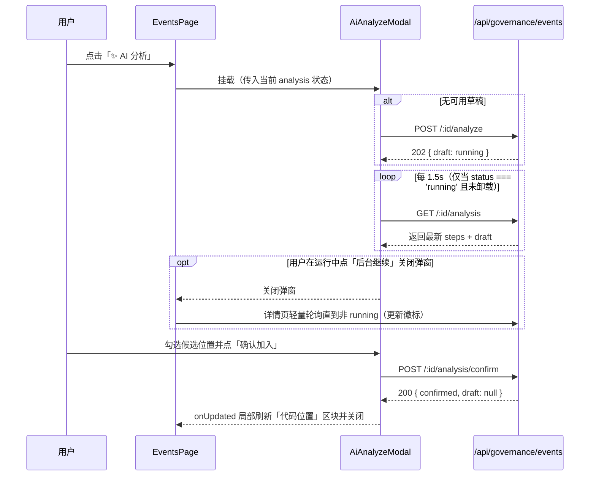

# S-05：事件页前端闭环设计

## 1. 术语

跨子需求共享术语见父文档 `DESIGN.md` §4.3（`AnalysisDraft`、`ConfirmedCodeLocation`、`AnalysisStepRecord`）。本子需求特有术语：

| 术语 | 含义 | 引用 |
|---|---|---|
| `AiAnalyzeModal` | 替换原占位说明弹窗的正式分析弹窗组件（`web/src/components/governance/AiAnalyzeModal.tsx`） | — |
| `CodeLocationsSection` | 事件详情页内新增的「代码位置」区块（展示已确认位置 + 唤醒/丢弃未确认草稿或查看运行中进度） | — |

---

## 2. 现状（AS-IS）

### 2.1 现状描述

- `web/src/pages/EventsPage.tsx:489-500, 1098-1135` 已存在右上角 `✨ AI 分析` 按钮和占位弹窗 `AiAnalyzeModal`，但该按钮未检查 `canWrite` 权限，点击只弹出静态方案说明和「提示词设置」跳转。
- `EventsPage.tsx` 的 `NewEventModal` 与详情区尚无「事件描述」输入/展示，也没有「代码位置」独立区块。
- `web/src/components/governance/AiProcessPanel.tsx` 与 `FindRefModal.tsx` 已沉淀出一套与对话页风格一致的折叠步骤时间线、调用胶囊与复选框候选列表样式（`governance.css:525-690`）。

### 2.2 痛点

- 痛点 1：无法新建或编辑事件描述，详情页看不到代码位置与分析进度。
- 痛点 2：只读账号目前也能点击 `✨ AI 分析` 按钮且无写权限禁用提示。
- 痛点 3：分析最多可持续 90s，弹窗若关闭就丢状态无法找回后台已完成的草稿。

---

## 3. 方案（TO-BE）

### 3.1 方案概述

> 默认假设：本子需求默认单机低频交互，轮询间隔 1500ms（仅 `running` 状态激活），并严格遵守已在 `requirement.md §6.2` 经用户确认的 ASCII 界面布局图。

对照已在需求阶段确认的界面 ASCII 布局（`requirement.md §6.2`）：
1. 在 `NewEventModal` 与 `EventsPage` 详情头下方增加可选「事件描述」编辑/展示区；
2. 详情页阶段线下方、关联文档上方增加「代码位置」独立区块，支持单条删除已确认位置，并在存在 `running` 或 `ready/partial` 草稿时显示状态提示条与直达弹窗入口；
3. 抽离并实现 `AiAnalyzeModal`：触发分析（或恢复已有运行中/草稿状态）、1.5s 间隔轮询进度、渲染真实步骤时间线（直接复用 `gov-ai-proc*` 样式与 `ki-chat-tl__node` 胶囊）、复选框勾选确认写入、`[后台继续]` 关闭弹窗、`[丢弃]` 清理草稿；
4. `✨ AI 分析` 按钮在 `closed`（已收口）状态下保持可点（支持复盘），仅受 `!canWrite` 禁用；各类前置错误码均提供直达 `/ai-settings?cap=analysis` 的快捷按钮。

### 3.2 关键决策点

| 决策 | 选择 | 理由 | 备选方案 | 否决原因 | 重新评估触发条件 |
|---|---|---|---|---|---|
| **轮询机制与开关时机** | 组件层按 `draft?.status === 'running'` 启动 `1500ms` 定时轮询 `GET /analysis`，非 `running` 或切走事件/卸载即 `clearInterval` | 复用现有 REST + `governanceApi`，零新增 SSE/WS 连接复杂度，切回事件页 `loadDetail` 自动接续轮询 | 另建独立 SSE 流 `/events/:id/analyze/stream` | 关闭弹窗后页面切走再切回仍需靠 `GET /analysis` 恢复，双通道反而多一处状态同步问题 | 分析步数需要毫秒级逐字 token 流式输出时 |
| **草稿未确认与再次触发** | 当已有 `draft` 处于 `ready/partial` 且存在候选时，点击右上角 `✨ AI 分析` 先打开弹窗展示既有草稿，弹窗内提供 `[重新分析]`（二次确认后带 `forceOverwrite: true`） | 防止用户误点按钮把已跑了 40s 的草稿直接覆盖掉，且减少浪费 token | 点击按钮无条件覆盖重跑 | 误触一次直接丢弃上一批候选与耗时，体验差 | 暂无 |
| **过程组件策略** | 抽取共用步骤列表渲染或为 `AiAnalyzeModal` 适配后端下发的 `AnalysisStepRecord[]`（含真实 `calls` 与 `stats`），**复用既有 `gov-ai-proc*` CSS** | 视觉与「AI 查找」完全统一且不硬编码 `AiProcessPanel.tsx` 固定的 5 步枚举 | 修改 `AiProcessPanel.tsx` 强塞两套步骤翻译逻辑 | `AiProcessPanel` 硬编码了 `RefSearchStep['name']` 五步枚举，强合会让两个弹窗互相耦合 | 当站内统一抽象通用 `StepTimeline` 组件时 |

---

## 4. 接口消费模型

### 4.1 `AiAnalyzeModal` 组件契约（`web/src/components/governance/AiAnalyzeModal.tsx`）

```typescript
export interface AiAnalyzeModalProps {
  scope: string;
  event: EventView;
  analysis: { draft: AnalysisDraft | null; confirmed: ConfirmedCodeLocation[] } | null;
  canWrite: boolean;
  onClose: () => void;
  onUpdated: (next: { draft: AnalysisDraft | null; confirmed: ConfirmedCodeLocation[] }) => void;
  onOpenSettings: () => void; // 跳 /ai-settings?cap=analysis&from=...
}
```

### 4.2 状态流转逻辑

1. **打开弹窗时**：
   - 若 `analysis?.draft` 为 `null` 或上次 `failed`：自动或由用户确认发起 `startEventAnalysis(scope, event.id)`；
   - 若 `analysis?.draft.status === 'running'`：直接进入轮询视图，不重发 `POST`；
   - 若 `analysis?.draft.status === 'ready' | 'partial'`：直接展示既有草稿与勾选列表，头部提供 `[重新分析]` 按钮。
2. **勾选策略**：默认勾选 `confidence >= 0.6` 的候选（与 `FindRefModal` 同阈值体验）；支持全选/反选；无候选时显示 `unconfirmed` 与 `errorMessage`。
3. **按钮语义**：
   - `[后台继续]`（仅 `running` 时高亮主提示）：关闭弹窗，保留后台任务，详情页「代码位置」区保持显示「AI 分析进行中… [查看进度]」；
   - `[丢弃草稿]`：调 `DELETE /analysis/draft` 清空草稿并关闭弹窗；
   - `[确认加入 N 处]`：调 `POST /analysis/confirm`（携带 `expectedRunId: draft.runId` 与 `discardDraft: true`）写入 `confirmed` 并刷新详情。

---

## 5. 时序图



---

## 6. 异常处理

| 场景 | 行为 | 是否对外暴露 |
|---|---|---|
| 返回 `ANALYSIS_TARGET_NOT_CONFIGURED` / `ANALYSIS_TARGET_UNREADABLE` / `ANALYSIS_TOOLS_ALL_DISABLED` / `ANALYSIS_DISCLOSURE_REQUIRED` | 弹窗内错误区明确写出原因，并把 `[⚙ 前往 AI 分析设置]` 高亮为主引导按钮 | 是 |
| 返回 `ANALYSIS_TARGET_SYNCING` / `ANALYSIS_RATE_LIMITED` / `ANALYSIS_LLM_UNAVAILABLE` | 弹窗内提示明确原因与「重试」按钮，不卡死弹窗 | 是 |
| 只读账号（`!canWrite`） | `✨ AI 分析` 按钮、`事件描述`「编辑」按钮、删除已确认位置 `×` 全部禁用并挂 `title="需要写权限"` | 是 |
| 草稿确认时 `REVISION_CONFLICT` / `EVENT_NOT_FOUND` | 提示具体错误信息（如事件已被删除），禁止静默吞错 | 是 |

---

## 8. 测试方案

| 类型 | 范围 | 工具 |
|---|---|---|
| 单元测试（源码与模型逻辑） | `web/test/event-source-analysis.test.mjs`：验证 `canWrite` 门禁、已收口事件按钮不禁用、错误码引导映射、`confidence >= 0.6` 默认勾选逻辑与状态转换纯函数 | `cd web && npm test` |
| 类型与构建 | `cd web && npx tsc --noEmit && npm run build` | tsc / vite |
| 浏览器端到端走查 | 实施阶段按 `frontend-walkthrough` 验证事件描述编辑、设置页 6 卡配置、触发分析/后台继续/切回恢复/勾选确认与窄屏布局 | Playwright |

---

## 10. 影响范围

| 影响对象 | 影响类型 | 影响描述 | 是否破坏性变更 |
|---|---|---| :---: |
| `web/src/components/governance/AiAnalyzeModal.tsx` | 新增 | 分析过程弹窗与候选确认交互 | 否 |
| `web/src/pages/EventsPage.tsx` | 界面变更 / 行为变更 | 新增「事件描述」区（创建+详情）、「代码位置」区、替换占位弹窗、`canWrite` 门禁 | 否 |
| `web/src/styles/governance.css` | 界面变更 | 追加事件描述编辑框、代码位置行、`commit` 标签与候选置信度样式 | 否 |
