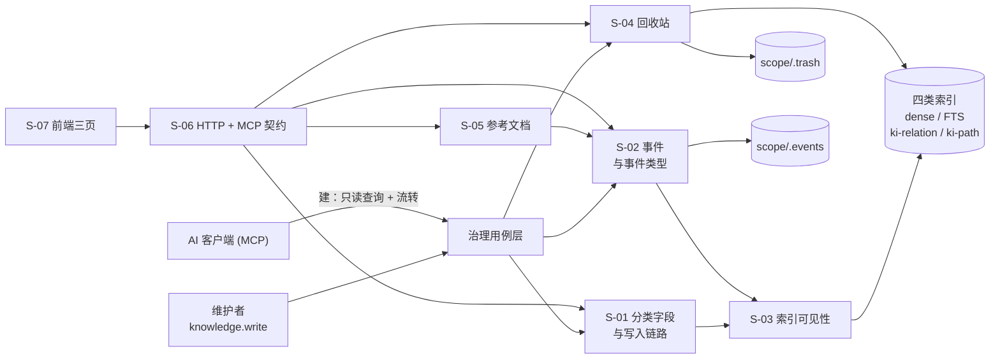
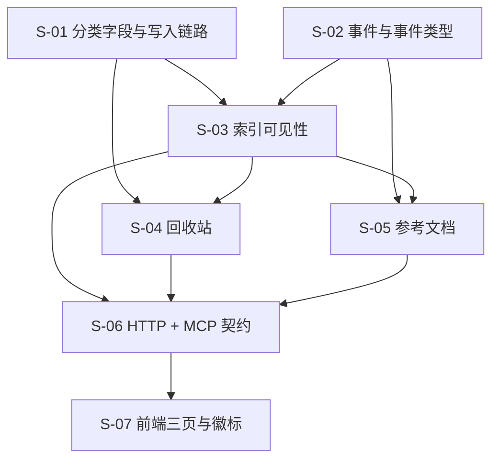

# 知识治理（文档分类 / 事件 / 回收站）设计

> 需求：`../requirement.md`（REQ-20261113-004）｜界面基线：`../demo/index.html`
> 状态：设计中（父文档 4 章 + 子文档 S-01~S-07 已落盘，待评审）

## 1. 需求背景 & 目标

**根因**：`Relation` 无生命周期字段（`src/lib/scoring.ts:23-55`），清理既无依据也无入口；本机 91 篇中 66 篇从未被读取（72.5%）。

**目标**：分类决定「何时消失」、事件阶段决定「何时可检索」、回收站保证「消失可逆」，三者正交。

**不在范围内**：检索期时效降权（Q3）、事件源码分析（REQ-20261113-003）、跨 scope 事件、组级删除进回收站（Q1）。

**默认假设**：单机单用户低频；摘索引同步、重建异步（数秒/篇）；不引入常驻定时器（惰性扫描）。

## 2. 关键环节一览图

## 3. 总体方案设计

> 章节变体声明：各子文档的「关键决策点」统一放在文档末尾（§7/§8），不并入「方案」章——本需求每个子需求的决策点较多（6-7 条），内联会打断方案叙述。

### 3.1 子需求节点图（依赖 DAG）

### 3.2 四个共享内核（定稿后只读，细节见各子文档）

| # | 内核 | 归属 | 一句话约束 |
|---|---|---|---|
| ① | 索引摘除/写入原语 `src/lib/visibility-index.ts` | S-03 | `hidden` 必须摘四类；`ki-relation` / `ki-path` docId 跨组共享，须复用 `delete-relation.ts:289-308` 的 `otherHolders` 保护；摘除同步、写入异步并回 `pending` |
| ② | 目录布局 | S-02 / S-04 | `.trash/` `.events/` `governance.json` 全落 `{dataDir}/{scope}/`（天然进备份）；**不放** `{sourceDir}/.ki/` |
| ③ | 分类缺省与覆盖语义 | S-01 | 新建未传 = `wiki`；**覆盖未传 = 保持原值**；数据源文档强制 `wiki` |
| ④ | AI 指定路径 | S-01 / S-06 | 3 只读 + 1 写（`ki_event_set_stage`）；**无任何创建类工具**；写入必须回显 `visibility` |

### 3.3 子需求与产物

| 子需求 | 核心产物 | 依赖 | 文档 |
|---|---|---|---|
| S-01 | `Relation.lifecycle/expiresAt/eventId` + 2 条 MCP 写入链路 + 导入强制 wiki 防线 + 预设 / group 默认（`governance.json`） | — | `S01_分类字段与写入链路_DESIGN.md` |
| S-02 | `EventRecord` / `EventTypeRecord` / `EventStageLog` + 阶段约束 + 终态动作 + 兜底期限 | S-01 | `S02_事件与事件类型_DESIGN.md` |
| S-03 | 三档可见性 + 四类索引摘除/重建 + 3×3 阶段切换矩阵 + 重建与覆盖写不绕过档位 | S-01、S-02 | `S03_索引可见性_DESIGN.md` |
| S-04 | 删除链路改造 + `scope/.trash` + 恢复重建 + `ttlDays` 续期 + 惰性清理 | S-01 | `S04_回收站_DESIGN.md` |
| S-05 | 引用关系 + AI 候选检索 + 过程可视 + 悬空引用处理 | S-02 | `S05_参考文档_DESIGN.md` |
| S-06 | `/api/governance/*` 30 条路由 + 3 只读 MCP + `ki_event_set_stage` + 四处登记 | S-01..S-05 | `S06_接口契约_DESIGN.md` |
| S-07 | 三页 + 侧栏分组 + 浏览页徽标 | S-06 | `S07_前端三页_DESIGN.md` |

## 4. 全局风险 & 跨子需求依赖

### 4.1 共享术语速查

| 术语 | 定义 | 归属 |
|---|---|---|
| `lifecycle` | `wiki \| temp \| event`，缺省 `wiki`（界面称「分类」） | S-01 |
| `visibility` | `full \| fts-only \| hidden`，三档，非布尔 | S-03 |
| `terminalAction` | `keep \| trash`，**事件类型级字段**，不挂阶段 | S-02 |
| `fallbackDays` | 未收口事件兜底天数，默认 90，`null` 关闭 | S-02 |
| `ttlDays`（入参） | `ki_sync_relation` 的期限天数（1~365），落库换算为绝对 `expiresAt`，并记录到 `Relation.ttlDays` 供后续快照 | S-01 |
| `ttlDays`（快照） | `TrashItem` 上的原期限长度，**只能**取 `relationSnapshot.ttlDays`；不得用 `expiresAt - now` 反推（过期瞬间 ≤ 0） | S-04 |
| `governance.json` | scope 级治理配置（预设 + group 默认 + 回收站设置）；**不塞进 `group-index.json`**（其 `groups` 键即子组名） | S-01 / S-04 |
| `preset` | 分类预设 = 命名的「分类 + 期限」组合；**仅页面侧，不对 AI 暴露入参** | S-01 |
| 四类索引 | dense / FTS / ki-relation（关系名）/ ki-path（路径） | S-03 |

### 4.2 全局风险 & 契约变化面

| 风险 / 契约 | 变化 | 后果 |
|---|---|---|
| `Relation` 分片 schema（`group-cache.ts:106-112`） | 加 3 可选字段，读侧补缺省，`version` 不变 | 绕开 `writeGroupCache` 三步曲会丢 WAL |
| `/api/*` 路由表（`auth/route-permissions.ts:36-115`） | 新增 30 条（`/api/governance/*`） | 未登记 → 404；`test/capability-coverage.test.ts` 转红 |
| MCP 工具登记（4 处） | 3 只读 + 1 写 | 漏 `tool-access.ts` → 只读 Token 可见写工具（fail-open）；流转是重活，超时口径须单列 |
| `rebuild-vector` | 按档位过滤 | 漏改 → hidden 文档被重建回可检索 |
| `export` / `restore` | 带 3 字段（含 `ttlDays`）+ trash + events | 漏字段 → 还原后生命周期与续期基数丢失。导出侧清单点 `src/export.ts:55-64`（`RelationEntry`），还原侧对应 `src/restore.ts` 的分片重写段 |
| 存量 91 篇 | 读时补 `wiki`，不批量写盘 | 僵尸文档继续污染，靠清单人工过 |

**需求文档六处缺口的设计结论**：①续期靠 `TrashItem.ttlDays`；②`terminalAction` 上提类型级；③新建/覆盖语义分离；④`→ full` 必须重建索引；⑤hidden 摘四类复用共享保护；⑥**事件位置用 `stageKey` 而非 `stageIndex`**（阶段可拖动排序，用 index 会让所有事件集体漂移一个阶段，且收口判定必须以 `closedAt` 为权威）——见 S-02 §3.3。

### 4.3 待定问题

| # | 问题 | 现状 |
|---|---|---|
| Q1 | 组级删除是否进回收站 | 按「不进」，只补摘索引一致性 |
| Q2 | 回收站是否进备份 | 已由落点解决（scope 目录内） |
| Q4 | 存量初始化 | 读时补 `wiki` + 僵尸清单 |
| Q6 | 内置类型阶段名可改 | 允许，`originalName` 保留展示兜底 |
| Q7 | 预设是否对 AI 开放入参 | 不开放；`ki_lifecycle_list` 仍回显预设名 |
| Q8 | 已收口事件能否被 AI 绑定 | 不能，`EVENT_CLOSED` |
