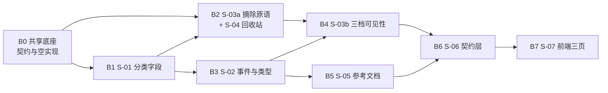

# 实施计划 · REQ-20261113-004 知识治理

> 设计：`DESIGN.md` + `S01~S07`｜评审：`design-review.md`（3 阻断已修）
> 交付方式：**单窗口串行**（阶段 5.5 判定：改造型砖头 57%、共享面 6 处、契约探索中）
> 更新：2026-11-15

## 1. 开工前代码假设核实清单

设计中有 8 处依赖现有代码行为的假设。**已当场核实 7 条，剩 1 条开工前必查**。

| # | 假设 | 结论 | 证据 |
|---|---|---|---|
| 1 | `delete-relation` 的元数据提交窗口内不夹引擎 I/O | ✅ 成立 | `src/delete-relation.ts:192-210` 窗口内只有分片写 + local KB 删 |
| 2 | `writeGroupCache` 是分片唯一写入口（三步曲） | ✅ 成立 | `src/lib/group-cache.ts:493-501` + 文件头注释「写路径唯一入口」 |
| 3 | `relation-edit-publish` 就地改字段，不重建 Relation 对象 | ✅ 成立 | `src/lib/relation-edit-publish.ts:242-255`（`relation.memoryIds = …`） |
| 4 | `ftsDeleteByIds` 不抛异常，返回 `{deleted, failed, failedIds}` | ✅ 成立 | `src/lib/fts-client.ts:214` |
| 5 | `vectorDelete` 对不存在 id 不抛 | ✅ 成立 | `src/lib/vector-client.ts:1523-1535`（`engine.delete` 返回计数，`normalize` 兜底） |
| 6 | `withScopeWriteLock` 允许同调用链嵌套（流转内调删除/入站） | ✅ 成立 | `src/lib/scope-write-lock.ts:110-112`（`heldLocks` AsyncLocalStorage，命中直接 `run()`） |
| 7 | `upsertRelation` 是导入链路唯一 relation 写入口 | ✅ 成立 | `src/lib/import.ts:2356-2392`，全仓仅 `import.ts:2376` 一处 `hot_relations.push` |
| 8 | **新增的 operation 名不会被只读门禁误拦** | ⚠️ 待核实 | `withScopeWriteLock` 有 `EXEMPT_OPS` / `BLOCKED_OPS`；需确认 `trash-*` / `event-*` / `visibility-*` 不在 BLOCKED，且 `trash-purge` 是否该进 EXEMPT（只读库也应能清站？） |

**开工前置动作（10 分钟）**：读 `src/lib/scope-write-lock.ts` 的 `EXEMPT_OPS` / `BLOCKED_OPS` 名单，把 `event-create` / `event-transition` / `event-delete` / `trash-move` / `trash-restore` / `trash-purge` / `visibility-apply` 逐个定档。

## 2. 批次划分



| 批 | 范围 | 可独立验收 | 预估 |
|---|---|---|---|
| B0 | ✅ **已完成 2026-11-15**（9 文件：实体类型 / 生命周期 / 错误码 / store / DTO 双份 / 可见性桩 + policy 登记） | 编译 + 契约测试（23 例绿） | 0.5 天 |
| B1 | S-01 分类字段与写入链路 | A1、A3 | 2 天 |
| B2 | ✅ **已完成 2026-11-15**：S-04 回收站（`trash-store` / `trash-service` / 删除链路快照 / 惰性清理，13 例绿）。**摘索引原语改随 B4** —— 与三档矩阵同一份代码，分开写会重复 | A2（索引部分待 B4）、A11、A12、A18 | 3 天 |
| B3 | ✅ **已完成 2026-11-15**：`events/{types,store,stage-log,builtin-types,type-service,event-service}`，18 例绿。索引档位与兜底扫描留 B4 | A8-A10、A17、A19 | 2.5 天 |
| B4 | ✅ **已完成 2026-11-15**：`visibility-index`（3×3 矩阵 + 跨组/组级保护）、`visibility-queue`（pending 四段生命周期）、三处档位防线（`sync-relation` 写入 / `relation-edit-publish` 发布 / `rebuild-vector` 重建）、daemon 启动恢复 pending + 清回收站，19 例绿 | A4-A7 | 2 天 |
| B5 | ✅ **已完成 2026-11-15**：`events/{refs-store,refs-service}`，11 例绿（A13 字节级红线已验证） | A13、A14 | 1.5 天 |
| B6 | ✅ **已完成 2026-11-15**：`governance-http.ts`（30 路由）+ 4 个 MCP 工具 + 五处登记（route-permissions / tool-permissions / tool-access / operation-coordinator / factory），11 例绿；路由与工具登记用「表即契约」测试钉死 | A20-A24 | 2 天 |
| B7 | ⏳ **功能面已完成 2026-11-15**：三页 + 侧栏分组 + API 客户端（`web tsc` 0 错误）。**未做**：与 demo 的像素对齐、分类页文档列表与批量条、行内倒计时配色、浏览页分类徽标 | R5/R7/R8/R24/R32 手工 | 3 天 |
| B8 | ✅ **代码完成 2026-11-15**（B8-1~B8-5）：AI 查找生产接线 + 弹窗。新增 13 例测试绿、既有 `refs-sr05` / `governance-contract` / `governance-routes` / `capability-coverage` 全绿；**手工走查待做**（S-07 §10.5 八项，需装配向量库的 scope） | A13/A14 自动 + A15/R29/R30 手工 | 1.5 天 |

合计约 16.5 天（需求文档估 24-35 天，差异来自"设计已把 7 处缺口定死，省掉探索"）。

## 3. 批次详情

### B0 共享底座（先建契约，之后只读）

**新增（只建签名 + TODO，不接线）**

```
src/lib/lifecycle.ts          resolveLifecycle / validateLifecycleInput / findExpiredTemp
src/lib/governance-store.ts   readGovernance / writeGovernance / 缺省值
src/lib/governance-contract.ts DTO（与 web/src/api/governanceContract.ts 双份）
src/lib/governance-errors.ts  GovernanceError + code 常量（语义字符串）
src/lib/visibility-index.ts   applyVisibility / rebuildVisibility / resolveVisibility（桩）
test/governance-contract.test.ts  前后端 DTO 字段比对 + 错误码唯一性
```

**不碰**：任何现有文件。**回滚点**：整目录删除即可。

**完成判据**：`npx tsc -p tsconfig.src.json --noEmit` 0；`npx jiti test/governance-contract.test.ts` 绿（DTO 双份一致）。

### B1 S-01 分类字段与写入链路

**改动**

| 文件 | 函数 / 位置 | 改什么 |
|---|---|---|
| `src/lib/scoring.ts` | `Relation` 接口 | 加 `lifecycle? / expiresAt? / eventId? / ttlDays?` |
| `src/sync-relation.ts` | `executeSyncRelation` 单条分支（203-240） | 入参透传 + 新建/覆盖语义 + 返回值回显 |
| `src/sync-relation.ts` | `executeBulkSyncRelation` | items 逐条校验，单条失败不影响其他 |
| `src/lib/mcp-tools/sync-relation.ts` | `server.tool` schema | 加 3 参数 |
| `src/lib/mcp-tools/bulk-sync-relation.ts` | `items` schema | 加 3 字段 |
| `src/lib/import.ts` | `upsertRelation`（2356-2392） | `isImported=true` 时清 `lifecycle/expiresAt/eventId/ttlDays` |
| `src/get-module-info.ts` | 返回体 | 加 `lifecycle` / `remainDays`（R5） |

**不碰**：`group-cache.ts`（分片 schema 不动）、`scoring.ts` 的 `recordUse`/`calculateScore`。

**验收**

```bash
npx tsc -p tsconfig.src.json --noEmit
npx jiti test/lifecycle-sr01.test.ts        # A1 A3 + 覆盖语义 + 导入防线
```

**完成判据**：不传分类写入 → `wiki`；覆盖未传 → 原值不变；数据源文档改分类 → 400；`temp` 缺 `ttl_days` → 400。

**回滚点**：单 commit；旧数据零迁移（字段可选），回滚不需要数据修复。

### B2 S-03a 摘除原语 + S-04 回收站

**改动**

| 文件 | 函数 / 位置 | 改什么 |
|---|---|---|
| `src/lib/visibility-index.ts` | `applyVisibility` 摘除分支 | FTS → dense → ki-relation（otherHolders 保护）→ 组级 ki-path |
| `src/lib/trash-store.ts` | 新增 | `.trash/` 读写 + `_settings.json` + 列表 |
| `src/lib/trash-service.ts` | 新增 | `moveToTrash` / `restoreFromTrash` / `purgeExpired` |
| `src/delete-relation.ts` | `executeDeleteRelationLocal`（182-312） | 插入 ② 写 trash；③④ 顺序调整；wiki 改 copy 后 unlink |
| `src/lib/scope.ts` | 新增 `getTrashDir` / `getTrashSettingsPath` | 路径 |
| `src/sync-relation.ts` / `src/lib/import.ts` | 收尾 | 调 `purgeExpired`（fire-and-forget） |

**不碰**：`group-delete.ts`（Q1 定案不进站）、`backup.ts`（scope 目录打包已覆盖 `.trash`）。

**验收**

```bash
npx jiti test/trash-sr04.test.ts    # A2 A11 A12 A18 + 同名冲突 + notify 模式
```

**完成判据**：删除后 `ki_search` 两种模式都搜不到；恢复后可按名读到且能搜到；`expiresAt` 已过 → 恢复后 `expiresAt = now + ttlDays`（不是原值）；`ttlDays` 缺失 → 回退 7 且 `ttlAssumed=true`。

**回滚点**：`delete-relation` 是本批唯一破坏性改动 —— 保留旧实现分支（`governance.trashEnabled=false` 时走老路径），观察一周再删开关。

### B3 S-02 事件与事件类型

**改动**

```
src/lib/events/types.ts         新增（EventRecord / EventTypeRecord / EventStage / EventStageLog）
src/lib/events/store.ts         新增（_meta.json / _types.json / {eventId}.json，walWrite + 写锁）
src/lib/events/type-service.ts  新增（CRUD + 阶段约束 + 内置 3 类型）
src/lib/events/event-service.ts 新增（CRUD + transitionEvent + deleteEvent + reopen）
src/lib/events/stage-log.ts     新增（jsonl 追加 + 读取）
src/lib/events/builtin-types.ts 新增
test/events-sr02.test.ts        新增
```

**不碰**：`Relation`（B1 已完成）、`visibility-index.ts`（B4 才接线）。

**验收**

```bash
npx jiti test/events-sr02.test.ts   # A8 A9 A10 A17 A19 + stageKey 稳定性 + 乐观锁
```

**完成判据**：拖动阶段后事件 `stageKey` 不变；未收口删除 → 400；收口走 keep → 文档 `lifecycle=wiki` 且 `eventId` 清空；走 trash → 文档入站且 `eventId` 清空；`fallbackDays` 到期只动文档不动事件。

### B4 S-03b 三档可见性接入

**改动**

| 文件 | 改什么 |
|---|---|
| `src/lib/visibility-index.ts` | `resolveVisibility` 查事件/类型；3×3 矩阵；pending 落盘 + 队列消费 |
| `src/lib/visibility-queue.ts` | 新增：pending 消费、daemon 启动恢复、attempts 上限 |
| `src/lib/rebuild-vector.ts` | `rebuildScopeVectorsUnlocked` 内按档位过滤 `collect*` 结果 |
| `src/lib/relation-edit-publish.ts` | `runFinish` 写完后复核档位 |
| `src/sync-relation.ts` | 覆盖写按 `resolveVisibility` 决定 dense/FTS 写入 |

**验收**

```bash
npx jiti test/visibility-sr03.test.ts   # A4 A5 A6 A7 + 组级 ki-path + pending 生命周期
```

**完成判据**：hidden 阶段 `ki_search` hybrid 与 fulltext 都搜不到；`hidden→full→hidden` 往返后四类索引无残留**且无缺失**（B2 修复项）；同组还有可见文档时 `ki-path` 保留。

### B5 S-05 参考文档

```
src/lib/events/refs-store.ts    新增
src/lib/events/refs-service.ts  新增（候选用确定性检索 + min-max 归一化）
test/refs-sr05.test.ts          新增
src/lib/events/event-service.ts [修改] deleteEvent 一并删 refs.json
```

**验收**：`npx jiti test/refs-sr05.test.ts`（A13 红线：加入前后被引文档的分片条目字节级不变；A14 排除规则；steps 数字与真实召回一致）。

### B6 S-06 契约层

```
src/lib/governance-http.ts        新增（30 条路由分发）
src/lib/mcp-tools/{lifecycle-list,event-list,event-type-list,event-set-stage}.ts  新增
src/lib/mcp-tools/util.ts         [修改] TOOL_TIMEOUT.EVENT_TRANSITION = 60_000
src/lib/auth/route-permissions.ts [修改] 30 条
src/lib/auth/tool-permissions.ts  [修改] 4 条
src/lib/mcp-tools/tool-access.ts  [修改] READ_ONLY_TOOL_NAMES +3
src/lib/operation-coordinator.ts  [修改] READ_MCP_TOOLS +3
src/lib/mcp-server-factory.ts     [修改] 注册 4 工具（只读组 51-56 / 写组 61-67）
src/lib/mcp-http-api.ts           [修改] 1 条前缀分发
test/governance-contract.test.ts  [修改] 路由覆盖 + 工具覆盖 + 权限矩阵
```

**验收**

```bash
npx jiti test/capability-coverage.test.ts    # 既有覆盖测试必须仍绿
npx jiti test/governance-contract.test.ts    # A20 A21 A22
```

**完成判据**：新增路由漏登记会让 `capability-coverage` 转红（自证）；只读 Token 的 `tools/list` 不含 `ki_event_set_stage`；`docsPreview` 上限生效。

### B7 S-07 前端三页

```
web/src/pages/Governance{Classify,Events,Trash}Page.tsx   新增
web/src/components/governance/*.tsx                      新增（10 个）
web/src/api/{governanceApi,governanceContract}.ts        新增
web/src/router/routes.tsx                                [修改] +3
web/src/layouts/AppShell.tsx                             [修改] NAV 拆两组 + badge
web/src/pages/BrowsePage.tsx                             [修改] 页头徽标
web/src/styles/ki.css                                    [追加] demo 的治理类
```

**验收**

```bash
cd web && npx tsc --noEmit && npx vite build
```
手工走查：三页默认/空态/只读用户/批量部分失败/pending 提示（对应 S-07 §6.1 九条）。

## 4. 跨批共享面（B0 定稿后只读）

| 共享面 | 冻结时机 | 谁依赖 |
|---|---|---|
| `Relation` 4 字段 | B1 结束 | B2 / B3 / B4 / B6 |
| `lifecycle.ts` 口径 | B0 | 全部 |
| 错误码常量 | B0（B6 只做登记） | 全部 |
| `visibility-index` 签名 | B0（实现分 B2/B4） | B2 / B4 |
| DTO（含 web 副本） | B0 + B6 同步 | B7 |
| 目录布局（`.trash` / `.events` / `governance.json`） | B2 / B3 落地 | B4 / B6 |

**铁律**：B0 定稿后，任何共享面改动都要回头改设计文档，不允许"实现时顺手改"。

## 5. 风险登记

| # | 风险 | 触发条件 | 应对 |
|---|---|---|---|
| R1 | 删除链路改造导致既有删除行为回归 | B2 上线后删文档 | 保留 `trashEnabled` 开关，默认关 3 天观察，再默认开 |
| R2 | 只读 scope 上 `purgeExpired` 被 `assertOperationWritable` 拦 | 有只读库的部署 | B2 开工前定档（§1 第 8 条）；只读库回收站改为"不自动清"并提示 |
| R3 | 存量 91 篇读时补 `wiki`，但 `isImported` 文档已带 `sourcePath` | B1 上线 | 单测覆盖"有 sourcePath 无 lifecycle"→ 解析为 wiki 且 `editable=false` |
| R4 | 索引异步补齐撞 embedding 配额 | B4 一次流转 10+ 篇 hidden→full | pending 队列串行 + 单批上限 20；超限分批 |
| R5 | `ki-path` 组级判定与 `group-delete` 竞态 | 删组同时流转 | 两者都持 scope 写锁，天然串行；补一条测试 |
| R6 | 前端 demo 的样式类直接搬进 `ki.css` 与既有 token 冲突 | B7 | 只追加 `.gov-*` 前缀类，不改既有类；评审时对比 `ki.css` 现有 token |

## 6. 验收项 ↔ 批次映射

| 批次 | 承接验收 |
|---|---|
| B1 | A1、A3 |
| B2 | A2、A11、A12、A18 |
| B3 | A8、A9、A10、A17、A19 |
| B4 | A4、A5、A6、A7 |
| B5 | A13、A14 |
| B6 | A20、A21、A22、A23、A24 |
| B7 | R5、R7、R8、R24、R32（手工） |
| 拼接级 | A15（AI 过程数字一致）、A16（导出还原）—— 需 B2+B3+B4+B5 全部完成 |

**未覆盖项**：A16（导出/还原）跨 B1-B5，建议在 B6 之前单独跑一次全链路导出还原测试，避免留到最后。

## 7. 每批的统一门禁

```bash
# 1) 类型
npx tsc -p tsconfig.src.json --noEmit
# 2) 本批新增测试
env -u NODE_OPTIONS -u BASH_ENV npx jiti test/<batch>.test.ts
# 3) 既有回归（至少跑受影响模块）
env -u NODE_OPTIONS -u BASH_ENV npx jiti test/capability-coverage.test.ts
# 4) 前端批次额外
cd web && npx tsc --noEmit && npx vite build
```

任一条红 → 本批不进入下一批。

## 8. 待确认

| # | 问题 | 建议 |
|---|---|---|
| 1 | `trashEnabled` 开关是否真的要保留 3 天观测期 | 建议保留（删除链路是本需求唯一破坏性改动） |
| 2 | 只读 scope 的回收站是否允许"手动彻底删除" | 建议允许（否则只读库的回收站只增不减） |
| 3 | B3 与 B4 是否合并（事件与可见性同批） | 建议不合并：B3 的 `stageKey`/`closedAt` 要先冻结，B4 才有稳定输入 |

## 9. 增量 B8 · AI 查找接线（2026-11-15 拍板后新增）

> 设计依据：`S05 §10`（后端）+ `S07 §10`（前端）。**不新增需求条目**，只把已设计未落地的 R28/R29/R30 补齐。
> 前置事实：B5 的管线与测试已完成；缺的是「生产注入检索」与「前端弹窗」。

### 9.1 开工前假设核实（3 条）

| # | 假设 | 怎么核 | 核不过怎么办 |
|---|---|---|---|
| 1 | `governance-http.ts` 引入 `../search.js` 不形成循环依赖、不显著拖慢 MCP 启动 | `npx jiti -e "import('./src/lib/governance-http.ts')"` 计时；grep `search.ts` 的 import 链有无回指 governance | 改为 handler 内 `await import('../search.js')` 懒加载 |
| ↑ | **已核（2026-11-15）**：无循环依赖；`governance-http` 599ms / `search` 额外 46ms。**直接采用懒加载方案**（首次 AI 查找才付这 46ms），`ki mcp` 启动零影响 | | |
| 2 | `executeSearch` 的 `SearchHit` 在普通文档命中时 `group` / `relation` 都有值 | 真实库里跑一次 `ki search`，看返回字段 | 缺 `relation` 时回退到 `originalLocator`/`memoryId` 反查，或只返回能定位的命中并在 steps 里记 `unmapped` 数 |
| 3 | `throw new GovernanceError('SEARCH_UNAVAILABLE', …)` 能正确落 503 | `fail()` 走 `STATUS_BY_CODE`（`governance-http.ts:90-101`）—— **需先登记该 code** | 未登记会落 400，前端错误分支错位 |

### 9.2 切片

| 切片 | 文件 | 内容 | 完成判据 |
|---|---|---|---|
| **B8-1 服务层** | `src/lib/events/refs-service.ts`、`src/lib/events/types.ts`、`src/lib/governance-errors.ts` | ③b 文档聚合去重（取最高分 + `chunkHits`）→ 归一化；候选补 `visibility`；结果补 `query` / `reason`；提词加类型名（`extractKeywords` 第三参可选）；`REF_LIMIT_EXCEEDED` 替换误用 | 新测例：同文档 3 chunk → 1 候选 `chunkHits=3`；四种 `reason` 各一例；`extractKeywords` 两参调用仍成立 |
| **B8-2 接线** | `src/lib/governance-http.ts` | `/refs/search` 注入 `executeSearch` 适配器；**删掉 `query` 分支**；`/docs/search` 支持 `eventId` 排除；`STATUS_BY_CODE` 加 `SEARCH_UNAVAILABLE: 503`、`REF_LIMIT_EXCEEDED: 409` | 集成：真实库上候选非空；伪造 `ok:false` 的检索 → 503；`docs/search?eventId=` 不再返回已关联文档 |
| **B8-3 契约** | `src/lib/governance-contract.ts` + `web/src/api/governanceContract.ts` | 按 S-05 §4 加字段（形状 SSOT，双侧同步） | `npx jiti test/governance-contract.test.ts` 绿 |
| **B8-4 前端** | `web/src/components/governance/{FindRefModal,AiProcessPanel}.tsx`、`web/src/api/governanceApi.ts`、`web/src/pages/EventsPage.tsx`、`web/src/styles/governance.css` | 弹窗 + 过程面板 + 候选勾选；`findRefCandidates` / `searchDocs` / `addRefs(addedBy,score)`；`「AI 查找」`改开弹窗、去掉 `run()` 重载；样式按 S-07 §10.4 映射 | `cd web && npx tsc --noEmit && npx vite build`；手工 8 项（S-07 §10.5） |
| **B8-5 手动搜索改道** | `web/src/pages/EventsPage.tsx`（`AddRefModal`） | 改用 `GET /governance/docs/search?eventId=`，不再打 `POST /refs/search` | 已关联文档不出现在「＋ 添加」结果里；已加入仍显示禁用态 |

顺序固定：**B8-1 → B8-2 → B8-3 → B8-4 → B8-5**。B8-4 依赖 B8-3 的字段，B8-5 依赖 B8-2 的路由语义。

### 9.3 门禁

```bash
npx tsc -p tsconfig.src.json --noEmit
env -u NODE_OPTIONS -u BASH_ENV npx jiti test/refs-sr05.test.ts        # A13 红线必须仍绿
env -u NODE_OPTIONS -u BASH_ENV npx jiti test/refs-sr05-search.test.ts # 本次新增
env -u NODE_OPTIONS -u BASH_ENV npx jiti test/governance-contract.test.ts
cd web && npx tsc --noEmit && npx vite build
```

### 9.4 风险

| # | 风险 | 触发 | 应对 |
|---|---|---|---|
| R7 | 真实 embedding 慢（0.3–6.5s）导致弹窗像卡死 | 首次检索 / 外部 provider 抖动 | loading 明确「正在检索（语义检索需调用 embedding）」；超时用 `SEARCH_UNAVAILABLE` 给可操作文案，不静默空列表 |
| R8 | 归一化后候选质量不及 demo（真实 RRF 分布扁平） | 上线首周 | 先按 `weak` 分档展示，不改阈值口径；收集「勾选了 weak 项」的比例作为准确率代理指标 |
| R9 | 事件在 `default`、文档在 `kisearch-memory` → 永远 0 命中 | 用户切错 scope | `empty-scope` 文案点名「换 scope」，不跨库偷数据 |
| R10 | 删掉 `query` 分支后，旧前端（未更新）调用会拿不到 `hits` | 灰度不一致 | 一次性升级前后端；`refs/search` 收到 `query` 时返回 400 + `hint`「已拆分，手动搜索走 /governance/docs/search」，不做静默兼容 |

### 9.5 回滚点

B8 全部为**新增路径**（旧行为本身是错的）。回滚只需还原 `EventsPage.tsx` 的按钮与 `governance-http.ts` 的 refs/search 分支，`refs.json` 数据无结构变更，**无需数据修复**。
