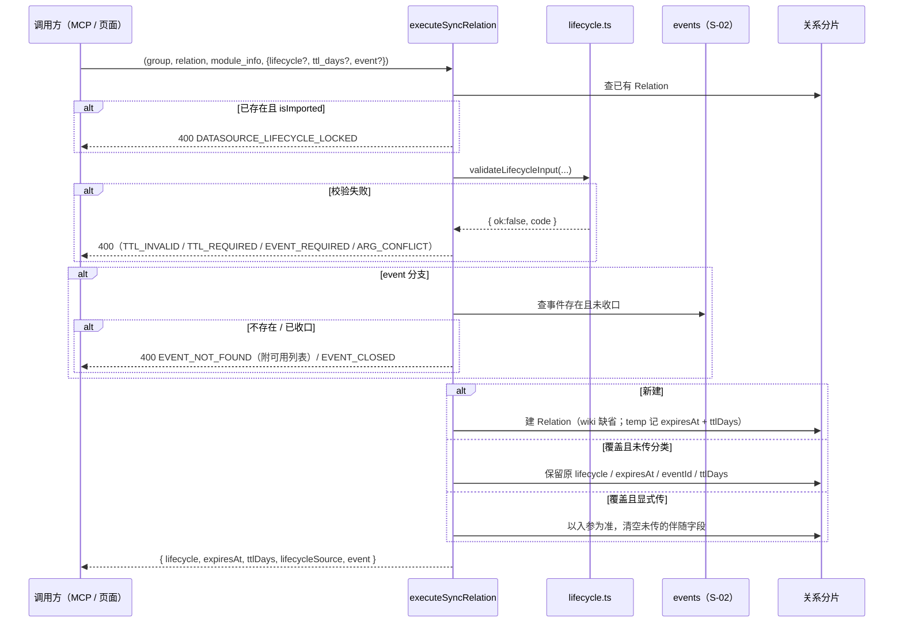

# S-01 分类字段与写入链路

> 父文档：`DESIGN.md`｜需求：`../requirement.md`（R1-R4、R37、R40、R41）｜依赖：无
> 状态：设计中 ｜ 更新：2026-11-15

## 1. 术语

| 术语 | 定义 |
|---|---|
| `lifecycle` | `wiki \| temp \| event`，缺省 `wiki`；界面上叫「分类」 |
| `expiresAt` | 毫秒时间戳，仅 `temp` 有值 |
| `eventId` | 仅 `event` 有值，指向 `EventRecord.id` |
| 不变量 | `temp` ⇔ `expiresAt` 必填；`event` ⇔ `eventId` 必填；`wiki` ⇔ 两者皆空 |
| `ttlDays` | **入参**用相对天数（1~365）；存储用绝对 `expiresAt` |
| `governance.json` | scope 级治理配置（预设 / group 默认 / 回收站设置），不在 `group-index.json` |

## 2. 现状（AS-IS）

| 位置 | 现状 | 问题 |
|---|---|---|
| `src/lib/scoring.ts:23-55` | `Relation` 只有 id/text/score/useCount/lastUsedTime/isImported/memoryId(s)/fts*/tags/groupSource | 无生命周期字段，清理无依据 |
| `src/sync-relation.ts:203-240` | 按 `text` 查已有；命中只改 `useCount/lastUsedTime/score`，未命中 `push` 新对象 | 无分类入参；覆盖分支原地改字段（**不会丢字段**，可利用） |
| `src/lib/import.ts:2356-2392` | `upsertRelation` 原地刷新 `isImported/memoryIds/sourcePath/tags` | **未清生命周期** → 手动 temp 文档被导入覆盖后仍是 temp + `isImported=true`，违反「数据源强制 wiki」 |
| `src/lib/mcp-tools/sync-relation.ts:7-17` | 参数：scope/group/relation/module_info/vector/tags | 无 `lifecycle` / `ttl_days` / `event` |
| `src/lib/mcp-tools/bulk-sync-relation.ts:11-19` | `items[]` 只有 group/relation/module_info/tags | 同上 |
| `src/lib/import.ts:703-715` | `handleDirectImport` = `ki import` / `/api/import/run` / 数据源同步三条链路共同入口，落 `isImported: true` | 按 R4 应强制 wiki，**不需要**分类入参 |
| `src/lib/group-cache.ts:106-112` | `GroupCacheDoc.hot_relations: Relation[]` | 新字段为可选，`version` 不用升 |
| `src/lib/store.ts:59-64` | `writeJson` 兜底补 `updatedAt` | 与本子需求无冲突 |

## 3. 方案（TO-BE）

### 3.1 字段与不变量

`Relation` 追加 3 个可选字段（`src/lib/scoring.ts`），不新增必填字段 ⇒ 旧数据零迁移。

写入时校验不变量，读时不修正（只诊断），避免"读路径偷偷改数据"。

### 3.2 读侧统一口径

新增 `src/lib/lifecycle.ts`（纯函数，无 I/O）：

```ts
export type LifecycleKind = 'wiki' | 'temp' | 'event';

/** 唯一缺省口径：所有消费方必须走它，禁止各处写 `rel.lifecycle ?? 'wiki'` */
export function resolveLifecycle(rel: Pick<Relation, 'lifecycle' | 'expiresAt' | 'eventId'>): {
  kind: LifecycleKind;
  expiresAt?: number;
  eventId?: string;
  /** 存储态与 kind 不一致时为 true（诊断用，不自动修） */
  inconsistent: boolean;
};

/** 写入校验：返回错误码或 null；不抛异常，由调用方决定 400 还是 assert */
export function validateLifecycleInput(input: {
  lifecycle?: LifecycleKind; ttlDays?: number; eventId?: string;
}): { ok: true; kind?: LifecycleKind; expiresAt?: number } | { ok: false; code: string; message: string };
```

`inconsistent` 的口径：`temp` 无 `expiresAt`、`event` 无 `eventId`、`wiki` 带残留字段。持久化数据出现该情况时由 S-04 的惰性扫描写诊断，不静默改分类。

### 3.3 写入链路：只有 2 条加参数（**修正需求 R2**）

| 链路 | 是否加分类入参 | 理由 |
|---|---|---|
| `ki_sync_relation`（`src/sync-relation.ts` + `src/lib/mcp-tools/sync-relation.ts`） | ✅ 加 | 人工/AI 主动写文档，需要分类 |
| `ki_bulk_sync_relation`（`executeBulkSyncRelation` + `items[]`） | ✅ 加 | 同上，按条独立 |
| `ki import` / `/api/import/run` / 数据源同步（`handleDirectImport`） | ❌ 不加 | `isImported: true` ⇒ R4 强制 wiki，加参数也无意义 |
| `/open/v1/import/upload`（`src/lib/mcp-http-api.ts:2416`） | ❌ 不加 | 第三方上传即导入，同上 |

> 需求 R2 原文写「4 条写入入口增加可选参数」与 R4/§4.4 冲突，本子需求按上表执行，已回写需求 R2。

### 3.4 新建 / 覆盖语义

```
写入 (scope, group, relation, { lifecycle?, ttlDays?, eventId? })
  │
  ├─ 文档不存在（新建）
  │    ├─ 未传任何分类 → wiki（source = 'fallback-wiki'）
  │    ├─ 传 lifecycle=temp + ttlDays → expiresAt = now + ttlDays*86400e3，
  │    │                                   同时记录 rel.ttlDays = ttlDays（供 S-04 恢复续期，见 B1）
  │    ├─ 传 lifecycle=event + eventId → 校验事件存在且未收口（S-02 提供查询）
  │    └─ 传 lifecycle=wiki → 清空 expiresAt / eventId
  │
  └─ 文档已存在（覆盖）
       ├─ 未传任何分类 → **保持原值**（source = 'preserved'）
       ├─ 显式传 lifecycle → 以入参为准，未传的伴随字段清空
       │    （显式 lifecycle=temp 但没传 ttlDays → 400 TTL_REQUIRED）
       └─ 数据源文档（isImported / sourcePath 非空）→ 400 DATASOURCE_LIFECYCLE_LOCKED
```

`lifecycleSource` 四值：`explicit` / `group-default` / `preserved` / `fallback-wiki`。返回值必须回显它，否则 AI 无法解释「我没传分类，为什么它是临时」。

### 3.5 数据源强制 wiki 的最后一道防线

`src/lib/import.ts::upsertRelation` 在 `isImported = true` 时**必须清空** `lifecycle / expiresAt / eventId`（两处：新建对象与已存在分支）。

不这样做的后果：UI 和 MCP 层都拦住了「数据源改分类」，但一次 `ki import` 覆盖同组同名文档就能写出 `isImported=true` + `lifecycle=temp` 的矛盾态，S-04 的惰性扫描会把它当临时文档删掉。

### 3.6 `governance.json`（预设 + group 默认 + 回收站设置）

新增 `src/lib/governance-store.ts`，读写 `{dataDir}/{scope}/governance.json`。

- 写操作必须在 `withScopeWriteLock` 内；落盘走 `writeJson`（原子写 + `updatedAt`）
- 文件不存在 ⇒ 返回内存缺省（`keepDays=7`、`expireAction='purge'`、无预设、无 group 默认），**不自动创建文件**
- 配置坏掉（`CORRUPT_JSON` / schema 不符）⇒ fail-loud，不静默回落缺省（否则回收站期限会莫名变 7 天）

预设有 3 个内置项（不可删、可改期限）：`长期保留(wiki)` / `临时 7 天` / `临时 30 天`。

### 3.7 `ki_lifecycle_list`（只读，归 S-06 注册）

返回：三档语义 + 期限选项（7/30/90 + 1~365）+ 预设列表 + `group` 有效默认。`group` 不传时不枚举全部组。

### 3.8 返回值扩展

`executeSyncRelation` 返回体追加 `lifecycle / expiresAt / ttlDays / lifecycleSource / event`；`visibility` 字段由 S-03 填充，S-01 预留位（不填则省略）。

### 3.9 惰性过期的边界（只定义契约，实现归 S-04）

S-01 只提供「找出已过期 temp 文档」的纯查询：

```ts
export function findExpiredTemp(relations: Relation[], now: number): Relation[];
```

触发时机（daemon 启动 / 每次删除或写入顺带扫）与「入 trash」动作属 S-04，**不引入定时器**。

### 3.10 写入流程（新建 vs 覆盖）



## 4. 数据模型

```ts
// src/lib/scoring.ts —— Relation 追加（其余字段不动）
interface Relation {
  // …现有字段…
  /** 文档分类；缺省 wiki。存储层不做缺省填充，读取统一走 resolveLifecycle() */
  lifecycle?: 'wiki' | 'temp' | 'event';
  /** 仅 temp：毫秒时间戳；写入时由 ttlDays 换算 */
  expiresAt?: number;
  /** 仅 event：指向 EventRecord.id */
  eventId?: string;
  /** 仅 temp：写入时记录的原始期限天数（1~365）。
   *  不进对外契约，专供 S-04 进回收站时快照「原期限长度」——
   *  仅凭 expiresAt 无法反推期限（过期瞬间 expiresAt-now <= 0） */
  ttlDays?: number;
}

// src/lib/governance-store.ts —— 新增
interface GovernanceConfig {
  version: 1;
  scope: string;
  /** 分类预设；页面侧便利，MCP 不接受 preset 入参（Q7） */
  lifecyclePresets: LifecyclePreset[];
  /** key = 完整 group 路径；只支持 wiki/temp，不支持 event（事件必须显式绑定） */
  groupDefaults: Record<string, { kind: 'wiki' | 'temp'; ttlDays?: number }>;
  trash: { keepDays: 3 | 7 | 14 | 30; expireAction: 'purge' | 'notify' };
  updatedAt: string;
}

interface LifecyclePreset {
  id: string;              // preset_<ulid>
  name: string;            // scope 内唯一，用户命名
  kind: 'wiki' | 'temp';
  ttlDays?: number;        // kind=temp 必填，1~365
  builtin?: boolean;       // 内置 3 项不可删
}
```

不变量（写入时校验）：

| 条件 | 结果 |
|---|---|
| `kind='temp'` 且 `ttlDays` 缺失或 ∉ [1,365] | 400 `TTL_INVALID` |
| `kind='wiki'` 且带 `ttlDays` | 400 `LIFECYCLE_ARG_CONFLICT` |
| `groupDefaults[g].kind='event'` | 400 `GROUP_DEFAULT_EVENT_UNSUPPORTED` |
| 预设 `name` 重复 | 400 `PRESET_NAME_TAKEN` |

## 5. 接口设计

### 5.1 `ki_sync_relation`（扩展）

```ts
{
  scope?: string; group: string; relation: string; module_info: string;
  vector?: boolean; tags?: string;
  // 新增
  lifecycle?: 'wiki' | 'temp' | 'event';
  ttl_days?: number;   // 仅 temp，1~365 整数
  event?: string;      // 仅 event，evt_ id 或 #3
}
```

```json
// Demo 返回示例（仅示意格式）
{
  "ok": true,
  "relation": "登录页白屏排查记录",
  "group": "错误库/Web前端界面",
  "lifecycle": "temp",
  "expiresAt": 1769212800000,
  "ttlDays": 30,
  "lifecycleSource": "explicit",
  "event": null,
  "hint": "临时文档将在 2026-12-15 到期后进入回收站（保留 7 天）"
}
```

异常（对外暴露，MCP 侧转 `isError: true` + 原文）：

| code | 场景 | HTTP |
|---|---|---|
| `LIFECYCLE_INVALID` | `lifecycle` 非三值 | 400 |
| `TTL_INVALID` | `ttl_days` 非整数或越界 | 400 |
| `TTL_REQUIRED` | 显式 `temp` 但无 `ttl_days` | 400 |
| `EVENT_REQUIRED` | 显式 `event` 但无 `event` | 400 |
| `EVENT_NOT_FOUND` | 事件不存在（附可用列表） | 400 |
| `EVENT_CLOSED` | 事件已收口 | 400 |
| `LIFECYCLE_ARG_CONFLICT` | `wiki` 带 `ttl_days` / `event` | 400 |
| `DATASOURCE_LIFECYCLE_LOCKED` | 数据源文档改分类 | 400 |

### 5.2 `ki_bulk_sync_relation`（扩展）

`items[]` 每项追加同样的 3 个可选字段；**逐条独立校验**，单条失败不影响其他条（沿用现有 `failed` 计数与明细）。

### 5.3 `ki_lifecycle_list`（新）

```ts
{ scope?: string; group?: string }
```

```json
// Demo 返回示例（仅示意格式）
{
  "ok": true,
  "scope": "kisearch-memory",
  "group": "错误库/Web前端界面",
  "effectiveDefault": { "kind": "temp", "ttlDays": 30, "source": "group" },
  "kinds": [
    { "kind": "wiki", "label": "wiki", "meaning": "永久保留" },
    { "kind": "temp", "label": "临时", "ttlOptions": [7, 30, 90], "min": 1, "max": 365 },
    { "kind": "event", "label": "事件", "requires": "event", "hint": "用 ki_event_list 查可绑定事件" }
  ],
  "presets": [{ "id": "preset_01J…", "name": "周报临时", "kind": "temp", "ttlDays": 7, "builtin": false }]
}
```

`effectiveDefault.source`：`group` / `fallback-wiki`。不传 `group` 时该字段为 `fallback-wiki`，且不返回 `groupDefaults` 全表。

## 6. 影响范围

```
src/
├─ lib/
│  ├─ scoring.ts                    # [修改] Relation 追加 3 字段
│  ├─ lifecycle.ts                  # [新增] resolveLifecycle / validateLifecycleInput / findExpiredTemp
│  ├─ governance-store.ts           # [新增] governance.json 读写 + 缺省 + 校验
│  ├─ import.ts                     # [修改] upsertRelation 清空生命周期（数据源强制 wiki）
│  └─ group-cache.ts                # [只读] 分片 schema 不变（可选字段天然兼容）
├─ sync-relation.ts                 # [修改] 单条/批量写入的入参、校验、返回值
├─ lib/mcp-tools/sync-relation.ts   # [修改] 工具 schema + 透传
├─ lib/mcp-tools/bulk-sync-relation.ts # [修改] items schema + 透传
└─ lib/mcp-tools/lifecycle-list.ts  # [新增] ki_lifecycle_list（注册归 S-06）
test/
└─ lifecycle-sr01.test.ts           # [新增] 字段/校验/覆盖语义/导入防线
```

`export` / `restore` / `rebuild-vector` 由 S-06 统一改（本子需求只保证字段存在于分片）。

## 7. 关键决策点

| # | 决策 | 被否决方案 | 否决理由 |
|---|---|---|---|
| 1 | 入参用 `ttl_days` 相对天数 | `expires_at` 绝对时间戳 | AI 需自算时间戳，时区/时钟漂移会写错；「30 天」是用户语义 |
| 2 | 3 个可选字段，`version` 不升 | 升 `version: 2` + 迁移脚本 | 旧数据零迁移；读侧统一 `resolveLifecycle` 已足够，升级反而要求全量重写 |
| 3 | 缺省不在读路径填充 | 读时 `rel.lifecycle ??= 'wiki'` 并写回 | 读路径写盘会污染 WAL 与并发语义；且 91 篇存量会被无意义改写 |
| 4 | 导入链路不加参数 | 4 条链路都加 | 导入即 `isImported`，R4 强制 wiki，加了也只能被拒 |
| 5 | groupDefaults 不支持 `event` | 支持整组绑事件 | 整组自动挂到某事件 = 一次事件收口批量删一整个组的文档，风险不可接受 |
| 6 | 预设不开放给 AI | 开放 `preset` 入参 | AI 直接传 `ttl_days` 更准；预设名是私有语义，猜不中反而多一条失败路径 |

重新评估触发条件：若季度内出现 ≥3 次「AI 未传分类且 group 未配默认」导致的 wiki 污染投诉，则把 `groupDefaults` 提升为必配项（而非可选）。

## 8. 待定问题

| # | 问题 | 影响 | 建议 |
|---|---|---|---|
| 2 | `groupDefaults` 的 key 用完整路径还是前缀匹配 | 影响配置灵活性 | 完整路径精确匹配（可预测）；前缀继承留待后续 |
| 3 | 僵尸清单（Q4）是否并入本子需求 | 影响工作量 | 不进；Q4 只做「读时补 wiki」，清单一期后单独排 |
