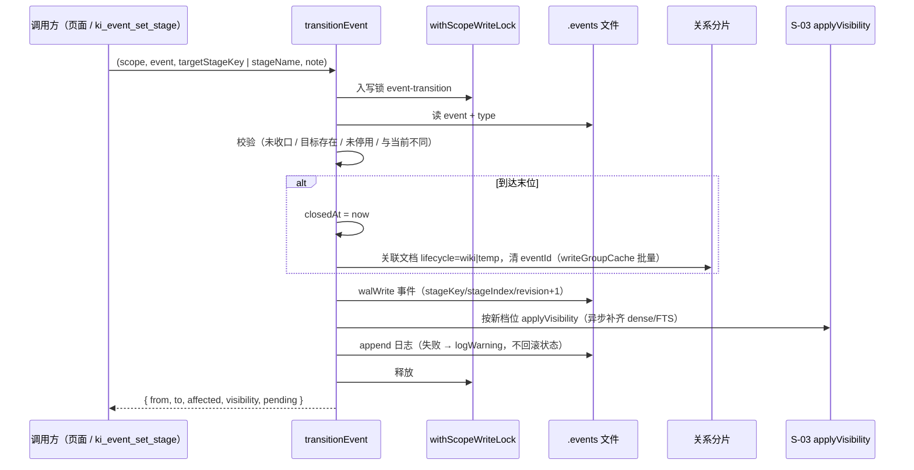
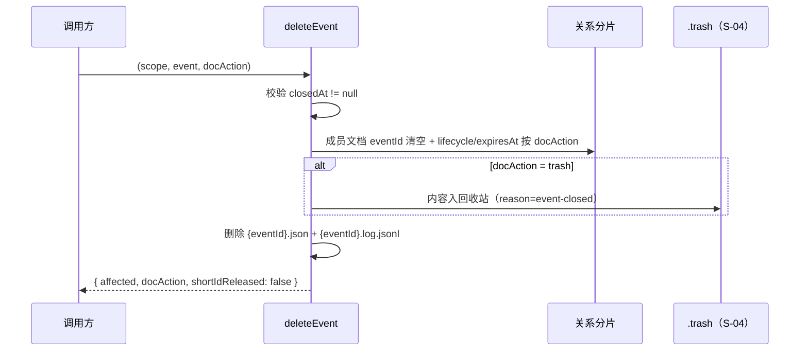

# S-02 事件与事件类型

> 父文档：`DESIGN.md`｜需求：`../requirement.md`（R8-R19、R39）｜依赖：S-01
> 状态：设计中 ｜ 更新：2026-11-15

## 1. 术语

| 术语 | 定义 |
|---|---|
| 事件（Event） | 一批文档的处理链容器；`Relation.eventId` 反向聚合成员 |
| 事件类型（EventType） | 阶段模板；`stages[]` 有序，末位为终态 |
| `stageKey` | **阶段的稳定标识**（`st_<n>`），创建时生成，永不改变；拖动排序 / 改名都不动它 |
| `closedAt` | 收口的**唯一权威**；非空即已收口，与「是否停在末位」无关 |
| `terminalAction` | `keep \| trash`，类型级字段；收口时文档去向 |
| `fallbackDays` | 未收口兜底天数，默认 90，`null` 关闭 |
| `shortId` | 人类可读编号 `#3`，per-scope 单调递增，**删除后不复用** |

## 2. 现状（AS-IS）

| 位置 | 现状 | 缺口 |
|---|---|---|
| `src/lib/scoring.ts:23-55` | `Relation` 无 `eventId` | 无法把文档挂到事件 |
| `src/` 全局 | 无任何 Event / EventType 实体、无 `.events/` 目录 | 事件从零建 |
| `src/lib/scope.ts:90` | `getKbDir(scope)` 给出 scope 数据目录 | 事件文件可直接落 `${getKbDir}/.events/` |
| `src/lib/wal.ts:134` | `walWrite(filePath, data)` 单文件原子写 | 事件/类型文件用它 |
| `src/lib/scope-write-lock.ts:93` | `withScopeWriteLock(scope, operation, run)` | 事件写操作入锁 |
| `src/lib/group-cache.ts:494-501` | 分片写走 `writeGroupCache` 三步曲（bump → walWrite → 失效） | 文档生命周期回写必须走它 |
| `src/lib/mcp-tools/*` | 无事件工具 | 3 只读 + 1 写由 S-06 注册 |

## 3. 方案（TO-BE）

### 3.1 实体关系

```
EventTypeRecord (scope 级, _types.json)
  ├─ stages[]  { key, name, originalName?, visibility, disabled }
  ├─ terminalAction  keep | trash
  └─ fallbackDays    90 | null
        ▲
        │ typeId
EventRecord ({eventId}.json)          Relation.eventId ──┐
  ├─ id / shortId / title / typeId                      │ 反向聚合
  ├─ stageKey  ← 稳定，不随拖动漂移                       │
  ├─ closedAt  ← 收口唯一权威                            │
  └─ revision                                            │
        │                                                │
        └────────────────────────────────────────────────┘
EventStageLog ({eventId}.log.jsonl)  ← 追加写，删除事件时一并删
```

### 3.2 存储与并发

```
{dataDir}/{scope}/.events/
├─ _meta.json          { version, nextShortId }            # walWrite
├─ _types.json         { version, revision, types: [...] }  # walWrite
├─ {eventId}.json      EventRecord                          # walWrite
└─ {eventId}.log.jsonl EventStageLog 逐行                  # appendFileSync
```

- 目录不存在 ⇒ 首次写入时创建；**读路径不创建目录**
- 所有写操作进 `withScopeWriteLock(scope, 'event-<action>')`；跨 scope 由 `OperationCoordinator` 排队（沿用 `delete-relation` 的写法）
- 事件 id：`evt_${Date.now().toString(36)}_${随机 6 位}`（项目无 ulid 依赖，不引新包）
- `shortId`：`#${_meta.nextShortId}`，自增后立即 walWrite；**号不回收**，删除事件留下的空号不复用

### 3.3 阶段标识：`stageKey`（修正需求 §9.2）

需求把 `EventRecord.stageIndex` 与「阶段可拖动排序」放在一起，会出问题：

```
拖动前： [排查中(0), 已定位(1), 修复中(2), 已关闭(3)]
事件 #3 停在 stageIndex=1 → 「已定位」
拖动后： [排查中(0), 修复中(1), 已定位(2), 已关闭(3)]
事件 #3 仍是 stageIndex=1 → 变成「修复中」   ← 没人操作，状态自己变了
```

所以：

| 字段 | 角色 |
|---|---|
| `stages[].key` | 身份。`st_1`…`st_n`，随类型创建生成，**永不修改** |
| `EventRecord.stageKey` | 事件当前位置（唯一持久化依据） |
| `EventRecord.stageIndex` | 展示用冗余，随类型顺序重算；**读时以 `stageKey` 反查 index** |

改名（Q6）：只改 `name`，`originalName` 保留首次名称用于历史展示兜底；`key` 不动。

### 3.4 收口判定

`closedAt != null` 是唯一权威。原因：终态位置随拖动变化，用「是否停在末位」推导会让已收口事件在拖动后变成"未收口"，进而允许删除——语义错误。

到达终态的动作（单一用例 `transitionEvent`）：

> **事务边界（B/S1）**：`closedAt` 与事件文件用**一次 walWrite** 先落盘，随后才批量回写文档的 `lifecycle/eventId`。
> 文档回写失败时事件不回滚，失败项记入 `.visibility-failures.json` 并通过返回值 `docsPending` 暴露，由扫描器补偿。
> 反序（先改文档再写事件）会出现「文档已按终态处理、事件仍未收口」，无法自愈。

```
target.stageKey === 末位阶段.key  → closedAt = now
                                  → 按 type.terminalAction 处理关联文档
                                        keep  : lifecycle=wiki, 清 eventId/expiresAt
                                        trash : lifecycle=temp, expiresAt=now+7d,
                                                清 eventId, 内容入 .trash（S-04）
                                  → 触发 S-03 applyVisibility
```

**已收口事件禁止流转**（400 `EVENT_CLOSED`）。页面若需回退，走「重新打开事件」：置 `closedAt=null`，但**不自动恢复文档绑定**（文档已按终态动作处理，可能已在回收站）。

重开后**成员文档为 0 篇**（`eventId` 已在收口时清空），接口返回 `membersRestored: 0`，页面必须明示「事件已重开，成员需重新绑定」，否则用户会以为数据丢失。

### 3.5 阶段约束

| 操作 | 已存在类型 | 新建草稿 |
|---|---|---|
| 追加阶段 | ✅ 允许（追加到末位） | ✅ |
| 删除阶段 | ❌ 400 `STAGE_DELETE_FORBIDDEN` | ✅ |
| 改名 | ✅（`originalName` 兜底） | ✅ |
| 改可见性 | ✅（触发 S-03 批量重算该阶段文档） | ✅ |
| 停用 | ✅（末位除外） | — |
| 拖动排序 | ✅（不影响已有事件，见 3.3） | ✅ |
| 停用末位阶段 | ❌ 400 `TERMINAL_STAGE_CANNOT_DISABLE` | — |

末位不可停用：停用等于"永远进不去"，事件永远收不了口，兜底期限会被迫代偿。

### 3.6 `terminalAction` 类型级（修正需求冲突）

`EventTypeRecord.terminalAction`，**不挂阶段**。阶段表 UI 不再有「进入时动作」列（S-07 按此实现，demo 现状需改）。

内置 3 类型的取值（对齐需求 §5.2 示例）：

| 类型 | 阶段链（可见性） | `terminalAction` |
|---|---|---|
| bug 排查 | 排查中(hidden) → 已定位(fts-only) → 修复中(fts-only) → 已关闭(full) | `keep` |
| 性能优化 | 分析中(hidden) → 优化中(fts-only) → 已验证(fts-only) → 已完成(full) | `trash` |
| 需求实现 | 实施中(hidden) → 联调中(fts-only) → 已上线(full) | `keep` |

### 3.7 未收口兜底 `fallbackDays`

- 判定：`closedAt == null && now - createdAt > fallbackDays*86400e3`
- 行为：关联文档进回收站（`reason='event-expired'`）+ 事件列表标红「已超兜底期限」；**事件本身不改状态**
- 扫描：S-04 的惰性扫描器负责（daemon 启动 + 每次删除/写入顺带扫），本子需求只提供纯查询：

```ts
export function findOverdueEvents(events: EventRecord[], types: EventTypeRecord[], now: number): OverdueEvent[];
```

- 文档侧动作（`lifecycle=temp` + `expiresAt=now+7d` + 清 `eventId`）与「事件收口走 trash」共用同一段代码，避免两套实现漂移。

### 3.8 事件删除

前置：`closedAt != null`，否则 400 `EVENT_NOT_CLOSED`（按钮在页面侧同样 disabled）。

必选文档去向（`docAction: 'wiki' | 'trash'`）：

| 去向 | `lifecycle` | `eventId` | `expiresAt` | trash `reason` |
|---|---|---|---|---|
| `wiki`（默认） | `wiki` | 清空 | 清空 | — |
| `trash` | `temp` | 清空 | `now + 7d` | `event-closed` |

两种都必须清 `eventId`（否则悬空引用）。删除后：事件文件 + 日志文件一并删除，`shortId` 不复用。

### 3.9 类型删除

内置（`builtin: true`）不可删；有事件在用（`typeId` 被引用）不可删。两条都在 API 层拦（400 `TYPE_BUILTIN` / `TYPE_IN_USE`），页面侧同时禁用按钮并外显原因。

## 4. 数据模型

```ts
// src/lib/events/types.ts（新增）
export type Visibility = 'full' | 'fts-only' | 'hidden';

export interface EventStage {
  key: string;              // st_1 … 稳定标识
  name: string;             // 可改
  originalName?: string;    // 首次名称，改名后保留
  visibility: Visibility;
  disabled?: boolean;       // 停用：不可进入；末位不可停用
}

export interface EventTypeRecord {
  id: string;               // et_<n>
  scope: string;
  name: string;
  builtin: boolean;
  stages: EventStage[];     // 有序，末位 = 终态
  terminalAction: 'keep' | 'trash';   // 类型级
  fallbackDays: number | null;        // 90 默认；null 关闭
  revision: number;                   // 乐观锁（N12）
  createdAt: number;
  updatedAt: number;
}

export interface EventRecord {
  id: string;               // evt_<base36>_<rand>
  shortId: number;          // 3 → 展示 #3；不复用
  scope: string;
  title: string;
  typeId: string;
  stageKey: string;         // 唯一持久化位置依据
  stageIndex: number;       // 冗余，读时按 stageKey 反查重算
  closedAt: number | null;  // 收口唯一权威
  revision: number;
  createdAt: number;
  updatedAt: number;
}

export interface EventStageLog {
  eventId: string;
  fromKey: string | null;   // null = 创建
  toKey: string;
  at: number;
  by: 'user' | 'ai';
  note?: string;
  /** 状态写失败时为 'aborted'，仅诊断用 */
  status?: 'committed' | 'aborted';
}

// _types.json
interface EventTypesDoc { version: 1; revision: number; types: EventTypeRecord[] }
// _meta.json
interface EventsMeta { version: 1; nextShortId: number }
```

不变量：

| 条件 | 结果 |
|---|---|
| `stages.length < 2` | 400 `TYPE_STAGES_TOO_FEW` |
| 末位 `disabled=true` | 400 `TERMINAL_STAGE_CANNOT_DISABLE` |
| `stageKey` 不在类型 `stages` 中 | 读时诊断 `EVENT_STAGE_ORPHANED`，按 `wiki` 处理并报诊断（N13） |
| `typeId` 指向已不存在类型 | 同上（N3） |

## 5. 时序图

### 5.1 流转（含收口）



日志在状态之后追加：日志是审计辅助，丢一条比"状态回滚到未流转但文档已改"更安全（后者会造成文档与事件不一致）。

### 5.2 删除事件



## 6. 接口设计

HTTP 与 MCP 的注册归 S-06，本子需求给契约：

```ts
// 类型
GET    /api/governance/event-types                    → EventTypeRecord[]
POST   /api/governance/event-types                    { name, stages?, terminalAction, fallbackDays }
PATCH  /api/governance/event-types/:id                { revision, name?, stages?, terminalAction?, fallbackDays? }
DELETE /api/governance/event-types/:id                { revision }

// 事件
GET    /api/governance/events                         ?status&type&q&limit&offset&docsPreviewLimit
POST   /api/governance/events                         { title, typeId, docs?: [] }
PATCH  /api/governance/events/:id                     { revision, title? }
POST   /api/governance/events/:id/transition          { targetStageKey, note? }
DELETE /api/governance/events/:id                     { docAction }
POST   /api/governance/events/:id/reopen              {}
```

```json
// Demo 返回示例（仅示意格式）
{
  "ok": true,
  "event": { "id": "evt_m3k2_9f1a2c", "shortId": "#3", "title": "登录页白屏" },
  "from": { "key": "st_2", "name": "已定位", "index": 1 },
  "to": { "key": "st_3", "name": "修复中", "index": 2 },
  "closed": false,
  "affected": { "docs": 3 },
  "visibility": { "mode": "fts-only", "dense": false, "fts": true },
  "pending": [],
  "logWarning": null
}
```

异常（对外暴露）：

| code | 场景 | HTTP |
|---|---|---|
| `EVENT_NOT_FOUND` / `TYPE_NOT_FOUND` | id 不存在 | 404 |
| `EVENT_CLOSED` | 已收口仍流转 | 400 |
| `STAGE_NOT_FOUND` | 目标 key/名称不存在 | 400（附可选阶段） |
| `STAGE_DISABLED` | 目标阶段已停用 | 400 |
| `STAGE_UNCHANGED` | 目标 = 当前 | 400 |
| `EVENT_NOT_CLOSED` | 未收口就删除 | 400 |
| `DOC_ACTION_REQUIRED` | 删除未带去向 | 400 |
| `TYPE_BUILTIN` / `TYPE_IN_USE` | 删内置 / 在用类型 | 400 |
| `STAGE_DELETE_FORBIDDEN` | 删除已存在类型的阶段 | 400 |
| `TERMINAL_STAGE_CANNOT_DISABLE` | 停用末位 | 400 |
| `REVISION_CONFLICT` | 乐观锁不匹配 | 409 |
| `EVENT_STAGE_ORPHANED` | 悬空引用（读时诊断） | 200 + `diagnostics[]` |

## 7. 关键决策点

| # | 决策 | 被否决方案 | 否决理由 |
|---|---|---|---|
| 1 | 事件存 `stageKey`，`stageIndex` 只做冗余 | 存 `stageIndex`（需求 §9.2 原方案） | 拖动排序会让所有事件集体漂移一个阶段（§3.3 示例），且无人操作 |
| 2 | 收口以 `closedAt` 为唯一权威 | 用 `stageIndex === stages.length-1` 推导 | 拖动后已收口事件会"变回未收口"，从而可被删除 |
| 3 | 末位阶段不可停用 | 允许停用，收口改为"最后一个未停用" | 终态定义会被停用状态污染，同一类型出现两种终态语义 |
| 4 | 已收口事件禁止流转，回退走"重新打开"且不恢复文档绑定 | 允许直接回退并自动反向恢复文档 | 文档可能已在回收站、索引已摘；"反向恢复"要重建索引且可能文档已物理删除，不可逆 |
| 5 | 状态先写、日志后追加，日志失败不回滚 | 日志先写 | 日志先写会产生"日志说有、状态说没有"的假记录，比缺一条日志更难排查 |
| 6 | 事件 id 自建（时间戳 + 随机） | 引入 ulid 依赖 | 只是本地唯一键，无需时间可排序的全局唯一性，不引新依赖 |
| 7 | `shortId` 不复用 | 删除后回收编号 | 编号会出现在 AI 参数与聊天记录里，复用会绑错事件 |

重新评估触发条件：若单 scope 事件数 > 500，`_types.json` 单文件读全量与 `.events/*.json` 逐文件读会成为瓶颈 → 改为按状态分目录 + 索引文件。

## 8. 影响范围

```
src/lib/events/
├─ types.ts            # [新增] EventRecord / EventTypeRecord / EventStage / EventStageLog
├─ store.ts            # [新增] _types.json / _meta.json / {eventId}.json 读写（walWrite + 写锁）
├─ type-service.ts     # [新增] 类型 CRUD + 阶段约束 + 内置 3 类型初始化
├─ event-service.ts    # [新增] 事件 CRUD + transitionEvent + deleteEvent + reopen
├─ stage-log.ts        # [新增] jsonl 追加 + 读取
└─ builtin-types.ts    # [新增] 3 个内置类型定义

src/lib/
├─ lifecycle.ts        # [依赖] resolveLifecycle / validateLifecycleInput（S-01）
├─ group-cache.ts      # [只读] 文档批量回写走 writeGroupCache
└─ mcp-tools/event.ts  # [新增于 S-06] ki_event_list / ki_event_type_list / ki_event_set_stage

test/
└─ events-sr02.test.ts # [新增] 阶段约束/收口/删除去向/兜底/乐观锁
```

## 9. 待定问题

| # | 问题 | 影响 | 建议 |
|---|---|---|---|
| 1 | 一个文档能否同时属于多个事件 | 数据模型（`eventId` 单值） | 不能，`Relation.eventId` 单值；多归属留 V2 |
| 2 | 事件标题是否唯一 | 列表可读性 | 不唯一（同 scope 可有同名事件），靠 `shortId` 区分 |
| 3 | 类型 `stages` 上限 | 拖拽可用性 | 12 个（页面 chip 换行仍可读）；超出 400 `TYPE_STAGES_TOO_MANY` |
| 4 | `fallbackDays` 到期扫描频率 | 文档滞留时长 | 惰性：daemon 启动 + 每次写/删顺带；无定时器（沿用需求 N7） |
