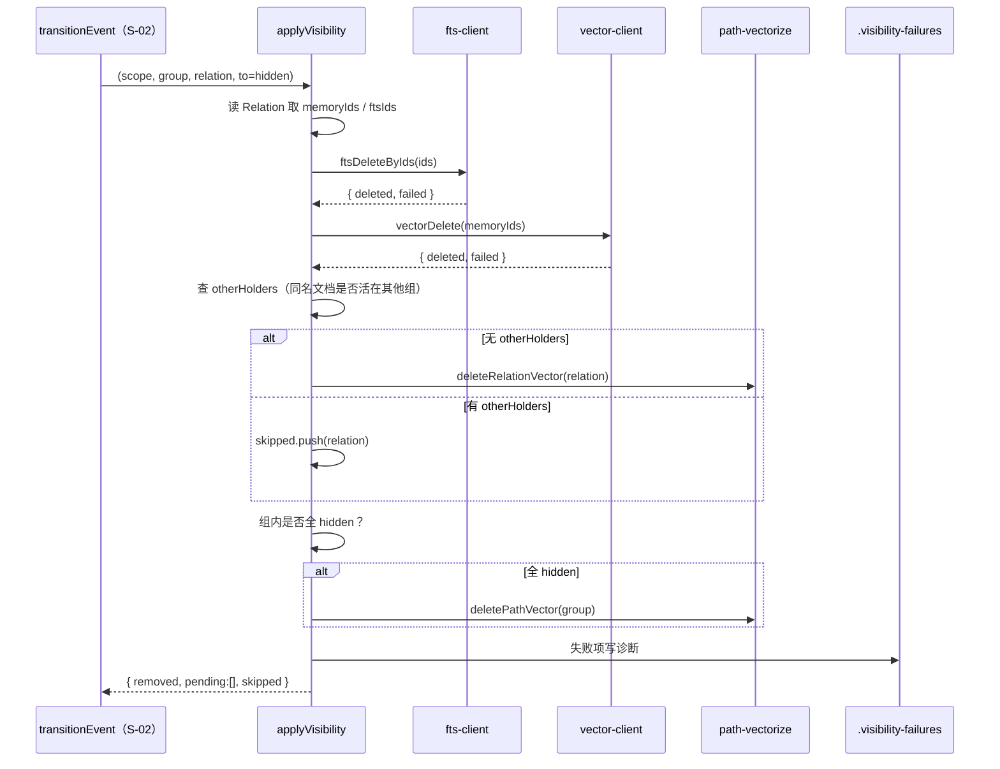
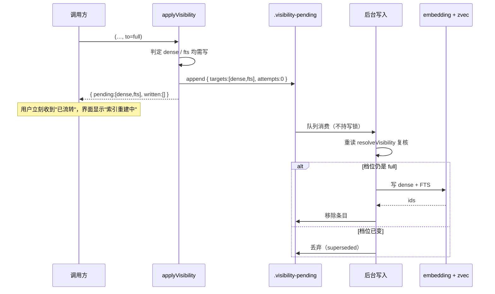

# S-03 索引可见性（三档）

> 父文档：`DESIGN.md`｜需求：`../requirement.md`（R10-R12、R14）｜依赖：S-01、S-02
> 状态：设计中 ｜ 更新：2026-11-15

## 1. 术语

| 术语 | 定义 |
|---|---|
| `visibility` | `full`（语义+全文）/ `fts-only`（仅全文）/ `hidden`（都不可检索），三档 |
| 四类索引 | dense（内容向量）/ FTS / `ki-relation`（关系名向量）/ `ki-path`（group 路径向量） |
| 文档级索引 | dense / FTS / `ki-relation` —— 按文档摘写 |
| **组级索引** | `ki-path` —— 每个 group 一条，**不能按文档摘** |
| `pending` | 已声明目标档位、但索引尚未补齐的待办项（持久化） |

## 2. 现状（AS-IS）

| 位置 | 现状 | 与三档的关系 |
|---|---|---|
| `src/lib/vector-client.ts:1523` | `vectorDelete({ scope, ids })` 删 dense | 摘 dense 的现成原语 |
| `src/lib/fts-client.ts:214` | `ftsDeleteByIds({ scope, ids })` 删 FTS | 摘 FTS 的现成原语 |
| `src/lib/path-vectorize.ts:177` | `deletePathVector(...)` 删 `ki-relation` + `ki-path` | **同时处理两类**，粒度需拆开（见 §3.4） |
| `src/delete-relation.ts:289-308` | 删关系前查 `otherHolders`（同名文档仍在其他组则保留路径向量） | 跨组共享保护的现成实现，必须复用 |
| `src/lib/rebuild-vector.ts:278` | `collectContentEntries` 按目录扫 `index.json`，**无 lifecycle 概念** | 重建会把 hidden 文档全部重建成可检索 |
| `src/lib/relation-edit-publish.ts:242-255` | 发布编辑时按 mode 就地重写 `memoryIds` 或 `ftsIds` | **绕过档位**：hidden 文档编辑一次就被重新索引 |
| `src/sync-relation.ts:1302` | `params.vector !== false` 时写 dense | 覆盖写同样绕过档位 |
| `src/lib/fts-client.ts` / `vector-client.ts` | 无"按档位写入"的统一入口 | 三档能力需要新建 |

## 3. 方案（TO-BE）

### 3.1 唯一出口

新增 `src/lib/visibility-index.ts`，**禁止**其他模块直接组合 `vectorDelete` + `ftsDeleteByIds` 实现档位切换：

```ts
export type Visibility = 'full' | 'fts-only' | 'hidden';
export type IndexKind = 'dense' | 'fts' | 'relation' | 'path';

export interface ApplyResult {
  relation: string;
  from: Visibility;
  to: Visibility;
  removed: IndexKind[];      // 本次同步摘除
  written: IndexKind[];      // 本次已写入
  pending: IndexKind[];      // 异步待补（已落 pending 队列）
  skipped: { kind: IndexKind; reason: string }[];
}

/** 单文档档位切换（调用方持 scope 写锁） */
export async function applyVisibility(args: {
  scope: string; group: string; relation: string;
  to: Visibility;
}): Promise<ApplyResult>;

/** 按当前阶段档位重建（rebuild-vector / restore 用） */
export async function rebuildVisibility(args: {
  scope: string;
  filter?: { group?: string; relations?: string[] };
}): Promise<{ applied: number; skipped: number }>;

/** 纯查询：文档当前应处的档位（不碰索引） */
export function resolveVisibility(rel: Relation, events: EventRecord[], types: EventTypeRecord[]):
  { mode: Visibility; source: 'lifecycle' | 'event-stage' };
```

档位来源：`lifecycle !== 'event'` → `full`；`event` → 按 `eventId` 查事件的 `stageKey` → 类型 `stages[key].visibility`。事件/类型缺失 → `full`（N13，按 wiki 处理）并在返回里标 `warning`。

### 3.2 3×3 转换矩阵

| from \ to | `full` | `fts-only` | `hidden` |
|---|---|---|---|
| `full` | — | **摘 dense**（同步） | **摘 dense + FTS + ki-relation**（同步） |
| `fts-only` | **写 dense**（异步）+ 保留 FTS | — | **摘 FTS + ki-relation**（同步） |
| `hidden` | **写 dense + FTS + ki-relation**（异步） | **写 FTS + ki-relation**（异步） | — |

规则：

- **摘除全部同步**（用户点完"流转"立刻搜不到，语义正确优于响应速度）
- **写入全部异步**（要 embed，秒级/篇），同步段落只做"Acknowledge + 入 pending 队列"
- `ki-path` **不随文档档位变化**（组级），只在"整组文档都 hidden"时才摘（§3.4）
- `fts-only → full` 时若旧 FTS 仍在（REQ-20261113-002 的残留场景），走 `delete-after-write`：dense 写成功后再删旧 FTS

### 3.3 摘除顺序与失败处理

```
1. FTS（失败 → 记 failed，继续）
2. dense（失败 → 记 failed，继续）
3. ki-relation（有 otherHolders → skipped）
4. 汇总：任一 failed → 返回 ok=false + failedKinds[]，**档位仍标记为 to**
   （宁可"声明已隐藏但索引残留"被诊断发现，也不要"声明未隐藏但索引已摘"导致搜不到）
```

失败项回写 `.visibility-pending.json`（`attempts+1`），由 `visibility-queue` 消费重试；`attempts >= 3` 才转入 `{scope}/.visibility-failures.json` 并标 blocked。**S-04 的惰性扫描只处理 trash 与过期文档，不承担索引重试**——两个扫描器抢同一份数据会导致状态互踩。

### 3.4 `ki-path` 是组级索引，不能按文档摘

`ki-path` 的 docId 由 group 路径决定，一组一条。若按文档摘：

```
组「错误库/Web前端」有 3 篇文档，其中 1 篇 hidden
→ 若摘掉该组的 ki-path，另外 2 篇的路径检索也失效（它们明明是 full）
```

规则：

| 条件 | 动作 |
|---|---|
| group 内**存在**至少一篇非 `hidden` 文档 | 保留 `ki-path`，返回 `skipped: [{kind:'path', reason:'group-has-visible-docs'}]` |
| group 内**全部**文档 `hidden` | 摘 `ki-path` |
| group 内文档全部删除 | 由 S-04 删除链路摘（不在本子需求） |

`ki-relation` 按文档摘，但**必须先查 `otherHolders`**（`src/delete-relation.ts:289-308` 同源逻辑）：同名文档仍活在别的组 → 保留并记 `skipped`。

### 3.5 三处绕过防线（必须一并改）

| 位置 | 现状行为 | 必须改为 |
|---|---|---|
| `src/lib/rebuild-vector.ts::collectContentEntries` 后续 | 全量重建 dense/FTS/关系/路径 | 先调 `resolveVisibility`，`hidden` 跳过；`fts-only` 只建 FTS |
| `src/lib/relation-edit-publish.ts::runFinish` | 按 mode 直接写 dense 或 FTS | 写完按 `resolveVisibility` 复核；档位为 `hidden` 则不写并立即摘 |
| `src/sync-relation.ts` 写入段 | `vector !== false` 就写 dense | 覆盖写时保留原 `lifecycle/eventId`（S-01），并按 `resolveVisibility` 决定 dens/FTS 写入 |

漏掉任何一处，都会出现"阶段说不可检索、实际搜得到"。

### 3.6 `pending` 的生命周期（跨事件累积状态）

```text
① 何时开始累积    applyVisibility 判定需要写入（dense / fts）时，写一条 pending
② 累积期存哪      {dataDir}/{scope}/.visibility-pending.json（落盘，daemon 重启不丢）
③ 何时并入主状态  异步写入成功后移除该条；写入失败累计 attempts+1，保留
④ 中途终止处理    daemon 启动时扫该文件恢复任务；attempts >= 3 → 转 .visibility-failures.json
                 并标记 blocked（不再自动重试，UI 显示"索引未切换"，需人工重试）
```

pending 条目结构：

```ts
interface PendingIndexWrite {
  relation: string;
  group: string;
  target: Visibility;
  kinds: IndexKind[];       // 待写
  createdAt: number;
  attempts: number;
  lastError?: string;
}
```

**不做**"内存里挂着"，否则 daemon 重启后 pending 丢失，文档永久停在"声明 hidden 但索引还在"的半态。

### 3.7 与写锁 / 并发的关系

- `applyVisibility` 要求调用方已持 `withScopeWriteLock`（与删除链路一致），本函数不自己加锁
- 异步写入段另起任务，**不持写锁**（避免长事务阻塞）；写前重读 `resolveVisibility` 复核，若档位已再次变化则丢弃本次写入（返回 `superseded`）
- 同一文档的 pending 条目按 `(scope, group, relation)` 去重，后者覆盖前者（只保留最新目标档位）

## 4. 数据模型

```ts
// src/lib/visibility-index.ts（新增）
export interface VisibilityFailure {
  relation: string; group: string;
  kind: IndexKind;
  code: string;
  message: string;
  attempts: number;
  at: number;
}

// {scope}/.visibility-pending.json
interface PendingFile { version: 1; items: PendingIndexWrite[] }
// {scope}/.visibility-failures.json
interface FailureFile { version: 1; items: VisibilityFailure[] }
```

索引 ID 来源（沿用现有，不新造）：

| 类 | 来源 |
|---|---|
| dense | `Relation.memoryIds`（多值）/ `memoryId` |
| FTS | `Relation.ftsIds` / `ftsLocators` |
| `ki-relation` | `generateDocId(buildRelationContent(relation), scope, 'ki-relation')` |
| `ki-path` | `buildGroupPathContent(group)` + `'ki-path'` |

## 5. 时序图

### 5.1 `full → hidden`（同步摘除）



### 5.2 `hidden → full`（异步补齐）



## 6. 接口设计

```ts
applyVisibility({ scope, group, relation, to }): Promise<ApplyResult>
rebuildVisibility({ scope, filter? }): Promise<{ applied, skipped }>
resolveVisibility(rel, events, types): { mode, source }
```

```json
// Demo 返回示例（仅示意格式）
{
  "relation": "登录页白屏排查记录",
  "from": "full",
  "to": "hidden",
  "removed": ["fts", "dense", "relation"],
  "written": [],
  "pending": [],
  "skipped": [{ "kind": "path", "reason": "group-has-visible-docs" }]
}
```

异常：本模块不抛业务异常（索引操作天然可失败），统一用返回值 + 诊断文件表达。参数非法（`to` 非三值）→ `Error` + `VISIBILITY_INVALID`。

## 7. 影响范围

```
src/lib/visibility-index.ts        # [新增] 唯一出口 + pending 队列 + 诊断
src/lib/visibility-queue.ts        # [新增] pending 消费（daemon 启动恢复）
src/lib/rebuild-vector.ts          # [修改] collect* 后按档位过滤
src/lib/relation-edit-publish.ts   # [修改] 发布后复核档位
src/sync-relation.ts               # [修改] 覆盖写保留分类并按档位写索引
src/delete-relation.ts             # [只读] otherHolders 保护逻辑复用
src/lib/path-vectorize.ts          # [只读] deletePathVector / buildGroupPathContent
src/lib/fts-client.ts              # [只读] ftsDeleteByIds
src/lib/vector-client.ts           # [只读] vectorDelete / vectorBulkStore
test/visibility-sr03.test.ts       # [新增] 矩阵/共享保护/组级 path/pending 生命周期
```

## 8. 关键决策点

| # | 决策 | 被否决方案 | 否决理由 |
|---|---|---|---|
| 1 | 摘除同步、写入异步 | 全部同步（等 embed 完成再返回） | 流转一个 3 篇文档的事件要等 3 次 embed（秒级），页面卡住；且失败无补偿点 |
| 2 | 失败也标记目标档位（宁可残留也不误摘） | 失败即回滚档位 | 回滚会导致"索引已摘但界面说还在"的反向不一致，更危险 |
| 3 | `ki-path` 按组判定，不按文档 | 按文档摘（与 ki-relation 同粒度） | `ki-path` 一组一条，按文档摘会误伤同组其他文档 |
| 4 | pending 落盘，不挂内存 | 内存队列 | daemon 重启即丢，文档永久半态 |
| 5 | 异步写入前重读档位复核 | 按提交时的档位直接写 | 连续两次流转（hidden→full→hidden）会把 hidden 文档写回可检索 |
| 6 | 统一出口，禁止调用方自行组合原语 | 各处按需组合 | 4 条链路 × 3 档 × 4 类索引必然漂移（项目已有两次残留先例） |

重新评估触发条件：单 scope 待重建文档 > 500 时，内联异步会拖垮 embedding 配额 → 改为独立 job（复用任务中心）。

## 9. 待定问题

| # | 问题 | 影响 | 建议 |
|---|---|---|---|
| 1 | `fts-only` 是否也摘 `ki-relation` | 语义推送是否彻底 | 不摘。`ki-relation` 只影响"关系名相似"，不影响文档内容召回；摘了会让同名关系检索失效 |
| 2 | 组内只有 1 篇文档且 hidden，`ki-path` 摘了之后恢复怎么办 | 恢复路径 | 恢复时按 §3.6 pending 重建（`full` 档写 `ki-path`） |
| 3 | 诊断文件是否需要 UI 出口 | 可运维性 | S-07 在分类页加一行提示"3 篇文档索引未切换"，点击展开明细 |
