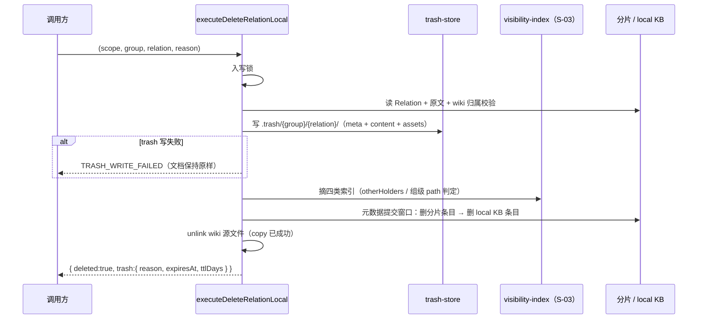
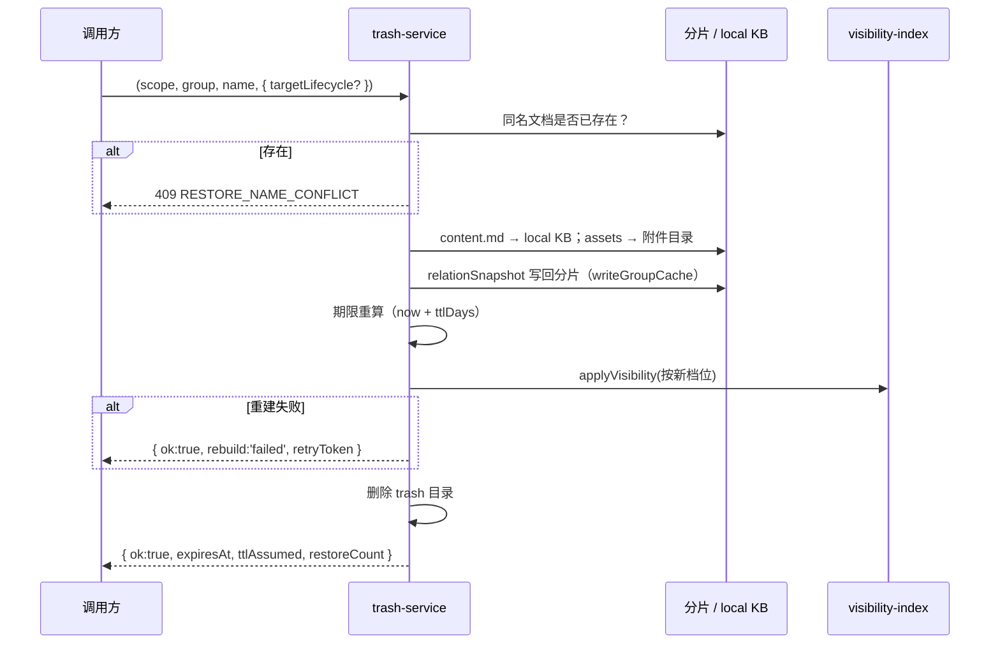

# S-04 回收站

> 父文档：`DESIGN.md`｜需求：`../requirement.md`（R19-R26）｜依赖：S-01、S-03
> 状态：设计中 ｜ 更新：2026-11-15

## 1. 术语

| 术语 | 定义 |
|---|---|
| 回收站条目（TrashItem） | 一次删除的完整快照：原文 + 附件 + Relation 元数据 |
| `reason` | `temp-expired` / `event-closed` / `event-expired` / `manual` |
| `ttlDays` | 原期限长度（天），恢复时用于续期 |
| `relationSnapshot` | 删除瞬间的 `Relation` 全量副本，恢复时还原 |
| 摘索引 | 删除瞬间清四类索引，**回收站内文档永不参与检索** |
| 惰性清理 | daemon 启动 + 每次写/删操作顺带扫，不引入定时器 |

## 2. 现状（AS-IS）

| 位置 | 现状 | 缺口 |
|---|---|---|
| `src/delete-relation.ts:182-207` | 第 1-2 步：删分片条目 + 删 local KB（在元数据提交窗口内） | 直接删，无备份 |
| `src/delete-relation.ts:212-268` | 第 3 步：硬删 wiki 源 `.md`，带 realpath containment 归属校验 | 文件永久消失 |
| `src/delete-relation.ts:270-308` | 第 4-4.5 步：删 dense / FTS / 路径向量（含 `otherHolders` 保护） | 已是"先摘索引"的正确形态，可复用 |
| `src/lib/group-delete.ts:497` | 组级删除，连 wiki 都不碰 | Q1 定案：**不进回收站** |
| `src/lib/backup.ts` | 按 `scopeDataDir` 打 tar | 回收站放 scope 目录内即自动进备份（Q2） |
| `src/lib/scope.ts:90` | `getKbDir(scope)` = scope 数据目录 | `.trash/` 落点 |
| `src/lib/scope.ts:128` | `getAssetsDir(scope, group)` = 附件目录 | 需一并快照 |

## 3. 方案（TO-BE）

### 3.1 删除链路改造（插入点）

`executeDeleteRelationLocal` 改为四段，**trash 快照必须在删除任何数据之前成功**：

```
① 读快照：Relation + local KB 原文 + wiki 文件归属校验（沿用现有 realpath 逻辑）
② 写 trash：{scope}/.trash/{group}/{relation}/ + meta.json（失败 → 中止删除，返回 TRASH_WRITE_FAILED）
③ 摘四类索引：dense / FTS / ki-relation（otherHolders 保护）/ ki-path（整组无可见文档时）
④ 删内容：分片条目 + local KB 条目（元数据提交窗口内） → unlink wiki 源文件（copy 已成功才 unlink）
```

与现有的差异：③ 提前到 ④ 之前（现有已是"先落分片再删 KB"，但 wiki 文件删除在向量删除之前）；④ 的 wiki unlink 改为"copy 后再 unlink"。

失败语义：

| 失败点 | 行为 |
|---|---|
| ② 写 trash 失败 | 整个删除中止，文档保持原样（`TRASH_WRITE_FAILED`） |
| ③ 部分索引失败 | 继续删除，把失败项写入 `.visibility-failures.json`（与 S-03 共用诊断） |
| ④ unlink 失败 | 记录 `wikiSkipReason`，不报错（与现有一致） |

### 3.2 目录结构

```
{dataDir}/{scope}/.trash/
├─ _settings.json                     { keepDays, expireAction, updatedAt }
└─ {group 路径…}/{relation}/
   ├─ meta.json                       TrashItem（含 relationSnapshot）
   ├─ content.md                      原文（local KB 的 Markdown）
   └─ assets/…                        附件（若存在）
```

- group 路径含 `/` ⇒ 目录自然嵌套，与 local KB 布局同构
- 同组同名**再次删除**（前一次还在站内）⇒ 目录名加 `__{yyyyMMddHHmmss}` 后缀，两份都保留，恢复时按最新优先
- **不放** `{sourceDir}/.ki/`（`archive.md:213` 前例：会搬走用户 wiki 仓库子目录）
- 回收站在 scope 目录内 ⇒ 自动进 `ki backup` 快照（Q2 归零），`ki scope delete` 一并清理（合理）

### 3.3 恢复链路

```
① 校验：同 scope 同 group 同名文档是否已存在 → 409 RESTORE_NAME_CONFLICT（R25/N6）
② 还原内容：content.md → local KB；assets/ → 附件目录
③ 还原元数据：relationSnapshot 写回分片（走 writeGroupCache 三步曲）
④ 期限重算（§3.4）
⑤ 重建索引：调 S-03 applyVisibility(to = resolveVisibility(...))
⑥ 移出回收站：删除 trash 目录
⑦ 回执：{ restored, expiresAtChanged, rebuild: 'pending'|'done', restoreCount }
```

③④⑤ 必须在同一 `withScopeWriteLock(scope, 'trash-restore')` 内；⑤ 的 embed 异步。

失败语义（N5）：

| 失败点 | 行为 |
|---|---|
| ② 写 local KB 失败 | 中止，trash 保留（可重试） |
| ⑤ 索引重建失败 | **原文已恢复**，返回 `ok:true` + `rebuild:'failed'` + `retryToken`；页面明示"原文已恢复，索引重建失败"并给重试入口 |

### 3.4 恢复后的期限重算（需求 §6.4 的落地）

| 场景 | 恢复后 `expiresAt` |
|---|---|
| 原 `expiresAt` 已过（自动过期进入） | `now + ttlDays * 86400e3`（用快照里的**期限长度**，非原绝对值） |
| 原 `expiresAt` 未过（手动删除） | 原值不变 |
| 用户恢复时改分类为 wiki | 清空 `expiresAt`，`lifecycle='wiki'` |
| `ttlDays` 缺失（存量条目 / 手动改库） | 回退 7 天并标 `ttlAssumed: true`；**不得用 `expiresAt - now` 反推**（过期瞬间该值 ≤ 0） |

`restoreCount` 记在 `TrashItem` 与 `Relation` 上（后者用 `restoreCount?: number`，仅诊断用，不进对外契约）；≥3 次时返回 `hint`：「这份文档反复过期，建议改为 wiki 或调长有效期」。

### 3.5 惰性清理

```ts
export function purgeExpired(args: { scope: string; now: number; dryRun?: boolean }):
  { purged: string[]; notified: string[] };
```

触发点（三处，全部复用同一函数）：

| 触发 | 位置 |
|---|---|
| daemon 启动 | `src/mcp-server.ts` 初始化后（fire-and-forget） |
| 每次写入 | `executeSyncRelation` / `handleDirectImport` 的收尾 |
| 每次删除 | `executeDeleteRelationLocal` 的收尾 |

`expireAction='notify'` 时不物理删除，只返回 `notified` 列表（页面标红）。

扫描范围：`{scope}/.trash/*/**/meta.json`，按 `expiresAt` 过滤。**不引入定时器**（N7）。

### 3.6 与 S-02 / S-03 的交界

| 场景 | 谁做 | 说明 |
|---|---|---|
| 事件收口 `terminalAction='trash'` | S-02 调用本模块 `moveToTrash(..., reason:'event-closed')` | 必须清 `eventId` 后再入站 |
| 兜底 `event-expired` | S-04 扫描器调 S-02 的文档处理，再入站 | 不清事件状态（需求 §5.7） |
| `temp` 到期 | S-04 扫描器直接入站 | `reason='temp-expired'` |
| 删除时的四类索引 | 本模块调 S-03 的原语（不新建一套） | 复用 `otherHolders` / 组级 path 判定 |

### 3.7 批量操作

| 操作 | 语义 |
|---|---|
| 批量恢复 | 逐条独立事务；单条失败不影响其他条，返回 `results[]` |
| 批量彻底删除 | 逐条删目录；**不可恢复**，需二次确认（`confirmCount` 与选中数一致才执行） |
| 未勾选就点操作 | 返回 `EMPTY_SELECTION`，页面给提示（不静默，R24） |

### 3.8 设置

`_settings.json`：`keepDays ∈ {3,7,14,30}`（默认 7）、`expireAction ∈ {'purge','notify'}`（默认 purge）。
改小保留天数后，**不立即删除**，下一次扫描时按新值判定（避免用户改设置瞬间清空回收站）。
「删除即摘索引」不可配（无开关）。

## 4. 数据模型

```ts
// src/lib/trash-store.ts（新增）
export type TrashReason = 'temp-expired' | 'event-closed' | 'event-expired' | 'manual';

export interface TrashItem {
  scope: string;
  group: string;
  name: string;                       // relation
  reason: TrashReason;
  deletedAt: number;
  expiresAt: number;                  // 站内到期时间
  /** 原期限长度（天）：取 relationSnapshot.ttlDays；
   *  存量条目缺失该字段 → 回退 7 并置 ttlAssumed=true（见 B1） */
  ttlDays: number;
  ttlAssumed?: boolean;
  /** 删除瞬间的 Relation 全量副本（恢复时还原；不含 memoryIds/ftsIds——索引必须重建） */
  relationSnapshot: Omit<Relation, 'memoryIds' | 'memoryId' | 'ftsIds' | 'ftsLocators' | 'ftsIndexComplete'>;
  restoreCount: number;
  /** 目录名（同名重复删除时带时间戳后缀） */
  dirName: string;
  hasAssets: boolean;
  sizeBytes: number;
}

export interface TrashSettings {
  keepDays: 3 | 7 | 14 | 30;
  expireAction: 'purge' | 'notify';
  updatedAt: string;
}
```

`relationSnapshot` 必须保留 `lifecycle / expiresAt / eventId / tags / useCount / lastUsedTime / sourcePath / isImported / groupSource`；**不保留索引 ID**（恢复必须重建，沿用旧 ID 会与残留索引撞车）。

`TrashItem` 不含 `sourcePath` 之外的数据源字段（数据源文档禁止进站，R4）。

## 5. 时序图

### 5.1 删除 → 入回收站



### 5.2 恢复



## 6. 接口设计

```ts
moveToTrash(args: { scope; group; relation; reason; now? }): Promise<{ ok; trash?: TrashItem; error? }>
restoreFromTrash(args: { scope; group; name; dirName: string; targetLifecycle?: 'wiki'|'temp' }): Promise<RestoreResult>
purgeExpired(args: { scope; now; dryRun? }): Promise<{ purged: string[]; notified: string[] }>
listTrash(args: { scope; reason?; limit?; offset? }): Promise<{ items: TrashItem[]; total: number }>
```

```json
// Demo 返回示例（仅示意格式）
{
  "ok": true,
  "restored": { "group": "错误库/Web前端界面", "name": "cookie 过期策略" },
  "lifecycle": "temp",
  "expiresAt": 1769817600000,
  "ttlDays": 30,
  "expiresAtChanged": true,
  "rebuild": "pending",
  "restoreCount": 2,
  "hint": "已按原期限续期 30 天；索引重建中（数秒）"
}
```

异常：

| code | 场景 | HTTP |
|---|---|---|
| `TRASH_WRITE_FAILED` | 快照写失败 | 500 |
| `TRASH_NOT_FOUND` | 条目不存在 | 404 |
| `RESTORE_NAME_CONFLICT` | 同组同名已存在 | 409 |
| `RESTORE_REBUILD_FAILED` | 索引重建失败（原文已回） | 200 + `rebuild:'failed'` |
| `EMPTY_SELECTION` | 未勾选 | 400 |
| `PURGE_CONFIRM_MISMATCH` | 彻底删除确认数与选中数不符 | 400 |
| `TRASH_SETTINGS_INVALID` | 天数 / 到期处理非法 | 400 |

## 7. 影响范围

```
src/lib/trash-store.ts            # [新增] 目录读写 / meta / settings / 列表
src/lib/trash-service.ts          # [新增] moveToTrash / restore / purgeExpired / 批量
src/delete-relation.ts            # [修改] 插入 ② 写 trash；③④ 顺序调整；wiki 改 copy+unlink
src/lib/scope.ts                  # [修改] 新增 getTrashDir(scope) / getTrashSettingsPath(scope)
src/sync-relation.ts              # [修改] 收尾调 purgeExpired
src/lib/import.ts                 # [修改] 收尾调 purgeExpired
src/mcp-server.ts                 # [修改] 启动时调 purgeExpired（fire-and-forget）
src/lib/backup.ts                 # [只读] scope 目录打包已覆盖 .trash
src/lib/group-delete.ts           # [只读] Q1 定案不进回收站
test/trash-sr04.test.ts           # [新增] 删后搜不到 / 恢复可检索 / 续期 / 同名冲突 / notify 模式
```

### 7.1 迁移与兼容

| 存量情形 | 处理 |
|---|---|
| 本需求上线前已删除的文档 | **不可恢复**（历史删除没有快照）；不做「补快照」的假动作 |
| 存量 `temp` 文档无 `Relation.ttlDays` | 首次进站时 `ttlDays` 回退 7 并标 `ttlAssumed: true`；页面提示「原期限未知，已按 7 天」 |
| 存量 `Relation` 无 `lifecycle` 字段 | 读侧 `resolveLifecycle` 补 `wiki`（S-01），不进回收站 |
| `.trash` 目录不存在 | 首次写入时创建；读路径不创建目录 |
| `governance.json` 不存在 | 返回内存缺省（7 天 / 自动清除），不自动落盘 |

## 8. 关键决策点

| # | 决策 | 被否决方案 | 否决理由 |
|---|---|---|---|
| 1 | 回收站落 scope 数据目录内 | `{sourceDir}/.ki/trash/` | 会在用户 wiki 仓库凭空造目录（`archive.md:213` 已作为 bug 移除） |
| 2 | 先摘索引再入站，恢复必须重建 | 保留索引 + 标记已删 | "删了还在被召回"，污染没解决只是换了展示位置 |
| 3 | `relationSnapshot` 不保留索引 ID | 连 `memoryIds/ftsIds` 一起还原 | 旧 ID 可能与残留索引撞车，且无法验证完整性；重建路径已成熟 |
| 4 | trash 写失败即中止删除 | 先删后异步补快照 | 会出现"删了但没备份"的窗口，违反"删除可逆" |
| 5 | 改小保留天数不立即删 | 立即按新值清理 | 用户在设置弹窗点保存就清空回收站，属灾难性误操作 |
| 6 | 组级删除不进回收站（Q1） | 整组进站 | 整组恢复涉及组树重建与跨文档引用，语义完全不同；先做单篇/批量 |
| 7 | 恢复不沿用原 `expiresAt` 绝对值 | 原值还原 | 进场就是因为过期，还原后下一次扫描立刻再进站（需求 §6.4） |

重新评估触发条件：回收站条目 > 2000 或单条目 > 50 MB 时，目录级扫描成本过高 → 改为 `_index.json` 索引 + 惰性校验。

## 9. 待定问题

| # | 问题 | 影响 | 建议 |
|---|---|---|---|
| 1 | wiki 源文件被外部修改后再恢复，是否覆盖 | 数据安全 | 恢复前比对 `content.md` 与当前 wiki 文件 hash；不一致 → 提示"原文已在站外变化"，让用户选保留哪份 |
| 2 | 同组同名重复删除的恢复顺序 | 可预期性 | 按 `deletedAt` 倒序展示，默认恢复最新；旧副本保留 7 天 |
| 3 | 附件是否计入 `sizeBytes` 上限 | 存储 | 计入；超过 50 MB 的条目在列表标"较大"并提示清理 |
