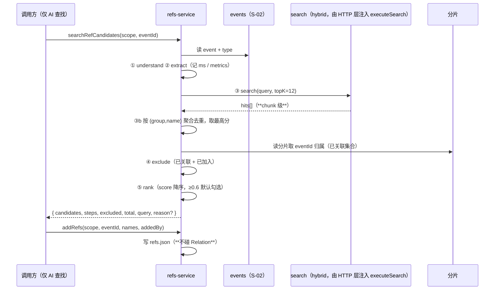

# S-05 参考文档与 AI 候选

> 父文档：`DESIGN.md`｜需求：`../requirement.md`（R27-R32）｜依赖：S-02
> 状态：**已落地（B5）· 生产接线补齐中（B8）** ｜ 更新：2026-11-15

## 1. 术语

| 术语 | 定义 |
|---|---|
| 关联文档 | `Relation.eventId` 指向本事件的文档；**可见性由阶段决定** |
| 参考文档（ref） | 一条引用记录 `EventRefDoc`；**可见性取文档自身**，与事件无关 |
| 悬空引用 | 被引文档已不存在（删除或改名），`stale: true` |
| 候选 | AI 检索出、尚未加入的文档；带 `score` 与 `why` |
| `steps[]` | 候选检索的 5 步执行记录，每步带真实数字 |

## 2. 现状（AS-IS · 设计期）

| 项 | 现状 |
|---|---|
| 引用关系存储 | 无（`src/lib/events/` 为 S-02 新建） |
| 语义检索能力 | `src/search.ts` + `src/lib/vector-client.ts` hybrid，已可复用 |
| 事件上下文 | S-02 提供 `EventRecord` + `EventTypeRecord` |
| 前端展示 | demo `index.html:2315-2324`（参考文档区）+ `:2681-2701`（AI 查找弹窗） |

> **本节是设计期快照**。落地后的真实状态（哪些已实现、哪些从未接线）见 §10.1 落地校准。

**关键约束（需求 §7.1）**：加入 / 移除参考文档**不得修改被引文档的任何属性**。这是本子需求唯一的验收红线（A13）。

## 3. 方案（TO-BE）

### 3.1 引用关系存储

```
{dataDir}/{scope}/.events/{eventId}.refs.json
{ version: 1, eventId, refs: EventRefDoc[], updatedAt }
```

独立文件而非塞进 `{eventId}.json`：引用是高频小的写，事件主体是低频写，分开避免互相覆盖（也是 S-02 决策 5 的同源考虑）。

```ts
interface EventRefDoc {
  scope: string;
  group: string;
  name: string;
  addedBy: 'ai' | 'manual';
  addedAt: number;
  score?: number;      // ai 加入时记录当时分数，供复现
}
```

**不写任何 `Relation` 字段**：加入/移除只动 `refs.json`。A13 的断言就是「操作前后该 Relation 的分片条目字节级不变」。

**加入时必须带来源与分数**：AI 候选加入 → `addedBy:'ai'` + `score`（复现"当初为什么选它"）；手动加入 → `addedBy:'manual'` 无 `score`。
⚠️ 现实现前端把 `addedBy` 恒写 `'manual'` 且从不传 `score`（`governanceApi.ts:395`、`EventsPage.tsx:517`），本期订正。

### 3.2 AI 候选检索（确定性，不调 LLM）

```
① 理解事件      读 event + type + 当前阶段 → { title, typeName, stageName, visibility }
② 提取线索      标题分词 + 关联文档名 → query 词表（去停用词/数字/行号）；**不含类型名**
③ 语义检索      search({ scope, query, mode: 'hybrid', topK: 12 })
③b 文档聚合    命中是 **chunk 级**的：按 (group, name) 聚合取最高分，原 chunk 命中数记进 metrics
④ 排除          去掉 eventId === 本事件 的（已关联）+ refs 里的（已加入）
⑤ 排序取前 N    按 score 降序，取前 3-5；**同批次 min-max 归一化后** >= 0.6 默认勾选
```

**② 为何不含类型名（2026-11-15 实施时修正，原设计写的是"标题 + 关联文档名 + 类型名"）**：
内置类型名是「bug 排查 / 性能问题 / 需求交付」这类模板词，同一类型的事件全带同一个词，
对 query 是**常量噪声**而非区分信号；更关键的是它会让「提不出线索词」这条路径**永不触发**
（每个事件都有类型）—— 于是没线索的事件也会去检索，单条命中再被归一化成 1.0 默认勾选。
类型名仍在 ① 的 `metrics`/面板里展示，只是不参与检索词。

**③b 是必须的（2026-11-15 补）**：`executeSearch` 返回的是 chunk 命中，同一篇文档 3 个 chunk 命中会出现 3 条候选、占满 `limit`，且把 `min-max` 分布压向该文档。聚合口径：

```
name       = hit.relation（relations-cache 的 hot_relation.text，与 refs.json 的 name 同口径）
group      = hit.group
score      = max(同文档所有 chunk 的 score)
chunkHits  = 该文档的 chunk 命中数（过程面板第③步的真实数字）
过滤       = 缺 group 或 relation 的命中丢弃（ki-relation / ki-path 辅助通道命中无 relation，无法定位到文档）
```

**生产接线（本层不 import `search.ts`，由调用方注入）**：

```ts
// src/lib/governance-http.ts —— refs/search 分支
import { executeSearch } from '../search.js';   // 顶层已懒加载（mcp-http-api 由 mcp-http 动态 import）

const deps: RefSearchDeps = {
  search: async ({ scope, query, topK }) => {
    const r = await executeSearch({ scope, query, limit: topK, mode: 'hybrid' });
    if (!r.ok) throw new GovernanceError('SEARCH_UNAVAILABLE', r.error);  // → 503
    return r.results
      .filter((h) => h.group && h.relation)
      .map((h) => ({ group: h.group!, name: h.relation!, score: h.score }));
  },
};
```

不调 LLM 的理由：候选检索要可复现、可自动断言（A15「每步数字与实际召回量一致」），LLM 参与会让同一输入产出不同 `why` 与顺序。

`why` 生成规则（可解释即可，不追求文采）：

```
"命中「cookie / 登录态」· 与关联文档同属「错误库/Web前端界面」"
```

**分数口径（不按此实现阈值必然失效）**：`search` 返回的是 RRF 融合分，本机实测 0.02~0.03 量级，**不是**余弦相似度。因此 0.6 只能理解为「批次内相对分位」，不能当绝对相似度：

```
normalized = (raw - minRaw) / (maxRaw - minRaw)      // maxRaw > minRaw
           = 1.0                                      // 单条命中，避免除零
```

归一化后 `>= 0.6` 的默认勾选，低于的标 `weak` 但**照常返回**（R29：低分留给人判断）。

### 3.3 5 步执行记录

```ts
interface RefSearchStep {
  name: 'understand' | 'extract' | 'search' | 'exclude' | 'rank';
  ms: number;
  metrics: Record<string, number | string>;   // 必带真实数字
  detail?: Record<string, unknown>;           // 可展开：实际 query / 排除名单
}
```

每步 `metrics` 必须来自真实执行结果，禁止写死：

| 步 | metrics 必含 |
|---|---|
| understand | `stages`、`visibility` |
| extract | `keywords`（数量）、`sources`（关联文档数） |
| search | `total`（库内文档数）、`hits`（chunk 召回数）、`docs`（聚合后文档数）、`mode` |
| exclude | `associated`（已关联数）、`added`（已加入数）、`remaining` |
| rank | `candidates`（最终返回数）、`threshold: 0.6` |

**调用行：只标真实调用（2026-11-15 二次拍板后修订）**

初版为"不出 chip"，理由是 demo 的「4 次调用」属演示态。二次拍板改为：**出调用行，但只标真调了东西的**，
并**直接复用 AI 对话的工具行**（`.ki-chat-tl__node--tool` / `__skill` / `__act` / `__tool` / `__stat`），
站内"调用行"只有一种长相。

| 步 | 是否出调用行 | 依据 |
|---|---|---|
| ① understand | 否 | 本地读事件 / 类型分片，不是工具调用 |
| ② extract | 否 | 纯函数分词 |
| ③ search | **是** → `tool ki_search` + 真实 ms | 走 `executeSearch`（与 `ki_search` 同一引擎） |
| ④ exclude | 否 | 本地读 `refs.json` + 分片比对 |
| ⑤ rank | 否 | 纯函数排序 |

`steps[].calls` 由服务层按**真实执行**填充，禁止为了让界面像 demo 而补 `event-context` / `relevance-rank`
这类并不存在的 skill。表头计数同样按 `calls` 累加（`5 步 · N 次调用 · X.Xs`），不写死。

### 3.4 手动添加

按名称 / group 路径搜索全库（`getDocList({ q })` 的元数据扫描，不走向量），同样排除已关联 + 已加入。返回 `{ name, group, visibility }`（可见性取文档自身）。

**空查询 = 列可加入的前 N 篇（2026-11-15 走查后订正）**：demo 的 `renderRefSearch()` 在输入框为空时
`!q` 分支不过滤，打开弹窗就把候选列出来。初版实现里 `searchDocsForAdd` 空 `q` 直接 `return []`，
前端又短路不发请求 → **弹窗一片空白、连一句提示都没有**。现改为：

| 场景 | 行为 |
|---|---|
| 打开弹窗（q 为空） | 立即列出「未关联、未加入」的前 20 篇 + 可见性 |
| 有 q、命中 | 按名 / 路径包含匹配（大小写不敏感） |
| 有 q、0 命中 | 文案：`没有匹配的文档（已排除关联文档与已加入的参考文档）` + 提示核对 scope |
| q 为空、0 条 | 文案：该 scope 没有可加入的文档（都已关联/已加入，或库本身为空） |
| 搜索中 | 「搜索中…」（空查询不防抖，有查询 250ms 防抖） |
| 换一批结果 | 列表 **scrollTop 归零**（否则上一批的滚动位置会把首行裁掉半截） |

### 3.5 悬空引用（N10）

读 `refs.json` 时按 `(group, name)` 查分片：

| 结果 | 处理 |
|---|---|
| 文档存在 | 正常展示，`visibility` 取 `resolveVisibility` |
| 文档不存在 | `stale: true` + 页面「已失效」+ 一键清理（`DELETE /refs/:name`） |

**不静默消失**：条目留在列表里直到用户点清理或事件删除。

### 3.6 事件删除时

`{eventId}.refs.json` 随事件一并删除（S-02 §3.8）。参考文档本身不受影响（引用关系消失，文档仍在）。

## 4. 数据模型

```ts
// src/lib/events/refs-store.ts（新增）
interface RefsDoc { version: 1; eventId: string; refs: EventRefDoc[]; updatedAt: number }

export interface RefCandidate {
  group: string;
  name: string;
  score: number;            // 0~1（批次内 min-max 归一化，非绝对相似度）
  why: string;              // 规则生成，含命中词
  matchedKeywords: string[];
  weak: boolean;            // score < 0.6
  /** 该文档自身的检索可见性（full / fts-only / hidden）；候选行显示它，不能取事件阶段档位 */
  visibility: Visibility;
  /** 该文档的 chunk 命中数（去重前）；1 = 单点命中 */
  chunkHits: number;
}

export interface RefSearchResult {
  candidates: RefCandidate[];
  steps: RefSearchStep[];
  excluded: { associated: string[]; added: string[] };
  total: number;            // 库内文档数
  durationMs: number;
  /** 实际发给检索的 query（面板第②/③步要展示，不让前端自己拼） */
  query: string;
  /**
   * 0 候选的原因，供前端写不一样的空态文案（不许一律「没有相关文档」）：
   *   no-keywords  标题与关联文档名都没提出线索词
   *   empty-scope  本库没有任何文档（多半是 scope 选错）
   *   no-hits      检索跑了但无命中
   *   all-excluded 命中的都被「已关联 / 已加入」排掉了
   */
  reason?: 'no-keywords' | 'empty-scope' | 'no-hits' | 'all-excluded';
}
```

> `scope` 不进候选对象，由响应外壳 `{ ok, scope, ...result }` 提供（与实现一致，避免逐条重复）。

## 5. 时序图



## 6. 接口设计

```ts
searchRefCandidates(args: { scope; eventId; topK?: number; threshold?: number }): Promise<RefSearchResult>
addRefs(args: { scope; eventId; docs: {group;name;score?}[]; addedBy: 'ai'|'manual' }): Promise<{ added: number; skipped: string[] }>
removeRef(args: { scope; eventId; group; name }): Promise<{ removed: boolean }>
listRefs(args: { scope; eventId }): Promise<{ refs: (EventRefDoc & { stale: boolean; visibility: Visibility })[] }>
searchDocsForAdd(args: { scope; q; limit?; eventId? }): Promise<{ items: {group;name;visibility}[] }>
```

**HTTP 映射（2026-11-15 拍板：一个端点只保留一种语义）**

| 路由 | 语义 | 入参 | 谁调 |
|---|---|---|---|
| `POST /governance/events/:id/refs/search` | **AI 候选**（§3.2 五步） | `{ scope }`，**不再接受 `query`** | AI 查找弹窗 |
| `GET /governance/docs/search` | **按名/路径检索文档** | `scope` / `q` / `limit` / `eventId?` | ＋ 添加弹窗 |

- 旧实现把两种语义塞在同一路由（`query` 有无决定走哪条），正是 2026-11-15 前「AI 查找永远 0 命中」的根因，**不得恢复**。
- `searchDocsForAdd` 新增可选 `eventId`：传了就排除「该事件已关联」与「已加入参考文档」的文档（R31 的服务端兜底）；未传保持旧行为（向后兼容）。前端仍保留「已加入」禁用态，用于弹窗打开后被别人加入的竞态。

```json
// Demo 返回示例（仅示意格式）
{
  "ok": true,
  "scope": "kisearch-memory",
  "query": "登录页白屏 cookie 登录态 失效",
  "candidates": [
    { "group": "项目架构/配置", "name": "cookie 作用域配置说明", "score": 0.88,
      "why": "命中「cookie / 登录态」· 与关联文档同属「错误库/Web前端界面」",
      "matchedKeywords": ["cookie", "登录态"], "weak": false,
      "visibility": "full", "chunkHits": 3 },
    { "group": "项目踩坑点", "name": "接口鉴权失败排查 SOP", "score": 0.76,
      "why": "命中「鉴权 / 登录态」", "matchedKeywords": ["鉴权", "登录态"], "weak": false,
      "visibility": "fts-only", "chunkHits": 1 },
    { "group": "项目架构", "name": "用户表设计", "score": 0.42,
      "why": "仅字面命中「用户」", "matchedKeywords": ["用户"], "weak": true,
      "visibility": "full", "chunkHits": 1 }
  ],
  "steps": [
    { "name": "understand", "ms": 3, "metrics": { "stages": 4, "visibility": "fts-only" } },
    { "name": "extract", "ms": 5, "metrics": { "keywords": 5, "sources": 3 } },
    { "name": "search", "ms": 640, "metrics": { "total": 168, "hits": 12, "docs": 9, "mode": "hybrid" } },
    { "name": "exclude", "ms": 2, "metrics": { "associated": 3, "added": 2, "remaining": 7 } },
    { "name": "rank", "ms": 1, "metrics": { "candidates": 3, "threshold": 0.6 } }
  ],
  "excluded": { "associated": ["登录页白屏排查记录"], "added": ["历史同类问题：cookie 域不匹配"] },
  "total": 168,
  "durationMs": 651
}
```

异常：

| code | 场景 | HTTP |
|---|---|---|
| `EVENT_NOT_FOUND` | 事件不存在 | 404 |
| `REF_ALREADY_ASSOCIATED` | 加入的是本事件的关联文档 | 409（已在 `STATUS_BY_CODE`） |
| `REF_ALREADY_ADDED` | 重复加入 | **不抛**：走 `skipped` 汇总返回 200 |
| `REF_LIMIT_EXCEEDED` | 超过 50 条上限 | 409 —— **订正**：现实现误用 `REF_ALREADY_ADDED` 表达上限（`refs-service.ts:244`），语义错，本期订正并登记 |
| `REF_NOT_FOUND` | 移除不存在的引用 | 404 |
| `SEARCH_UNAVAILABLE` | 向量服务不可用 / embedding 失败 | 503 + 降级说明 —— **必须补进 `STATUS_BY_CODE`**（当前缺失 → 落到 400） |

## 7. 影响范围

```
src/lib/events/refs-store.ts            # [已完成] refs.json 读写
src/lib/events/refs-service.ts          # [已完成 + 本期改] 候选检索 / 加入 / 移除 / 悬空判定
src/lib/governance-http.ts              # [本期改] refs/search 注入 executeSearch；docs/search 支持 eventId
src/lib/governance-contract.ts          # [本期改] RefCandidate / RefSearchResult 加字段（形状 SSOT）
web/src/api/governanceContract.ts       # [本期改] 同上（副本，parity 测试会比对）
src/lib/events/types.ts                 # [只读] EventRefDoc 不变
src/search.ts                           # [只读] executeSearch 复用
src/lib/vector-client.ts                # [只读]
src/lib/events/event-service.ts         # [已完成] 删除事件时一并删 refs.json
web/src/pages/EventsPage.tsx            # [本期改] AI 查找按钮 → 弹窗（不再自动加入）
web/src/components/governance/FindRefModal.tsx     # [新增]
web/src/components/governance/AiProcessPanel.tsx   # [新增]
web/src/styles/governance.css           # [追加] demo 的 .ai-proc* / .cand* → gov-* 前缀
test/refs-sr05.test.ts                  # [已完成] A13 红线 + 排除规则 + 悬空 + steps 数字一致性
test/refs-sr05-search.test.ts           # [新增] 接线 / 去重 / reason / visibility / 503
```

## 8. 关键决策点

| # | 决策 | 被否决方案 | 否决理由 |
|---|---|---|---|
| 1 | 引用独立文件 `{eventId}.refs.json` | 塞进 `{eventId}.json` | 引用是高频小写，事件主体是低频写；同文件会互相覆盖 |
| 2 | 加入/移除不写任何 `Relation` 字段 | 在被引文档上记 `refBy` 反查 | 会让"引用"污染文档属性，且被判 A13 直接否掉；反查用 refs 文件枚举即可 |
| 3 | 候选用确定性检索，不调 LLM | LLM 生成 `why` 与排序 | 不可复现、不可断言；同一输入两次结果不同，A15 无法验 |
| 4 | 低分候选照常返回并标 `weak` | 直接过滤 < 0.6 | 需求 R29 明确"低分项保留给人判断" |
| 5 | 悬空引用保留并标 `stale` | 读取时自动清理 | 静默消失会让用户以为"引用没加成功"（N10 明确要求） |
| 6 | 手动添加走元数据扫描 | 走向量检索 | 按名字找文档是精确匹配场景，向量反而引入噪声 |
| 7 | **一个路由一种语义**（AI 候选 / 手动搜索分离） | 同一路由按 `query` 有无分流 | 2026-11-15 前正是这种分流让「AI 查找」把标题当手动搜索词、永远 0 命中 |
| 8 | **过程面板一次回填真实 steps**，不做逐步回放 | 照 demo 用定时器逐步推进 | 后端是单次请求无中间事件，回放属于伪造时序且让用户等两遍（S-07 决策 6 的本意是"数字不造假"，不是"逐帧演"） |
| 11 | **调用行只标真实调用**，且复用对话页工具行 | 照 demo 标 4 次调用（含 2 个不存在的 skill） | 标不存在的 skill 是伪造；真实只有 1 次 `ki_search`，其余是本地计算 |
| 12 | **`mode` / `degraded` 如实透出** | 面板一律写 `hybrid` | `executeSearch` 语义不可用时会降级全文；写死 hybrid 等于骗人（本项为实施后发现的缺陷，已修） |
| 9 | 命中按文档聚合去重（取最高分，记 `chunkHits`） | 直接拿 chunk 命中当候选 | 同篇文档多 chunk 会重复占位、把 min-max 分布压向该文档 |
| 10 | 手动搜索的"排除已关联/已加入"放服务端（`eventId` 可选） | 只在前端禁用 | R31 是服务端契约；前端禁用只能覆盖"打开弹窗后"的竞态，覆盖不了初始集合 |

重新评估触发条件：若候选准确率反馈 < 60%，改为「规则召回 + 可选 LLM 重排」（LLM 只重排不召回，仍保留可复现的召回集合）。

## 9. 待定问题

| # | 问题 | 影响 | 建议 |
|---|---|---|---|
| 1 | 参考文档上限 | 弹窗性能 | 单事件 50 条；超出拒绝并提示清理（错误码改 `REF_LIMIT_EXCEEDED`） |
| 2 | `why` 是否要展示命中片段 | 说服力 | 只展示命中词；片段留给"打开原文"（S-07 已支持高亮） |
| 3 | 跨 scope 引用 | 视图场景 | 不支持（引用限同 scope），与事件边界一致 |
| 4 | **单条命中归一化恒为 1.0** | 候选恰有 1 条时分数显示 1.00 且默认勾选，容易被读成"完全相关" | 保留归一化（阈值口径不变），但**单条时 `score` 仍取 1.00 的同时标 `singleHit: true`**，前端对单条显示「唯一命中」而非 1.00；待实测后定稿 |
| 5 | `why` 在无分隔符标题下退化 | 提词按分隔符切，整串标题只得到一个 token，`name.includes(token)` 命中率极低 → `why` 多为「语义相似」 | 中文分词不做（引入词典依赖不划算）；退化时接受「语义相似」，且「与关联文档同组」这条理由仍会命中 |

## 10. 增量落地记录（2026-11-15 · 生产接线）

### 10.1 落地校准（设计时假设 vs 实际代码）

| 项 | 设计假设 | 实际 | 结论 |
|---|---|---|---|
| 候选检索 5 步 | 已接线 | `refs-service.ts:127-232` 已实现，**但 HTTP 层传 `search: async () => []`**（`governance-http.ts:392`） | 管线可用、接线缺失 |
| `/refs/search` | 单一语义 | 按 `query` 有无分流：有 query → `searchDocsForAdd`（子串匹配）；无 query → 空检索候选 | 双语义是本轮 bug 根因，按决策 7 拆分 |
| 前端入口 | 弹窗 + 勾选 | 一键发 `active.title` 当手动搜索词，命中则**自动加入前 3 条**（`EventsPage.tsx:515-521`） | 违反 R28/R29，重做 |
| 候选契约 | 带可见性 | `RefCandidate` 无 `visibility`、无 `chunkHits` | 本期补 |
| 错误码 | `SEARCH_UNAVAILABLE` → 503 | `STATUS_BY_CODE` 无此项 → 落 400 | 本期补 |

### 10.2 切片（B8，见 `IMPL_PLAN.md` §9）

| 切片 | 范围 | 完成判据 |
|---|---|---|
| B8-1 | `refs-service`：去重、`visibility`、`query`、`reason`、`REF_LIMIT_EXCEEDED` | 单测：同文档 3 chunk → 1 候选且 `chunkHits=3`；四种 `reason` 各命中一次 |
| B8-2 | `governance-http`：注入 `executeSearch`、拆双语义、`docs/search` 支持 `eventId`、503 映射 | 集成：候选非空；向量服务异常 → 503 + 可读文案 |
| B8-3 | 契约双侧 + parity 测试 | `test/governance-contract.test.ts` 绿 |
| B8-4 | 前端弹窗 + 过程面板 + 样式移植 | `web tsc` 0 错；手工走查 5 态（loading/done/empty/error/只读） |
| B8-5 | 「＋ 添加」改走 `docs/search` | 回归：已关联文档不再出现在手动搜索结果里 |

### 10.3 验收

| 项 | 方式 |
|---|---|
| A13 红线不破 | `test/refs-sr05.test.ts` 必须仍绿（加入/移除前后分片字节不变） |
| A14 排除规则 | 同上 + 新增 `eventId` 排除用例 |
| A15 过程数字一致 | 手工：面板第③步 `hits/docs` 与后端 `steps[search].metrics` 逐字一致；耗时之和 ≈ `durationMs` |
| R29 默认勾选 | 手工：≥0.6 默认勾选、`weak` 可勾；0 勾选时主按钮禁用 |
| R30 过程可见可折叠 | 手工：结果出来后自动折叠、点开见 5 步、每步可展开 |

### 10.4 实施结果（2026-11-15）

| 切片 | 状态 | 证据 |
|---|---|---|
| B8-1 | ✅ | `test/refs-sr05-search.test.ts` 13 例绿（聚合去重 / 契约字段 / 四种 reason / eventId 排除 / 适配器错误翻译 3 例） |
| B8-2 | ✅ | `governance-http.ts` 注入 `searchAdapter`（懒加载 `../search.js`）；`test/governance-refs-route.test.ts` 3 例绿（带 query → 400 / 服务端排除 / 挂载点不越界） |
| B8-3 | ✅ | `test/governance-contract.test.ts` 24 例绿（DTO 双侧字段一致 + 新错误码登记） |
| B8-4 | ✅ 代码完成，手工走查待做 | `web tsc --noEmit` 0 错；`vite build` ✓ |
| B8-5 | ✅ | `AddRefModal` 改走 `docs/search?eventId=` |

**实施中的两处偏离（均已回写本节）**：
1. **类型名不进 query** —— 见 §3.2 说明；否则 `no-keywords` 分支永不触发。
2. **`singleHit` 不加契约字段** —— 由前端按 `candidates.length === 1` 直接显示「唯一命中」，不改 DTO（少一处双侧同步成本）。

**核实结论（IMPL_PLAN §9.1 假设 1）**：`governance-http.ts` 已加载 599ms、`search.ts` 额外 46ms；
因采用**懒加载**，这 46ms 只落在首次「AI 查找」请求，不影响 `ki mcp` 启动。

**真实链路探针（2026-11-15，隔离 scope，带 1 篇文档但无向量索引）**：

```
POST /governance/events/:id/refs/search  →  50ms
{ ok:true, candidates:[], total:1, query:"登录页 cookie 白屏", reason:"no-hits",
  steps: [understand 1ms, extract .., search 47ms{hits:0,docs:0}, exclude 1ms, rank 1ms] }
```
说明：无索引时 `executeSearch` **正常返回空**（不抛、不卡、不触发 embedding 超时），
`reason` 落到 `no-hits`，前端按"检索跑了但没命中"给文案 —— 与设计一致。

**适配器独立成文件（`src/lib/events/refs-search.ts`）**：错误翻译（`ok:false` 与**抛异常**都 → `SEARCH_UNAVAILABLE`）
是可断言逻辑，塞在 HTTP 模块里只能起服务验证；`test/refs-sr05-search.test.ts` ⑤ 四例覆盖
「ok:false / 抛异常 / relation→name 与缺定位字段丢弃 / mode·degraded 透出」。

### 10.5 二次修订（2026-11-15 · 用户走查后）

用户实机走查提出两点：**① 过程面板缺 skill/MCP 调用行，与 demo 不一致；② 点一下就查完了，怀疑没真检索。**
逐项核实后确认：① 是上次"不出 chip"的取舍（可按新拍板改）；② 是真检索（见下），但**顺带查出我方一个真缺陷**。

| # | 问题 | 处理 |
|---|---|---|
| 1 | 调用行缺失 | `steps[].calls` 落地，只标真实调用（③ → `tool ki_search`），前端**复用对话页工具行类**渲染；表头计数改为按 `calls` 累加（`5 步 · N 次调用`） |
| 2 | **`mode` 写死 `hybrid`**（缺陷） | 适配器原样透出 `mode` / `degraded` / `degradedReason`；服务层记进 `metrics.mode` 与 `detail`；结果体加同名字段；面板在 `fulltext` 时显式提示"语义不可用，已降级为全文" |
| 3 | 分数看起来极端（1.00 / 0.00） | 保持归一化口径，弹窗底部加说明：分数是**本批次相对分位**（最高恒 1.00、最低恒 0.00），不是绝对相似度 |

**真实数据取证（scope `default`，5 篇文档，只读，未写任何引用）**：

```
事件 #6 向量重建耗时优化 → endToEnd 766ms
mode: hybrid · degraded: false · query: "向量重建耗时优化"
steps: understand 1ms / extract 1ms{keywords:1} / search 761ms{total:5,hits:5,docs:5,mode:hybrid}
       exclude 1ms{remaining:5} / rank 1ms{candidates:5}
calls: [{ kind:"tool", name:"ki_search", label:"语义检索", ms:761 }]
```
→ 结论：**检索确实发生**（761ms 为引擎实测），"快"是因为该 scope 只有 5 篇文档，候选池极小；
此前面板无法自证这一点，正是 `mode`/`query` 没暴露导致的观感问题。

**未覆盖**：装配向量库并配置 embedding 的 scope 上的候选质量与首次检索耗时（需手工走查 S-07 §10.5 的 8 项）。
