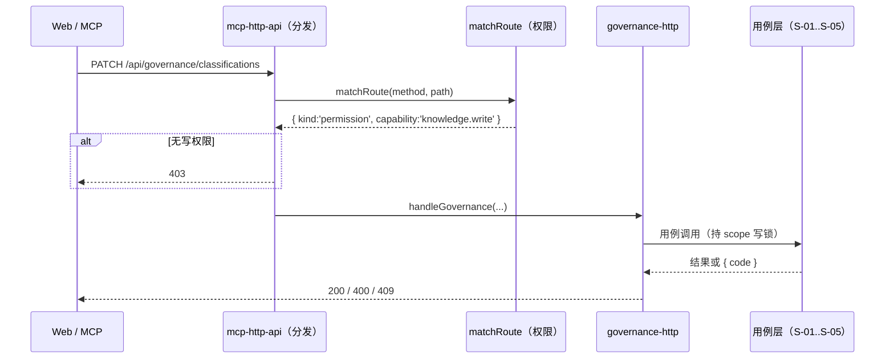
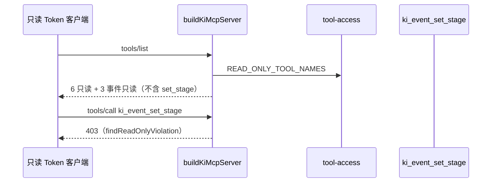

# S-06 接口契约（HTTP + MCP + 权限）

> 父文档：`DESIGN.md`｜需求：`../requirement.md`（R33-R36、R5）｜依赖：S-01..S-05
> 状态：设计中 ｜ 更新：2026-11-15

## 1. 术语

| 术语 | 定义 |
|---|---|
| 契约层 | 本子需求只定义"对外形状"（路由 / 参数 / 返回 / 错误码 / 权限），业务实现归 S-01..S-05 |
| 只读族 | 3 个 MCP 查询工具，只读 Token 可见 |
| 唯一写工具 | `ki_event_set_stage`，写 Token 才可调 |
| 登记点 | 新增 MCP 工具必须同步的 4 个文件（漏一个就 fail-open 或调度错乱） |

## 2. 现状（AS-IS）

| 位置 | 现状 |
|---|---|
| `src/lib/mcp-server-factory.ts:38-74` | `buildKiMcpServer` 按 `authScopes` 分组注册：只读组 51-56、写组 61-67 |
| `src/lib/auth/tool-permissions.ts:13-31` | 工具 → capability 映射表，`test/capability-coverage.test.ts` 会断言覆盖 |
| `src/lib/mcp-tools/tool-access.ts:30-49` | `READ_ONLY_TOOL_NAMES`（6 个）+ `SCOPE_LESS_ENUM_TOOL_NAMES`（2 个） |
| `src/lib/operation-coordinator.ts:78-148` | `READ_MCP_TOOLS` / `kindForMcpToolNames`（读并行、写串行） |
| `src/lib/auth/route-permissions.ts:36-115` | `/api/*` 白名单，未登记 → 404 |
| `src/lib/mcp-http-api.ts:1678` | 路由分发（`p === '/import/upload'` 形式的 if 链） |
| `src/lib/auth/capabilities.ts:11-12` | `knowledge.read` / `knowledge.write` |

**不新增 capability**：R34 明确三页写操作按 `knowledge.write`；新增能力点会连锁改 `capabilities.ts` + 角色表 + 覆盖测试，收益为零。

## 3. 方案（TO-BE）

### 3.1 HTTP 路由（前缀 `/api/governance`，共 30 条）

| # | 方法 | 路径 | 用途 | 权限 | 归属 |
|---|---|---|---|---|---|
| 1 | GET | `/governance/lifecycle` | 三档 + 期限 + 预设 + group 有效默认 | read | S-01 |
| 2 | GET | `/governance/classifications` | 分类页列表（筛选/排序/分页） | read | S-01 |
| 3 | PATCH | `/governance/classifications` | 批量改分类 | write | S-01 |
| 4 | GET | `/governance/presets` | 预设列表 | read | S-01 |
| 5 | POST | `/governance/presets` | 新建预设 | write | S-01 |
| 6 | PATCH | `/governance/presets/:id` | 改预设 | write | S-01 |
| 7 | DELETE | `/governance/presets/:id` | 删预设（内置拒绝） | write | S-01 |
| 8 | PUT | `/governance/group-defaults` | 配 group 默认分类 | write | S-01 |
| 9 | GET | `/governance/events` | 事件列表（status/type/q/分页） | read | S-02 |
| 10 | POST | `/governance/events` | 新建事件 | write | S-02 |
| 11 | PATCH | `/governance/events/:id` | 改标题（乐观锁） | write | S-02 |
| 12 | POST | `/governance/events/:id/transition` | 流转 | write | S-02 |
| 13 | POST | `/governance/events/:id/reopen` | 重新打开 | write | S-02 |
| 14 | DELETE | `/governance/events/:id` | 删除（必带 docAction） | write | S-02 |
| 15 | GET | `/governance/event-types` | 类型列表（含阶段） | read | S-02 |
| 16 | POST | `/governance/event-types` | 新建类型 | write | S-02 |
| 17 | PATCH | `/governance/event-types/:id` | 改类型（乐观锁） | write | S-02 |
| 18 | DELETE | `/governance/event-types/:id` | 删类型 | write | S-02 |
| 19 | GET | `/governance/events/:id/refs` | 参考文档列表（含 stale） | read | S-05 |
| 20 | POST | `/governance/events/:id/refs` | 加入参考文档 | write | S-05 |
| 21 | DELETE | `/governance/events/:id/refs` | 移除（body 带 group/name） | write | S-05 |
| 22 | POST | `/governance/events/:id/refs/search` | AI 候选检索（纯读，不改数据） | read | S-05 |
| 23 | GET | `/governance/docs/search` | 手动添加的文档搜索 | read | S-05 |
| 24 | GET | `/governance/trash` | 回收站列表（reason/分页） | read | S-04 |
| 25 | POST | `/governance/trash/restore` | 批量恢复 | write | S-04 |
| 26 | POST | `/governance/trash/purge` | 批量彻底删除 | write | S-04 |
| 27 | GET | `/governance/trash/settings` | 回收站设置 | read | S-04 |
| 28 | PUT | `/governance/trash/settings` | 保存设置 | write | S-04 |
| 29 | GET | `/governance/diagnostics` | 索引失败 / 悬空引用 / 僵尸清单 | read | S-03 |
| 30 | GET | `/governance/counts` | 侧栏与三页页头共用的计数聚合 | read | S-07 |

分发实现：在 `src/lib/mcp-http-api.ts` 的 if 链加一段前缀分支

```ts
if (p === '/governance' || p.startsWith('/governance/')) {
  return void (await handleGovernance(req, res, p, url, authScopes, operator));
}
```

新增 `src/lib/governance-http.ts` 承载 30 条路由的分发（避免继续膨胀 `mcp-http-api.ts`，该文件已 2400+ 行）。

### 3.2 MCP 工具（4 个）

| 工具 | 类型 | 关键参数 | 返回 | 超时 |
|---|---|---|---|---|
| `ki_lifecycle_list` | 只读 | `scope`、`group?` | 三档 + 期限 + 预设 + `effectiveDefault` | `TOOL_TIMEOUT.READ` |
| `ki_event_list` | 只读 | `scope`、`status?`、`type?`、`q?`、`limit?`（默认 20/上限 100）、`offset?`、`docsPreviewLimit?`（默认 3/上限 10） | 事件 + 阶段 + 可见性 + `docsPreview` + `total`/`hasMore` | `TOOL_TIMEOUT.READ` |
| `ki_event_type_list` | 只读 | `scope` | 类型 + 阶段链 + `terminalAction` + `fallbackDays` | `TOOL_TIMEOUT.READ` |
| `ki_event_set_stage` | 写 | `scope`、`event`、`stage`、`note?` | 新旧阶段 + `affected` + `visibility` + `pending` | **`TOOL_TIMEOUT.EVENT_TRANSITION`（新增 60s）** |

**不提供**：`ki_event_create` / `ki_event_type_create` / `ki_lifecycle_create` / `ki_event_delete`（创建与删除只走页面）。

### 3.3 四处登记（漏一处即缺陷）

| # | 文件 | 动作 | 漏了会怎样 |
|---|---|---|---|
| 1 | `src/lib/mcp-tools/tool-access.ts` | 3 只读加入 `READ_ONLY_TOOL_NAMES`；写工具**不加** | 只读 Token 调不到查询 / 或看见写工具（fail-open） |
| 2 | `src/lib/auth/tool-permissions.ts` | 4 条映射（3 read + 1 write） | `test/capability-coverage.test.ts` 转红；且鉴权缺省拒绝导致工具不可用 |
| 3 | `src/lib/operation-coordinator.ts` | 3 只读加入 `READ_MCP_TOOLS`；写工具走默认 write | 只读工具被写串行阻塞，与导入并发时排队 |
| 4 | `src/lib/mcp-server-factory.ts` | 只读三件加在 51-56 组；`ki_event_set_stage` 加在 61-67 写组 | 只读会话看不见查询 / 写会话用不了流转 |

`SCOPE_LESS_ENUM_TOOL_NAMES` **不加**：四个工具都有 `scope` 参数。

### 3.4 横切约定（定稿后只读）

| 项 | 约定 |
|---|---|
| 分页 | `limit`（默认 20，上限 100）+ `offset`；返回 `{ items, total, hasMore }` |
| 时间 | 全部毫秒时间戳（number），**不返回 ISO 字符串**（前端格式化） |
| ID | `evt_<base36>_<rand>` / `et_<n>` / `preset_<n>` / `st_<n>`；`shortId` 仅展示 |
| 错误体 | `{ ok:false, code, message, ...context }`，`code` 见 §3.5 |
| 日志 | 沿用 `mcp-http-api` 既有访问日志，新增业务日志 `[governance] action=X scope=Y relation=Z ms=N outcome=ok|fail` |
| 幂等 | 读接口幂等；写接口不幂等（重复调用 `transition` 第二次返回 `STAGE_UNCHANGED`） |
| 只读降级 | 只读用户：读接口全可用，写接口 403（与现有 `matchRoute` 一致） |

### 3.5 错误码分段（防撞码）

| 段 | 归属 | 示例 |
|---|---|---|
| 1000-1099 | S-01 分类 | `LIFECYCLE_INVALID` / `TTL_INVALID` / `TTL_REQUIRED` / `EVENT_REQUIRED` / `LIFECYCLE_ARG_CONFLICT` / `DATASOURCE_LIFECYCLE_LOCKED` / `PRESET_NAME_TAKEN` |
| 1100-1199 | S-02 事件 | `EVENT_NOT_FOUND` / `EVENT_CLOSED` / `EVENT_NOT_CLOSED` / `STAGE_NOT_FOUND` / `STAGE_DISABLED` / `STAGE_UNCHANGED` / `STAGE_DELETE_FORBIDDEN` / `TERMINAL_STAGE_CANNOT_DISABLE` / `TYPE_BUILTIN` / `TYPE_IN_USE` / `TYPE_STAGES_TOO_FEW` / `REVISION_CONFLICT` / `DOC_ACTION_REQUIRED` |
| 1200-1299 | S-03 可见性 | `VISIBILITY_INVALID` / `VISIBILITY_PARTIAL` |
| 1300-1399 | S-04 回收站 | `TRASH_WRITE_FAILED` / `TRASH_NOT_FOUND` / `RESTORE_NAME_CONFLICT` / `EMPTY_SELECTION` / `PURGE_CONFIRM_MISMATCH` / `TRASH_SETTINGS_INVALID` |
| 1400-1499 | S-05 参考文档 | `REF_ALREADY_ASSOCIATED` / `REF_ALREADY_ADDED` / `REF_NOT_FOUND` / `SEARCH_UNAVAILABLE` |

数值号段（`code` 保留语义字符串，HTTP 状态码映射见各子文档）。若后续需要数值错误码，按上表分段分配，**跨子需求不得复用同号**。

## 4. 数据模型

契约层不新增实体，只定义 DTO：

```ts
// src/lib/governance-contract.ts（新增，与 web 侧同名文件保持一致）
export interface PageResult<T> { items: T[]; total: number; hasMore: boolean }

export interface ClassificationRow {
  scope: string; group: string; name: string;
  lifecycle: 'wiki' | 'temp' | 'event';
  expiresAt?: number;
  remainDays?: number;              // 仅 temp，服务端算
  event?: { id: string; shortId: number; title: string; stageName: string; visibility: Visibility };
  isImported: boolean | null;       // null = 旧数据无该字段
  editable: boolean;                // false = 数据源文档
}

export interface DiagnosticsBundle {
  visibilityFailures: VisibilityFailure[];
  staleRefs: { eventId: string; group: string; name: string }[];
  orphanedEvents: { eventId: string; typeId: string }[];
  zombieDocs: { group: string; name: string; useCount: number; lastUsedTime: number | null }[];
}
```

## 5. 时序图

### 5.1 写路由的通用链路



### 5.2 只读 Token 调工具



## 6. 接口设计

```json
// Demo 返回示例（仅示意格式）
// GET /api/governance/events?status=open&limit=2
{
  "ok": true,
  "items": [
    {
      "id": "evt_m3k2_9f1a2c", "shortId": 3, "title": "登录页白屏",
      "type": { "id": "et_1", "name": "bug 排查" },
      "stage": { "key": "st_2", "name": "已定位", "index": 1, "visibility": "fts-only" },
      "closedAt": null, "docCount": 3,
      "docsPreview": [
        { "group": "错误库/Web前端界面", "name": "登录页白屏排查记录", "visibility": "fts-only" },
        { "group": "错误库/Web前端界面", "name": "登录态失效根因", "visibility": "fts-only" }
      ],
      "visibilitySummary": { "full": 0, "ftsOnly": 3, "hidden": 0 },
      "refCount": 2, "updatedAt": 1763200000000
    }
  ],
  "total": 15, "hasMore": true
}
```

```json
// Demo 返回示例（仅示意格式）
// POST /api/governance/events/evt_m3k2_9f1a2c/transition
{
  "ok": true,
  "from": { "key": "st_2", "name": "已定位" },
  "to": { "key": "st_3", "name": "修复中" },
  "closed": false,
  "affected": { "docs": 3 },
  "visibility": { "mode": "fts-only", "dense": false, "fts": true },
  "pending": [],
  "logWarning": null
}
```

## 7. 影响范围

```
src/lib/governance-http.ts        # [新增] 30 条路由分发
src/lib/governance-contract.ts    # [新增] DTO（与 web/src/api/governanceContract.ts 对齐）
src/lib/mcp-tools/lifecycle-list.ts      # [新增]
src/lib/mcp-tools/event-list.ts          # [新增]
src/lib/mcp-tools/event-type-list.ts     # [新增]
src/lib/mcp-tools/event-set-stage.ts     # [新增]
src/lib/mcp-tools/util.ts         # [修改] 新增 TOOL_TIMEOUT.EVENT_TRANSITION = 60_000
src/lib/auth/route-permissions.ts # [修改] 30 条登记
src/lib/auth/tool-permissions.ts  # [修改] 4 条
src/lib/mcp-tools/tool-access.ts  # [修改] READ_ONLY_TOOL_NAMES +3
src/lib/operation-coordinator.ts  # [修改] READ_MCP_TOOLS +3
src/lib/mcp-server-factory.ts     # [修改] 注册 4 个工具
src/lib/mcp-http-api.ts           # [修改] 加 1 条前缀分发
test/governance-contract.test.ts  # [新增] 路由覆盖 / 工具覆盖 / 权限矩阵 / 分页契约
```

## 8. 关键决策点

| # | 决策 | 被否决方案 | 否决理由 |
|---|---|---|---|
| 1 | 不新增 capability，复用 `knowledge.read/write` | 新增 `knowledge.govern` | 会连锁改能力表、角色表与两个覆盖测试，收益为零；R34 已明确口径 |
| 2 | 分发独立到 `governance-http.ts` | 继续堆进 `mcp-http-api.ts` | 后者已 2400+ 行，30 条路由再加会让它难以维护 |
| 3 | 契约 DTO 单独成文件，前后端各一份同名 | 前端直接 `any` / 手写类型 | 形状漂移无法被测试发现（项目已有 `chatContract` 双份对齐的先例） |
| 4 | `ki_event_set_stage` 超时单列 60s | 复用 `TOOL_TIMEOUT.WRITE` | 它要摘四类索引（多 chunk 多请求），普通写超时会误判失败并让 AI 重试（重复流转） |
| 5 | 错误码保留语义字符串 | 纯数值错误码 | 语义字符串可读、可 grep；数值段只作为分配规则的兜底 |
| 6 | 创建/删除不进 MCP | 全量 CRUD 化 | 用户明确要求：事件与分类只能在页面创建；删除（物理/事件）同样不外露 |

重新评估触发条件：若 MCP 客户端在 30 天内提出「需要 AI 批量建事件」≥2 次，再评估开放 `ki_event_create`（需同时设计配额与审计）。

## 9. 待定问题

| # | 问题 | 影响 | 建议 |
|---|---|---|---|
| 1 | 是否给 `governance` 前缀加租户级限流 | 滥用风险 | 不做（本地单机），仅保留写串行 |
| 2 | `X-Request-Id` 是否要新增 | 排障 | 沿用现有访问日志，不新增头 |
| 3 | DTO 双份（src / web）如何防漂移 | 一致性 | 复用 `chatContract` 的对齐测试模式：一个测试逐字段比对两份声明 |
