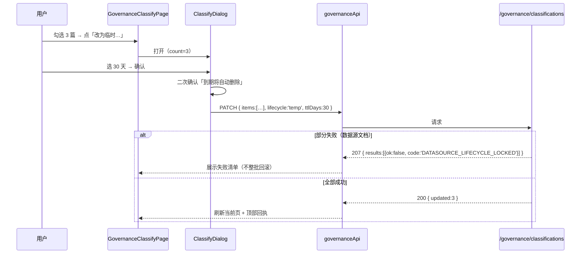
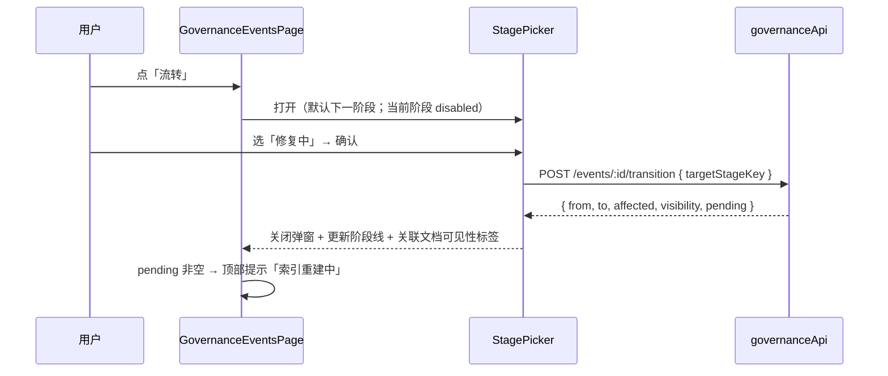
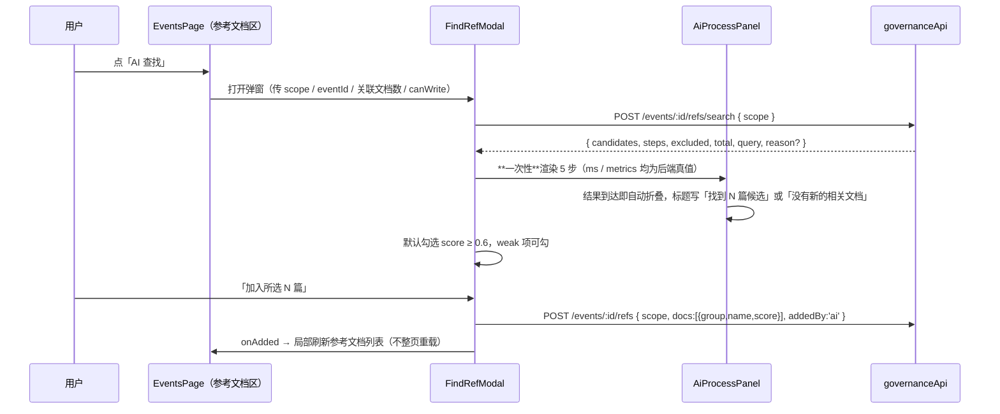

# S-07 前端三页与徽标

> 父文档：`DESIGN.md`｜需求：`../requirement.md`（R5、R7、R8、R18、R24、R32、§8）
> 依赖：S-06｜**界面基线：`../demo/index.html`（用户 2026-11-15 拍板：以 demo 为准，不再出 ASCII 图）**
> 状态：**三页已落地 · AI 查找与只读门禁已补齐（§10）** ｜ 更新：2026-11-15

## 1. 术语

| 术语 | 定义 |
|---|---|
| 分类徽标 | 文档在列表 / 阅读器上的 `wiki / 临时 / 事件` 标记 |
| 剩余天数语气 | `≤2` 红 / `3~5` 琥珀 / `≥6` 中性 |
| 分段筛选 | demo 的 `.seg` 控件（全部 / 事件 / 临时 / wiki） |
| 阶段流水线 | demo 的 `.stage-line`（`is-done` / `is-current` / 未到达） |

## 2. 现状（AS-IS）

| 位置 | 现状 |
|---|---|
| `web/src/router/routes.tsx:48-99` | 12 条路由，无治理三页 |
| `web/src/layouts/AppShell.tsx:66-80` | `NAV_MAIN` 扁平 10 项 |
| `web/src/layouts/AppShell.tsx:219` | 侧栏按 `can('knowledge.write')` 隐藏导入/写入 |
| `web/src/api/httpApi.ts` | 单文件 1200+ 行，按域导出函数，内部有统一 request 封装 |
| `web/src/styles/ki.css` | 设计 token + `ki-badge` / `ki-seg` / `ki-tbl` 等 |
| `web/src/pages/BrowsePage.tsx` | 阅读器页头（模块抽屉 `ModuleDrawer`） |
| demo `index.html` | 三页 + 抽屉 + 11 个弹窗，视觉基线 |

## 3. 方案（TO-BE）

### 3.1 路由与导航

```
/governance/classify   文档分类
/governance/events     事件（含「事件类型」页内 tab）
/governance/trash      回收站
```

`routes.tsx` 新增 3 条（均 `RequireCapability cap="knowledge.read"`，**只读用户可看**；写按钮按 `knowledge.write` 禁用而不是隐藏路由——需求 R34「只读可看不可改」）。

`AppShell.tsx` 的 `NAV_MAIN` 拆为两组（demo 侧栏形态）：

```ts
const NAV_WORKSPACE = [ /* 现有 10 项 */ ];
const NAV_GOVERNANCE = [
  { to: '/governance/classify', label: '文档分类', icon: 'tag', badge: 'count' },
  { to: '/governance/events',   label: '事件',     icon: 'event', badge: 'openCount' },
  { to: '/governance/trash',    label: '回收站',   icon: 'trash', badge: 'trashCount' },
];
```

计数来源：分类页面头一次性返回三页计数（`GET /governance/diagnostics` 或列表返回的 `total`），侧栏只读缓存，不在侧栏单独发请求。

### 3.2 与 demo 的 6 处差异（实现时按此修正，布局不动）

| # | demo 现状 | 实现要求 | 依据 |
|---|---|---|---|
| 1 | 事件类型页第 3 列「进入时动作」（挂在阶段上） | 删掉该列；页头加类型级「终态动作」切换（保留在库 / 移入回收站） | S-02 §3.6（demo `index.html:3552/3773` 会静默丢 `terminalAction`） |
| 2 | 事件详情阶段线写死 4 段（`STAGE_VIS` 常量） | 按所选事件的 `type.stages` 渲染，切换事件/类型即重算 | S-02 §3.3 |
| 3 | 分类页行内「改」与批量条 4 按钮无 handler | 全部接线：行内「改」→ 单篇改分类弹窗；批量条 4 动作 → 批量接口 | S-01、R7 |
| 4 | 倒计时 3 天标红、12 天标琥珀、文案写「≤3 天转红」 | 统一 `≤2` 红 / `3~5` 琥珀 / `≥6` 中性，文案同步 | 需求 §4.3 |
| 5 | 回收站筛选 4 档（缺兜底过期） | 补第 5 档「兜底过期」；恢复回执展示「已按原期限续期 N 天」 | S-04 §3.4 |
| 6 | 浏览页无分类徽标 | 阅读器页头加 `[临时 · 剩 3 天]` / `[当前不可被检索]`，**不加高度**（复用现有 badge 行） | 需求 §8.2、Q5 定案 |

另：事件列表的类型筛选计数在 demo 里只覆盖 3 个内置类型，实现改为按实际类型动态生成。

### 3.3 页面结构

```
web/src/pages/                                  # 实际落地：ClassifyPage / EventsPage / TrashPage
├─ ClassifyPage.tsx            # 表格 + 分段筛选 + 批量条 + 改分类弹窗 + 预设管理
├─ EventsPage.tsx              # 左列表（搜索/类型/状态/限高滚动） + 右详情
│                              #   右详情含：阶段线 / 关联文档 / 参考文档 / MCP 示例 / AI 分析
│                              #   页内 tab：事件列表 / 事件类型
│                              #   ⚠️ 现有弹窗（AddRefModal / NewEventModal / TransitionModal…）仍内联在本文件
└─ TrashPage.tsx               # 表格 + 原因筛选 + 行内恢复/沉淀 + 批量 + 设置弹窗

web/src/components/governance/                  # B8 新建本目录，只放"AI 查找"两个组件
├─ FindRefModal.tsx            # 弹窗壳：请求编排 + 状态机 + 候选勾选 + 页脚动作
└─ AiProcessPanel.tsx          # 5 步执行过程（可折叠、每步可展开、真实数字）
```

**目录策略（2026-11-15 拍板）**：三页现有弹窗**不搬家**——把 6 个内联弹窗抽出去属于纯重构，与本增量无关，会稀释回归面。新组件单独进 `components/governance/`，后续改动顺着这个目录长，逐步收敛。

组件复用而非重写：文档抽屉直接复用 `web/src/components/ModuleDrawer.tsx`（`data-doc` 点击 → 传入 `{module, group, highlightQuery}`），阶段 chip 拖动逻辑照搬 demo 的 `flipAfter` + 容器级 `dragover`（含幂等短路，`index.html:3712-3754`）。

### 3.4 关键交互规则

| 场景 | 行为 |
|---|---|
| 只读用户 | 页面可进；所有写按钮 `disabled` + `title="需要写权限"`；后端仍 403 兜底 |
| 改分类为 temp | 弹窗内必选期限；确认时二次确认「到期将自动删除」 |
| 数据源文档 | 分类徽标 + 「由数据源同步」，改分类按钮禁用并外显原因（S-01 `editable=false`） |
| 流转 | 二次确认弹窗，默认选中下一阶段；与当前相同则确认按钮禁用（N11） |
| 事件未收口 | 删除按钮 `disabled` + tooltip「先流转到终态」 |
| 类型在用 / 内置 | 删除按钮 `disabled` + 旁边写明原因（不弹窗才知道） |
| 回收站未勾选 | 点批量操作 → 提示条「先勾选要处理的文档」，不静默 |
| **AI 候选** | 默认勾选 `score ≥ 0.6`；低分项标 `weak` 但可勾；**结果到达后一次回填 5 步（ms 为真实值）并自动折叠**，不做逐步回放 |
| **AI 查找零候选** | 按后端 `reason` 分档写文案（`no-keywords` / `empty-scope` / `no-hits` / `all-excluded`），`empty-scope` 要提示「事件与知识文档可能不在同一 scope」 |
| **AI 查找失败** | 弹窗内错误条 + 主按钮禁用 + 「改用手动添加」一键切换，不关闭弹窗丢上下文 |
| 索引 pending | 分类页顶部提示「3 篇文档索引切换中」，点击展开诊断明细 |
| 空态 | 三页各自空态文案（demo `index.html:2107-2110` / `:2255`） |

### 3.5 状态与数据层

新增 `web/src/api/governanceApi.ts`（不塞进 `httpApi.ts`），复用其内部 request 封装导出的能力；类型放 `web/src/api/governanceContract.ts`，与 `src/lib/governance-contract.ts` 双份对齐（同 `chatContract` 模式，由测试逐字段比对）。

请求策略：

- 三页均为**页面级一次性拉取 + 操作后局部刷新**，不引 react-query 的全局缓存（与现有页面一致）
- 列表分页：滚动到底加载（`hasMore`），保持 demo 的限高滚动体验
- 写操作成功后再刷新（失败保留原状态 + 错误条），避免"界面已变但后端失败"

## 4. 数据模型（前端态）

```ts
interface ClassifyPageState {
  filter: 'all' | 'event' | 'temp' | 'wiki';
  sort: 'none' | 'remain-asc' | 'remain-desc';
  q: string;
  selected: Set<string>;                 // `${group}\u0000${name}`
  rows: ClassificationRow[];
  total: number; hasMore: boolean;
}

interface EventsPageState {
  tab: 'list' | 'types';
  selectedEventId: string | null;
  filters: { q: string; typeId: string | 'all'; status: 'open' | 'closed' | 'all' };
  events: EventListItem[];
  types: EventTypeRecord[];
  refs: RefRow[];
  aiProcess: { steps: RefSearchStep[]; collapsed: boolean; running: boolean } | null;
}

interface TrashPageState {
  reason: 'all' | 'temp-expired' | 'event-closed' | 'event-expired' | 'manual';
  selected: Set<string>;                 // dirName
  items: TrashItem[];
  settings: TrashSettings;
}
```

## 5. 时序图

### 5.1 分类页批量改分类



### 5.2 事件流转



### 5.3 参考文档 AI 查找



**不做逐步回放（2026-11-15 拍板）**：后端是一次请求、无中间事件，逐帧演只能靠前端定时器伪造时序，既违背 R30 本意，又让用户多等一遍。真实耗时由 loading 态承载，`ms` 仍逐字来自后端。

## 6. 接口设计

前端只消费 S-06 的 29 条路由，额外需要 1 条聚合（减少首屏请求）：

```ts
// GET /api/governance/counts?scope=...
{ ok: true, classify: 168, eventsOpen: 15, trash: 7 }
```

侧栏 badge 与三页页头共用，避免每页各拉一次全量列表。

```json
// Demo 返回示例（仅示意格式）
{ "ok": true, "classify": 168, "eventsOpen": 15, "trash": 7 }
```

### 6.1 异常处理

| 场景 | 行为 | 对外暴露 |
|---|---|---|
| 批量改分类部分失败（数据源文档） | 展示失败清单，成功的照常刷新；不整批回滚 | 是（逐条原因） |
| 流转后索引 `pending` | 顶部提示「N 篇索引切换中」，可展开诊断；不阻塞后续操作 | 是 |
| 索引切换失败（blocked） | 分类页顶部红条 + 「重试」按钮（走 diagnostics 的重试入口） | 是 |
| 写接口 403（只读用户绕过禁用按钮） | 全局错误条「需要写权限」+ 刷新权限态 | 是 |
| 409 `REVISION_CONFLICT`（两人同时编辑类型） | 弹窗「该类型已被他人修改，已为你刷新」+ 丢弃本地改动 | 是 |
| 409 `RESTORE_NAME_CONFLICT`（恢复同名） | 行内错误「同组已存在同名文档，请先改名」 | 是 |
| 网络超时 / 5xx | 保留已渲染列表不变 + 顶部可重试错误条（不清空数据） | 是 |
| AI 候选检索 `SEARCH_UNAVAILABLE` | 弹窗内错误条「向量服务不可用，可改用手动添加」+ 主按钮禁用 + 一键切到「＋ 添加」，**不关弹窗** | 是 |
| AI 候选 0 条 | 按 `reason` 分档文案（`no-keywords` / `empty-scope` / `no-hits` / `all-excluded`），`empty-scope` 追加「事件与知识文档可能不在同一 scope」 | 是 |
| 流转成功但 `pending` 非空 | 阶段线立即更新，可见性标签显示「切换中」而非最终档位 | 是 |

## 7. 影响范围

```
web/src/
├─ router/routes.tsx                     # [已完成] +3 路由
├─ layouts/AppShell.tsx                  # [已完成] NAV 拆两组 + badge
├─ pages/LifecyclePage.tsx               # [已完成] 文档分类页
├─ pages/EventsPage.tsx                  # [已完成 + 本期改] 参考文档区「AI 查找」→ 打开弹窗；只读门禁
├─ pages/TrashPage.tsx                   # [已完成 + 本期改] 只读门禁
├─ pages/BrowsePage.tsx                  # [已完成] 阅读器页头徽标（不加高度）
├─ components/governance/FindRefModal.tsx    # [本期新增]
├─ components/governance/AiProcessPanel.tsx  # [本期新增]
├─ components/ModuleDrawer.tsx           # [只读] 复用，不改
├─ api/governanceApi.ts                  # [已完成 + 本期改] findRefCandidates / searchDocs / addRefs(addedBy,score)
├─ api/governanceContract.ts             # [已完成 + 本期改] 与 src/lib/governance-contract.ts 对齐
├─ layouts/AppShell 图标                 # [已完成] icons.tsx 加 tag/event/trash
└─ styles/governance.css                 # [本期追加] demo 的 .ai-proc* / .ai-step* / .cand* → gov-* 前缀
test/governance-contract.test.ts         # [已完成 + 本期改] 前后端 DTO 字段比对
```

**样式落点订正（2026-11-15）**：治理三页样式实际落在 `web/src/styles/governance.css`（全部 `--ki-*` token、`gov-` 前缀、禁字面色值），**不改 `ki.css`**——原设计把类名写进 `ki.css` 会和浏览页既有类争用。

**不改**：`ModuleDrawer.tsx`（复用现状）、`BrowsePage` 的列表与筛选逻辑、三页现有 6 个内联弹窗（搬家属纯重构，不在本增量）。

## 8. 关键决策点

| # | 决策 | 被否决方案 | 否决理由 |
|---|---|---|---|
| 1 | 只读用户可进三页、按钮禁用 | 路由层直接 `RequireCapability(knowledge.write)` 挡掉 | 需求 R34 要求"只读可看不可改"；挡路由会让只读用户完全看不到治理信息 |
| 2 | 页面级拉取 + 局部刷新，不引全局缓存 | 用 react-query 统一缓存 | 与现有 12 个页面不一致；治理页数据变更频率低，收益低于一致性成本 |
| 3 | 新 api 文件而非塞进 `httpApi.ts` | 继续加进单文件 | 该文件已 1200+ 行；治理域有 30 条接口，再塞会失控 |
| 4 | 组件按治理域独立目录 | 复用现有零散组件 | 阶段线 / 阶段构建器 / AI 过程面板都是新形态，现有组件无同类 |
| 5 | 徽标只在阅读器页头，不改列表 | 分类页之外也在列表加徽标 | 需求 §8.2 明确"不加高度、不改列表"，避免浏览页变成治理页 |
| 6 | AI 过程用真实 `steps`，**结果到达后一次回填** | 前端按定时器逐条播放 | 后端单次请求无中间事件，逐帧只能伪造时序；且让用户先等请求、再等动画（两遍）。真实耗时由 loading 承载，数字仍逐字来自后端 |
| 7 | 新组件进 `components/governance/`，存量内联弹窗不动 | 顺手把 6 个弹窗一起抽出 | 纯重构会稀释本增量的回归面，且与 AI 查找无因果关系 |

重新评估触发条件：若三页首屏请求 > 6 次或首屏 > 1.5s，改为聚合接口（`/governance/overview`）一次返回。

## 9. 待定问题

| # | 问题 | 影响 | 建议 |
|---|---|---|---|
| 1 | 分类页是否需要「按 group 筛选」 | 大盘可用性 | 一期不做（demo 也没有）；group 默认分类在设置入口配 |
| 2 | 事件详情「AI 分析」入口 | 属 REQ-20261113-003 | 已实现为弹窗（`AiAnalyzeModal`），与 AI 查找互不影响 |
| 3 | 窄屏（≤375px）三页的表格堆叠 | 移动可用性 | 沿用 demo 的两段堆叠规则（`index.html:1900-1918`） |

## 10. 增量落地记录（2026-11-15 · AI 查找）

### 10.1 现状校准

| 项 | 原设计 | 实际 | 结论 |
|---|---|---|---|
| 页面文件 | `Governance*Page.tsx` | `LifecyclePage / EventsPage / TrashPage.tsx` | 本节按实际文件名书写 |
| 组件目录 | 10 个组件 | **不存在该目录**，弹窗内联在页面里 | 本增量只建 2 个新组件 |
| AI 查找 | 弹窗 + 过程面板 + 勾选 | 一键发 `active.title` 当手动搜索词，命中即**自动加入前 3 条** | 重做（违反 R28/R29） |
| 过程面板 | `.ai-proc*` 在 `ki.css` | 无样式、无组件 | 移植到 `governance.css`，改名 `gov-` 前缀 |

### 10.2 组件契约

```ts
// FindRefModal.tsx
interface FindRefModalProps {
  scope: string;
  eventId: string;
  /** 仅用于副标题「基于事件标题与 N 篇关联文档检索」 */
  assocCount: number;
  /** 只读账号：加入按钮禁用 + title「需要写权限」 */
  canWrite: boolean;
  onClose: () => void;
  /** 成功加入后回调；父级做局部刷新，不整页重载 */
  onAdded: (added: number) => void;
}

// AiProcessPanel.tsx
interface AiProcessPanelProps {
  steps: RefSearchStep[];      // ms / metrics 全部来自后端
  durationMs: number;
  state: 'loading' | 'done' | 'error';
  candidateCount: number;
  /** 0 候选时的分档文案依据 */
  reason?: 'no-keywords' | 'empty-scope' | 'no-hits' | 'all-excluded';
}
```

`canWrite` 取值：`useAuth()` 的 `user?.role !== 'viewer'`（本机管理端未登录时按可写处理），与三页既有按钮的权限口径一致。

### 10.3 状态机

| 状态 | 进入条件 | 过程面板 | 主按钮 |
|---|---|---|---|
| `loading` | 弹窗打开即请求 | 「正在检索…」+ 转圈 | 「检索中…」disabled |
| `done` | `candidates.length > 0` | 折叠 + 「检索完成 · 找到 N 篇候选」+ 「5 步 · N 次调用 · X.Xs」（调用数按真实 `calls` 累加） | 「加入所选 N 篇」/「未选择」disabled |
| `empty` | `candidates.length === 0` | 折叠 + 「检索完成 · 没有新的相关文档」（按 `reason` 换文案） | 「未选择」disabled |
| `error` | 503 / 网络异常 | 不渲染步骤，显示错误条 | disabled + 「改用手动添加」 |

加入成功后：`onAdded` → 关闭弹窗 → 父级刷新参考文档区（**不再走 `run()` 全页重载**）。

### 10.4 样式映射（demo → governance.css）

| demo 类 | 落地类 | 备注 |
|---|---|---|
| `.ai-proc` / `__head` / `__title` / `__time` / `__spin` / `__steps` | `.gov-ai-proc` 同名后缀 | 转圈用 `data-done` 切静态圆点 |
| `.ai-step` / `.is-running` / `.is-done` / `__mark` / `__body` / `__head` / `__text` / `__chev` / `__detail` | `.gov-ai-step` 同名后缀 | 每步可展开（`aria-expanded`） |
| `.cand-list` / `.cand` / `.cand__name` / `.cand__meta` / `.cand__why` / `.cand__score` | `.gov-cand-list` 等（**已存在**） | 只新增 `__why` 与 `__score--weak` |
| `.ai-call*` | **不移植**，改用 `ki.css` 现成的 `.ki-chat-tl__node--tool` / `__skill` / `__act` / `__tool` / `__stat` | 调用行复用 AI 对话那套视觉，站内只有一种长相（S-05 §3.3 二次修订） |

### 10.5 手工验收

| # | 场景 | 期望 |
|---|---|---|
| 1 | 正常命中 | 候选带分数/理由/可见性；≥0.6 默认勾；面板自动折叠且 5 步齐全 |
| 2 | 步骤展开 | 第②步见线索词、第④步见被排除的文档名 |
| 3 | 全部低分 | 全部不勾，主按钮「未选择」且禁用 |
| 4 | 0 候选 | 文案与 `reason` 一致；`empty-scope` 提示换 scope |
| 5 | 向量服务不可用 | 错误条 + 「改用手动添加」可切到 ＋添加 |
| 6 | 只读账号 | 候选可见可查，加入按钮禁用 + tooltip |
| 7 | 竞态 | 弹窗开着时别处已加入同篇 → 加入返回 `skipped`，提示「已跳过 N 篇」 |
| 8 | 加入后 | 参考文档区立即出现新条目，页面不整屏闪烁 |

### 10.6 只读账号门禁落地（B9 · R34）

**口径**（对应 §3.4「只读用户」一行）：页面可进、数据全可见，**写入口 `disabled` + `title="需要写权限"`**，
页内再给一行说明；后端 `knowledge.write` 仍 403 兜底。**不藏按钮**——藏起来用户不知道"是没这功能还是没权限"。

**判定源**：`useAuth().can('knowledge.write')`（页面只判 capability，不判 role，与 authContext 约定一致）。

| 页面 | 已门禁的写入口 |
|---|---|
| `LifecyclePage` | ＋ 新建分类、批量「改 wiki / 临时 7 / 临时 30」、行内「改分类」、改分类弹窗「应用」、新建分类弹窗「新建分类」 |
| `TrashPage` | 批量恢复、批量彻底删除、行内「恢复」、行内「沉淀为 wiki」、设置弹窗「保存」 |
| `EventsPage` | ＋ 新建事件、＋ 新建类型、删除类型、阶段可见性三档、阶段停用/启用、＋ 追加阶段、重新打开、删除事件、流转、＋ 添加参考文档、参考文档「×」 |

**刻意不禁用的读操作**（避免"一刀切禁用"造成功能缺失）：

- `EventsPage` 的「AI 查找」——检索是读，加入才写（弹窗内按 `canWrite` 单独门禁）；
- `EventsPage` 的「AI 分析」——只读定位代码；
- `TrashPage` 的「回收站设置」入口——看设置是读，只有「保存」需要写；
- 全部筛选 / 排序 / 刷新 / 取消选择 / 列表与详情查看。

**取证**：`web tsc --noEmit` + `vite build` 通过；三页 `disabled={busy` 的残留项经逐条核对，
只剩上述"读操作"与 `disabled={busy || !canWrite}` 的已门禁项（无遗漏的写入口）。

### 10.7 手动添加对齐 demo（B10）

用户走查对比 demo 的 `添加参考文档` 弹窗，指出"手动添加的也不一样"。逐项对齐（行为口径见 S-05 §3.4）：

| 项 | 初版 | 对齐后（= demo） |
|---|---|---|
| 打开弹窗 | 输入框为空 → **列表空白、无任何提示** | 列「未关联/未加入」的前 20 篇 |
| 0 命中 | 仅在有输入时给一句提示 | `没有匹配的文档（已排除关联文档与已加入的参考文档）` + 核对 scope 提示 |
| 候选行 | 左：名字 + group；右：可见性圆点 | 一行小字 `group · 可见性`（与 AI 候选行、demo 三处同构） |
| 主按钮 | `加入所选`（恒为此文案） | `未选择`（禁用） / `加入所选 N 篇` |
| 结果轮换 | 保留上一批 scrollTop，首行可能被裁半截 | 换一批即 `scrollTop = 0` |

**未对齐项（有意保留差异）**：demo 的 `REF_SEARCH_POOL` 是演示数据；真实实现的分页上限 20、
搜索防抖 250ms（空查询 0ms），并额外带「已加入」禁用态兜住"弹窗打开后别人加过"的竞态。
