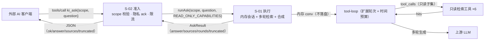
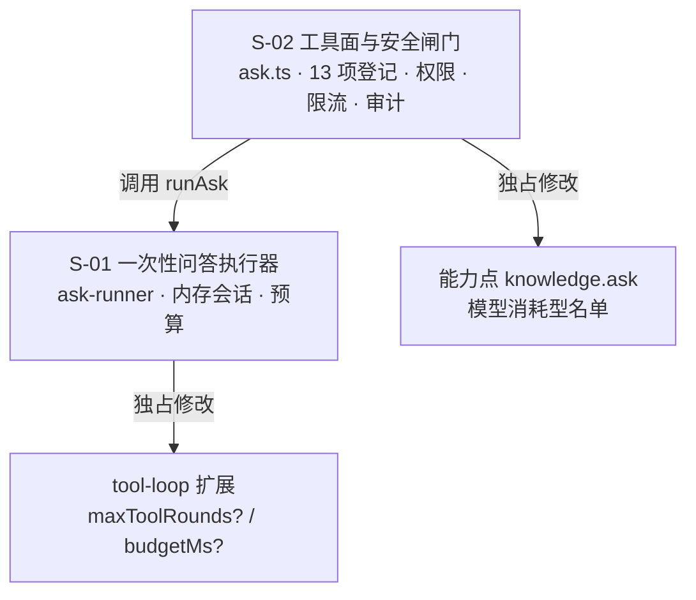

# ki_ask 无状态 AI 问答工具 · 总体设计

> 需求：REQ-20261113-001　日期：2026-11-13　子需求：S-01、S-02
> 输入：`requirement.md`（v2）+ `demo/verify-report.md`（形态 B 有条件通过）

---

## 1. 需求背景 & 目标

**背景**：ki 现有 14 个 MCP 工具均为知识库原子操作。外部 AI 客户端只能「自己检索、自己合成」；实测同题外部 AI 直连 `ki_search` 3 种措辞 0 命中，而 ki 侧多轮检索能答对并给出 55 条来源。

**目标**：新增 MCP 工具 `ki_ask` —— 一次调用完成「内部多轮检索 + 合成 + 来源」，**每次全新、不落盘、不进会话列表**，端到端 < 60s（客户端硬超时）。

**不在范围**：二期 `context_id` 续接与 10 分钟 TTL；web 页面改动；`monitor-memory` 向量索引异常排查。

---

## 2. 关键环节一览图

---

## 3. 总体方案设计

**共享术语速查**（子文档引用，不重复定义）

| 术语 | 权威定义 |
|---|---|
| `AskInput` / `AskResult` | S-01 §4a；S-02 只消费不改 |
| `ASK_MAX_ROUNDS_DEFAULT = 6` | S-01 §3.2 / §4a.1（配置项 `llm.askMaxRounds`，范围 1~12） |
| 软预算 25s / 硬预算 45s | S-01 §3.2（软 = 强制作答点，硬 = 兜底超时） |
| 内存会话骨架 | S-01 §3.2 / §4b（复用 `ConversationFile` 形状的 **13 个必填字段**，**不落盘**） |
| 强制作答 | 现有机制「拿掉 `tools` 再调一次」（`tool-loop.ts:692,769`），S-01 复用 |
| **内层恒只读** | S-01 §7（S-02 固定传 `READ_ONLY_CAPABILITIES = new Set(['knowledge.read'])`）⇒ 内层只有 6 个只读工具，**与 `PromptConfig.tools` 的用户配置无关**，且永不含 `ki_ask` |
| 能力点 `knowledge.ask` | S-02 §3.2（`/mcp` 实际不校验 capability，闸门是 scope + readOnly） |
| 模型消耗型工具 | S-02 §3.2（只读 Token 禁用的新名单 `MODEL_CONSUMING_TOOL_NAMES`） |
| 审计记录 | S-02 §4a.4（`AskLogFields` + `ASK_LOG_EVENTS`，**只记长度不记正文**） |
| 错误码前缀 `ASK_` | S-02 §4b.1（12 个码；对外**展平**为 `{ok,code,message,retryable}`） |

---

## 4. 全局风险 & 跨子需求依赖

| # | 风险 | 影响 | 处理 |
|---|---|---|---|
| R1 | `tool-loop` 改动波及现有 3 条对话链路（messages / regenerate / edit） | 高（回归） | 扩展一律**可选入参 + 缺省保持现状**；`npm run test:chat` 全量回归 |
| R2 | 客户端 60s 硬超时（外部不可控，SDK `DEFAULT_REQUEST_TIMEOUT_MSEC=60000`） | 高 | 硬预算 45s + `withTimeout` 双层兜底（S-01 定预算、S-02 定超时档） |
| R3 | 单次问答 token 成本（实测 36 轮 ≈ 20~45 万 input tokens） | 中 | `ASK_MAX_ROUNDS_DEFAULT = 6`（单次降到约 50~60K） |
| R4 | 递归自调（内层 LLM 调 `ki_ask`） | 中 | 不登记 `CHAT_MCP_TOOLS` → 工具面天然不含；加一条守卫测试锁死 |
| R5 | 上游模型不可用 / 未配置 | 中 | fail-loud 专用错误码，不静默返回空答案 |
| R6 | 二期 `context_id` 兼容 | 低 | 一期返回不含该字段；二期为可选新增，不改一期语义 |
| R7 | 与导入/同步并发时行为不可预测 | 低 | 登记 `READ_MCP_TOOLS` 走读车道（与 `ki_search` 同性质） |

**跨子需求依赖**：S-02 依赖 S-01 的 `runAsk(AskInput): Promise<AskResult>` 契约（S-01 §4a）。**跨子需求共写的文件只有两处**，各由一方独占：`tool-loop.ts`（含 `chat-contract.ts` 的 `done` 事件）归 **S-01**；能力点枚举与四份工具清单归 **S-02**。

**交付方式**：单窗口串行（阶段 5.5 判定：改造现有逻辑占比高、共享面 2~4 处、砖头数 < 3 → 不走多窗口并行）。
