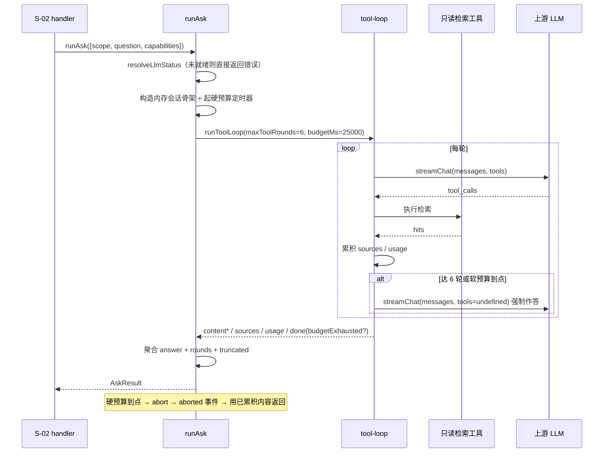

# S-01 一次性问答执行器 · 详细设计

> 父文档：[DESIGN.md](DESIGN.md)　需求：REQ-20261113-001　日期：2026-11-13
> 上游子需求：无　下游子需求：S-02（消费本子需求的 `runAsk` 契约）

---

## 1. 术语

| 术语 | 含义 | 引用 |
|---|---|---|
| **内存会话骨架** | 按 `ConversationFile` 形状构造、**只存在于内存**的会话对象，用于喂给 `runToolLoop`；不写盘、不进会话列表、不参与任何会话 API | — |
| **一次性问答** | 每次 `runAsk` 都是一次独立的检索 + 生成，不读任何历史（`messages` 恒为空） | 父文档 §3 |
| **轮次上限** | 内层工具循环允许的最大模型往返轮数，达上限改为「拿掉 tools 强制作答」 | — |
| **软预算** | 检索阶段的耗时上限；到点即触发**强制作答**（不再检索，但仍走一次生成） | — |
| **硬预算** | 整次问答的兜底耗时上限；到点 `abort` 上游，用**已累积内容**作答 | — |
| **截断作答** | 因轮次或预算提前收口的答案，`AskResult.truncated = true` | — |
| 能力集 `capabilities` | 调用方 principal 的能力集合，用于收窄内层工具面 | S-02 §4b |

> 6 条，未超 7；不拆理由：全部围绕"一次问答内部如何限时与收口"，拆开会把同一循环的判定分散到两处。

---

## 2. 现状（AS-IS）

### 2.1 现状描述

- 对话生成只有 3 个入口（`messages` / `regenerate` / `edit`），全部经 `chat-routes.ts::runGeneration()` 落到 `runToolLoop()`，**都强依赖已落盘的 `ConversationFile`**（`tool-loop.ts:82` 的 `conv` 为必填）。
- `runToolLoop()` 本身**不落盘**（`tool-loop.ts:599` 注释：「本函数只产出事件流；内容落盘由调用方」）。
- 轮次预算来自 `runtime.maxToolRounds`，内置值为 `Infinity`（`chat-contract.ts:475`），**无时间预算**。
- 工具面 = `CHAT_MCP_TOOLS` ∩ `PromptConfig.tools`（`tool-loop.ts:646-650`），由 `canUseTool` 按能力过滤。
- 达轮次上限后的语义已实现：拿掉 `tools` 再调一次（`tool-loop.ts:692,769,705`）。

### 2.2 痛点

- 痛点 1：**没有"不落盘也能跑"的入口**。想跑一次问答就必须先建会话文件，与"每次全新、不污染会话列表"直接冲突。
- 痛点 2：**轮次无上限**。实测同题出现 36 轮、62.4s，超出 MCP 客户端 60s 硬超时（`demo/verify-report.md` R-02）。
- 痛点 3：**无时间预算**。耗时完全由模型自觉决定，同一接口 6s 与 62s 并存，调用方无法预期。
- 痛点 4：**耗时构成被误解**。工具执行只占总耗时 6%，真正的成本是「轮次 × 单轮生成」，因此限轮次才是有效手段。

---

## 3. 方案（TO-BE）

### 3.1 方案概述

新增 `src/lib/chat/ask/`（2 个文件）：`ask-contract.ts` 定义契约与常量，`ask-runner.ts` 提供 `runAsk()`。`runAsk` 构造**内存会话骨架** → 带 `maxToolRounds` 与 `budgetMs` 调 `runToolLoop()` → 消费事件流聚合成 `AskResult`。`tool-loop` 仅做两处**可选入参**扩展，不传时行为与现在完全一致。

### 3.2 关键决策点

| 决策 | 选择 | 理由 | 备选方案 | 否决原因 | 重新评估触发条件 |
|---|---|---|---|---|---|
| 复用 `tool-loop` 还是新写问答引擎 | **复用**（内存骨架驱动） | 检索策略、反幻觉注入、`use_skill`、sources 投影全部现成；行为与页面一致（用户要"就像页面这样"） | 新写一个精简 RAG 引擎 | 重复实现提示词注入与工具循环约 800 行，且日后必然与页面行为漂移 | 若 `tool-loop` 出现"必须有落盘会话才能工作"的新耦合，且改造成本 > 重写 |
| 轮次上限的注入方式 | **`ToolLoopInput` 加可选 `maxToolRounds`** | 单点覆盖、默认 `undefined` 时沿用 `runtime` 值，存量 3 条链路零改动 | ① 直接改 `CHAT_BUDGET.maxToolRounds` 全局值；② `ask-runner` 外部计数后 `abort` | ① 会改变页面现有行为（36 轮→6 轮是产品决策，不能在无人察觉处发生）；② `abort` 丢弃已生成内容，无法"收口作答" | 若对话侧也需要独立配置轮次上限，改为 `PromptConfig.maxToolRounds` 字段 |
| 时间预算的实现方式 | **循环内软预算（复用强制作答）+ 外部硬兜底** | 软预算能"收口作答"而不是硬切；硬兜底保证 45s 一定返回 | 只用 `AbortController` 硬切 | 硬切丢失全部已生成内容，且用户在等待 45s 后拿到失败，体验与信息量双输 | 若上游出现"最后一次生成也超 20s"，需下调软预算并复测 |
| 会话对象形态 | **复用 `ConversationFile` 形状的内存对象** | `tool-loop` 的 `conv` 是必填且被多处读取（`injected` / `loadedSkillIds` / `messages` / `seq`），改签名会波及 3 条链路 + 全部测试夹具 | 新建轻量 `AskSession` 并给 `tool-loop` 加泛型 | 为省 10 行构造代码而改核心签名，回归面远大于收益 | 若 `ConversationFile` 新增必填字段且与问答无关，改为部分类型 `Pick` |
| 是否注入 `injected` 快照 | **不注入**，每轮按当前 `PromptConfig` 组装 | 无会话语义下"首轮快照"没有承载物；10 分钟窗口内配置变更概率低，用户可接受 | 落盘一份快照 | 违背"不落盘"核心约束，且快照文件本身需要 TTL | 若出现"同一问题两次调用答案风格不一致"被投诉 |
| 默认轮次上限 | **6 轮**（配置项 `llm.askMaxRounds`：默认 6、范围 1~12、越界 fail-loud） | 实测 3 轮可答好事实类问题，11 轮为排查类，36 轮属"穷举清单"（更适合外部 AI 直接调 `ki_search`）。6 轮 ≈ 15~20s，留足作答与序列化余量 | 8 轮 / 12 轮 | 8 轮实测约 19s、12 轮约 19s 但 token 翻倍；12 轮在慢模型上仍可能破 45s | 若线上 `truncated=true` 占比 > 30%，上调默认值至 8 并复测 p95 |
| 模型不支持 `tools` 时的行为 | **直接拒绝**（`ASK_TOOLS_UNSUPPORTED`） | 纯聊天答案不含任何知识库依据，与"基于知识库回答"的产品承诺冲突；静默降级会让调用方误判答案来源 | 复用现有 `pureChatPath` 降级（`tool-loop.ts:620-622`） | 返回"看起来正常但无依据"的答案，属静默失败，违背项目 fail-loud 原则 | 若上游模型普遍不支持 tools，改为显式 `allow_pure_chat` 参数由调用方选择 |

### 3.3 行为差异对照（对现有调用方）

| 场景 | AS-IS | TO-BE | 影响 |
|---|---|---|---|
| 页面发消息（不传新入参） | `maxRounds = Infinity`，无时间预算 | **完全不变** | 无 |
| `ki_ask` 调用 | — | `maxRounds = 6` + 软预算 25s + 硬预算 45s | 新增 |
| `done` 事件 | 无 `budgetExhausted` 字段 | 新增**可选**字段（仅预算触发时为 `true`） | 可选字段，消费方无需改 |

---

## 4a. 接口设计

### 4a.1 契约与常量（`src/lib/chat/ask/ask-contract.ts`，新增）

```ts
/** 内层工具循环的默认轮次上限（父文档共享术语 ASK_MAX_ROUNDS） */
export const ASK_MAX_ROUNDS_DEFAULT = 6;
/** 轮次上限的可配置上界（配置越界即 fail-loud，不静默钳制） */
export const ASK_MAX_ROUNDS_LIMIT = 12;
/** 软预算：检索阶段到点改为强制作答（不再发起新的工具轮） */
export const ASK_SOFT_BUDGET_MS = 25_000;
/** 硬预算：整次问答兜底，到点 abort 上游并用已累积内容作答 */
export const ASK_HARD_BUDGET_MS = 45_000;

export interface AskInput {
  /** 单个知识库名（S-02 已校验形态与存在性；一期不接受视图名/逗号多库） */
  scope: string;
  /** 用户问题原文（非空由 S-02 校验） */
  question: string;
  /**
   * **内层工具面的能力上界**（不是"调用方权限校验"）。
   * S-02 固定传 `new Set(['knowledge.read'])` ⇒ 内层只能看到 6 个只读工具；
   * 缺省 = 不过滤（仅限单测直接调用，生产入口必须传）。
   */
  capabilities?: ReadonlySet<Capability>;
  /** 调用方中止信号（S-02 的硬超时也会并入此信号） */
  signal?: AbortSignal;
}

export interface AskResult {
  ok: boolean;
  /** markdown 正文；`truncated` 时仍是完整可读的部分答案 */
  answer: string;
  /** 已去重的来源引用（无命中时为空数组，**不输出空占位**） */
  sources: SourceRef[];
  /**
   * 净化（丢弃空投影 + 截断到 15 条）**前**的来源条数。
   * `sourcesTotal > sources.length` ⇒ 有来源被过滤/截断，调用方据此区分"证据只有这些"与"被截断了"。
   */
  sourcesTotal: number;
  /**
   * **内层工具调用次数**（按 `tool_end` 计）。
   * ⚠️ 不等于模型往返轮数：一次响应可含 N 个 `tool_calls`（`tool-loop.ts:49` 实现细节 a），
   * 故本值可能大于实际轮次；用于审计与截断归因，不用于预算计算。
   */
  rounds: number;
  /** 本层实测耗时（含强制作答），S-02 用于审计 */
  elapsedMs: number;
  /** 因轮次上限或软/硬预算提前收口 */
  truncated: boolean;
  /** 收口原因（`truncated=false` 时缺省）；S-02 原样透传给调用方 */
  truncatedReason?: 'round-limit' | 'time-budget' | 'hard-timeout';
  /** 降级说明（**仅检索工具失败时**产生；模型不支持 tools 已改为直接拒绝） */
  degraded?: { reason: string; message: string };
  usage?: { promptTokens: number; completionTokens: number; reasoningTokens?: number };
  /** 失败时缺省 ok:false + error；**对外形状由 S-02 展平为 `{ok,code,message,retryable}`** */
  error?: { code: string; message: string; retryable: boolean };
}
```

### 4a.2 执行器（`src/lib/chat/ask/ask-runner.ts`，新增）

```ts
export async function runAsk(input: AskInput): Promise<AskResult>;
```

| 接口 | 输入 | 输出 | 异常 |
|---|---|---|---|
| `runAsk` | `AskInput` | `AskResult`（**不抛**：所有失败归一为 `ok:false + error`） | 无（内部捕获） |

> **前置责任分工**：隐私确认（`ackRequired`）、scope 校验、限流都由 S-02 在调用前完成，**`runAsk` 不重复校验**。任何绕过 S-02 直接调用 `runAsk` 的新入口，必须自行补上这三道闸门 —— 否则等于绕过"知识库内容外发确认"。

**内部流程**（5 步，缺一不可）：

1. 就绪闸门：`resolveLlmStatus(loadConfig())` → `!enabled` 返回 `ASK_LLM_NOT_READY`；`supportsTools === false` 返回 `ASK_TOOLS_UNSUPPORTED`。两者都**不发起上游请求**。
2. 构造内存会话骨架（**13 个必填字段，缺一即 TS 报错**）：`version: 1`、`id = 'ka-' + base36(now) + rand6`、`scope`、`title: ''`、`systemPrompt: ''`、`archived: false`、`archivedAt: null`、`createdAt/updatedAt: new Date().toISOString()`、`seq: 0`、`messageCount: 0`、`lastMessagePreview: ''`、`messages: []`。**不写盘**。
3. 起 `AbortController`：`ASK_HARD_BUDGET_MS` 后 `abort()`，并与 `input.signal` 联动（任一触发即中止）。
4. `for await (const ev of runToolLoop({ scope, conv, userText: question, convSystemPrompt: '', capabilities, maxToolRounds, budgetMs: ASK_SOFT_BUDGET_MS, signal: ac.signal }))`，按下表聚合。其中 `maxToolRounds = loadConfig().llm?.askMaxRounds ?? ASK_MAX_ROUNDS_DEFAULT`（越界 → `ASK_INTERNAL` 并 fail-loud，不静默钳制）。
5. `clearTimeout` + 返回 `AskResult`。

**事件聚合规则**：

| 事件 | 处理 |
|---|---|
| `content` | 追加到 `answer` |
| `reasoning` | **只计数不返回**（N12：reasoning 永不外传） |
| `tool_start` / `tool_end` | `rounds += 1`（**按 `tool_end` 计 = 工具调用次数**，不是模型往返轮数）；`tool_end.error` 记录但不中断 |
| `sources` | 覆盖为当前累积来源（`tool-loop` 已在内部 `dedupeSources`） |
| `usage` | 记录最后一次 |
| `degraded` | 记录（至多一次；仅检索失败来源） |
| `context` / `meta` / `skill` | 忽略 |
| `error` | 归一为 `error: { code, message, retryable }`，`ok:false` |
| `aborted` | `ok: answer.length > 0`；有内容则返回部分答案 + `truncated:true` + `truncatedReason='hard-timeout'`；无内容则 `ASK_TIMEOUT` |
| `done` | `done.warning === 'tool-rounds-exhausted'` → `truncated=true` + `truncatedReason='round-limit'`；`done.budgetExhausted === true` → `truncated=true` + `truncatedReason='time-budget'`（同时命中时取 `time-budget`） |

### 4a.3 对 `tool-loop.ts` 的具体改动（3 处，均为最小侵入）

| # | 位置 | 现状 | 改成 |
|---|---|---|---|
| 1 | `tool-loop.ts:641` | `const maxRounds = runtime.maxToolRounds;` | `const maxRounds = input.maxToolRounds ?? runtime.maxToolRounds;` |
| 2 | `tool-loop.ts:685-693`（`while` 顶部） | `const reachedLimit = round >= maxRounds; if (reachedLimit) roundsExhausted = true;` | 增加 `startedAt`（循环前 `const startedAt = Date.now()`）与一次判定：`const overBudget = input.budgetMs !== undefined && Date.now() - startedAt >= input.budgetMs;` → `const reachedLimit = overBudget \|\| round >= maxRounds;` → `if (round >= maxRounds) roundsExhausted = true;` → `if (overBudget) budgetExhausted = true;` |
| 3 | `tool-loop.ts:930-935`（`finalize` 调用）与 `:1040-1071`（`finalize` 定义） | 只透传 `roundsExhausted` | 增加 `budgetExhausted` 入参，并在 `done` 事件里 `...(budgetExhausted ? { budgetExhausted: true } : {})` |

**不变量（必须保持不变）**：

- 两个新入参均**可选**；不传时 `overBudget` 恒为 `false`、`maxRounds` 沿用 `runtime` 值 → 现有 3 条对话链路行为逐字节不变。
- `warning` 枚举**不改**：轮次触发仍报 `tool-rounds-exhausted`，预算触发额外带 `budgetExhausted: true`（新增可选字段），避免前端既有分派逻辑失效。

### 4a.4 对现有模块的接口变更

```ts
// src/lib/chat/retrieval/tool-loop.ts
export interface ToolLoopInput {
  // ...现有字段不变
  /** 覆盖本次循环的轮次上限；缺省沿用 runtime.maxToolRounds（存量行为不变） */
  maxToolRounds?: number;
  /** 检索阶段的时间预算（毫秒）；到点视同达上限，改为强制作答；缺省不限 */
  budgetMs?: number;
}
```

```ts
// src/lib/chat/chat-contract.ts —— done 事件（仅新增可选字段）
| { type: 'done'; messageId: string; finishReason: string; sources: SourceRef[];
    warning?: 'tool-rounds-exhausted' | 'conversation-too-long';
    /** 因时间预算而非轮次触发的收口（S-01 新增，可选） */
    budgetExhausted?: boolean }
```

### 4a.5 契约变更声明

| 变更类型 | 接口 | 变更内容 | 影响的子需求 |
|---|---|---|---|
| 新增 | `runAsk` / `AskInput` / `AskResult` | 全新 | S-02（消费） |
| 修改 | `ToolLoopInput` | 新增 2 个**可选**字段 | 无（存量调用方不传即不变） |
| 修改 | `ChatEvent.done` | 新增 1 个**可选**字段 | 无（前端按 `data.type` 分派，不读该字段也不受影响） |

---

## 4b. 数据模型

**不涉及持久化**（本子需求的核心约束：不落盘）。内存中的会话骨架形状见 §4a.2 第 2 步，字段取自 `chat-contract.ts:283-305`，**13 个必填字段**（`version` / `id` / `scope` / `title` / `systemPrompt` / `archived` / `archivedAt` / `createdAt` / `updatedAt` / `seq` / `messageCount` / `lastMessagePreview` / `messages`），可选字段（`ownerUserId` / `compaction` / `injected` / `loadedSkillIds`）**一律不设**。

---

## 5. 时序图



---

## 6. 异常处理

| 场景 | 行为 | 是否对外暴露 |
|---|---|---|
| `llm` 未配置 / 不可用 | 返回 `{ok:false, error:{code:'ASK_LLM_NOT_READY', retryable:false}}`，**不发起上游请求** | 是 |
| 上游 401/403/5xx | `streamChat` 抛 `LlmUpstreamError` → `ASK_LLM_UPSTREAM`（`retryable:true`） | 是 |
| 首字节超时（默认 30s） | `LlmTimeoutError` → `ASK_LLM_TIMEOUT` | 是 |
| 软预算到点 | 不报错，改为强制作答 → `truncated:true` + `truncatedReason:'time-budget'` | 是（字段） |
| 硬预算到点且已有内容 | `abort` → 返回部分答案，`ok:true` + `truncated:true` + `truncatedReason:'hard-timeout'` | 是（字段） |
| 硬预算到点且无内容 | `ASK_TIMEOUT`（`retryable:true`） | 是 |
| 模型不支持 tools（`llm.supportsTools=false`） | **直接拒绝**：`{ok:false, error:{code:'ASK_TOOLS_UNSUPPORTED', retryable:false}}`，**不发起上游请求、不降级为纯聊天** | 是 |
| 检索工具失败 | `tool_end.error` + `degraded.reason='retrieval-unavailable'`，继续作答 | 是 |
| 检索无命中 | 不发 `sources`，模型按 `HARD_RULES_BLOCK` 反幻觉规则如实说"未检索到" | 是（sources 为空） |
| 会话骨架构造异常 | 内部捕获 → `ASK_INTERNAL`，并打错误日志（含堆栈） | 是（脱敏文案） |

---

## 7. 性能 & 安全

### 性能

- **预期量级**：p50 ≈ 7s（3 轮）、p95 ≈ 30s（6 轮 + 作答）；硬上限 45s。
- **关键瓶颈**：**轮次 × 单轮生成**（实测工具执行仅占 6%）；因此不做检索侧优化，只做轮次与预算控制。
- **token 预算**：单次约 **50~60K input tokens**（按 6 轮递增估算：实测单轮 prompt 随工具返回从约 5K 涨到约 13K，累计约 5+8+10+11+12+13≈59K；现状 36 轮时可达 20~45 万，降一个数量级）。
- **不做的优化**：不做内层并发检索、不做答案流式返回（MCP 工具为一次性响应）、不做结果缓存（问题不重复）。

### 安全

- **不落盘**：`conv` 为内存对象；`runToolLoop` 内部无任何写盘调用（`tool-loop.ts:599` 契约）。验收用「调用前后 `{chatDir}/{scope}` 文件列表不变」锁定。
- **★ 内层恒只读（不可由用户配置放开）**：`runAsk` 的 `capabilities` 由 S-02 固定传 `new Set(['knowledge.read'])` ⇒ 内层工具面经 `canUseTool` 过滤后**只剩 6 个只读工具**，与 `PromptConfig.tools` 里是否打开写/删工具**无关**。理由：问答工具带写副作用无法被本层审计发现，且违背"问答"的直觉契约。验收：在配置层打开 `ki_delete_relation` 后调用 `ki_ask`，断言内层 `tool_start` 中**不出现**任何写工具名。
- **不递归**：内层工具面来自 `CHAT_MCP_TOOLS`，`ki_ask` 不在其中 → 结构上不可能自调（R4）。
- **输入校验**在 S-02 完成（本层信任 `question` 已校验）。

---

## 8. 测试方案

| 类型 | 范围 | 工具 |
|---|---|---|
| 单元（mock 上游） | 轮次上限生效（第 7 次不再发起检索）、软预算到点强制作答、硬预算 abort 后用部分答案、`sources` 去重与透传、`reasoning` 不外传 | `test/chat/ask-runner.test.ts`（新增，仿 `tool-budget-injection.test.ts` 的 jiti alias 夹具） |
| 单元（守卫） | `ki_ask` 不在 `CHAT_MCP_TOOLS`（防递归）、`runAsk` 不写盘（`{chatDir}` 前后文件数一致） | 同上 |
| 回归 | 存量 3 条对话链路行为不变（不传新入参） | `npm run test:chat` 全量 |
| 真链路 | daemon 真实 LLM：同题在 6 轮上限下的答案完整度与耗时 | 复用 `demo/ask-latency.mjs`（改造传入上限） |

不在测试范围内：

- 上游模型多样性（deepseek 之外的 provider）—— 属 S-02 的配置问题，非本层逻辑。
- 并发压测 —— 由 S-02 的限流设计覆盖。

---

## 9. 影响范围

| 影响对象 | 影响类型 | 影响描述 | 是否破坏性变更 |
|---|---|---|---|
| `src/lib/chat/retrieval/tool-loop.ts` | 接口变更 + 行为变更 | 新增 2 个可选入参；`maxRounds` 与循环内预算判定改为「入参优先、缺省沿用现状」 | 否（不传即不变） |
| `src/lib/chat/chat-contract.ts` | 接口变更 | `done` 事件新增可选 `budgetExhausted` | 否 |
| `src/lib/config-schema.ts` | 配置变更 | `llm.askMaxRounds`（可选、默认 6、范围 1~12、越界报错） | 否（缺省行为不变） |
| `src/lib/chat/llm-client.ts` | 接口变更 | `LlmStatus` 暴露 `askMaxRounds`（`resolveLlmStatus` 读取，缺省 6） | 否 |
| `src/lib/config.ts` | 接口变更 | **必须**在 `llm` 段的**逐字段白名单拷贝**（`parseAndExpand` 里 `llm = { ... }`）中加 `askMaxRounds` —— 该段不是对象直传，漏加会出现「类型上有值、运行时永远 `undefined`」（2026-11-13 实施时实际踩到，测试 `②` 卡住） | 否 |
| `src/lib/chat/ask/ask-contract.ts` | 新增 | 契约与常量 | 否 |
| `src/lib/chat/ask/ask-runner.ts` | 新增 | `runAsk` 实现 | 否 |
| `test/chat/*` | 新增 | 本子需求测试 | 否 |
| 现有 `chat-routes.ts` / 前端 | 无变更 | 不传新入参，行为与现状一致 | 否 |

---

## 10. 已决问题（原待定，2026-11-13 需求方拍板）

| 编号 | 问题 | 决策 | 落地位置 |
|---|---|---|---|
| T-01 | 6 轮上限对"穷举清单类问题"的答案完整度（实测同类问题无上限时需 36 轮 / 62s） | **接受**。`ki_ask` 定位为"知识问答"，穷举清单本就适合外部 AI 多次调 `ki_search`；用 `truncated:true` + 结果文案让调用方知情 | §3.2 默认轮次上限、§4a.1 `AskResult.truncated` |
| T-02 | 模型不支持 tools 时是否退回纯聊天（纯聊天答案无知识库依据） | **直接拒绝**（`ASK_TOOLS_UNSUPPORTED`），不做静默降级 | §3.2、§6 异常处理 |

**无遗留待定问题。**
