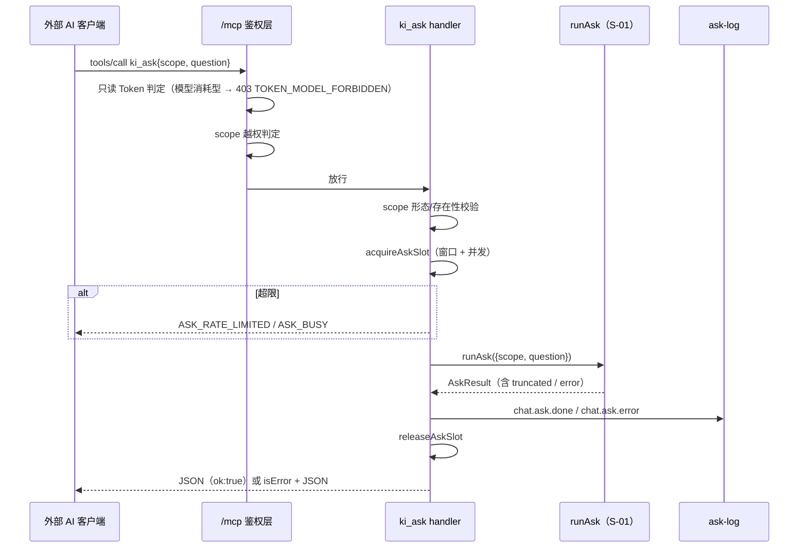

# S-02 MCP 工具面与安全闸门 · 详细设计

> 父文档：[DESIGN.md](DESIGN.md)　需求：REQ-20261113-001　日期：2026-11-13
> 上游子需求：S-01（消费其 `runAsk` / `AskResult` 契约）

---

## 1. 术语

| 术语 | 含义 | 引用 |
|---|---|---|
| **模型消耗型工具** | 调用会消耗上游 LLM 额度、且内容外发的工具（当前仅 `ki_ask`）。与"只读/写入"是两个正交维度 | — |
| **只读子集** | `READ_ONLY_TOOL_NAMES` 的 6 个纯读工具；`ki_ask` **不在其中** | 父文档 §3 |
| **读车道** | `operation-coordinator` 的 `READ_MCP_TOOLS` 判定，可与导入长任务并行 | — |
| **滑动窗口限流** | 按 `(principal, scope)` 在 60s 窗口内计数，超限拒绝 | — |
| **审计记录** | 每次 `ki_ask` 一条单行 JSON（**不含问题正文与答案正文**） | — |
| **结果 JSON** | `ki_ask` 的返回体：与既有 14 个工具一致，走 `content[0].text` 的 JSON 字符串 | — |
| 调用方键 `principalKey` | `tokenId` / `userId` / `'local'`（回环免鉴权），用于限流与审计归属 | — |

> 7 条（上限 7）；不拆理由：全部是同一入口的准入与留痕维度，拆开会把"谁能用/多少配额/记什么"分散。

---

## 2. 现状（AS-IS）

### 2.1 现状描述

| 维度 | 现状 | 证据 |
|---|---|---|
| 工具总数 | 14（6 读 + 8 写） | `mcp-server-factory.ts:47-67` |
| 注册条件 | `readOnly === true` 时只注册 6 个读工具，写工具整块不注册 | `mcp-server-factory.ts:38,59` |
| 只读拦截 | `tools/call` 的工具有不在 `READ_ONLY_TOOL_NAMES` → 403 `TOKEN_READONLY` + `readonlyRejectMessage()` | `mcp-http.ts:296-333`、`tool-access.ts:29-37,91-97` |
| scope 越权 | `findScopeViolation` 逐段校验 `arguments.scope`；无 scope 参数的工具走 `SCOPE_LESS_ENUM_TOOL_NAMES` 白名单跳过 | `mcp-http.ts:186-219`、`tool-access.ts:46-49` |
| 调度 | `kindForMcpToolNames`：命中 `READ_MCP_TOOLS` → read，否则 write 串行 | `operation-coordinator.ts:78,113-115,132-142` |
| 能力表 | `TOOL_CAPABILITIES` 仅用于 **chat 工具循环**过滤与拦截；`/mcp` **不校验 capability** | `tool-permissions.ts:5-6,36-39` |
| 对话工具面 | `CHAT_MCP_TOOLS`（14 项）+ `MCP_TOOL_GROUPS`（配置分组） | `mcp-tool-registry.ts:354`、`prompt-config.ts:106-147` |
| 工具超时 | `READ 30s / WRITE 60s / BULK 300s` | `mcp-tools/util.ts:35-42` |

### 2.2 痛点

- 痛点 1：**没有问答入口**。外部 AI 只能拿原始片段自己合成（实测同题 0 命中，见 `demo/verify-report.md` R-03）。
- 痛点 2：**只读白名单只有"是否修改数据"一个维度**。`ki_ask` 不改数据，但会消耗模型额度并外发内容——放进白名单会让只读 Token 静默烧钱，不放进白名单则错误文案说成"写入工具"，理由错但结论对。
- 痛点 3：**超时档位对不上**。最长档 `BULK 300s` 远大于客户端 60s 硬超时；最短档 `READ 30s` 会误杀正常问答。
- 痛点 4：**调度默认 write**。一次 20s 问答若落 write 车道会阻塞同 scope 的导入与写入。

---

## 3. 方案（TO-BE）

### 3.1 方案概述

新增 `ki_ask` 工具（`src/lib/mcp-tools/ask.ts`）：先做 scope 与限流准入，再调 S-01 的 `runAsk()`，把结果与错误归一为 JSON 返回，并写一条审计。只读 Token 通过**新增的模型消耗型名单**拦截，配有独立错误码与自解释文案。

### 3.2 关键决策点

| 决策 | 选择 | 理由 | 备选方案 | 否决原因 | 重新评估触发条件 |
|---|---|---|---|---|---|
| 工具名 | **`ki_ask`** | 语义精确表达"一次问答"；`ki_chat` 会让外部 AI 误认为可多轮续接（一期不是） | `ki_chat` / `ki_qa` | `chat` 与"无状态"直接矛盾，会诱发"追问不带上文"的误用；`qa` 不如 ask 直白 | 二期支持 `context_id` 后可考虑改名或保留 |
| `scope` 是否必填 | **必填，且一期只接受单个具体 KB** | 问答针对哪个库必须由调用方明确；缺省 `default` 会让"问错库"变成静默结果 | 可选、缺省 `default`（与 `ki_search` 一致） | `ki_search` 返回的是片段，用户能自己判断；`ki_ask` 返回的是成品答案，问错库时会产出"看似权威的胡话" | 真链实测证明视图展开可靠后，二期放开 view |
| 返回形态 | **JSON 字符串**（`content[0].text`） | 与既有 14 个工具完全一致，外部 AI 的消费方式无需新增约定；`sources` 可精确取用 | 纯 markdown 文本 | 外部 AI 要自己从 markdown 里解析来源列表，解析质量不稳定；且失败态与成功态形状不一致 | 若实测发现 JSON 转义显著推高 token（>15%），改 markdown |
| 只读 Token 语义 | **不登记 `READ_ONLY_TOOL_NAMES`；新增 `MODEL_CONSUMING_TOOL_NAMES` + `TOKEN_MODEL_FORBIDDEN` + 独立文案** | 安全性由白名单方向保证（fail-safe）；独立错误码让调用方知道"不是权限不足，是这类工具被禁用" | ① 直接登记进只读白名单；② 不新增名单，复用 `TOKEN_READONLY` 文案 | ① 只读 Token 可无限烧模型额度，与"只读"的最低权限原则冲突；② 文案说"不能调用写入工具 `ki_ask`"，理由错误，会误导用户去查写权限 | 若产品决定"只读 Token 也应能问答"，改为可配置开关而非改名单 |
| 调度车道 | **登记 `READ_MCP_TOOLS`（读车道）** | 工具对库只做只读检索（`executeSearch` 等），与 `ki_search` 同性质；LLM 调用不经过 coordinator | 默认 write 串行 | 一次问答 6~45s 会把同 scope 的导入、写入、同步全部阻塞；而它并不改库，没有串行的必要性 | 若出现"问答期间导入导致检索结果错乱"的实测证据，改回 write |
| 能力点 | **新增 `knowledge.ask`**（`ALL_CAPABILITIES` + `ROLE_CAPABILITIES` 三角色 + `TOKEN_CAPABILITIES` 自动继承） | 与"读"分离，未来可单独撤销；`/api/auth/me` 可展示 | 复用 `knowledge.read` | 只读=零成本，问答有模型成本，同一能力点无法分别授权 | — |
| `/mcp` 是否做 capability 校验 | **不做**（`/mcp` 的实际闸门是 scope + readOnly） | `tool-permissions.ts` 注释已明确 capability 只服务 chat 工具循环；为 `ki_ask` 单独引入 principal→capabilities 会扩大本次范围 | 扩展 `buildKiMcpServer` 接受 capabilities 并在 handler 内校验 | 当前 `TokenAuth` 无 capabilities 字段，且所有 Token 的能力集是同一个常量 `TOKEN_CAPABILITIES` —— 加了也是恒真判断，是**死代码** | 若 Token 支持按能力点裁剪（如只给部分 Token 问答权限），必须补这一层 |
| 是否登记进对话工具面 | **`CHAT_MCP_TOOLS` 与 `MCP_TOOL_GROUPS` 都不登记** | 内层工具面来自这两处；不登记 = 内层 LLM 结构上无法自调 `ki_ask`，递归风险归零 | 登记后靠轮次上限兜底 | `maxToolRounds` 只在最外层生效，内层递归会重新计数（每次自调都重置），上限挡不住 | 若日后需要"对话里也能让 ki 自己问答"，必须先设计递归深度限制 |
| 限流 | **进程内滑动窗口 + 全局并发上限**（每 `(principal, scope)` 10 次/60s；全局并发 2） | 单进程 daemon，无需分布式；10 次覆盖正常追问节奏；并发 2 防止一次打满上游拖慢全站 | 不限流 / 令牌桶 | 无上限＝额度失控（实测单次可达 20~45 万 input tokens）；令牌桶对"低频突发"无优势，增加实现量 | 若出现 5 个以上客户端并发使用，改为可配置队列；**阈值先硬编码为常量**（`ASK_RATE_MAX=10` / `ASK_RATE_WINDOW_MS=60000` / `ASK_CONCURRENT_MAX=2`），需要运维调整时再提 `llm.askRateLimit` 配置项 |
| 审计出口 | **新增 `ask-log.ts`**（复用 `chat-log` 的单行 JSON + 白名单 + 脱敏风格） | 问答没有 `convId`/`msgId`，字段集完全不同 | 复用 `chat-log` | `chat-log` 的字段白名单固定为会话语义（`convId`/`msgId`），若为问答新增 `rounds`/`elapsedMs`/`questionChars`，会迫使**全部对话链路的日志契约**承担问答字段；且脱敏规则里"禁打消息正文"与"问题正文"要不要打也要分叉 | — |

### 3.3 行为差异对照（对既有工具与通道）

| 场景 | AS-IS | TO-BE | 影响 |
|---|---|---|---|
| 只读 Token 调 `ki_ask` | 工具不存在 | 工具不可见；构造调用 → 403 `TOKEN_MODEL_FORBIDDEN` | 新增 |
| 读写 Token 调 `ki_ask` | — | 正常问答（受 scope + 限流约束） | 新增 |
| 同 scope 正在导入 | — | `ki_ask` 走读车道，**不阻塞**导入 | 新增 |
| `tools/list` | 14 项 | 读写 Token 15 项；只读 Token 仍 6 项 | 只读侧无变化 |
| `/api/auth/me` 的 permissions | 15 项 | 16 项（+`knowledge.ask`） | 前端无需改（它按能力点字符串展示） |

---

## 4a. 接口设计

### 4a.1 MCP 工具契约（`src/lib/mcp-tools/ask.ts`，新增）

```ts
server.tool(
  'ki_ask',
  // ★ 工具描述是外部 AI 决定"要不要用/怎么用"的唯一依据，四要素缺一不可
  '让 ki 用它自己的模型 + 指定知识库回答一个问题：内部会自动多轮检索再合成，返回答案与来源。'
  + '⚠️ 每次调用都是独立问答，不保留上下文——追问请把上文并入 question。'
  + '适合"需要知识库综合结论"的问题；若只要原始文档片段，请用 ki_search。'
  + '单次耗时约 5~40 秒，超过 45 秒会返回已生成的部分答案（truncated=true）。',
  {
    scope: z.string().min(1).describe('知识库名（必填）。必须是单个具体知识库，不接受视图名或逗号分隔多库'),
    question: z.string().min(1).describe('自然语言问题（建议一句话，包含必要的限定条件）'),
  },
  handler,
);
```

| 接口 | 输入 | 输出 | 异常 |
|---|---|---|---|
| `ki_ask` | `{scope, question}` | JSON 字符串（见下） | 不抛；失败归一为 `isError:true` + JSON |

### 4a.2 返回示例

**成功**（`degraded` 与 `truncatedReason` 为可选字段，无值时**整个键不出现**）

```json
{
  "ok": true,
  "scope": "monitor-memory",
  "answer": "## 处理记录ID 与告警ID 的关联\n\n两者通过 `AlertDocument.alert_id` ...（markdown 正文）",
  "sources": [
    { "group": "专题记忆/告警屏蔽", "doc": "快捷屏蔽接口体系", "lineStart": 1, "lineEnd": 30,
      "snippet": "QuickAlertShield 继承 QuickActionTokenResource，验证 token 并解析 alert_ids" }
  ],
  "sourcesTotal": 12,
  "rounds": 3,
  "elapsedMs": 6842,
  "truncated": false
}
```

**成功但被收口**

```json
{
  "ok": true,
  "scope": "kisearch-memory",
  "answer": "...（部分答案）",
  "sources": [ ... ],
  "rounds": 6,
  "elapsedMs": 24310,
  "truncated": true,
  "truncatedReason": "round-limit"
}
```

**失败（错误已展平，不暴露 S-01 的嵌套 `error`）**

```json
{
  "ok": false,
  "code": "ASK_DISCLOSURE_REQUIRED",
  "message": "知识库内容外发未确认：请先在 ki 的对话配置里完成隐私确认（llm.kbDisclosureAck），或由管理员在 config.yaml 中设置。",
  "retryable": false
}
```

**限流失败（带 `retryAfterSec`）**

```json
{ "ok": false, "code": "ASK_RATE_LIMITED", "message": "调用过于频繁：每个知识库 60 秒内最多 10 次问答。", "retryable": true, "retryAfterSec": 37 }
```

### 4a.3 handler 执行步骤（顺序固定）

1. **入参**：zod 已校验 `scope` / `question` 非空；再对 `question.trim()` 判空 → `ASK_QUESTION_INVALID`（防全空白绕过 `min(1)`）。
2. **scope 形态**：`isViewRequest(scope)` → `ASK_SCOPE_VIEW_UNSUPPORTED`（一期不支持视图）；含 `,` → 同码。
3. **scope 存在性**：`executeScopeList()` 返回 `{ ok, scopes: Array<{ scope, kb: boolean, vector: boolean, ... }> }`（实现处 `src/scope-list.ts`），存在性判定 = `kb === true || vector === true`；不存在 → `ASK_SCOPE_NOT_FOUND`。
4. **隐私闸门（合规，不可省）**：`resolveLlmStatus(loadConfig(), cfg._configPath ?? '~/.ki/config.yaml').ackRequired === true` → `ASK_DISCLOSURE_REQUIRED`。理由：`ki_ask` 内部检索会把知识库内容发给上游模型，与页面 `/api/chat/*` 的 `DISCLOSURE_REQUIRED` 是同一件事，**不得因为换了 MCP 通道就绕过**。（`llm.enabled === false` 留给 S-01 判，避免两处重复实现同一判定）
5. **限流准入**：`acquireAskSlot(principalKey, scope)`；拒绝时先 `askLog(ASK_LOG_EVENTS.THROTTLED, {...})` 再返回 `ASK_RATE_LIMITED`（带 `retryAfterSec`）或 `ASK_BUSY`。
6. **执行**：`await withTimeout(runAsk({ scope, question, capabilities: READ_ONLY_CAPABILITIES }), TOOL_TIMEOUT.ASK, 'ki_ask')`。
   ★ `READ_ONLY_CAPABILITIES = new Set<Capability>(['knowledge.read'])`（常量，定义在本文件）—— 它**不是**"调用方权限校验"，而是**给内层工具面设能力上界**：内层只剩 6 个只读工具，与 `PromptConfig.tools` 里用户是否打开写/删工具无关（详见 S-01 §7「内层恒只读」）。
7. **审计**：`askLog(ASK_LOG_EVENTS.DONE | ERROR, {...})`（**在 finally 中执行**，保证失败也留痕）。
8. **释放**：`releaseAskSlot()`（finally）。
9. **归一返回（对外形状以此为准）**：
   - `ok:true` → `content[0].text = JSON.stringify({ ok, scope, answer, sources, rounds, elapsedMs, truncated, ...(truncatedReason ? {truncatedReason} : {}) , ...(degraded ? {degraded} : {}) })`
   - **失败展平**：`AskResult.error` 是嵌套对象（S-01），对外一律展平为 `{ ok:false, code, message, retryable, ...(retryAfterSec ? {retryAfterSec} : {}) }`，并置 `isError:true`。**嵌套形状不对外暴露**。

> `principalKey` 由 `buildKiMcpServer()` 推导并注入 `registerAskTool(server, {principalKey})`：`auth?.id ?? 'local'`（回环 / stdio 免鉴权时为 `'local'`）。**不改 `buildKiMcpServer` 的签名**，只是在注册处把已有 `auth` 的 `id` 透传下去。

### 4a.4 内部接口

```ts
// src/lib/chat/ask/ask-limiter.ts（新增）
export type AskLimitDecision =
  | { ok: true }
  | { ok: false; code: 'ASK_RATE_LIMITED' | 'ASK_BUSY'; retryAfterSec: number };
export function acquireAskSlot(principalKey: string, scope: string): AskLimitDecision;
export function releaseAskSlot(): void;
/** 单测用：重置窗口与并发计数 */
export function resetAskLimiterForTest(): void;
```

```ts
// src/lib/chat/ask/ask-log.ts（新增）
export const ASK_LOG_EVENTS = {
  DONE: 'chat.ask.done',
  ERROR: 'chat.ask.error',
  THROTTLED: 'chat.ask.throttled',
} as const;
export interface AskLogFields {
  scope: string;
  principalKey: string;
  rounds?: number;
  elapsedMs?: number;
  truncated?: boolean;
  questionChars?: number;   // ★ 只记长度，不记正文
  code?: string;
  retryable?: boolean;
  promptTokens?: number;
  completionTokens?: number;
}
export function askLog(evt: string, fields: AskLogFields): void;
```

### 4a.5 契约变更声明

| 变更类型 | 接口 | 变更内容 | 影响的子需求 |
|---|---|---|---|
| 新增 | `ki_ask` MCP 工具 | 全新工具 + 2 个入参 | — |
| 修改 | `tool-access.ts` | 新增 `MODEL_CONSUMING_TOOL_NAMES` / `isModelConsumingTool` / `TOKEN_MODEL_FORBIDDEN` / `modelConsumingRejectMessage` | — |
| 修改 | `mcp-http.ts::rejectReadOnlyRequest` | 按工具类型分流错误码与文案 | — |
| 修改 | `operation-coordinator.ts::READ_MCP_TOOLS` | 加入 `ki_ask` | — |
| 修改 | `capabilities.ts` / `tool-permissions.ts` | 新增 `knowledge.ask` 与工具映射 | — |
| 修改 | `mcp-tools/util.ts::TOOL_TIMEOUT` | 新增 `ASK: 50_000` | — |

---

## 4b. 数据模型

**不涉及持久化**（审计走日志出口，不落库）。

### 4b.1 错误码表

| 错误码 | 触发条件 | 文案要点 | `retryable` |
|---|---|---|---|
| `ASK_QUESTION_INVALID` | `question` 为纯空白（`trim()` 后为空）或超过 `ASK_QUESTION_MAX_CHARS = 4000` | 空 → 提示给出具体问题；超长 → 报出实际长度与上限，并指路「大段材料请用 ki_search」 | false |
| `ASK_SCOPE_VIEW_UNSUPPORTED` | scope 是视图名或含逗号 | 说明一期只支持单个知识库，给出「改用具体库名」的出路 | false |
| `ASK_SCOPE_NOT_FOUND` | scope 在 KB 与向量层都不存在 | 列出可用的 `ki_scope_list` 出路 | false |
| `ASK_LLM_NOT_READY` | `llm` 段缺 `baseURL/model/apiKey`（S-01 判定） | 指向 `~/.ki/config.yaml` 的 `llm` 段 | false |
| `ASK_TOOLS_UNSUPPORTED` | `llm.supportsTools === false`（S-01 判定） | 说明问答依赖工具调用，请在配置中启用 | false |
| `ASK_DISCLOSURE_REQUIRED` | `ackRequired === true`（S-02 §4a.3 步骤 4） | 指向对话配置的隐私确认入口 | false |
| `ASK_LLM_TIMEOUT` | 首字节超时（`firstByteTimeoutMs`，默认 30s，S-01） | 建议稍后重试或缩小问题范围 | true |
| `ASK_RATE_LIMITED` | 60s 窗口内超过 10 次 | 带 `retryAfterSec` | true |
| `ASK_BUSY` | 全局并发已满（2） | 建议稍后重试 | true |
| `ASK_TIMEOUT` | 硬预算到点且无任何内容 | 建议缩小问题范围 | true |
| `ASK_LLM_UPSTREAM` | 上游 4xx/5xx（原文只进日志） | 规范化文案 | true |
| `ASK_INTERNAL` | 未预期异常 | 通用失败文案 + 建议重试 | true |

### 4b.2 限流状态（内存）

```ts
// 每 (principalKey, scope) 一个时间戳数组；全局一个在途计数
Map<string, number[]>   // key = `${principalKey}\u0000${scope}`
let inFlight = 0
```

---

## 5. 时序图



---

## 6. 异常处理

| 场景 | 行为 | 是否对外暴露 |
|---|---|---|
| 只读 Token 调用 | 403 `TOKEN_MODEL_FORBIDDEN` + `modelConsumingRejectMessage()`（原因/现象/出路/双因四要素） | 是 |
| scope 越权 | 403（既有 `rejectScopeViolationRequest` 路径） | 是 |
| 上游模型不可用 | `isError:true` + `ASK_LLM_UPSTREAM`，**原文只进 daemon 日志** | 是（规范化文案） |
| `runAsk` 抛未预期异常 | `isError:true` + `ASK_INTERNAL`，日志带堆栈（**不含问题正文**） | 是 |
| `withTimeout` 50s 触发 | `ASK_TIMEOUT`，同时置位让底层 `runAsk` 的 45s 预算先自行收口 | 是 |
| 审计写失败 | 吞掉异常，不影响主流程（审计是旁路） | 否 |
| 限流计数泄漏（进程重启） | 状态在内存，重启即清零（人为可接受） | 否 |

---

## 7. 性能 & 安全

### 性能

- **准入开销**：scope 存在性走 `executeScopeList()`（有缓存），与会话生成的读取量级相同；限流为纯内存 Map 操作。
- **并发上限 2**：与 daemon 单进程的上游连接数匹配；超过后立即返回 `ASK_BUSY` 而非排队（排队会叠加到 45s 之上，必然超客户端 60s）。
- **不做**：请求队列、优先级、结果缓存。

### 安全

- **只读 Token**：白名单方向（不在 `READ_ONLY_TOOL_NAMES` 即拒），新增工具漏登记时默认被拒（fail-safe 不变）。
- **跨库越权**：`arguments.scope` 由 `findScopeViolation` 逐段校验（`ki_ask` 有 scope 参数，无需进 `SCOPE_LESS_ENUM_TOOL_NAMES`）。
- **递归**：`ki_ask` 不进 `CHAT_MCP_TOOLS` / `MCP_TOOL_GROUPS` → 内层工具面结构上不含自身。
- **日志脱敏**：审计只记 `questionChars` 长度与计数，**不记问题正文、不记答案正文、不记检索片段**（沿用 `chat-log` 的白名单 + 遮罩约定）。
- **额度**：限流 + 轮次上限（S-01）双层，单次约 **50~60K input tokens**（6 轮递增估算，见 S-01 §7）。
- **内层只读**：`runAsk` 固定传 `READ_ONLY_CAPABILITIES` ⇒ 内层工具面恒为 6 个只读工具，**用户即便在对话配置里打开写/删工具也不生效**（S-01 §7「内层恒只读」）。

---

## 8. 测试方案

| 类型 | 范围 | 工具 |
|---|---|---|
| 单元 | `MODEL_CONSUMING_TOOL_NAMES` 与 `READ_ONLY_TOOL_NAMES` 互斥；`isReadOnlyTool('ki_ask') === false`；拒绝文案四要素齐全 | `test/mcp-ask-tool.test.ts`（新增） |
| 单元 | 限流：窗口内第 11 次被拒、窗口滚动后恢复、并发 2 满返回 `ASK_BUSY`、异常路径必释放槽位 | 同上 |
| 单元 | 登记一致性：`TOOL_CAPABILITIES.ki_ask === 'knowledge.ask'`；`READ_MCP_TOOLS` 含 `ki_ask`；**`CHAT_MCP_TOOLS` 不含 `ki_ask`**（防递归守卫）；`MCP_TOOL_GROUPS` 不含；`SEARCH_TOOL_NAMES` 不含 | 同上 |
| 单元 | **隐私闸门**：`ackRequired === true` → `ASK_DISCLOSURE_REQUIRED` 且**零上游请求**（与页面口径一致，防止 MCP 通道绕过外发确认） | 同上 |
| 单元 | **内层只读**：`READ_ONLY_CAPABILITIES` 只含 `knowledge.read`；配置层打开 `ki_delete_relation` 后，内层 `tool_start` 仍不出现写工具名 | `test/chat/ask-runner.test.ts` |
| 集成 | 只读 Token 构造调用 → 403 `TOKEN_MODEL_FORBIDDEN`；读写 Token → 正常返回 | `test/mcp-http*.test.ts`（扩展） |
| 集成 | `tools/list` 只读会话不含 `ki_ask` | 同上 |
| 真链路 | daemon 真实 LLM：一次 `ki_ask` 调用耗时、答案、来源 | 复用 `demo/ask-latency.mjs`（改走 MCP 调用） |

不在测试范围内：

- 分布式限流（单进程 daemon）。
- `/mcp` 的 capability 校验（本设计明确不做）。

---

## 9. 影响范围（13 项登记 + 1 项明确不登记，逐项确认）

| # | 文件 | 改动 | 漏改后果 |
|---|---|---|---|
| 1 | `src/lib/mcp-tools/ask.ts` | **新增**工具定义与 handler | 功能不存在 |
| 2 | `src/lib/mcp-server-factory.ts` | 在 `!readOnly` 块内注册（单列"模型消耗型"注释区） | 工具不出现 |
| 3 | `src/lib/mcp-tools/tool-access.ts` | 新增 `MODEL_CONSUMING_TOOL_NAMES` / `isModelConsumingTool` / `TOKEN_MODEL_FORBIDDEN` / `modelConsumingRejectMessage` | 只读 Token 可烧额度 |
| 4 | `src/lib/mcp-http.ts::rejectReadOnlyRequest` | 按工具类型分流错误码与文案 | 文案说成"写入工具"，理由错误 |
| 5 | `src/lib/operation-coordinator.ts::READ_MCP_TOOLS` | 加入 `ki_ask` | 一次 20s 问答阻塞导入与写入 |
| 5b | `src/lib/mcp-tools/tool-access.ts::SEARCH_TOOL_NAMES` | **不登记**（加注释：问答是"多次检索 + 合成"，不是一次查询，计入会让 scope 用量虚高） | 用量统计把 1 次问答算成 1 次检索，冷热榜失真 |
| 6 | `src/lib/auth/capabilities.ts` | 新增 `knowledge.ask` + `ALL_CAPABILITIES` + `ROLE_CAPABILITIES`（三角色） | `/api/auth/me` 缺该权限 |
| 7 | `src/lib/auth/tool-permissions.ts::TOOL_CAPABILITIES` | `ki_ask → knowledge.ask` | 将来 chat 通道纳入时被拒 |
| 8 | `src/lib/chat/prompt-config.ts::MCP_TOOL_GROUPS` | **不登记**（加注释说明防递归） | 若登记 → 内层可自调 → 无限递归 |
| 9 | `src/lib/chat/mcp-tool-registry.ts::CHAT_MCP_TOOLS` | **不登记**（加注释） | 同上 |
| 10 | `src/lib/mcp-tools/util.ts::TOOL_TIMEOUT` | 新增 `ASK: 50_000` | 用 `READ` 30s 会误杀正常问答 |
| 11 | `src/lib/chat/ask/ask-log.ts` | **新增**审计出口 | 无留痕，超限与失败无法追溯 |
| 12 | `src/lib/chat/ask/ask-limiter.ts` | **新增**限流 | 额度失控 |
| 13 | `docs/mcp-http.md`、`docs/cli.md` | 工具清单与说明同步 | 文档漂移（项目已有两份知识库工具清单也需同步） |

---

## 10. 已决问题

| 编号 | 问题 | 决策 |
|---|---|---|
| T-03 | 只读 Token 是否允许问答 | **不允许**（新增模型消耗型名单，fail-safe） |
| T-04 | 一期是否支持视图（多库）作为落点 | **不支持**，明确报 `ASK_SCOPE_VIEW_UNSUPPORTED`；二期随续接一起评估 |
| T-05 | 是否给 `/mcp` 引入 capability 校验 | **不引入**（当前 Token 能力集是同一常量，加校验是死代码）；记录为重新评估触发条件 |

**无遗留待定问题。**
