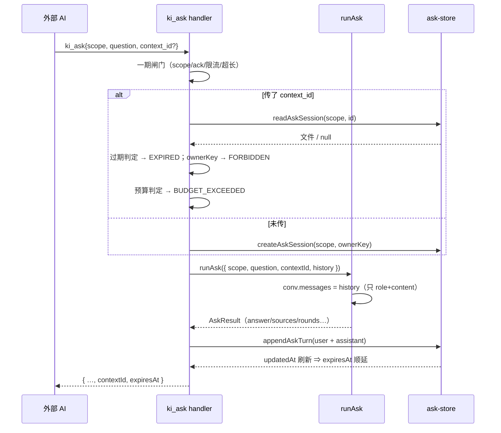

# S-03 可选续接 · 短会话（二期）· 详细设计

> 父文档：[DESIGN.md](DESIGN.md)　需求：[requirement.md](../requirement.md) §9（v2 修订）
> 一期：S-01 执行器 / S-02 工具面（已交付）；本子需求 = 二期 R13~R17
> 台账：`.plans/2026-11-13-ask-context-continuation/`

---

## 1. 术语

| 术语 | 含义 |
|---|---|
| **短会话** | `ki_ask` 的一次会话上下文；10 分钟滑动 TTL，**不进 web 会话列表**、不归档、不可枚举 |
| **`context_id`** | 短会话标识（`ka-...`），由 `ki_ask` 每次返回；传入即续接，不传即全新 |
| **滑动 TTL** | 过期时刻 = **最后一次交互** + `ttlMs`（问一次顺延一次），不是创建时间 |
| **ownerKey** | 归属标识 = `tokenId` / `'local'`；跨 key 复用一律拒绝 |
| **上下文预算** | 短会话允许累积的消息条数与字符总量上限，超限**显式报错**而非截断 |

> 5 条（≤7）。共享术语（`AskInput`/`AskResult`/内层恒只读等）见父文档 §3。

---

## 2. 现状（一期行为）

- `runAsk` 构造**内存会话骨架**，`messages` **恒为空**、不落盘（`ask-runner.ts`）。
- 每次调用独立，答案无法引用上一次（需求 N1 的代价）。
- `{chatDir}/{scope}/` 下的会话文件由 `CONV_FILE_RE = /^c-[A-Za-z0-9-]+\.json$/` 筛选（`chat-store.ts:127`），其他文件名一律忽略。

**痛点**：外部 AI 追问时必须把上文整段并进 `question` —— token 翻倍，且第一轮已检索到的证据无法复用。

---

## 3. 方案（TO-BE）

### 3.1 概述

短会话落 `{chatDir}/{scope}/ka-{id}.json`（**复用会话目录 + 前缀隔离**）。`ki_ask` 返回 `contextId` + `expiresAt`；传回 `context_id` 即回放历史再作答，作答后追加本轮并把 `updatedAt` 刷成当下（= 滑动 TTL）。

### 3.2 关键决策点

| 决策 | 选择 | 理由 | 备选方案 | 否决原因 | 重新评估触发条件 |
|---|---|---|---|---|---|
| 存储位置 | **`{chatDir}/{scope}/ka-*.json`**（同目录 + 前缀） | `CONV_FILE_RE` 只认 `c-`，放同目录**天然不进列表**；`chatDirFor` 已做 scope 隔离与 `validateScope`；`withConvLock` 直接可用 | ① 独立 `{chatDir}/ask/{scope}/`；② 纯内存 | ① 要另写路径函数 + GC 得遍历两棵树，且未来容易漏清理；② daemon 重启即失效，10 分钟窗口内重启会让用户追问直接失败 | 若短会话需要独立配额/限速（按目录统计），改独立目录 |
| TTL 依据 | **`updatedAt`**（`writeJson` 每次写盘自动打戳） | 零新字段；写入路径本身就是"一次交互"，语义天然一致 | 独立 `lastActiveAt` 字段 | 多一处要维护，任何漏更新都会变成"永不滑动"或"提前过期" | 若短会话出现"只读不写"的交互（如纯查询不追加消息），需显式 touch |
| GC 时机 | **定时（60s）+ 惰性（读时判）+ 启动扫一次** | 只惰性会让"再也没人访问"的会话永久占盘；启动扫兜住停机期间过期的堆积 | ① 只惰性；② 只定时 | ① 盘上垃圾不回收；② 读路径仍要判过期（定时有最长 60s 窗口），两者都必须有 | — |
| 过期语义 | **删文件 + 报 `ASK_CONTEXT_EXPIRED`** | 用户拍板 D11：静默新开会让人基于空历史作答 | 静默当新会话 | 属静默失败，违背项目 fail-loud 原则 | — |
| 归属校验 | **scope 由路径天然隔离 + `ownerKey` 显式比对** | 跨 scope 拼不到路径 → 直接 `NOT_FOUND`（不泄露"存在但无权"）；同 scope 跨 Token 用 `ownerKey` 拦 | 只做 scope 隔离 | 同一 scope 下两个 Token 能互相续接，等于读他人问答历史 | 若引入"共享短会话"需求 |
| 预算口径 | **独立常量**：`ASK_CONTEXT_MAX_MESSAGES = 20`、`ASK_CONTEXT_MAX_CHARS = 60_000` | 明确是**硬上限**（超限报错） | 复用 `llm.contextChars` | 项目已明确 `contextChars` 只作占比分母与预警基准，**不参与截断/拒绝**（`chat-contract.ts` 注释），拿它当硬上限是与既有语义冲突 | 若实测 20 条不够追问 |
| 历史回放内容 | **只 `role + content`** | 与 `buildUpstreamMessages` 一致；`sources`/`reasoning` 是展示物，回放会放大上下文且违反 N12 | 回放含 sources | reasoning 永不回传是硬约束；sources 只在答案文本里已有引用标注 | — |

### 3.3 行为差异对照

| 场景 | 一期 | 二期 |
|---|---|---|
| 不传 `context_id` | 全新问答，`messages=[]` | **不变**（仅返回多 `contextId`/`expiresAt`） |
| 传有效 `context_id` | — | 回放历史 → 作答 → 追加本轮 → 顺延 TTL |
| 传过期 / 不存在 / 他人 ID | — | 四个专用错误码 |
| web 会话列表 | 无 | **仍无**（`ka-` 前缀不在 `CONV_FILE_RE`） |

---

## 4. 接口设计

### 4.1 契约增量

```ts
// ask-contract.ts
export interface AskInput {
  scope: string;
  question: string;
  /** 续接：传回上一次返回的 contextId；缺省 = 全新问答（一期语义） */
  contextId?: string;
  /** 调用方键（`tokenId` / `'local'`）：短会话归属校验用；缺省 `'local'` */
  principalKey?: string;
  capabilities?: ReadonlySet<Capability>;
  signal?: AbortSignal;
}

export interface AskResult {
  // …一期字段不变（answer / sources / sourcesTotal / rounds / elapsedMs / truncated / degraded / usage / error）
  /** 本次问答的短会话 id（首次即新建；续接时为传入值） */
  contextId: string;
  /** 过期时刻（ISO，= updatedAt + ttlMs，每次交互后顺延） */
  expiresAt: string;
  /** 本次是否真的复用了历史（`false` = 新建） */
  resumed: boolean;
}

/**
 * 失败收尾的清理规则（实现细节，容易漏）：
 * `resolveAskSession` **先建会话再跑问答**（否则拿不到 `contextId`），
 * 因此失败路径（5xx / 超时 / 中断）必须删掉**本次新建**的会话
 * （`resumed === false`）—— 它的 id 不会返回给调用方，留着就是无主文件。
 * 续接的（`resumed === true`）绝不能删。

export const ASK_CONTEXT_MAX_MESSAGES = 20;
export const ASK_CONTEXT_MAX_CHARS = 60_000;
export const ASK_SESSION_TTL_DEFAULT_MS = 600_000;
export const ASK_SESSION_TTL_LIMIT_MS = 3_600_000;
```

### 4.2 落盘结构（`src/lib/chat/ask/ask-store.ts`，新增）

```ts
export interface AskSessionFile {
  version: 1;
  /** `ka-` + base36(now) + 8 位 CSPRNG（≥128bit，不可猜） */
  id: string;
  scope: string;
  /** 归属：tokenId / 'local'；跨 key 拒绝 */
  ownerKey: string;
  createdAt: string;
  /** 滑动 TTL 的唯一依据（每次写入由 writeJson 打戳） */
  updatedAt: string;
  /** 只存 role + content（N12：reasoning 永不回放） */
  messages: Array<{ role: 'user' | 'assistant'; content: string; at: string }>;
}

export function createAskSession(scope: string, ownerKey: string): Promise<AskSessionFile>;
export function readAskSession(scope: string, id: string): AskSessionFile | null;
export function appendAskTurn(scope: string, id: string, turns: Array<{role;content;at}>): AskSessionFile;
export function deleteAskSession(scope: string, id: string): void;
/** 独立防穿越：**不能**复用 chat-store 的 `assertValidId`（那里强制 `c-` 前缀） */
export function assertValidAskId(id: string): void;
```

### 4.3 错误码（4 个）

| 码 | 触发 | 文案要点 | retryable |
|---|---|---|---|
| `ASK_CONTEXT_NOT_FOUND` | 路径拼不到 / 文件不存在 / 跨 scope | 「上下文不存在（或已清理）：不传 context_id 即可开启新会话」 | false |
| `ASK_CONTEXT_EXPIRED` | `now > updatedAt + ttlMs`（判定后即删） | 「上下文已过期（最后一次交互 10 分钟前）：请开启新会话」 | false |
| `ASK_CONTEXT_FORBIDDEN` | 同 scope 但 `ownerKey` 不符 | 「该上下文不属于当前凭据」 | false |
| `ASK_CONTEXT_BUDGET_EXCEEDED` | 消息 > 20 条或累计字符 > 60000 | 「追问过多（N 条/M 字符上限）：请开启新会话并带上必要上文」 | false |

### 4.4 GC（`src/lib/chat/ask/ask-gc.ts`，新增）

```ts
/** daemon 启动后调用一次：立即扫 + 起 60s 定时器（unref） */
export function startAskGc(): void;
/** 单测用 */
export function sweepExpiredAskSessions(now?: number): { scanned: number; deleted: number };
```

扫描范围：`chatRootDir()` 下**每个 scope 子目录**里的 `ka-*.json`（前缀过滤，绝不碰 `c-*` / assets / 压缩备份）。

---

## 5. 时序图



---

## 6. 异常处理

| 场景 | 行为 | 对外暴露 |
|---|---|---|
| `context_id` 格式非法（非 `ka-` 或含路径穿越） | `ASK_CONTEXT_NOT_FOUND`（不区分"非法"与"不存在"，避免成为探测面） | 是 |
| 文件损坏（JSON 解析失败） | 删除该文件 + `ASK_CONTEXT_NOT_FOUND`（损坏即不可用，且无修复价值） | 是 |
| 过期 | 判定时即删 → `ASK_CONTEXT_EXPIRED` | 是 |
| 跨 scope | 路径拼不到 → `ASK_CONTEXT_NOT_FOUND` | 是 |
| 同 scope 跨 Token | `ASK_CONTEXT_FORBIDDEN` | 是 |
| 追加写失败（磁盘满 / 权限） | 不影响本次答案，`contextId` 仍返回但下次续接会 `NOT_FOUND`；同时 `askLog` 记 `chat.ask.context.write-failed` | 是（不静默，但答案照给） |
| GC 删除失败 | 单个文件失败跳过并计数（不阻断整轮清扫） | 否 |

---

## 7. 影响范围

| 对象 | 类型 | 说明 |
|---|---|---|
| `src/lib/chat/ask/ask-contract.ts` | 接口变更 | `AskInput.contextId?`、`AskResult.contextId`/`expiresAt`、4 个常量 |
| `src/lib/chat/ask/ask-store.ts` | 新增 | 短会话读写 + 独立防穿越 |
| `src/lib/chat/ask/ask-gc.ts` | 新增 | 定时 + 启动扫 |
| `src/lib/chat/ask/ask-runner.ts` | 行为变更 | 接受历史、返回 `contextId`/`expiresAt`（不传 id 时行为不变） |
| `src/lib/mcp-tools/ask.ts` | 接口变更 | 入参加 `context_id`、序列化加 2 字段、4 个错误码 |
| `src/lib/config-schema.ts` / `config.ts` / `llm-client.ts` | 配置变更 | `llm.askSessionTtlMs`（**三处都要改**，`parseAndExpand` 是白名单拷贝） |
| `src/lib/mcp-http.ts` | 调用点 | 启动时 `startAskGc()` |
| `docs/mcp-http.md` / `docs/cli.md` | 文档 | `context_id` 语义（不传=全新）、TTL、错误码 |

---

## 8. 待定问题

| # | 问题 | 建议 |
|---|---|---|
| T-06 | 短会话是否需要 `GET /api/chat/ask-sessions` 之类的人工可观测入口（排查"为什么续不上"） | 先不做；`askLog` 里记 `contextId` 前缀即可定位 |
| T-07 | 20 条消息 / 60K 字符是否合适 | 实现后按真链路实测调整（两者都是常量，改动成本低） |
