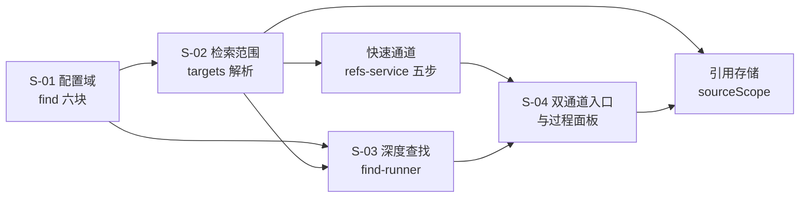
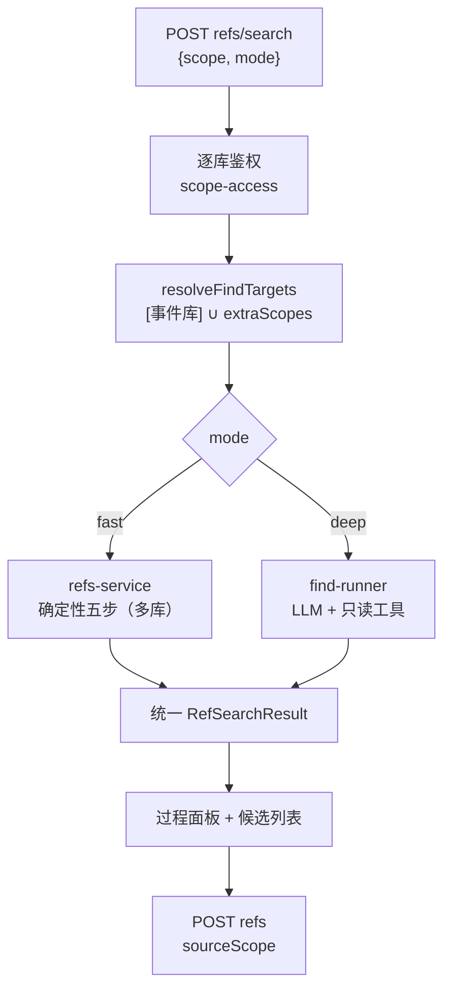

# AI 查找可配置化 · 设计（父文档）

- 需求：REQ-20261116-005
- 状态：设计中
- 设计日期：2026-11-16
- 需求文档：`../requirement.md`

## 1. 需求背景与目标

「AI 查找」当前是确定性五步（不调 LLM），因此 AI 设置页的「检索词改写提示词」没有任何读取点。本设计把它扩成与「AI 分析」同构的可配置能力：检索范围（scope / 视图）、基础提示词、Skill、只读工具、预算全部可配，并保留确定性通道作为「快速查找」。

目标：一期（S-01/S-02）在**不引入 LLM** 的前提下交付范围与跨库能力；二期（S-03/S-04）接入 LLM 深度查找并让配置真实生效。

⛔ 不在范围内：文件工具（`fs_*`）整组；创建事件时的查找入口；深度查找登记进 `/mcp` 或 AI 对话工具面；快速通道算法与分数口径的重构；异步草稿 + 轮询形态。

## 2. 关键环节一览图



## 3. 总体方案设计

四个子需求构成两条链路，共享同一份配置与同一种响应形状：



**共享术语速查**（定义在各自子文档，此处只引用）

| 术语 | 归属 | 一句话 |
|---|---|---|
| `find` 配置域 | S-01 | `PromptConfig.find`，与 `analysis` 同级、物理独立的配置块 |
| 检索单元（target） | S-02 | 一个参与检索的库名或视图名 |
| 源库（sourceScope） | S-02 | 候选 / 引用文档实际所在的库；缺省 = 事件库 |
| 批次分位 | S-02 | 同一次查找内所有候选的 min-max 归一化分（沿用现状口径） |
| 库内排名（rankInScope） | S-02 | 候选在其源库内的分数名次，缓解跨库分数不可比 |
| 快速通道 / 深度通道 | S-03 | 确定性五步 / LLM 工具循环 |
| 工具作用域 | S-03 | 本次查找允许 LLM 触碰的库集合 = `targets`，模型不可扩大 |
| 定向输出 | S-03 | 末轮要求模型给出的结构化候选块（```json） |
| 检索预算 | S-03 | 轮次上限 + 候选上限 + 硬超时 |
| 真实调用记录（calls） | S-04 | 后端实际发生的工具调用行 |

**非功能性假设**（未显式声明即按此执行，需变更请在实施前提出）

| 维度 | 假设 | 依据 |
|---|---|---|
| 数据量级 / 并发 | 单机低频：单库文档数 ≤ 1e5，`extraScopes` ≤ 5，同一事件同时只允许 1 次深度查找 | 现状 `REF_LIMIT=50`、事件页单人操作 |
| 可用性 / 一致性 | 允许单点失败；引用落盘为最终一致（沿用 `refs.json` 直写） | 无分布式约束 |
| 延迟容忍 | 快速通道 ≤ 1s；深度通道 ≤ 45s（硬超时），超过即降级 | 现有五步 <1s 实测、`ki_ask` 的 25s/45s 预算先例 |

## 4. 全局风险与跨子需求依赖

### 4.1 已定契约（共享面，定稿后只读）

```ts
// src/lib/events/types.ts —— 引用记录
interface EventRefDoc {
  scope: string;          // 事件所在库（不变）
  sourceScope?: string;   // 文档实际所在库；缺省 = scope（老数据兼容）
  group: string; name: string; addedBy: 'ai'|'manual'; addedAt: number; score?: number;
}

// 候选（响应侧）—— 字段定义以 S-02 §3.3 为准，此处为跨子需求引用的快照
interface RefCandidate {
  /** 通道来源：决定默认勾选策略（fast 按分数、deep 按模型顺序），见 S-04 §3.4 */
  origin: 'fast' | 'deep';
  scope: string;          // 新增：候选文档所在库
  group: string; name: string;
  score: number;          // fast：批次分位（全批次 min-max）；deep：库内最后一次命中分，可为 0
  rankInScope: number;    // 新增：源库内分数名次（1 = 库内最高）
  rawScore: number;       // 新增：原始检索分（排障用，跨库不可比）
  why: string;
  matchedKeywords: string[]; weak: boolean;
  /** 可见性 + 不可检索时的原因（源事件未收口 / 已收口），见 S-02 §3.4 */
  visibility: Visibility;
  visibilityReason?: { kind: 'event-open' | 'event-closed'; eventId: string; shortId: number; title: string };
  chunkHits: number;
}

// 请求/响应
// POST /api/governance/events/:ref/refs/search  body: { scope, mode?: 'fast'|'deep', topK?, limit?, threshold? }
//   响应新增 targets: string[]（本次实际生效的检索单元，前端据此显示"检索 N 个库"）
//   ⚠️ targets 不接受前端传入，一律后端解析（防越权指定任意库）
// DELETE /api/governance/events/:ref/refs?scope=&group=&name=&sourceScope=
```

### 4.2 权限模型（三层，定稿后只读）

| 层 | 规则 | 落点 | 越权语义 |
|---|---|---|---|
| 配置写 | 需 `ops.write` | 现有 PUT `/api/chat/config` | 403 |
| 检索范围 | 每个 target 必须 `isScopeAccessAllowed(tokenScopes, target)`（视图要求成员全有）；**保存配置时校验 + 运行期再校验** | `scope-access.ts` | 运行期 403；保存配置 400（同一错误码，理由见 S-01 D-01-7：403 会被前端解读成"你不能改配置"） |
| 加入引用 | 需写权限 + 源库在授权范围内 | `refs` POST（`tokenScopes` 由 HTTP 层注入） | 403 |
| **引用可检索性** | 源文档被**已收口**事件绑定在不可检索阶段 → 拒绝加入；被**未收口**事件临时不可检索 → 允许 + 前端强提示 | `refs` POST | `REF_DOC_NOT_SEARCHABLE` 409 |

> 配置只能**收窄**：extraScopes 里出现无权访问项时，保存侧拒绝（不静默丢弃），运行期遇到权限被收回则剔除该项并在响应 `skippedTargets` 里如实列出。

### 4.3 错误码分段

| 号段 | 子需求 | 错误码 |
|---|---|---|
| FIND-T（target） | S-02 | `FIND_TARGET_NOT_AUTHORIZED`（配置保存 / 运行期越权）、`REF_DOC_NOT_FOUND`（引用目标不存在）、`REF_DOC_NOT_SEARCHABLE`（源文档被已收口事件锁在不可检索阶段）。**范围类"被剔除"不占用错误码**，走响应字段 `skippedTargets`（见 S-02 §3.1），避免"部分成功却报错" |
| FIND-R（runner） | S-03 | `FIND_LLM_UNAVAILABLE`、`FIND_DISCLOSURE_REQUIRED`、`FIND_TOOLS_UNSUPPORTED`、`FIND_TOOLS_ALL_DISABLED`、`FIND_BUSY`、`FIND_TIMEOUT` |
| FIND-D（display） | S-04 | 无新增（沿用 `SEARCH_UNAVAILABLE`、`REF_LIMIT_EXCEEDED` 等既有码） |

### 4.4 跨子需求风险

| 风险 | 影响 | 处置 |
|---|---|---|
| 跨库分数不可比（单批次 min-max） | 用户被弱库高分误导 | S-02 决策 D-02-1：保留批次分位 + 增加「库内排名」；文案同步改 |
| 45s 同步长请求可能被网关/反代掐断 | 深度通道整体不可用 | S-03 待定项 U-03-1：先 `demo-verify` 实测，再定超时上限 |
| 引用去重 key 不含库 | 跨库同名文档被静默跳过 / 删错 | S-02 必须改 key 为 `sourceScope\0group\0name`，并同步 DELETE 入参 |
| **跨库引用可指向不可检索文档** | 加入后永远召回不到（「幽灵引用」），用户无法自查 | §4.2「引用可检索性」：已收口事件 → 409 拒绝；未收口 → 允许 + 候选行强提示（S-02 §3.4） |
| **一期（无深度通道）时 5 块配置仍不生效** | 把「改了没反应」换个位置，需求目标落空 | S-01 §3.2 一期统一挂「深度查找上线后生效」横幅，且不与「未接入」混用 |
| **跨库后事件生命周期路径未核查** | 事件关闭 / 回收站 / 删除可能误伤跨库引用 | S-02 §9 影响范围补 `event-service.ts` / 回收站路径核查（判据：事件侧只动本库 refs 文件） |
| 前端 `req()` 无 AbortSignal | 深度通道无法取消 | S-04 改造 `governanceApi.req` 支持 signal |
| 老配置无 `find` 域 | 读取整份回退默认（会连累对话配置） | S-01 走软读取 + 缺失补齐，禁止报 issue |

### 4.5 分期与依赖

一期 = S-01 → S-02（快速通道多库，可独立验收）；二期 = S-03 → S-04（深度通道与面板）。S-03 依赖 S-01 的配置与 S-02 的 targets 解析，不可并行先行。
