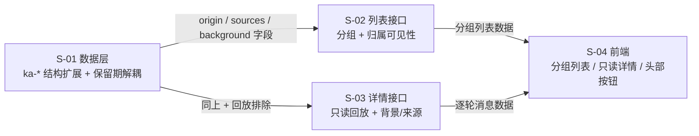

# ki_ask 问答按来源分组上屏 · 总体设计（父文档）

> 需求：`requirement.md`（REQ-20261116-003）。界面基线：`demo/ki-ask-grouping/index.html`（已确认）。
> 子文档：S-01 数据层 / S-02 列表与归属 / S-03 详情与只读回放 / S-04 前端。

## 1. 需求背景 & 目标

`ki_ask` 的问答早已落盘（`{chatDir}/{scope}/ka-*.json`），但因文件前缀过滤**从不进页面**，且 10 分钟 TTL 后文件被 GC 删除。用户无法回看「agent 刚才问了什么、答案怎么说」。

本设计要达成三件事：

1. **看得见**：`/chat` 左栏按来源分组展示 agent 问答（我的会话 / 本地连接 / 各 Token）；
2. **看得到底**：点开只读回放，含**提问背景**与**来源**；
3. **不伤人工会话**：分组隔离，主列表的查询成本与行为零变化。

**不在范围内**：`ki_ask` 的问答链路与提示词、`context_id` 续接语义、主会话列表接口、`clearConversations` 对 `ka-*` 的行为、「以该问答新建会话」。

### 1.1 两条被推翻的决策（必须留痕）

| # | 原决策 | 出处 | 本次口径 | 为什么可推翻 |
|---|---|---|---|---|
| C1 | 不落盘 / 不进会话列表 | REQ-20261113-001 R1·R9 | 落盘保留 + 独立分组 | 原动机是「防污染人工列表」，分组隔离同样达成 |
| C2 | `background` 不落盘 | REQ-20261115-001 §10-1 | 落盘留痕、**回放丢弃** | 解耦「不占上下文」与「不落盘」 |

> C2 的解耦是全设计的核心约束：**写入路径加字段，回放路径必须显式排除**。漏了这一步，背景会跨轮重复进入上下文，直接撞穿 20 条 / 60K 字符预算。

## 2. 关键环节一览图

数据流：`Agent → ki_ask → ask-store(ka-*) → chat-routes(只读接口) → 前端`。续接链路 `context_id → ask-runner → ask-store` **原样不动**，只在读取侧新增视图。

## 3. 总体方案设计

### 3.1 三层职责

| 层 | 子需求 | 一句话 |
|---|---|---|
| 存储 | S-01 | `ka-*` 从「10 分钟的临时文件」升级为「保留 7 天、带来源与背景的记录」，且**续接 TTL 与文件保留期分离** |
| 接口 | S-02 / S-03 | 新增两个**只读**接口，走独立扫描路径，不复用主列表 |
| 呈现 | S-04 | 左栏分组 + 只读详情 + 头部按钮右移 |

### 3.2 共享术语速查

| 术语 | 定义 | 归属 |
|---|---|---|
| **来源组** | 列表中的一个分组：`local`（本机连接）或 `token:<tokenId>`（某个 MCP Token） | S-02 定义，S-04 消费 |
| **归属链** | `ka-*.ownerKey(tokenId)` → `TokenRecord.ownerId` → `web 用户 id`，用于判定可见性 | S-02 |
| **续接 TTL** | `updatedAt + 10min`（滑动），只决定 `context_id` 能否续接 | S-01 定义，S-03 只读不受影响 |
| **保留期** | `createdAt + 7d`，决定文件何时被 GC 删除 | S-01 |
| **回放排除** | 组装上游 `messages` 时丢弃 `background`（与 `sources` 同理，均属展示物） | S-01 提出，S-03 复核 |
| **失效三态** | `expired`（上下文过期，仍可看）/ `corrupted`（文件损坏）/ `deleted-token`（Token 已删除，分组仍在） | S-02 定义，S-04 呈现 |

### 3.3 关键决策点

| 决策 | 选择 | 被否决方案 | 否决理由 | 重新评估触发条件 |
|---|---|---|---|---|
| 列表数据来源 | **新增独立接口** | 扩展 `GET /api/chat/conversations` 加 `source` 参数 | 主列表是 `readdir` + 逐文件 `JSON.parse` 全量扫描，且 `total` 还要再扫一遍（`chat-store.ts:195-223`、`chat-routes.ts:729-734`）；混入后 500 个 `ka-*` 会让每次列表请求多解析 500 个文件 | 主列表改为索引化查询（如引入 SQLite） |
| 存储位置 | **沿用 `{chatDir}/{scope}/ka-*.json`**，不搬家 | 新建 `{chatDir}/agent-asks/` 目录 | 搬家要写迁移脚本 + 两棵树 GC + 旧文件兼容期；现有前缀隔离已足够（`chat-store.ts:127` 只认 `c-*`） | 需要按来源做独立配额或跨 scope 聚合时 |
| 保留期依据 | **`createdAt + 7d`** | 沿用滑动的 `updatedAt + 7d` | 滑动会让高频续接的记录永不过期，磁盘无上界 | 出现「必须按最后活跃时间保留」的业务要求 |
| Token 名称 | **存 `tokenId` + 名称快照，列表时实时 join 现名** | 只存名称快照 | 改名后分组分裂成新旧两组 | Token 记录改为不可改名 |
| 详情权限 | **只读** | 支持在页面续聊（fork 成 `c-*`） | 本期范围外；fork 还涉及消息 id、上下文用量、快照固化等一串既有契约 | 用户明确要求在本页继续追问 |

## 4. 全局风险 & 跨子需求依赖

| # | 风险 | 影响 | 缓解 |
|---|---|---|---|
| R-1 | **背景泄漏进回放上下文**（C2 的核心失效点） | 每轮重复 2000 字符 → 撞穿 60K 预算，且与「背景只对本轮生效」的既有语义冲突 | S-01 加单测守：带 `background` 的会话回放后，上游 messages 字节等于不带背景的版本 |
| R-2 | Token 删除后归属悬空 | 分组消失（用户以为数据丢了）或越权可见 | S-02：快照兜底 + 「已删除的 Token」标记 + 无 `ownerId` 仅 admin |
| R-3 | 旧 `ka-*`（`version:1`，无 `origin`） | 反序列化缺字段 | S-01：读时按 `ownerKey` 推导 `origin`；`tokenLabel` 实时查，查不到标「已删除的 Token」 |
| R-4 | GC 改口径后旧文件不被清理 | 磁盘累积 | S-01：GC 只按保留期删，首次上线即清理存量过期文件 |
| R-5 | 前端分组渲染 500 条卡顿 | 左栏滚动卡 | S-04：单组默认 5 条 + 「还有 N 条…」；组内展开按需加载 |
| R-6 | 与「清空会话」语义冲突 | 用户以为清了但 agent 问答还在 | 不在本期改 `clearConversations`；S-04 在左栏分组标题上不提供清空入口，文档说明口径 |

**跨子需求依赖**：S-02 / S-03 都依赖 S-01 的字段落盘；S-04 依赖前两者的响应结构。S-02 与 S-03 之间无依赖，可并行。

### 4.1 非功能性默认假设（未显式要求，按此设计）

| 维度 | 假设 | 依据 | 超出假设时的表现 |
|---|---|---|---|
| 数据量级 | 单 scope 的 `ka-*` ≤ 5000 个；单次调用问答 ≤ 20 次/小时 | `ki_ask` 限流 10 次/60s + 并发 2（`ask-limiter.ts`），实际为低频工具 | 列表扫描读放大 >100MB → 需侧车索引（S-02 §3.4 已留触发条件） |
| 并发 | 列表接口并发 ≤ 10 QPS | 单机 web 面板，非对外服务 | 10s 缓存失效后重复全扫，需加锁或预计算 |
| 延迟 | 列表首屏 ≤ 200ms（P95）、详情 ≤ 100ms | 与主列表同量级 | 需把 `count` 退化为「N+」 |
| 可用性 | 允许单点（daemon 单进程）；无跨节点一致性要求 | 现有部署形态 | 需引入共享存储与分布式缓存 |
| 一致性 | 最终一致：新产生的问答最多 10s 后出现在列表（缓存 TTL） | 回看场景对实时性无强要求 | 需降为 2s 或改为目录 mtime 精确失效 |

**共享面冻结**：`AskOrigin` / `AskSessionMessage` 的字段形态由 S-01 定稿，S-02/S-03/S-04 只消费不改。字段一旦落盘，后续只能「增字段」不能改语义（已落盘数据无法回填）。
