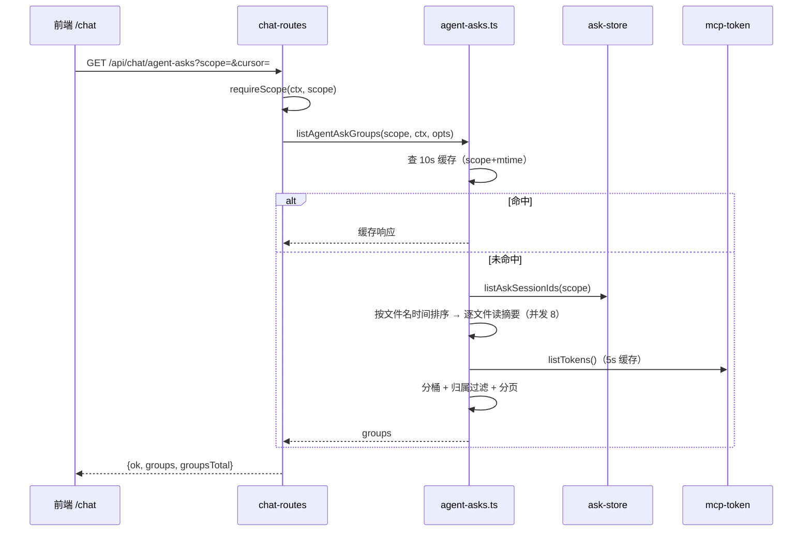

# S-02 · 列表与归属：`GET /api/chat/agent-asks`

## 1. 术语

| 术语 | 定义 |
|---|---|
| **来源组** | 列表分组单位：`local`（本机连接）或 `token:<tokenId>` |
| **归属链** | `ka-*.origin.tokenId` → `TokenRecord.ownerId` → web `userId` |
| **越权静默** | 无权访问的组**不出现在响应中**（而非返回空组或 403），避免成为枚举探测面 |
| **摘要** | 列表项只含标题/轮次/时间/状态，不含消息正文 |

## 2. 现状（AS-IS）

| 事实 | 位置 |
|---|---|
| 主列表接口签名与实现 | `chat-routes.ts:736-771`、`chat-store.ts:169-240` |
| 主列表是 `readdir` + 逐文件 `JSON.parse`，`total` 再全扫一遍 | `chat-store.ts:195-223`、`chat-routes.ts:729-734` |
| 非 admin 按 `ownerUserId` 强制过滤 | `chat-routes.ts:718-720` |
| `ka-*` 文件枚举现状只服务 GC | `ask-store.ts:172-182` |
| Token 记录：`id` / `label` / `ownerId`（可缺省）/ `createdBy` | `mcp-token.ts:38-51`；`listTokens()` `:250`、`listTokensByOwner()` `:285` |
| 上下文结构 | `chat-routes.ts:117-130`（`userId` / `role` / `authScopes`） |

## 3. 方案（TO-BE）

### 3.1 接口契约

```
GET /api/chat/agent-asks
      ?scope=<知识库名，缺省 default>
      &limit=<每页条数，1..50，缺省 20>
      &cursor=<{createdAt}__{id}，缺省首页>
      &group=<all|local|token:<tokenId>，缺省 all>
```

**响应 200**

```json
{
  "ok": true,
  "scope": "kisearch-memory",
  "groups": [
    {
      "id": "local",
      "kind": "local",
      "label": "本地连接",
      "tokenDeleted": false,
      "count": 3,
      "hasMore": false,
      "nextCursor": null,
      "items": [
        {
          "id": "ka-m9x2k1-ab12cd34ef5678901234567890abcdef",
          "title": "ki 导入流程分几个阶段？",
          "rounds": 2,
          "messageCount": 4,
          "createdAt": "2026-11-16T04:31:00.000Z",
          "lastActiveAt": "2026-11-16T04:33:00.000Z",
          "retainUntil": "2026-11-23T04:31:00.000Z",
          "retainDaysLeft": 7,
          "contextExpired": true,
          "corrupted": false
        }
      ]
    },
    {
      "id": "token:ab12cd34",
      "kind": "token",
      "label": "codex",
      "tokenId": "ab12cd34",
      "tokenDeleted": false,
      "count": 12,
      "hasMore": true,
      "nextCursor": "2026-11-16T02:10:00.000Z__ka-m9x1zz-...",
      "items": [ /* 同上，最多 limit 条 */ ]
    }
  ],
  "groupsTotal": 2
}
```

字段语义：

| 字段 | 说明 |
|---|---|
| `title` | 首条 user 消息 `content` 截断到 48 字符（与主列表 `TITLE_MAX_LEN` 同口径）；无 user 消息时为「（空问答）」 |
| `rounds` | user 消息条数（= 问答轮次） |
| `contextExpired` | 续接 TTL 已过（`isAskSessionExpired`）。**列表不展示**（见下） |
| `retainUntil` / `retainDaysLeft` | 保留期截止时刻与剩余天数（`createdAt + retainDays`） |
| | |
| **★ `contextExpired` 当前无消费方** | 后端算好返回，前端两处都没用（列表刻意不展示、详情是只读）。保留它是为后续「这条还能不能在 MCP 侧继续追问」的提示；若一直用不上，应在下一轮清理掉，避免变成恒真的死字段 |
| **★ 为什么列表不展示 `contextExpired`** | 续接 TTL 只有 10 分钟，**几乎所有历史条目都是"已过期"** ⇒ 标签恒亮 = 零信息量，还会让用户误以为"记录要没了"。列表真正该提示的是「快被清理了」，即 `retainDaysLeft <= 1` |
| `tokenDeleted` | `origin.tokenId` 在 `listTokens()` 中找不到 |
| `corrupted` | 文件解析失败；该组其余项正常返回 |

**必须过滤的两类文件**（否则会出现"列表里有、点开报错"）：

| 过滤条件 | 原因 |
|---|---|
| `isAskSessionPastRetention(file) === true` | 超保留期（GC 尚未跑到）→ 若出现在列表，点开会拿 410（S-03） |
| 损坏文件**跳过**（B2 实施调整） | 原设计是"保留 `corrupted` 项"，但 `origin` 只在文件内容里，读不出来就无从分组 —— 硬塞进「本地连接」会给出**错误的来源归属**。改为列表跳过、详情直连仍给 422（文件不删） |

> **搜索不在服务端做**：`keyword` 由前端跨两个数据源（人工会话 + agent 组）本地过滤，本接口不接收 `keyword` 参数 —— 否则"人工会话在前端过滤、agent 组在后端过滤"会出现同一关键词两边命中口径不一致。

**错误码**

| 状态 | 码 | 场景 |
|---|---|---|
| 400 | `SCOPE_INVALID` | scope 名非法（`requireScope` 现状） |
| 403 | `SCOPE_FORBIDDEN` | scope 不在授权范围（`requireScope` 现状） |
| 200 | — | 无任何组 → `groups: []`（不是 404） |

### 3.2 归属与可见性

> **前提：本机回环部署下 `origin` 恒为 `local`（2026-11-16 实测确认）**
>
> `mcp-http.ts:1332` `const authEnabled = !isLoopbackHost(host)` —— daemon 绑定 `127.0.0.1` 时
> **整个鉴权链路关闭**：即便客户端带了 `Authorization: Bearer <token>`，身份仍是
> `source: 'local'`、`principalKey = 'local'`（实测两次调用：带 token 与不带 token 落盘都是
> `origin: {kind:'local'}`）。
>
> ⇒ **Token 分组只在 daemon 对外监听时才会出现**（`--host 0.0.0.0` / 反向代理暴露），
> 单机自用场景下左栏只有「本地连接」一组。这是既有安全设计（本机免鉴权），本需求不改它；
> 若将来要"本机也按 Token 分组"，需要单独决策是否让回环连接识别 Bearer（那会动鉴权模型）。

```ts
// src/lib/chat/agent-asks.ts
const isAdmin = ctx.role === undefined || ctx.role === 'admin';

// 非 admin：只保留 ownerId === ctx.userId 的 token 组；local 组整组不返回
const visible = isAdmin
  ? groups
  : groups.filter((g) => g.kind === 'token' && tokenOwner(g.tokenId) === ctx.userId);
```

| 调用者 | 可见组 | 备注 |
|---|---|---|
| admin（或鉴权未启用 `role === undefined`） | 全部（local + 全部 token） | 与主列表「不过滤」口径一致 |
| 普通用户 | 仅 `TokenRecord.ownerId === userId` 的 token 组 | **local 组不可见**（本机调用不属于任何账号） |
| 旧 Token（无 `ownerId`） | 仅 admin | 无归属者不归任何人 |

**越权语义**：不可见的组直接**不出现在 `groups` 里**，不返回 403 —— 与主列表「过滤掉不是自己的会话」口径一致，且不泄露"存在某个 codex 组"。

### 3.3 分组与命名

```ts
function resolveGroupMeta(origin: AskOrigin, tokens: Map<string, TokenRecord>): GroupMeta {
  if (origin.kind === 'local') return { id: 'local', kind: 'local', label: '本地连接', tokenDeleted: false };
  const tokenId = origin.tokenId!;
  const rec = tokens.get(tokenId);
  // 实时 join 现名；改名即跟随（决策见父文档 §3.3）
  const label = rec ? tokenLabel(rec) : (origin.tokenLabel ?? '未知 Token');
  return { id: `token:${tokenId}`, kind: 'token', label, tokenId, tokenDeleted: !rec };
}
```

| 情况 | 分组标题 | 附加 |
|---|---|---|
| Token 存在 | 当前 `label`（`tokenLabel()` 已处理缺省 `Token <id>`） | — |
| Token 已删除 | 落盘快照名（`origin.tokenLabel`）或「未知 Token」 | `tokenDeleted: true` → 前端加「已删除」标 |
| 快照名也缺失（v1 旧文件） | 「「已删除的 Token」（tokenId 前 6 位）」 | `tokenDeleted: true` |

**组排序**：`local` 固定第二（在「我的会话」之后），token 组按**组内最新一条 `createdAt` 倒序**。前端把「我的会话」渲染在第一位，本接口只返回 agent 组。

### 3.4 扫描与性能

```ts
// 1) 文件名即时间：ka-<base36(createdAt)>-<32hex> ⇒ 排序无需读文件
//    parseInt(name.slice(3, name.indexOf('-', 3)), 36) → 毫秒
// 2) 只读候选：按组所需条数（limit+1）从新到旧读；count 需要全量 → 走缓存
// 3) 进程内缓存 10s（key = scope + 目录 mtimeMs + token 文件 mtimeMs）
```

| 步骤 | 成本 | 措施 |
|---|---|---|
| 枚举文件 | `readdir` 一次 | 只认 `/^ka-[A-Za-z0-9-]+\.json$/`（`ask-store.ts:57`） |
| 分桶（按组） | 需读文件头部字段 `origin` | 读全文但 `JSON.parse` 后只取必要字段；**串行读取** —— `readJson` 是同步 fs，`Promise.all` 只是排队、拿不到真并发，串行即最优 |
| `count` | 全量 | 与分桶同一次扫描内完成 |
| Token 名称 | `listTokens()` 一次 | 进程内缓存 5s（`mcp-tokens.json` 的 `mtimeMs` 变化即失效） |
| 重复请求 | — | **不做整响应缓存**（B2 实施决定）：10s 缓存会让"刚问的那条"最多晚 10s 出现，回看场景更在意及时性；当前量级（单机 agent）实测可接受 |

**容量边界**：`ka-*` 超过 **5000 个/scope** 时，本方案单次扫描约 100MB 读放大 —— 此时改为侧车索引（`{chatDir}/{scope}/ka-index.jsonl`，追加写）。当前量级（单机 agent 使用）远低于阈值，不预先实现。

> 主列表**不受影响**：`CONV_FILE_RE` 只认 `c-*`（`chat-store.ts:127`），本接口是独立路径。

### 3.5 代码改动清单

```
src/lib/chat/agent-asks.ts            [新增] 扫描/分桶/归属/分页/缓存（约 220 行）
src/lib/chat/chat-routes.ts           [修改] 注册 `GET /agent-asks`（segs.length===1）
src/lib/chat/ask/ask-store.ts         [修改] 导出 readAskSummary(scope,id)：只返回摘要字段
src/lib/mcp-token.ts                  [只读] listTokens / tokenLabel 复用，不改
web/src/api/chatApi.ts                [修改] listAgentAsks(params)
web/src/api/chatContract.ts           [修改] AgentAskSummary / AgentAskGroup 类型
test/agent-asks-list.test.ts          [新增] 分桶 / 归属 / 分页 / 损坏 / 缓存失效（10 例）
```

**新增目录结构**：不新增目录。

### 3.6 时序



## 4. 异常处理

| 场景 | 行为 | 是否对外暴露 |
|---|---|---|
| scope 非法 / 越权 | 400 / 403（`requireScope` 现状） | 是 |
| `cursor` 格式非法 | **忽略游标，返回首页**（与主列表宽容口径一致） | 否 |
| `limit` 越界 | 收敛到 1..50（不报错） | 否 |
| 目录不存在（该 scope 没跑过 `ki_ask`） | 返回 `groups: []` | 否 |
| 单个 `ka-*` 解析失败 | 该条 `corrupted: true`，不影响同组其余项 | 是（字段） |
| `mcp-tokens.json` 损坏 | `listTokens()` 返回空（fail-closed 读取，`mcp-token.ts:248-251`）→ 所有 token 组视为已删除 | 否（降级为「已删除」） |
| 同一 scope 并发 10 次列表请求 | 缓存命中，只扫一次 | 否 |
| 某组全部文件都超保留期 | 该组不出现在 `groups`（退化为空） | 否 |
| 非 admin 显式传 `group=token:<他人 tokenId>` | 返回 `groups: []`（**不是 403**，与"组不出现"同口径，防探测） | 否 |
| `group` 值非法（如 `token:` 空、未知前缀） | 忽略该参数，按 `all` 处理 | 否 |

## 5. 关键决策点

| 决策 | 选择 | 被否决方案 | 否决理由 | 重新评估触发条件 |
|---|---|---|---|---|
| 是否复用主列表接口 | 独立接口 | `GET /conversations?source=agent` | 主列表全量解析 + `total` 二次全扫；混入会让主列表成本随 `ka-*` 增长 | 主列表改为索引化查询 |
| 越权表现 | **组不出现** | 返回空组 / 403 | 空组会暴露"存在这个来源"，403 会让前端多一套错误分支 | 产品要求「明确告知无权访问」 |
| 组名来源 | 实时 join | 只用快照 | 改名后分组分裂 | Token 不可改名 |
| 排序锚点 | 组内最新一条 `createdAt` | 组名首字母 | 字母序与使用频率无关；用户找的是"最近用过哪个 agent" | 用户习惯按名称查找 |
| 缓存时长 | **仅 Token 列表 5s**，响应不缓存 | 整响应缓存 10s | 每次开页面全量扫 500 文件（约 50~100ms）会拖慢首屏 | 缓存导致用户"看不到刚问的"投诉（此时降为 2s 或改为 mtime 精确失效） |

## 6. 待定问题

| # | 问题 | 影响 | 临时处理 |
|---|---|---|---|
| T-1 | 组内 `count` 是否需要精确值（可用「N+」省略全量扫描） | 首屏成本 | 先精确；若实测 >100ms 再退化 |
| T-2 | 前端是否需要"本组只剩 N 天"提示 | 交互 | `retainUntil` 已返回，前端按需使用 |
| T-3 | 搜索是否要命中答案正文（当前只匹配 `title`） | 检索体验 | 本期只匹配标题；正文匹配需全文索引，随侧车索引一起做 |

---

## 附录 · B2 实施口径（2026-11-16）

| 项 | 实现 |
|---|---|
| 读盘顺序 | 按文件名 `ka-<base36(ms)>` 倒序（不读内容即可排序） |
| 分页排序 | 扫描完再按 `createdAt` 重排 —— 游标比的是内容时间，文件名只是"先读谁"，两者不同步时（历史文件 / 手工落盘）仍不跳条 |
| 游标 | **组内游标**：`all` 查询每组各带自己的 `nextCursor`；带 `group=` 时按该游标翻页 |
| Token 缓存 | 5s（只做时间缓存、不监听 `mcp-tokens.json` mtime：改名是低频运维动作） |
| Token 读失败 | fail-closed：视为"无 Token"，所有 token 组标记 `tokenDeleted`、仅 admin 可见 |
| 归属判断 | 列表过滤与详情校验**共用 `canViewGroup`**（分开写是越权高发点） |
| 实测 | `GET /api/chat/agent-asks?scope=kisearch-memory` 返回 1 组（local，2 条）；详情返回 `background` 54 字 + `sources` 15 条；假 id → 404 `AGENT_ASK_NOT_FOUND` |
