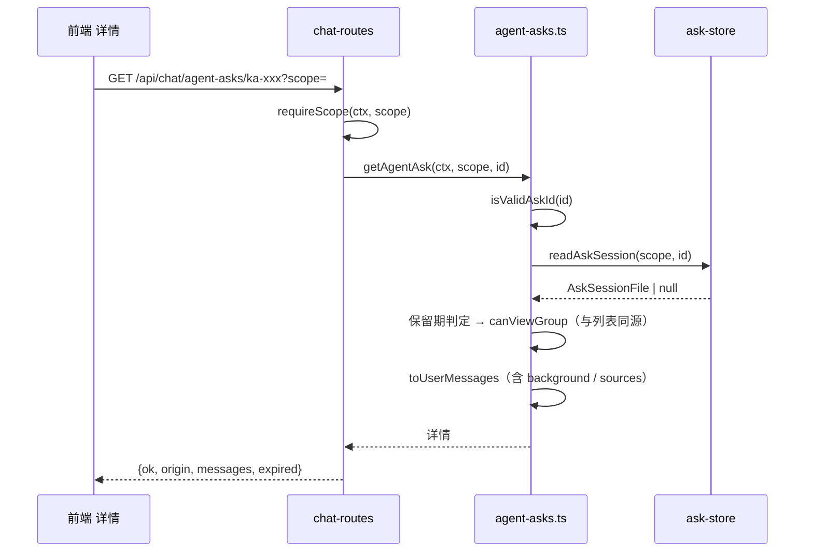

# S-03 · 详情与只读回放：`GET /api/chat/agent-asks/:id`

## 1. 术语

本子需求最容易混淆的是「回放」一词，**必须区分两种**：

| 术语 | 定义 | 含 `background` / `sources` | 实现位置 |
|---|---|---|---|
| **模型回放**（replayForModel） | 续接时把历史拼进上游 `messages` | ❌ **必须排除** | `ask-runner.ts::buildMemoryConv` |
| **用户回放**（replayForUser） | 详情接口把历史返回给页面 | ✅ **必须包含** | 本子需求 |

> 两者共用同一份 `AskSessionMessage[]`，但投影规则**相反**。S-01 的「回放排除」单测守的是前者；本子需求的验收守的是后者。任一漏掉都会出问题：漏前者会撑爆上下文预算，漏后者则背景与来源白落盘。

## 2. 现状（AS-IS）

| 事实 | 位置 |
|---|---|
| 会话详情返回完整 `ConversationFile`（含 messages/sources/progress） | `chat-routes.ts:778-800` 附近 `handleConversationGet` |
| 越权/不存在的统一处理：`ConversationNotFoundError` → 404 | `chat-routes.ts` 全局错误映射 |
| `ka-*` 只有 `readAskSession`（返回原始文件） | `ask-store.ts:110-124` |
| 短会话 id 校验（防路径穿越） | `ask-store.ts:66-76` |
| 续接归属校验（`ownerKey`） | `ask-runner.ts:196-205` |

## 3. 方案（TO-BE）

### 3.1 接口契约

```
GET /api/chat/agent-asks/<id>?scope=<知识库名，缺省 default>
```

**响应 200**

```json
{
  "ok": true,
  "id": "ka-m9x2k1-ab12cd34ef5678901234567890abcdef",
  "scope": "kisearch-memory",
  "origin": {
    "kind": "token",
    "tokenId": "ab12cd34",
    "label": "codex",
    "tokenDeleted": false
  },
  "createdAt": "2026-11-16T04:31:00.000Z",
  "lastActiveAt": "2026-11-16T04:33:00.000Z",
  "retainUntil": "2026-11-23T04:31:00.000Z",
  "expired": true,
  "messages": [
    {
      "role": "user",
      "content": "ki 导入流程分几个阶段？",
      "at": "2026-11-16T04:31:00.000Z",
      "background": "项目 kisearch 0.1.0，正在把 3 个 Git 仓库的文档迁进来；需要向同事说明导入会经历哪些步骤。"
    },
    {
      "role": "assistant",
      "content": "分三个阶段：① 预检 …",
      "at": "2026-11-16T04:31:00.000Z",
      "sources": [
        { "group": "部署运维", "doc": "构建知识库", "lineStart": 12, "lineEnd": 40 },
        { "group": "专题记忆", "doc": "数据流", "lineStart": 8, "lineEnd": 22 }
      ]
    }
  ]
}
```

| 字段 | 说明 |
|---|---|
| `origin.label` | 实时 join 的 Token 现名（与 S-02 同源）；`tokenDeleted` 时取快照名 |
| `expired` | 续接 TTL 已过 —— **只表示"不能在 MCP 侧继续追问"**，详情仍完整可读 |
| `background` | 仅 user 消息可能出现；本轮没传则字段缺省 |
| `sources` | 仅 assistant 消息；空数组时字段缺省（与 `SourcesList` 的空值契约一致） |

**错误码**

| 状态 | 码 | 场景 |
|---|---|---|
| 400 | `SCOPE_INVALID` | scope 非法（`requireScope`） |
| 404 | `AGENT_ASK_NOT_FOUND` | **含 id 结构非法**——id 由服务端生成、用户不会手输，单列一个 `AGENT_ASK_ID_INVALID` 只会多一条无用的分支（B3 实施决定） |
| 403 | `SCOPE_FORBIDDEN` | scope 越权（`requireScope`） |
| 404 | `AGENT_ASK_NOT_FOUND` | 文件不存在 / 不存在于该 scope / **无权访问**（三者统一，防探测） |
| 410 | `AGENT_ASK_PAST_RETENTION` | 文件仍在但已过保留期（并发窗口，GC 尚未删） |
| 422 | `AGENT_ASK_CORRUPTED` | 文件存在但解析失败（此时**不删文件**，与续接路径的「损坏即删」相反，见 §5） |

### 3.2 权限校验顺序

```ts
// src/lib/chat/agent-asks.ts
export async function getAgentAsk(ctx: ChatRouteContext, scope: string, id: string) {
  const r = await readAskSessionForRead(scope, id);   // 三态：ok / missing / corrupt（不删文件）
  if (r.kind === 'missing') throw new AgentAskError(404, 'AGENT_ASK_NOT_FOUND', ...);
  if (r.kind === 'corrupt') throw new AgentAskError(422, 'AGENT_ASK_CORRUPTED', ...);
  const meta = groupMetaOf(r.file.origin, tokens);
  // ★ 顺序：权限**先于**保留期 —— 反过来的话，无权者可凭 410 与 404 的差异探测「这条记录存在过」
  if (!canViewGroup(ctx, meta, tokens)) throw new AgentAskError(404, 'AGENT_ASK_NOT_FOUND', ...);
  if (isAskSessionPastRetention(r.file, retainDays())) throw new AgentAskError(410, ...);
  return toDetail(file, origin);
}
```

`canView` 与 S-02 的列表过滤**共用同一个函数**（`canViewGroup(ctx, origin, tokens)`），避免两处判定漂移 —— 这是权限模型里最容易出现"列表看不到、直接敲 URL 能看"的口子。

### 3.3 消息投影（用户回放）

```ts
function toUserMessages(msgs: AskSessionMessage[]): AgentAskMessage[] {
  return msgs.map((m) => ({
    role: m.role,
    content: m.content,
    at: m.at,
    ...(m.background ? { background: m.background } : {}),
    ...(m.sources && m.sources.length > 0 ? { sources: m.sources } : {}),
  }));   // ★ 显式投影，禁止 ...m 展开
}
```

> **与 S-01 的镜像约束**：`buildMemoryConv` 用同样的显式投影但**只取 3 个字段**；本函数取 5 个。两处都禁止改成对象展开——这是两个方向相反的规则，展开写法会让它们无法分别演进。

### 3.4 只读边界（不做写操作）

| 可能的写操作 | 是否提供 | 原因 |
|---|---|---|
| 续聊 / 追加消息 | ❌ | `ka-*` 的写入方是 MCP 通道（`ownerKey` 归属校验）；页面写入会绕过该模型 |
| 改名 | ❌ | `ka-*` 无 `title` 字段，标题由首条 user 消息派生 |
| 归档 | ❌ | 无 `archived` 字段；与主列表归档语义不同源 |
| 删除 | ❌ | 本期不做；删除入口只在 Token 管理侧（删 token 不删问答） |

⇒ 前端详情页**不渲染**任何写操作入口（对应需求 N1：不是渲染后点了没反应）。

### 3.5 代码改动清单

```
src/lib/chat/agent-asks.ts            [修改] 增 getAgentAsk / canViewGroup / toUserMessages
src/lib/chat/chat-routes.ts           [修改] 注册 `GET /agent-asks/:id`（segs.length===2）
src/lib/chat/ask/ask-store.ts         [只读] readAskSession 复用，不改
web/src/api/chatApi.ts                [修改] getAgentAsk(id, scope)
web/src/api/chatContract.ts           [修改] AgentAskDetail / AgentAskMessage 类型
test/agent-asks-detail.test.ts        [新增] 投影含背景与来源 / 越权 404 / 过保留期 410 / 损坏 422（8 例）
```

### 3.6 时序



## 4. 异常处理

| 场景 | 行为 | 是否对外暴露 |
|---|---|---|
| id 结构非法 | 400 `AGENT_ASK_ID_INVALID` | 是 |
| 越权（他人 Token 组） | **404**（与不存在同码同文案） | 是 |
| 文件不存在 | 404 `AGENT_ASK_NOT_FOUND` | 是 |
| 超保留期 | 410 `AGENT_ASK_PAST_RETENTION`，文案「该问答已超过 7 天保留期」 | 是 |
| 文件损坏 | 422 `AGENT_ASK_CORRUPTED`，**不删文件** | 是 |
| 消息数组为空（只有文件头） | 200 + `messages: []`，前端显示「该问答无内容」 | 是（字段） |
| 单条 assistant 无 `sources` | 字段缺省，前端不渲染来源区 | 否 |

> **与续接路径的差异**：`readAskSession` 遇到损坏文件会**删除**并返回 `null`（`ask-store.ts:110-124`），那是为了让 MCP 调用方能重新开始；详情接口是**只读**，删文件属于越权副作用 ⇒ 详情路径改用 `readAskSessionRaw`（不删），区分 422 与 404。

## 5. 关键决策点

| 决策 | 选择 | 被否决方案 | 否决理由 | 重新评估触发条件 |
|---|---|---|---|---|
| 越权语义 | 404（同"不存在"） | 403 | 403 等于确认"这条存在但你不能看"，可被用于枚举 `ka-*`（虽然 id 高熵，但列表侧已泄露 id） | 产品要求明确区分权限错误 |
| 损坏文件处理 | 详情不删、返回 422 | 沿用续接路径「损坏即删」 | 只读接口产生删除副作用违反最小惊讶；且列表可能仍引用该 id | 损坏文件堆积成为运维负担 |
| 详情是否受 TTL 限制 | **不受** | 10 分钟后 410 | 那等于"列表能看到但点不开"，且保留期本来就是 7 天 | 隐私要求"上下文过期即不可读" |
| 是否返回 `progress`（检索步骤） | ❌ 不返回 | 与主会话一致返回工具行 | `ka-*` 从未存该字段（S-01 也未加）；补它要改落盘结构与体积 | 用户明确要求看检索过程 |

## 6. 待定问题

| # | 问题 | 影响 | 临时处理 |
|---|---|---|---|
| T-1 | 详情是否需要展示「本轮用了哪个模型」 | 排查体验 | 本期不展示（`ka-*` 无该字段） |
| T-2 | 长答案（>40K）在详情页的渲染性能 | 前端 | 沿用主会话的 markdown 渲染路径；实测后再优化 |
