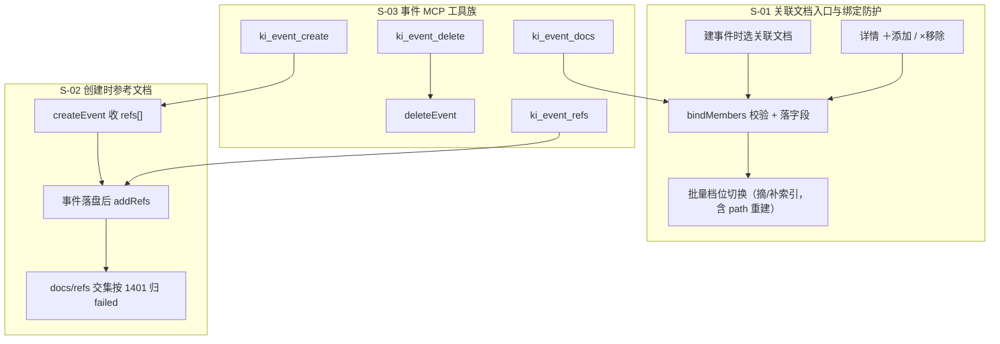
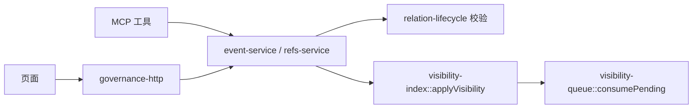

# 事件文档入口与事件 MCP 工具 · 设计（父文档）

- 需求：REQ-20261116-004（已确认）
- 设计版本：v1（2026-11-16）
- 证据基线：代码直读（`src/lib/events/*`、`src/lib/governance-http.ts`、`web/src/pages/EventsPage.tsx`）

## 1. 需求背景 & 目标

**现状三个缺口**：① 新建事件弹窗只有标题/描述/类型/起始阶段（`web/src/pages/EventsPage.tsx:1291-1393`），无法在建事件时选文档；② 详情「关联文档」区没有任何按钮（同文件 `:704-734`），只有参考文档有「AI 查找 / ＋ 添加」；③ MCP 侧只有只读 `ki_event_list` / `ki_event_type_list` 与唯一写工具 `ki_event_set_stage`，"事件只能由人在页面创建"被写死在三处文案里。

**目标**：页面与 MCP 两侧对等的四类事件文档操作——创建事件（可带文档）、删除事件、关联文档增删、参考文档增删。

**不在范围内**：AI 查询参考文档的 MCP 工具（`searchRefCandidates` 的 MCP 化，用户明确搁置）；事件源码分析（已有 REQ-20261113-003）；事件类型的 MCP 增删改；AI 对话工具面（`CHAT_MCP_TOOLS`）登记。

**验收口径**：页面两处入口可用；4 个 MCP 工具在只读 Token 下不可见；文档归属冲突与数据源锁定被拒；绑定到不可检索阶段后 `ki_search` 搜不到。

## 2. 关键环节一览图

## 3. 总体方案设计

三个子需求共用一条服务层主链：**入口（页面/MCP）→ 领域服务（event-service / refs-service）→ 分类落盘（relation-lifecycle 判定）→ 索引可见性（visibility-index 唯一出口）**。入口层只做参数转译与 UI，不承载业务规则；归属冲突、上限、数据源锁三条校验全部落在服务层，保证页面、HTTP、MCP、CLI 四条路径口径一致。

**接口权威声明**：本批新增/扩展的接口签名以各子文档「接口设计」章为唯一权威，父文档不重复定义，避免两处漂移；文中出现的 `EventRecord` / `Relation` / `Visibility` 是既有类型（`src/lib/events/types.ts`、`src/lib/scoring.ts`）。

**共享术语速查**

| 术语 | 含义 | 权威位置 |
|---|---|---|
| 关联文档（member） | 分类为 `event` 且 `eventId` 指向某事件的文档，可见性随阶段变化 | `Relation.lifecycle='event'` + `Relation.eventId` |
| 参考文档（ref） | 仅建立引用，不改文档分类与可见性 | `{scope}/events/refs/{eventId}.json` |
| 绑定 / 解绑 | 把文档改成 event 并挂到事件 / 清除 `lifecycle`+`eventId` 回 `wiki` | `event-service.ts` |
| 档位（Visibility） | `full` / `fts-only` / `hidden` 三档 | `visibility-index.ts::resolveVisibility` |
| 可见性队列 | 档位切换时需异步补写的索引登记（`.visibility-pending.json`） | `visibility-queue.ts` |

## 4. 全局风险 & 跨子需求依赖

| # | 风险 | 影响 | 处理 |
|---|---|---|---|
| G1 | 契约双份漂移 | `governance-contract.ts` 与 `web/src/api/governanceContract.ts` 任一侧改动都会让 `test/governance-contract.test.ts` 红 | 新增 DTO 两份同改 + 测试断言；本批新增 `EventMemberChangeResult` |
| G2 | 错误码号段冲突 | 各子需求自选号会撞码且不报错 | 本批统一定段：S-02 事件域 `1117~1119`，S-05 参考域复用 `1401~1406` |
| G3 | 索引补齐只在 daemon 启动时消费（`mcp-http.ts:1548`），本次新增的绑定/解绑若不主动触发，`pending` 永远不会执行 | 声明"补索引中"却永不完成 | 写操作末尾 fire-and-forget `consumePending(scope)`；S-01 统一实现 |
| G4 | 三处旧文案与新工具自相矛盾（`event-set-stage.ts:4`、`sync-relation.ts:19,435`、`relation-lifecycle.ts:157`） | AI 被自己的工具描述劝退 | S-03 逐条改，验收项 grep 兜底 |
| G5 | 三个子需求都要改 `event-service.ts` 与 `EventsPage.tsx` | 并行实现必冲突 | 交付时不拆并行：按 S-01 → S-02 → S-03 串行 |
| G6 | 成员上限与参考上限不对称（现有 `REF_LIMIT=50`，成员无上限） | 返回体无界、MCP 上下文被吃 | 新增 `MEMBER_LIMIT=50` + `EVENT_MEMBER_LIMIT_EXCEEDED` |
| G7 | `ki-path`（组级）**只有摘除路径、没有重建路径**（`visibility-index.ts:351-359`） | 事件文档从 `hidden` 回到 `full`（解绑 / 流转 / 恢复）后，该组路径向量永久缺失，按组路径检索静默失效；本批新增的"随时解绑"把它从偶发变成常规路径 | S-01 §3.1.2 修 `planTransition`；**已拍板同批修** `transitionEvent` / `restore` 同源路径（共用同一函数与同一测试面） |
| G8 | 索引摘除失败只进诊断文件（`.visibility-failures.json`），页面与 AI 均无感 | 绑定"成功"但文档仍可被检索，展示与真实状态相反 | 接口与 MCP 返回 `visibilityFailed[]`，页面给警示条（S-01 §5.1/§7、S-03 §3.2） |

**跨子需求依赖**：S-03 依赖 S-01 的 `bindMembers`/`unbindMember` 与 S-02 的 `createEvent.refs`；S-02 依赖 S-01 的冲突校验函数（同批校验 docs/refs 交集）。

**非功能假设（显式标注）**：默认单机低量级（单 scope 文档 ≤ 1 万篇、单事件成员 ≤ 50），无并发写同一事件的强需求（已有 `withScopeWriteLock` 串行）；绑定操作允许秒级完成，索引补写异步。
