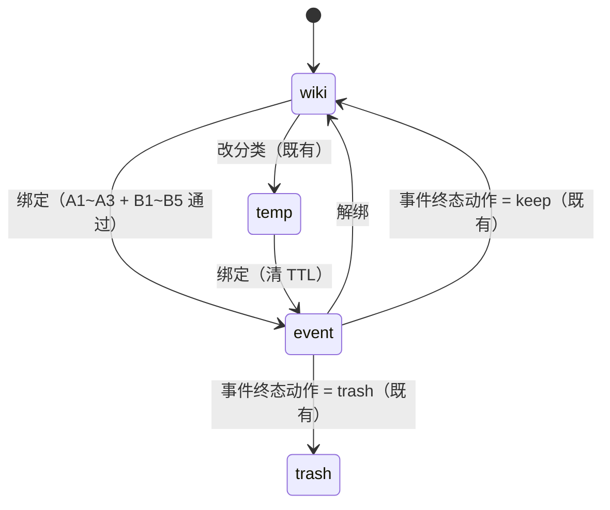
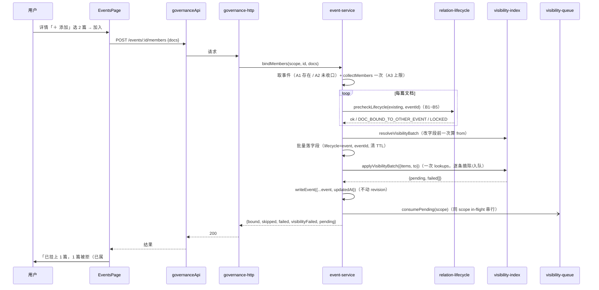

# S-01 关联文档入口与绑定防护 · 设计

- 需求：REQ-20261116-004 / 子需求 S-01
- 覆盖验收项：R1 建事件时选关联文档、R3 详情「＋ 添加」、R4 详情行内「×」移除、R6 绑定后索引同步、R7 归属冲突校验
- 上游确认：ASCII 布局（新建弹窗两区块 + 详情区按钮）已确认；移除语义 = 解绑回 `wiki`；成员上限 50

## 1. 术语

| 术语 | 定义 |
|---|---|
| 关联文档 | `Relation.lifecycle === 'event'` 且 `Relation.eventId === <event.id>` 的文档，检索可见性由该事件当前阶段决定 |
| 绑定 | 把文档分类改成 `event` 并写入 `eventId`（写前必须通过归属/锁定/上限校验） |
| 解绑 | 清除 `lifecycle`、`eventId`、`expiresAt`、`ttlDays`，文档回到 `wiki`（长期保留、可检索），**不删除文档、不进回收站** |
| 归属冲突 | 目标文档已绑在另一个未收口事件上 |
| 档位切换 | `applyVisibility({from, to})`：`hidden` 时同步摘索引、其余情况入 pending 队列异步补写 |

## 2. 现状（AS-IS）

| # | 位置 | 现状 | 问题 |
|---|---|---|---|
| P1 | `web/src/pages/EventsPage.tsx:1291-1393` | `NewEventModal` 只有标题/描述/类型/起始阶段 | 建事件时无法选文档 |
| P2 | `web/src/pages/EventsPage.tsx:704-734` | 「关联文档」区只有列表与阶段档位徽标；空态文案是「暂无关联文档（用 ki_sync_relation 的 event 参数绑定）」 | 没有添加/移除入口，把动作推给 AI |
| P3 | `src/lib/events/event-service.ts:248-283` | `bindDocs` 直接 `rel.lifecycle='event'; rel.eventId=event.id`，随后 `enqueueVisibility` | ① 无归属冲突校验（静默改绑）② 无 `isImported` 数据源锁校验 ③ 只入队不摘除：绑到 `hidden` 阶段后旧 dense/FTS 索引仍在，`ki_search` 仍能搜到 |
| P4 | `src/lib/relation-lifecycle.ts:213-253` | `changeLifecycle` 只做 `precheckLifecycle` + `applyLifecyclePlan` + 写分片 | 同上：无归属冲突校验、无档位切换（页面/HTTP 改分类后索引不同步）；注释承诺的 `visibilityHint` 在仓库内不存在（grep 0 命中） |
| P5 | `src/lib/mcp-http.ts:1547-1559` | `resumePendingOnStartup` 仅在 daemon 启动时消费 `.visibility-pending.json` | 运行期入队的补索引任务无人消费，"索引重建中"永不完成 |

`applyVisibility`（`src/lib/visibility-index.ts:271`）是档位切换的唯一出口，已经实现「同步摘除 + 异步补写」，但当前只有事件流转与重建在用它。

## 3. 方案（TO-BE）

### 3.1 服务层新增绑定/解绑（`src/lib/events/members.ts`，新建）

**改什么**：新增 `bindMembers()` / `bindMembersLocked()` / `unbindMember()`。`bindMembers` 只负责抢 `withScopeWriteLock(scope,'event-update')` 后转调 `bindMembersLocked`；`createEvent` 已持写锁，**必须直接调 `bindMembersLocked`**（同 scope 锁重入会排队到超时）。私有 `bindDocs` 删除，职责并入 `bindMembersLocked`。

**校验顺序（逐条独立失败，不影响同批其他文档）**

```
【批次级前置 A1~A3，任一条不满足即整批拒绝】
A1 事件存在                       → EVENT_NOT_FOUND（附 available 未收口事件）
A2 事件未收口                     → EVENT_CLOSED
A3 绑定后总数 ≤ MEMBER_LIMIT(50)   → EVENT_MEMBER_LIMIT_EXCEEDED（不截断、不部分执行）

【逐条判定 B1~B5，一条失败不影响其他】
B1 文档存在（该 group 分片内有该 relation） → DOC_NOT_FOUND
B2 非数据源文档（isImported）      → DATASOURCE_LIFECYCLE_LOCKED
B3 未被其他**未收口**事件占用       → DOC_BOUND_TO_OTHER_EVENT（details 带冲突事件 id/shortId/title）
B4 同批重复项                     → skipped（reason: duplicate-in-request）
B5 已绑在本事件                    → skipped（reason: already-bound，幂等）
```

> B3 只拦「未收口」事件：已收口事件的 `eventId` 按既有语义在收口时已被清（`applyTerminalAction`）。若遇到收口后仍残留绑定的历史数据，按覆盖处理并记 `staleEventBinding` 警告（不阻断；`resolveVisibility` 本就把悬空 `eventId` 按 wiki 兜底）。

**写成什么**：先把全部候选分到 `ok / skipped / failed` 三类（纯校验，不落盘；`collectMembers` 只调一次复用），再对 `ok` 批量落字段，最后批量切换档位。落盘成功后同步 `writeEvent({...event, updatedAt: now})`——**只动 `updatedAt`，不动 `revision`**（`revision` 是描述编辑的乐观锁，绑定不该让页面正在编辑的描述变成冲突）。

**为什么**：校验与落盘分离才能保证"一批里 3 篇成功 1 篇冲突"时给出完整报告；`applyVisibility` 必须在**改字段前**算 `from`（改完再算会把自己算成新档位）。

```ts
// 伪代码（关键顺序）
const from = resolveVisibilityOfRelation(scope, rel).mode; // 改字段前
rel.lifecycle = 'event'; rel.eventId = event.id;            // 改字段
delete rel.expiresAt; delete rel.ttlDays;
const to = resolveStageVisibility(type, event.stageKey).visibility;
await applyVisibility({ scope, group, relation, from, to });
```

### 3.1.1 批量档位切换（性能约束）

`applyVisibility`（`src/lib/visibility-index.ts:271-376`）每次调用都执行 `findRelation`（全量扫分片）与 `buildLookups`（全量读事件 + 类型）。单批 50 篇逐条调用 = 50 次全量读，大库上会到秒级，且全部发生在持有 scope 写锁期间。

**改什么**：`visibility-index.ts` 新增两个导出——

- `resolveVisibilityBatch(scope, items): Map<string, Visibility>`（key = `group\u0000relation`）：一次 `buildLookups`，在**改字段前**批量算出每篇的 `from`（否则实现时仍会逐条 `resolveVisibilityOfRelation`，重复全量读）；
- `applyVisibilityBatch(scope, items, to)`：一次 `readAllGroupCaches`，逐条执行原有「摘除 + 入队」逻辑，`from` 取自上面的快照。

**为什么**：绑定是批量操作且已有 50 篇上限，逐条全量读是纯浪费；但**不能**为性能退回"只入队不摘除"——摘除是语义正确性要求（D1），且摘除本身是删除调用，毫秒级。

### 3.1.2 解绑必须补回 `ki-path`（既有缺陷，本批被稳定触发）

`planTransition`（`src/lib/visibility-index.ts:165-183`）只把 `dense/fts/relation` 放进 `write`；`ki-path` 仅有一条**摘除**分支（同文件 `:351-359`，`to==='hidden'` 且组内全不可见时删组级向量），**没有任何重建路径**。

后果：某组里唯一的事件文档被解绑回 `wiki` 后，该组的 `ki-path` 向量永久缺失——按组路径的语义检索再也搜不到这个组，而页面一切正常。事件流转 `hidden → full` 同样中招（既有缺陷），本批新增的「随时解绑」会让它从"偶发"变成"常规路径"。

**改什么**：`planTransition` 增加 `hidden → non-hidden` 时 `write` 含 `'path'`（组级写入幂等，重复写同一路径安全）；`applyVisibility`/`applyVisibilityBatch` 的 pending 入队按新矩阵执行。

**为什么不能只修解绑路径**：`transitionEvent` 用的是同一个 `applyVisibility`，只补解绑等于给同一缺陷留两个入口。

**范围声明（2026-11-16 已拍板：同批修）**：这条同时修复既有 `transitionEvent` / `restore` 的同源缺陷。既然 `planTransition` 只有一处、三条路径（解绑 / 流转 / 恢复）共用同一函数，**不做"只补解绑"的分裂修法**；相应回归测试也一并覆盖（见 §8 的 `visibility-batch.test.ts`）。

### 3.2 `changeLifecycle` 接入档位切换与冲突校验（`src/lib/relation-lifecycle.ts`）

**改什么**：① `precheckLifecycle` 的 `event` 分支增加归属冲突校验；② `changeLifecycle` 在 `applyLifecyclePlan` 之后调用 `applyVisibility`，并返回 `visibility`。

**为什么**：分类页把文档改成 `event`、上传接口带 `lifecycle/eventId`、`ki_sync_relation` 覆盖写都走这条链；不接档位切换则"声明不可检索但索引还在"，阶段设计被静默推翻。

**边界**：`precheckLifecycle` 是纯函数（无 IO），冲突校验需要的 `existing.eventId` 已在其 `existing` 入参里，可直接判定，无需新增读盘。

### 3.3 触发补索引消费（`src/lib/visibility-queue.ts` 使用方）

**改什么**：绑定/解绑/改分类成功后 `void consumePending(scope)`（fire-and-forget，不阻塞响应；失败由既有 `attempts` 机制保留重试）；新增模块级 `Map<scope, Promise>` 做**同 scope 串行**——已有消费在飞时直接复用该 Promise，不再并发跑第二个消费者。

**为什么**：消费目前只在 daemon 启动时跑（P5），不加触发则"pending 数秒后生效"永远是假的；而 `consumePending`（`visibility-queue.ts:120-219`）读-改-写 `.visibility-pending.json` 无锁，两次并发消费会互相覆盖、重复 embed（幂等但浪费，且可能把 `attempts` 计数写乱）。

### 3.4 HTTP 两个端点（`src/lib/governance-http.ts`）

在 `segs[0]==='events'` 分支内、`refs` 段旁新增 `members` 段（详见 §5）。

**为什么新端点而不是前端循环调 `lifecycle/apply`**：循环调用会 N 次抢写锁、无统一 `failed[]`、冲突校验散在前端。新端点一次锁、一次报告。

### 3.5 前端（`web/src/pages/EventsPage.tsx` + 新组件）

| 文件 | 变更 |
|---|---|
| `web/src/components/governance/DocPickerModal.tsx` | **新增**：从 `EventsPage.AddRefModal`（`:1130-1246`）抽出，参数化 `mode: 'member' \| 'ref'`、`eventId?`（新建时无）、`title`、`emptyHint`；已属其他事件的候选行禁用并标注 `已属 #3 登录白屏` |
| `web/src/pages/EventsPage.tsx` | `NewEventModal` 增「关联文档（可选）」「参考文档（可选）」两区块（已确认 ASCII）；详情「关联文档」区头加 `＋ 添加`，行内加 `×`（二次确认）；空态文案改为指向按钮；`visibilityFailed[]` 非空时在成员区上方显示警示条；删除本地 `AddRefModal` 定义 |
| `web/src/api/governanceApi.ts` | `createEvent` 增 `docs?`/`refs?`；新增 `addMembers` / `removeMember`；`searchRefDocs` 返回类型增 `event?` |

**只读账号门禁（必须一并做）**：本批新增的写入口共 3 处 —— 弹窗内两个选择器的「加入」、详情「＋ 添加」、详情行内「×」——全部按既有口径处理：`disabled={!canWrite}` + `title="需要写权限"`（不隐藏按钮），与治理三页已登记的 23 处写入口保持一致；后端权限点仍兜底。

### 3.6 契约与错误码

- `src/lib/governance-contract.ts` 与 `web/src/api/governanceContract.ts` **同改**：新增 `EventMemberChangeResult`、`EventMemberRemovalResult`；把 `searchDocsForAdd` 原本的**匿名内联返回结构**提为具名 `DocSearchHit`（含新增 `event?: {id: string; shortId: number; title: string}`），两侧契约同步。
- `src/lib/governance-errors.ts`：新增三个码（S-02 事件段续号 1117~1119）——
  - `DOC_BOUND_TO_OTHER_EVENT: 1117`（映射 HTTP 409）：文档已属其他未收口事件；
  - `EVENT_MEMBER_LIMIT_EXCEEDED: 1118`（409）：绑定后超过 50 篇，整批拒绝；
  - `EVENT_DOCS_INVALID: 1119`（400）：`docs` 字段缺失 / 非数组 / 元素缺 `group` 或 `name`（**空数组不算错**，按幂等空操作返回）。
- `src/lib/events/members.ts`：新增 `export const MEMBER_LIMIT = 50`。
- `EventMemberChangeResult.shortId` 为 **number**（与 `EventRefSummary` 契约一致）；MCP 工具层给人看的 `shortId` 带 `#` 前缀（字符串），两层刻意不同，S-03 §3.2 已注明。

## 4. 数据模型

无新表、无 schema 迁移。复用 `Relation` 既有字段：

| 字段 | 类型 | 绑定后 | 解绑后 | 说明 |
|---|---|---|---|---|
| `lifecycle` | `'temp' \| 'event' \| undefined` | `'event'` | `undefined` | `undefined` 等价 `wiki` |
| `eventId` | `string \| undefined` | `event.id`（`evt_…`） | `undefined` | 成员归属的唯一依据（`collectMembers` 反向索引） |
| `expiresAt` / `ttlDays` | `number \| undefined` | 删除 | 删除 | 事件文档不受 TTL 约束 |
| `isImported` | `boolean` | 不变 | 不变 | `true` 时禁止任何分类变更（判定 B2） |

状态机（单文档视角）：



## 5. 接口设计

### 5.1 `POST /api/governance/events/:id/members`

```ts
// 请求
interface AddMembersBody {
  scope?: string;                          // 缺省取 query 的 scope，再缺省 default
  docs: Array<{ group: string; name: string }>;
}

// 响应 200（即使部分失败；全部失败仍 200，看 failed[]）
interface EventMemberChangeResult {
  ok: true;
  scope: string;
  eventId: string;
  shortId: number;
  visibility: { mode: 'full' | 'fts-only' | 'hidden'; dense: boolean; fts: boolean };
  bound: Array<{ group: string; name: string }>;
  skipped: Array<{ group: string; name: string; reason: 'already-bound' | 'duplicate-in-request' }>;
  failed: Array<{ group: string; name: string; code: string; error: string }>;
  /** 已绑定成功但索引摘除失败（文档仍可能被检索到）：必须让用户看见，不能只进诊断文件 */
  visibilityFailed?: Array<{ group: string; name: string; kind: 'dense' | 'fts' | 'relation' | 'path'; error: string }>;
  pending: string[];     // 需异步补写的索引类别；非空时 hint 提示"数秒后生效"
  hint: string;
}

// 400 / 409（整批前置失败）
{ ok: false, code: 'EVENT_CLOSED', error: '事件「#8 登录白屏」已收口，不能新增关联文档' }
{ ok: false, code: 'EVENT_MEMBER_LIMIT_EXCEEDED', error: '单个事件最多 50 篇关联文档（当前 48，本次 5）' }
```

Demo 返回示例（仅示意格式，非最终数据）：

```json
{
  "ok": true,
  "scope": "default",
  "eventId": "evt_9f2c1a",
  "shortId": 8,
  "visibility": { "mode": "hidden", "dense": false, "fts": false },
  "bound": [{ "group": "wiki/登录", "name": "登录页白屏排查笔记" }],
  "skipped": [{ "group": "wiki/登录", "name": "登录态失效根因", "reason": "already-bound" }],
  "failed": [
    {
      "group": "ops/网关",
      "name": "网关超时日志片段",
      "code": "DOC_BOUND_TO_OTHER_EVENT",
      "error": "该文档已属于事件 #3「登录白屏」（未收口），请先解绑或改选其他文档"
    }
  ],
  "pending": [],
  "hint": "1 篇已挂上；当前阶段不可检索（语义与全文都搜不到，这是阶段设计的预期行为）"
}
```

### 5.2 `DELETE /api/governance/events/:id/members?scope=&group=&name=`

```ts
interface EventMemberRemovalResult {
  ok: true;
  scope: string;
  eventId: string;
  removed: { group: string; name: string };
  lifecycle: 'wiki';
  visibility: { mode: 'full'; dense: true; fts: true };
  pending: string[];
  hint: string;
}
```

Demo 返回示例：

```json
{
  "ok": true,
  "scope": "default",
  "eventId": "evt_9f2c1a",
  "removed": { "group": "wiki/登录", "name": "登录页白屏排查笔记" },
  "lifecycle": "wiki",
  "visibility": { "mode": "full", "dense": true, "fts": true },
  "pending": ["dense", "fts", "relation", "path"],
  "hint": "已解绑，文档恢复长期保留；索引补齐中（含组路径索引），数秒后可被语义检索"
}
```

失败：`404 DOC_NOT_FOUND`（文档不存在或不在本事件成员中，`details: { memberOf: 'evt_...' | null }`）。

### 5.3 服务层函数

```ts
// src/lib/events/members.ts（新建）
export const MEMBER_LIMIT = 50;

export interface BindMembersInput {
  docs: Array<{ group: string; name: string }>;
  by?: 'user' | 'ai';
}
export interface BindMembersOutcome {
  event: EventRecord;
  visibility: { mode: Visibility; dense: boolean; fts: boolean };
  bound: Array<{ group: string; name: string }>;
  skipped: Array<{ group: string; name: string; reason: 'already-bound' | 'duplicate-in-request' }>;
  failed: Array<{ group: string; name: string; code: string; error: string }>;
  /** 已绑定但摘除失败（供 HTTP/MCP 原样透出，页面给警示条） */
  visibilityFailed: Array<{ group: string; name: string; kind: IndexKind; error: string }>;
  pending: IndexKind[];
}
export async function bindMembers(
  scope: string,
  eventRef: string,
  input: BindMembersInput,
): Promise<BindMembersOutcome>;

/** 不加锁版本：仅 `createEvent`（已持 scope 写锁）与 `bindMembers` 内部调用 */
export async function bindMembersLocked(
  scope: string,
  event: EventRecord,
  input: BindMembersInput,
): Promise<BindMembersOutcome>;

export async function unbindMember(scope: string, eventRef: string, group: string, name: string): Promise<{
  event: EventRecord;
  removed: { group: string; name: string };
  lifecycle: 'wiki';
  visibility: { mode: 'full'; dense: boolean; fts: boolean };
  pending: IndexKind[];
}>;

// src/lib/visibility-index.ts
export function resolveVisibilityBatch(
  scope: string,
  items: Array<{ group: string; relation: string }>,
): Map<string, Visibility>;   // key = `${group}\u0000${relation}`

export async function applyVisibilityBatch(
  scope: string,
  items: Array<{ group: string; relation: string; from: Visibility }>,
  to: Visibility,
): Promise<{
  applied: number;
  pending: IndexKind[];
  failed: Array<{ group: string; relation: string; kind: IndexKind; error: string }>;  // per-item，供接口透出 visibilityFailed
}>;
```

> `unbindMember` 不需要 `visibilityFailed`：解绑只会「补写」索引（入 pending），不会摘除；写入失败由 `attempts` 重试机制兜住。
> `BindMembersOutcome` 为具名类型，S-02（`createEvent.binding.docs`）与 S-03（`ki_event_docs`）直接复用，避免三处手抄。

### 5.4 文档搜索扩展（供选择器标注）

`searchDocsForAdd`（`src/lib/events/refs-service.ts:416`）返回值增字段：

```ts
{ group: string; name: string; visibility: Visibility; event?: { id: string; shortId: number; title: string } }
```

`event` 仅在文档已绑定到**其他未收口事件**时出现；前端据此禁用该行并标注，后端仍在 `bindMembers` 兜底（409 语义进 `failed[]`）。

## 6. 时序图



## 7. 异常处理

| 场景 | 行为 | 对外暴露 |
|---|---|---|
| 事件不存在 / 已收口 | `EVENT_NOT_FOUND`（附可用事件）/ `EVENT_CLOSED` | 是（400） |
| `docs` 缺失 / 非数组 / 元素缺字段 | `EVENT_DOCS_INVALID`；空数组按幂等空操作返回 `{ok:true, bound:[]}` | 是（400） |
| 文档不存在 | 进 `failed[]`，`code=DOC_NOT_FOUND`，同批其他继续 | 是（200 体内） |
| 文档为数据源文档（`isImported`） | 进 `failed[]`，`code=DATASOURCE_LIFECYCLE_LOCKED`，提示"另建文档写入" | 是 |
| 已属其他未收口事件 | 进 `failed[]`，`code=DOC_BOUND_TO_OTHER_EVENT`，`details` 带冲突事件 | 是 |
| 绑定后超 50 篇 | 整批拒绝 `EVENT_MEMBER_LIMIT_EXCEEDED`，不部分执行 | 是（409） |
| 同批重复 / 已绑本事件 | 进 `skipped[]`，不报错（幂等） | 是 |
| `applyVisibility` 摘除失败 | 不回滚绑定；失败进 `.visibility-failures.json`（既有机制）+ **接口 `visibilityFailed[]` 透出**，前端显示警示条「索引未能摘除，这些文档仍可能被检索到」 | 是（接口 + 页面） |
| 解绑后 `ki-path` 需重建 | 按 §3.1.2 入 pending（组级写入幂等）；不入的情形（组内仍全不可见）不写 | 否（异步执行） |
| `consumePending` 失败 | 保留 pending + `attempts+1`，3 次后 blocked | 否（日志 + 诊断页） |
| 解绑时文档已不在（被删） | `DOC_NOT_FOUND` + `details.memberOf` | 是（404） |
| 解绑时该文档 `eventId` 指向其他事件 | 它不是本事件成员（`collectMembers` 按 `eventId` 反查）→ `DOC_NOT_FOUND` + `details.memberOf` 指回真正所属事件 | 是（404） |

## 8. 影响范围

```
src/lib/
├── events/
│   ├── event-service.ts        # [修改] createEvent 改调 bindMembersLocked；删除私有 bindDocs
│   ├── members.ts              # [新增] MEMBER_LIMIT / bindMembers / bindMembersLocked / unbindMember
│   └── refs-service.ts         # [修改] searchDocsForAdd 增 event 归属字段
├── relation-lifecycle.ts       # [修改] precheckLifecycle 增冲突校验；changeLifecycle 接 applyVisibility
├── visibility-index.ts         # [修改] 新增导出 resolveVisibilityBatch / applyVisibilityBatch；planTransition 补 path
├── visibility-queue.ts         # [修改] 新增 scheduleConsume(scope)（同 scope in-flight 串行）
├── governance-http.ts          # [修改] members 两个端点
├── governance-errors.ts        # [修改] 1117 / 1118 / 1119
├── governance-contract.ts      # [修改] 新增结果 DTO、DocSearchHit、LifecycleApplyResult.visibility
└── mcp-tools/                  # [只读] S-03 才改

web/src/
├── components/governance/
│   └── DocPickerModal.tsx      # [新增] 从 AddRefModal 抽出并参数化
├── pages/EventsPage.tsx        # [修改] 弹窗两区块 + 详情区按钮/行内 × + 空态文案 + 警示条
└── api/
    ├── governanceApi.ts        # [修改] createEvent(addMembers/removeMember/searchRefDocs + ApplyLifecycleResult 增 visibility)
    └── governanceContract.ts   # [修改] 与后端契约同改

test/
├── event-members.test.ts       # [新增] 校验矩阵（A1~A3 / B1~B5）+ 档位切换 + 幂等
├── visibility-batch.test.ts    # [新增] resolveVisibilityBatch / applyVisibilityBatch / path 重建（含 transitionEvent、restore 两条同源路径的回归，见 Q3）
├── governance-contract.test.ts # [复用] 双份契约比对自动覆盖新 DTO
└── governance-routes.test.ts   # [修改] 两个新端点

web/test/
└── event-members-ui.test.mjs   # [新增] 选择器禁用态、空态文案、移除二次确认
```

**兼容性**：新增端点与字段，无重命名；`createEvent` 入参只增 `refs`（S-02）；旧客户端行为不变。

## 9. 关键决策点

> 决策编号在三个子文档间**共用一套**（D1~D19），缺号为其他子需求的决策，不是漏号。

| ID | 决策 | 被否决方案 + 理由 | 重新评估触发条件 |
|---|---|---|---|
| D1 | 档位切换统一走 `applyVisibility`（同步摘 + 异步补） | 沿用 `event-service.enqueueVisibility`：只入队不摘除，绑到 hidden 阶段后仍可被 `ki_search` 召回 | 若摘除耗时导致绑定接口 P99 > 2s（当前摘除是删除操作，毫秒级） |
| D2 | 冲突/锁定/上限校验放服务层（`precheckLifecycle` + `bindMembers`） | 只在 HTTP 层拦：MCP 与 CLI 直接调服务层会绕过，形成"页面能拦、AI 能绕" | 无 |
| D4 | 新增 `POST/DELETE /events/:id/members` | 前端循环调 `lifecycle/apply`：N 次抢锁、无统一 `failed[]`、冲突信息只能靠前端拼 | 若单批文档数常态 > 200（当前上限 50 已封顶） |
| D5 | 成员上限 50（与 `REF_LIMIT` 对齐） | 不设限：返回体无界，MCP 一次调用即可塞爆上下文 | 单事件成员需求超过 50（需先评估索引摘除耗时） |
| D6 | 解绑 = 清分类回 `wiki` + 补回索引 | 解绑直接进回收站：用户点"移除"是想解绑，不是想删数据；删数据走回收站页 | 无 |
| D8 | 写操作后 fire-and-forget 触发 `consumePending`（同 scope 用 in-flight Map 串行） | 保持"仅启动时消费"：运行期入队的补索引永不执行，`pending` 提示永远是假的 | 单 scope 补索引条目常态 > 500 时改为常驻 worker（当前按需触发，50 篇/次） |
| D16 | `bindMembers` 拆成抢锁版 + `bindMembersLocked` | 复用同一个 `bindMembers`（内部再抢锁）：`createEvent` 已持同 scope 锁，重入会排队到 `lock_timeout` 后失败，创建事件带文档必挂 | 若 `withScopeWriteLock` 改为可重入锁（需先提供锁持有者标识） |
| D17 | 批量档位切换用 `applyVisibilityBatch`（一次 lookups） | 逐条调 `applyVisibility`：每篇都全量扫分片 + 读事件，50 篇在大库上是秒级且全程占着写锁 | 若单批上限提高到 200 篇以上（需先做索引摘除的并发安全评估） |
| D18 | 绑定/解绑抽到 `src/lib/events/members.ts` | 继续堆在 `event-service.ts`（已 ~700 行，本批再加 ~200 行）：成员语义与事件状态机混在一个文件，测试也更难按职责切 | 若 members 逻辑与事件状态机出现共用状态（如流转时批量改成员） |
| D19 | 解绑补回 `ki-path`（`planTransition` 增 hidden→non-hidden 的 write），**已拍板同批修复 `transitionEvent` / `restore` 同源缺陷** | 只补解绑路径、不修 `planTransition`：事件流转 `hidden → full` 仍丢 path 向量，同一缺陷留两个入口 | 若 `ki-path` 重建成本过高（组级一次 store，实测 > 500ms/组） |

## 10. 待定问题

| # | 待定 | 当前处置 |
|---|---|---|
| Q1 | 选择器空查询默认列 20 篇，成员多的大库是否够用 | 先按 20，前端保留"继续输入缩小范围"提示；上线后按实际命中率调 |
| Q2 | 解绑是否需要在页面上区分"解绑并保留"与"移入回收站"两个动作 | 本批只做解绑（已确认）；需要删数据走回收站页，避免入口重复 |
| Q3 | ~~`ki-path` 重建是否同批修~~ | **已拍板（2026-11-16）：同批修**（见 §3.1.2 与 D19）。三条路径共用 `planTransition`，不拆两批 |
