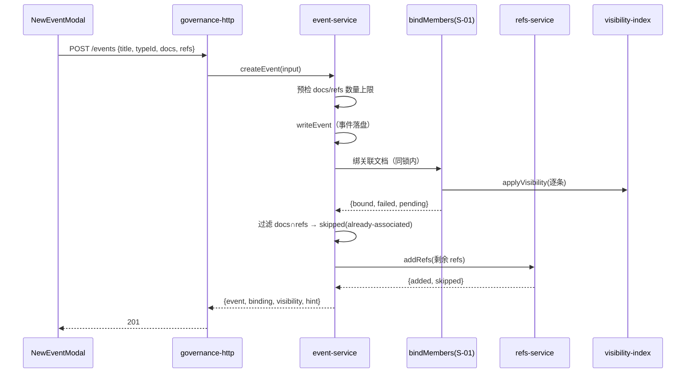

# S-02 创建时参考文档 · 设计

- 需求：REQ-20261116-004 / 子需求 S-02
- 覆盖验收项：R2 新建事件弹窗「参考文档（可选）」
- 上游确认：后端 `createEvent` 一次事务收 `refs[]`；单事件参考文档上限沿用 `REF_LIMIT=50`

## 1. 术语

| 术语 | 定义 |
|---|---|
| 参考文档 | 指向某事件的**外部引用**记录，存放在 `{scope}/events/refs/{eventId}.json`，不修改被引文档的 `lifecycle`/`visibility` |
| 引用失效（stale） | 被引文档已删除或移走，引用保留并标记，不静默消失（现有 N10 语义） |
| docs / refs 交集 | 同一篇文档既被选为关联文档又被选为参考文档 |

## 2. 现状（AS-IS）

| # | 位置 | 现状 | 问题 |
|---|---|---|---|
| P1 | `src/lib/events/event-service.ts:194-245` | `createEvent` 只接受 `title`/`description`/`typeId`/`stageKey`/`docs`，落盘后调私有 `bindDocs` | 建事件时无法同时建立参考文档 |
| P2 | `src/lib/events/refs-service.ts:359-395` | `addRefs` 独立入口：`mustEvent` → 上限校验 → 关联冲突**抛错** → `addRefDocs` | 交集时整批抛 `REF_ALREADY_ASSOCIATED`；若在 `createEvent` 内直接调用，会让"事件已建成但接口返回失败" |
| P3 | `src/lib/governance-http.ts:378-390` | `POST /governance/events` 只透传 `docs` | 与 P1 同源 |
| P4 | `web/src/pages/EventsPage.tsx:1291-1393` | 弹窗无参考文档区块（详见 S-01 P1） | 入口缺失 |

## 3. 方案（TO-BE）

### 3.1 `createEvent` 收 `refs[]`（`src/lib/events/event-service.ts`）

**改什么**：`CreateEventInput` 增 `refs?: Array<{group:string; name:string}>`；执行顺序固定为

```
1. 参数预检：refs.length ≤ REF_LIMIT，否则 REF_LIMIT_EXCEEDED（事件未落盘，整批拒绝）
2. 事件落盘（既有）
3. 绑关联文档：调 S-01 的 bindMembersLocked（createEvent 已持锁，不加锁版本）
4. 参考文档：过滤掉与 docs 交集的项 → 记为 skipped(already-associated) → addRefs 写剩余
5. 返回 binding 报告（三类状态各自成数组）
```

`REF_LIMIT`（`src/lib/events/refs-service.ts:30`）当前是模块内常量，需改成 `export const REF_LIMIT = 50` 供事件服务预检；不改其校验逻辑。

**为什么不做前端两段式**（先建事件再 `POST /refs`）：两段之间断网/刷新会留下"事件建成、参考文档没进去"的半成品，用户无法判断该重试哪一步；一次事务把报告一次给全。

**为什么不改 `addRefs` 的抛错语义**：它是页面「＋ 添加」的既有入口，改成"部分成功"会影响现有前端与测试。交集过滤放在 `createEvent` 内部，`addRefs` 行为保持不变。

### 3.2 HTTP 入参与返回扩展（`src/lib/governance-http.ts`）

`POST /governance/events` 增 `refs`；返回在既有 `{ok, scope, event}` 之上**只增** `binding`、`visibility`、`hint`（旧客户端可忽略）。详见 §5。

### 3.3 前端（与 S-01 同一弹窗）

| 文件 | 变更 |
|---|---|
| `web/src/pages/EventsPage.tsx` | `NewEventModal` 增「参考文档（可选）」区块（已确认 ASCII ④），复用 `DocPickerModal`（`mode='ref'`、无 `eventId`）；提交时把 `docs`/`refs` 一并传给 `createEvent` |
| `web/src/api/governanceApi.ts` | `createEvent` 入参增 `docs?`/`refs?`，返回类型增 `binding` |

**交集在 UI 层的处置**：同一篇文档被先后选入两个选择器时，第二个选择器将其标为 `已在关联文档中` 并禁用（前端剪枝）；后端仍兜底（3.1 第 4 步）。

### 3.4 错误码

复用 `REF_LIMIT_EXCEEDED:1405`（前置整批拒绝）；docs/refs 交集**不作为错误**，只记 `skipped.reason='already-associated'`（`REF_ALREADY_ASSOCIATED:1401` 仍只被独立 `addRefs` 入口使用）；本子需求**不新增**错误码。

## 4. 数据模型

无新增存储。引用记录结构沿用 `EventRefDoc`：

| 字段 | 类型 | 说明 |
|---|---|---|
| `scope` / `group` / `name` | `string` | 引用定位（`name` 为 `Relation.text`） |
| `addedBy` | `'ai' \| 'manual'` | 由 `createEvent.by` 决定：页面创建 `user → 'manual'`，MCP 创建 `ai → 'ai'`（见 S-03 D13） |
| `addedAt` | `number` | 毫秒时间戳 |
| `score` | `number?` | 仅 AI 候选携带；本路径不写 |

约束：单事件 ≤ `REF_LIMIT`（50）；与关联文档集合互斥（服务层保证）。

## 5. 接口设计

### 5.1 `POST /api/governance/events`（扩展）

```ts
interface CreateEventBody {
  scope?: string;
  title: string;
  description?: string;
  typeId: string;
  stageKey?: string;
  docs?: Array<{ group: string; name: string }>;
  refs?: Array<{ group: string; name: string }>;   // 新增
}

interface CreateEventResponse {
  ok: true;
  scope: string;
  event: EventRecord;
  binding: {
    /** 复用 S-01 的 BindMembersOutcome 字段（去掉 event/visibility/pending，它们在顶层） */
    docs: {
      bound: Array<{ group: string; name: string }>;
      skipped: Array<{ group: string; name: string; reason: 'already-bound' | 'duplicate-in-request' }>;
      failed: Array<{ group: string; name: string; code: string; error: string }>;
      visibilityFailed: Array<{ group: string; name: string; kind: 'dense' | 'fts' | 'relation' | 'path'; error: string }>;
    };
    refs: {
      added: number;
      addedList: Array<{ group: string; name: string }>;
      skipped: Array<{ group: string; name: string; reason: 'duplicate' | 'already-associated' }>;
      failed: Array<{ group: string; name: string; code: string; error: string }>;
    };
  };
  visibility: { mode: 'full' | 'fts-only' | 'hidden'; dense: boolean; fts: boolean };
  pending: string[];
  hint: string;
}
```

Demo 返回示例（仅示意格式）：

```json
{
  "ok": true,
  "scope": "default",
  "event": { "id": "evt_9f2c1a", "shortId": 8, "title": "登录页白屏", "stageKey": "st_1", "revision": 1 },
  "binding": {
    "docs": {
      "bound": [{ "group": "wiki/登录", "name": "登录页白屏排查笔记" }],
      "skipped": [],
      "failed": []
    },
    "refs": {
      "added": 1,
      "addedList": [{ "group": "ops/网关", "name": "网关超时日志片段" }],
      "skipped": [{ "group": "wiki/登录", "name": "登录页白屏排查笔记", "reason": "already-associated" }],
      "failed": []
    }
  },
  "visibility": { "mode": "hidden", "dense": false, "fts": false },
  "pending": [],
  "hint": "事件已创建：关联 1 篇、参考 1 篇；当前阶段不可检索（预期行为）"
}
```

### 5.2 前置失败（事件未创建）

| 情况 | 状态码 | code | 说明 |
|---|---|---|---|
| `refs.length > 50` | 409 | `REF_LIMIT_EXCEEDED` | 事件未落盘，用户可减少后重试 |
| `docs.length > 50` | 409 | `EVENT_MEMBER_LIMIT_EXCEEDED` | 同上（S-01 D5） |
| 标题为空 / 类型不存在 / 阶段停用 | 400 | 既有码 | `EVENT_NOT_FOUND` / `TYPE_NOT_FOUND` / `STAGE_DISABLED` |

## 6. 时序图



## 7. 异常处理

| 场景 | 行为 | 对外暴露 |
|---|---|---|
| refs 超上限 | 整批拒绝，事件不创建 | 是（409） |
| docs 超上限 | 同上（S-01 校验） | 是（409） |
| refs 与 docs 交集 | 归 `refs.skipped`（`already-associated`），事件与关联文档照常 | 是（200 体内） |
| 参考文档写盘失败（磁盘/JSON 异常） | 事件与关联文档已落盘，`refs.failed` 填该批；`hint` 指向"在详情页重试" | 是 |
| 关联文档部分失败 | 不影响事件与参考文档；`docs.failed` 如实返回 | 是 |
| 绑定时索引摘除失败 | 事件与绑定照常；`docs.visibilityFailed` 透出，页面警示"这些文档仍可能被检索到" | 是 |
| 事件落盘失败 | 整体 500，无半成品 | 是 |
| `bindMembers` 抛整批错（事件已收口不可能出现，创建时必未收口） | 视为服务内部错误，事件保留并 `hint` 提示重试 | 是 |

> 事务边界与既有 `deleteEvent`/`transitionEvent` 一致：**事件文件先落盘，文档侧失败不回滚事件**，用 `binding.*.failed` 暴露待补偿项。

## 8. 影响范围

```
src/lib/
├── events/
│   ├── event-service.ts     # [修改] CreateEventInput.refs + 事务顺序 + 交集过滤
│   └── refs-service.ts      # [修改] 仅导出 REF_LIMIT（校验与 addRefs 语义不变）
├── governance-http.ts       # [修改] body 收 refs、返回 binding
└── governance-contract.ts   # [修改] CreateEventResponse / binding 形状

web/src/
├── api/governanceApi.ts     # [修改] createEvent 入参与返回
├── api/governanceContract.ts# [修改] 同上（双份契约）
└── pages/EventsPage.tsx     # [修改] 弹窗参考文档区块

test/
├── create-event-refs.test.ts # [新增] 一次事务 / 交集 / 上限 / 部分失败
└── governance-contract.test.ts # [复用] 契约比对
```

## 9. 关键决策点

> 决策编号在三个子文档间共用一套（D1~D19），缺号为其他子需求的决策。

| ID | 决策 | 被否决方案 + 理由 | 重新评估触发条件 |
|---|---|---|---|
| D3 | `createEvent` 扩 `refs[]`，一次事务 | 前端两段式（先建事件再 POST refs）：中途失败留半成品且无法告知该重试哪步 | 若 refs 需要走 AI 候选（`searchRefCandidates`）自动生成，则改为人工确认后的第二段 |
| D9 | docs∩refs 交集在 `createEvent` 内过滤为 `skipped`，不改 `addRefs` 抛错语义 | 改 `addRefs` 支持部分成功：影响页面「＋ 添加」既有行为与 3 个测试文件 | 若后续其他入口也需要部分成功语义 |
| D10 | 文档侧失败不回滚事件 | 回滚事件：与既有 `transitionEvent`/`deleteEvent` 事务边界相反，且回滚本身可能失败，反而更难自愈 | 无 |

## 10. 待定问题

| # | 待定 | 当前处置 |
|---|---|---|
| Q1 | 创建后 `refs.failed` 的重试入口是否需要在详情页高亮 | 本批只给 `hint` 文案；若实际出现率高再补一次性重试横幅 |
