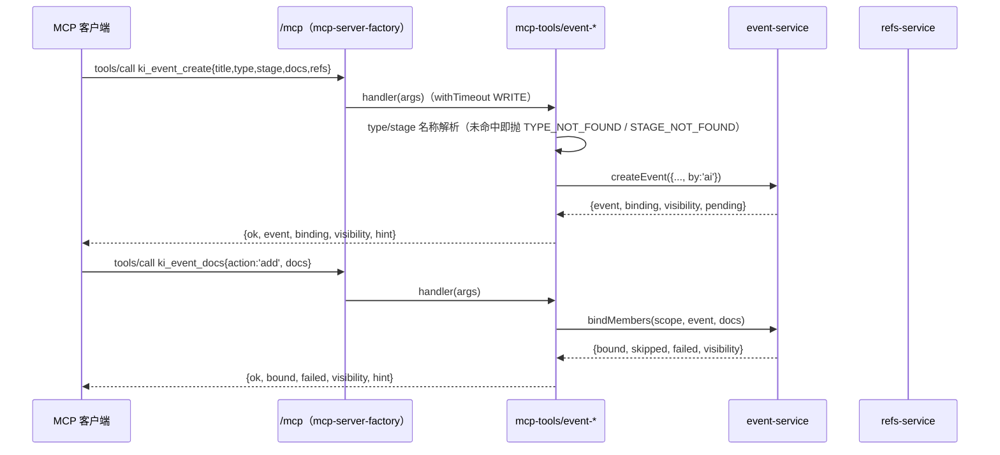

# S-03 事件 MCP 工具族 · 设计

- 需求：REQ-20261116-004 / 子需求 S-03
- 覆盖验收项：R5 四个事件类 MCP 工具、R8 文案与文档同步
- 上游确认：4 个工具（create / delete / docs / refs）；只进 `/mcp`，**不进** AI 对话工具面

## 1. 术语

| 术语 | 定义 |
|---|---|
| 写工具块 | `mcp-server-factory.ts:67` 的 `if (!readOnly)` 分支，只读 Token 看不到其中注册的工具 |
| 工具面 | 一次会话里注册进 `tools/list` 的工具集合；本批由 19 → 23 |
| 状态写工具 | 会改变事件/文档状态的工具（本批 4 个新增均属此类） |

## 2. 现状（AS-IS）

| # | 位置 | 现状 | 问题 |
|---|---|---|---|
| P1 | `src/lib/mcp-tools/` | 只有 `event-list.ts`（只读）、`event-type-list.ts`（只读）、`event-set-stage.ts`（唯一状态写） | 无事件创建/删除，无两类文档增删 |
| P2 | `src/lib/mcp-server-factory.ts:59-72` | 读工具在 `if (!readOnly)` 之外注册，写工具在块内 | 新工具必须进写块，否则只读 Token 可见 |
| P3 | `src/lib/auth/tool-permissions.ts:11-36` | 白名单表，未登记的工具在 chat 工具循环里一律拒绝 | 新工具须登记 `knowledge.write` |
| P4 | 三处旧文案 | `event-set-stage.ts:4-5`（"创建事件、删除事件…只能在页面做"）、`sync-relation.ts:19`（"事件只能由人在 Web 创建"）、`sync-relation.ts:435`（同义注释） | 与新工具自相矛盾 |
| P5 | `src/lib/relation-lifecycle.ts:157` | 错误文案"事件只能在 Web「知识治理 → 事件」创建，AI 不能创建" | 同上，且会出现在 `EVENT_NOT_FOUND.details` 前的说明里 |
| P6 | `docs/mcp-tools.md:3` | "共暴露 **19 个**工具"，写表仅列 `ki_event_set_stage` | 文档与实现脱节 |
| P7 | `test/mcp-token-readonly.test.ts:283-300` | 按 `READ_ONLY_TOOL_NAMES + WRITE_TOOLS` 清单断言注册数 | 不改清单会红 |

## 3. 方案（TO-BE）

### 3.1 四个工具（新增文件，各一个）

```
src/lib/mcp-tools/
├── event-create.ts   # ki_event_create
├── event-delete.ts   # ki_event_delete
├── event-docs.ts     # ki_event_docs
└── event-refs.ts     # ki_event_refs
```

**统一实现约定**（沿用 `event-set-stage.ts` 的形态，不新造风格）

- `withTimeout(..., TOOL_TIMEOUT.WRITE, '<tool>')` 包裹服务层调用；
- 成功返回 `{ content: [{ type: 'text', text: JSON.stringify(payload, null, 2) }] }`；
- `GovernanceError` → `{ isError: true, content: [...] }`，透出 `code / error / details`；
- 返回体**必须**回显 `visibility`（stage 档位）与 `hint`：AI 看到 `fts-only`/`hidden` 才知道"搜不到是预期"，否则会当成写入失败反复重试（沿用 `event-set-stage.ts:89-113` 的 `buildHint` 口径）。

### 3.2 各工具契约

#### `ki_event_create`

```ts
{
  scope?: string;                    // 缺省 default
  title: string;                     // 必填，trim 后非空
  description?: string;              // ≤ 4000 字（服务端既有校验）
  type: string;                      // 类型 id（et_1）或名称（如「bug 排查」）
  stage?: string;                    // 阶段 key（st_1）或名称（如「排查中」）；缺省首阶段
  docs?: Array<{ group: string; name: string }>;   // 关联文档，≤ 50
  refs?: Array<{ group: string; name: string }>;   // 参考文档，≤ 50
}
```

**名称解析**：`type` 先按 id 精确匹配，未命中再按名称（trim 后全等）匹配；`stage` 先按 key、再按名称。多处命中不猜，返回 `details.available` 让 AI 改传 id。

**返回**：与 `POST /governance/events` 同源（`createEvent` 的 `binding` 报告，含 `docs.visibilityFailed`）+ `event.shortId`（AI 后续用它调其他工具）。

> **shortId 两层差异**：MCP 返回 `shortId: "#8"`（给人/AI 直接当参数回传，形如 `#8`）；HTTP 契约 `EventRefSummary.shortId` 是 **number**。这不影响互操作——`ki_event_*` 系列入参同时接受 `evt_…`、`#8`、`8`。

Demo 返回示例：

```json
{
  "ok": true,
  "scope": "default",
  "event": { "id": "evt_9f2c1a", "shortId": "#8", "title": "登录页白屏", "type": { "id": "et_1", "name": "bug 排查" }, "stage": { "key": "st_1", "name": "排查中" }, "closed": false },
  "binding": {
    "docs": { "bound": [{ "group": "wiki/登录", "name": "登录页白屏排查笔记" }], "skipped": [], "failed": [] },
    "refs": { "added": 1, "skipped": [], "failed": [] }
  },
  "visibility": { "mode": "hidden", "dense": false, "fts": false },
  "hint": "当前阶段不可检索：语义与全文都查不到这 1 篇关联文档，这是阶段设计的预期行为；推进阶段用 ki_event_set_stage"
}
```

#### `ki_event_delete`

```ts
{
  scope?: string;
  event: string;                     // evt_… 或 #8
  doc_action: 'wiki' | 'trash';      // 必填，无默认（防误删文档）
}
```

**约束（服务层既有）**：事件必须已收口，否则 `EVENT_NOT_CLOSED`（`details` 带 `stageKey` 与"先流转到终态"提示）。

Demo 返回示例：

```json
{
  "ok": true,
  "scope": "default",
  "event": { "id": "evt_9f2c1a", "shortId": "#8", "title": "登录页白屏" },
  "docAction": "wiki",
  "affected": { "docs": 0, "failed": 0 },
  "hint": "事件已删除；关联文档在收口时已按终态动作处理（本次 0 篇待处理）。参考文档与阶段日志一并清除"
}
```

#### `ki_event_docs`

```ts
{
  scope?: string;
  event: string;
  action: 'add' | 'remove';
  docs: Array<{ group: string; name: string }>;   // ≤ 50
}
```

- `add` → `bindMembers`（S-01）：冲突/锁定/上限逐条进 `failed[]`；
- `remove` → 逐条 `unbindMember`：解绑回 `wiki`（不删文档）；
- 两者都把 S-01 的 `visibilityFailed[]` 原样透出——AI 必须知道"绑定成功但索引没摘掉"，否则会向用户保证"已隐藏"。

Demo 返回示例（add）：

```json
{
  "ok": true,
  "scope": "default",
  "event": { "id": "evt_9f2c1a", "shortId": "#8" },
  "action": "add",
  "bound": [{ "group": "wiki/登录", "name": "登录页白屏排查笔记" }],
  "skipped": [],
  "failed": [{ "group": "ops/网关", "name": "网关超时日志", "code": "DOC_BOUND_TO_OTHER_EVENT", "error": "已属于事件 #3「登录白屏」" }],
  "visibility": { "mode": "hidden", "dense": false, "fts": false },
  "hint": "1 篇已挂上；1 篇被拒（归属冲突），先用 ki_event_docs(action=remove) 从原事件解绑"
}
```

#### `ki_event_refs`

```ts
{
  scope?: string;
  event: string;
  action: 'add' | 'remove';
  docs: Array<{ group: string; name: string }>;   // ≤ 50
}
```

- `add` → `addRefs(..., addedBy:'ai')`；与关联文档冲突时该批抛 `REF_ALREADY_ASSOCIATED`（既有语义，不在此工具内改）→ 转译为 `failed[]` 单条更好：**逐条调用** `addRefs` 单元素批次，保证一条冲突不影响其他（批上限 50）；
- `remove` → 逐条 `removeRef`，不存在则 `REF_NOT_FOUND`。

Demo 返回示例（add）：

```json
{
  "ok": true,
  "scope": "default",
  "event": { "id": "evt_9f2c1a", "shortId": "#8" },
  "action": "add",
  "added": 1,
  "addedList": [{ "group": "ops/网关", "name": "网关超时日志片段" }],
  "skipped": [],
  "failed": [{ "group": "wiki/登录", "name": "登录页白屏排查笔记", "code": "REF_ALREADY_ASSOCIATED", "error": "该文档已作为关联文档挂在事件 #8 上" }],
  "hint": "已加入 1 条参考文档；被引文档的分类与可见性未做任何改动"
}
```

Demo 返回示例（remove）：

```json
{
  "ok": true,
  "scope": "default",
  "event": { "id": "evt_9f2c1a", "shortId": "#8" },
  "action": "remove",
  "removed": [{ "group": "ops/网关", "name": "网关超时日志片段" }],
  "failed": [],
  "hint": "已移除 1 条参考文档；被引文档本身未做任何改动"
}
```

### 3.2.1 调用时序（工具层只做转译）



### 3.3 注册与权限

| 文件 | 变更 |
|---|---|
| `src/lib/mcp-server-factory.ts` | 4 个 `register*Tool` 调用全部放入 `if (!readOnly)` 块（紧跟 `registerEventSetStageTool`），并 import 4 个文件 |
| `src/lib/auth/tool-permissions.ts` | 写工具段新增 4 行 `knowledge.write`（9 → 13 行），并把段注释「写工具（8）」更正为「写工具（13）」（该注释早已过期） |
| `src/lib/chat/mcp-tool-registry.ts` / `src/lib/chat/prompt-config.ts` | **不动**（已确认不进对话工具面）；在 `CHAT_MCP_TOOLS` 头部注释补一句"事件写工具刻意不登记：误建事件会批量改文档档位" |

只读 Token：`test/mcp-token-readonly.test.ts` 断言注册数 = 读清单 + 写清单 + 1（`ki_ask`），新工具进写清单后自动覆盖。

### 3.4 文案同步（R8）

| # | 文件:行 | 现状 | 改成 |
|---|---|---|---|
| 1 | `mcp-tools/event-list.ts:21` | 「只读，不能创建事件」 | 「只读；创建事件用 ki_event_create」 |
| 2 | `mcp-tools/event-type-list.ts:57` | 「新建事件只能在页面操作」 | 「创建事件用 ki_event_create（`type` 可传 id 或名称）」 |
| 3 | `mcp-tools/event-set-stage.ts:4-5` | 「创建事件、删除事件、改类型都只能在页面做」 | 「创建/删除见 ki_event_create / ki_event_delete，改类型仍只能在页面做」 |
| 4 | `sync-relation.ts:19` | 「事件只能由人在 Web 创建，本工具不能创建」 | 「事件可用 ki_event_create 创建，或用 ki_event_list 查未收口事件」 |
| 5 | `sync-relation.ts:435` | 「事件只能由人在页面创建」 | 同上（注释） |
| 6 | `relation-lifecycle.ts:157` | 「事件只能在 Web「知识治理 → 事件」创建，AI 不能创建」 | 「事件「x」不存在。可用 ki_event_list 查未收口事件，或用 ki_event_create 新建」 |
| 7 | `docs/mcp-tools.md:3` | 「共暴露 **19 个**工具」 | 「共暴露 **23 个**工具」 |
| 8 | `docs/mcp-tools.md` 写表 | 无事件 CRUD | 补 4 行（工具 / 作用 / 关键参数） |
| 9 | `docs/mcp-tools.md`「MCP 未提供的能力」 | 只提 scope/doc 级联删除 | 补「事件类型（阶段链）的增删改、事件 AI 分析」 |
| 10 | `web/src/pages/EventsPage.tsx:800-808` | 「AI 同源操作（MCP）」示例只展示 `ki_event_set_stage` | 按当前事件生成 4 条示例（create 用当前标题、docs/refs 用当前成员与引用、delete 标注"需先收口"） |

## 4. 数据模型

无新增存储。工具参数到服务层的映射：

```
ki_event_create → createEvent({ title, description, typeId, stageKey, docs, refs, by:'ai' })
ki_event_delete → deleteEvent({ event, docAction })
ki_event_docs   → bindMembers | unbindMember
ki_event_refs   → addRefs(addedBy:'ai') | removeRef
```

`by:'ai'` 会落到阶段日志 `appendStageLog({ by: 'ai' })`，用于区分人工/AI 创建；`refs.addedBy` 同源传 `'ai'`。

## 5. 异常处理

| 场景 | 工具行为 | 对外暴露 |
|---|---|---|
| `type` 传名称有歧义 | `isError` + `TYPE_NOT_FOUND` + `details.available:[{id,name}]` | 是 |
| `stage` 不存在 / 已停用 | `STAGE_NOT_FOUND` / `STAGE_DISABLED` + `details.available` | 是 |
| 未传 `doc_action` | zod 必填报错（SDK 层），服务层再兜 `DOC_ACTION_REQUIRED` | 是 |
| 删除未收口事件 | `EVENT_NOT_CLOSED` + `details.stageKey` + hint「先 ki_event_set_stage 到终态」 | 是 |
| 成员/参考超 50 | `EVENT_MEMBER_LIMIT_EXCEEDED` / `REF_LIMIT_EXCEEDED` | 是 |
| 归属冲突 / 数据源文档 | 进 `failed[]`（不整批失败，除非全部失败） | 是 |
| `ki_event_docs(action=remove)` 某篇不在该事件 | 逐条 try/catch → 进 `failed[]`（`DOC_NOT_FOUND`），其余继续 | 是 |
| `ki_event_refs(action=remove)` 引用不存在 | 逐条 try/catch → 进 `failed[]`（`REF_NOT_FOUND`），其余继续 | 是 |
| `ki_event_refs(action=add)` 某篇与关联文档冲突 | 该篇进 `failed[]`（`REF_ALREADY_ASSOCIATED`），其余继续（逐条调用，见 D15） | 是 |
| `docs` 传空数组 | 直接返回 `{ok:true, bound:[], ...}`（幂等空操作），不报错 | 是 |
| 服务层超时 | `withTimeout` 抛错 → `isError` + 原 message | 是 |
| 只读 Token 调用 | 工具根本不在 `tools/list`；若被构造调用，`tools/call` 白名单拦截 | 是（工具不存在） |

## 6. 影响范围

```
src/lib/
├── mcp-server-factory.ts           # [修改] 4 个 import + 写块注册
├── auth/tool-permissions.ts        # [修改] 4 行 knowledge.write
├── mcp-tools/
│   ├── event-create.ts             # [新增]
│   ├── event-delete.ts             # [新增]
│   ├── event-docs.ts               # [新增]
│   ├── event-refs.ts               # [新增]
│   ├── event-list.ts               # [修改] 描述文案
│   ├── event-type-list.ts          # [修改] hint 文案
│   └── event-set-stage.ts          # [修改] 头部注释
├── sync-relation.ts                # [修改] event 参数描述与注释
├── chat/mcp-tool-registry.ts       # [修改] 仅注释（声明刻意不登记）
└── events/event-service.ts         # [修改] createEvent 的 stageKey 支持名称解析（成员逻辑已移至 members.ts，见 S-01 D18）

docs/mcp-tools.md                   # [修改] 19→23、写表补 4 行、能力边界
web/src/pages/EventsPage.tsx        # [修改] 「AI 同源操作」示例块

test/
├── mcp-event-tools.test.ts         # [新增] 4 工具入参/错误码/只读结论/名称解析
└── mcp-token-readonly.test.ts      # [修改] READ_ONLY_TOOL_NAMES / WRITE_TOOLS 清单
```

**兼容性**：纯新增工具 + 描述文案改动，无签名变更；`tools/list` 数量变化是预期（有测试断言）。

## 7. 关键决策点

> 决策编号在三个子文档间共用一套（D1~D19），缺号为其他子需求的决策。

| ID | 决策 | 被否决方案 + 理由 | 重新评估触发条件 |
|---|---|---|---|
| D11 | 4 个工具（create / delete / docs / refs） | ① 3 个聚合（docs+refs 合一的 `kind` 枚举）：关联与参考语义完全不同（一个改档位、一个纯引用），合一会显著提高误选率；② 6 个细粒度（add/remove 分开）：工具描述总量增长 ~40%，每次会话都进上下文 | 若工具面继续膨胀到 30+，改聚合 |
| D12 | `type`/`stage` 同时接受 id/key 与名称 | 只收 id/key：AI 必须先调 `ki_event_type_list` 再拼，多一次往返且易抄错 key | 若名称解析出现歧义误判（同名类型），收窄为仅 id |
| D13 | MCP 路径 `by:'ai'`、`refs.addedBy:'ai'` | 一律记 `'manual'`：审计无法区分人/AI 发起，事后追责与统计失真 | 无 |
| D14 | 不进 `CHAT_MCP_TOOLS` | 登记进对话工具面：一次误判即可批量改文档档位（hidden 后立刻搜不到），且对话里难以要求二次确认 | 若对话侧先落地"写操作二次确认"机制 |
| D15 | `ki_event_refs` 逐条调用 `addRefs` 而非整批 | 整批调用：一条关联冲突会抛 `REF_ALREADY_ASSOCIATED` 使整批失败（既有语义），AI 无法知道哪条失败 | `addRefs` 若改为返回部分成功，可整批调用 |

## 8. 待定问题

| # | 待定 | 当前处置 |
|---|---|---|
| Q1 | `ki_event_create` 是否需要 `template`/`preset` 快捷参数（如 `bug` 直接用内置类型） | 不做：AI 先调 `ki_event_type_list` 即可，避免再维护一套类型别名 |
| Q2 | 删除事件后 `#shortId` 是否释放 | 沿用现状（`shortIdReleased: false`，不复用短号，避免历史引用歧义） |
