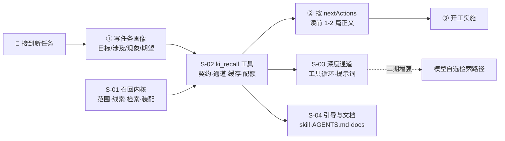
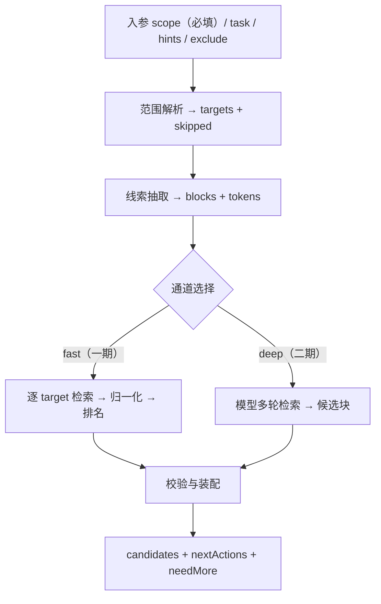

# 设计：AI Agent 任务前上下文预取（ki_recall）

- 需求：REQ-20261118-003（`requirement.md`）
- 设计基线：HEAD（2026-11-18）
- 子文档：S01 召回内核 / S02 ki_recall 工具 / S03 深度通道 / S04 引导与文档

## 1. 需求背景 & 目标

Agent 接到新任务 / 需求 / bug 时，缺一个「给一段任务描述，换回该读哪几篇文档」的原语：`ki_search` 要调用方先想好 query，`ki_get_module_info` 要已知 group+name，`ki_ask` 要提问且输出是答案。冷启动阶段（不知道模块名、不知道该问什么）正是 Agent 最需要上下文的时刻。

**目标**：新增只读 MCP 工具 `ki_recall`，单次调用、不追问、**范围由调用方显式指定（库名或视图，必填）**，返回「文档候选 + 阅读顺序 + 缺什么信息」，并配 agent 侧触发引导。

> 范围必填是 2026-11-18 的拍板结论（见 D-01-5 / D-02-1）：服务端不设默认库，避免「AI 以为查 A 库、实际查 B 库」这类无法复盘的错位。

**不在范围内**：Web 界面（含事件详情「AI 查找」面板）、改造 `ki_ask`、重写 `find-runner`、文档全文内联返回、跨进程共享缓存。

## 2. 关键环节一览图

一期交付 S-01 / S-02 / S-04（确定性通道，零模型成本、可复现）；二期交付 S-03。

## 3. 总体方案设计

数据流固定为五段，任何通道都不改变顺序：

**共享术语速查**（定义在各自子文档，此处只做索引）

| 术语 | 定义 | 归属 |
|---|---|---|
| 任务画像（task brief） | Agent 写给 recall 的 2-3 句任务描述：目标 / 涉及模块 / 症状 / 期望 | S-04 |
| 线索（term） | 从任务画像抽出的可检索单元，分两路输出（见下两行） | S-01 |
| blocks | 语义查询块：8~40 字、最多 4 块，用于 hybrid 检索 | S-01 |
| tokens | 精确线索：错误码 / 路径 / 英文标识符 / 中文 n-gram，最多 12 个，用于备路检索与命中理由 | S-01 |
| 范围单元（target） | 参与检索的库或视图名；视图在装配阶段必须换成物理库 | S-01 / S-02 |
| 库内排名（rankInScope） | 同一 target 内按原始分降序的名次，1 = 最高；**跨库只比名次与理由，不比分** | S-01 |
| 通道（channel） | `fast` 确定性 / `deep` 模型循环；对外只报实际使用的通道 | S-02 |
| 降级（degraded） | 请求的通道不可用时自动降级，并如实回报原因，不静默 | S-03 |
| 候选（candidate） | 通过「范围 → 存在性 → 可见性」校验的文档条目 | S-01 |
| nextActions | 建议 Agent 下一步读取动作，带可直接执行的参数 | S-02 |
| needMore | 任务画像缺失的信息维度（错误码 / 模块 / 现象），不是反问 | S-01 |

**非功能默认假设**（需求未提出更高要求，本方案按此设默认；超出需在实施前重新确认）：

| 维度 | 默认假设 |
|---|---|
| 部署形态 | 单机进程内（缓存与配额均为进程内，不做跨进程共享） |
| 调用频率 | 每个调用方 ≤20 次/分钟、并发 ≤4；同一任务通常 1 次、最多 3 次 |
| 规模 | 单次参与检索的 target ≤6；候选 ≤20 条；任务画像 ≤2000 字 |
| 延迟 | fast 通道 P95 目标 ≤2s；deep 通道 45s 硬顶（二期） |
| 可用性 | 允许降级（deep→fast）与部分结果（`partial`/`skipped`），不允许静默失败 |

## 4. 全局风险 & 跨子需求依赖

| # | 风险 | 影响 | 处置 |
|---|---|---|---|
| 1 | find 与 recall 各有一份工具循环（S-03 不抽公共 core），后续可能漂移 | 同一 bug 修一处漏一处 | S-03 在注释中双向标注；触发条件：两份循环出现第 2 次需同步修改时抽 core |
| 2 | 中文线索抽取质量依赖语料 | 冷启动召回率不达标 | 用 R0 试点的 10 个真实任务做基线校准；`tokens` 上限 12 且可观测 |
| 3 | MCP 工具面从 23 → 24，第三方客户端未知 | 调用方按工具名分支的逻辑受影响 | 需求侧 Q6 未确认；文档先改，不做兼容层 |
| 4 | 缓存与文档更新有时间窗 | 返回已被替换的候选 | 结果带 `cached` + `cacheAgeMs`；`cacheTtlSec=0` 可关闭 |
| 5 | `ki_search` / `ki_ask` 的工具描述改写 | 既有测试与文档断言可能失败 | S-04 先 grep 断言再改，改动以「追加一句分工」为上 |

**跨子需求依赖**：S-01 →（接口级）→ S-02 →（接口级）→ S-03；S-02 →（文档级）→ S-04。S-01 与 S-03 不直接耦合。

**跨子需求接口索引**（签名定义在子文档，此处只登记边界，防止两边各写一份）：

| 签名 | 定义处 | 调用方 | 契约要点 |
|---|---|---|---|
| `runFastRecall(req, deps): Promise<CoreRecallResult>` | S-01 §4.1 | S-02 | 不抛业务错误码，只抛内核错误（`NO_TARGETS` / `ALL_TARGETS_FAILED`），由 S-02 映射 |
| `RecallCandidate / CoreRecallResult` | S-01 §5 | S-02、S-03 | 字段增改必须两边同改；`scope` 恒为物理库 |
| `runDeepRecall(req, deps)` | S-03 §4 | S-02 | 门禁未过时**不抛错**，返回 `{degraded:true, reason}` 由 S-02 降级 |
