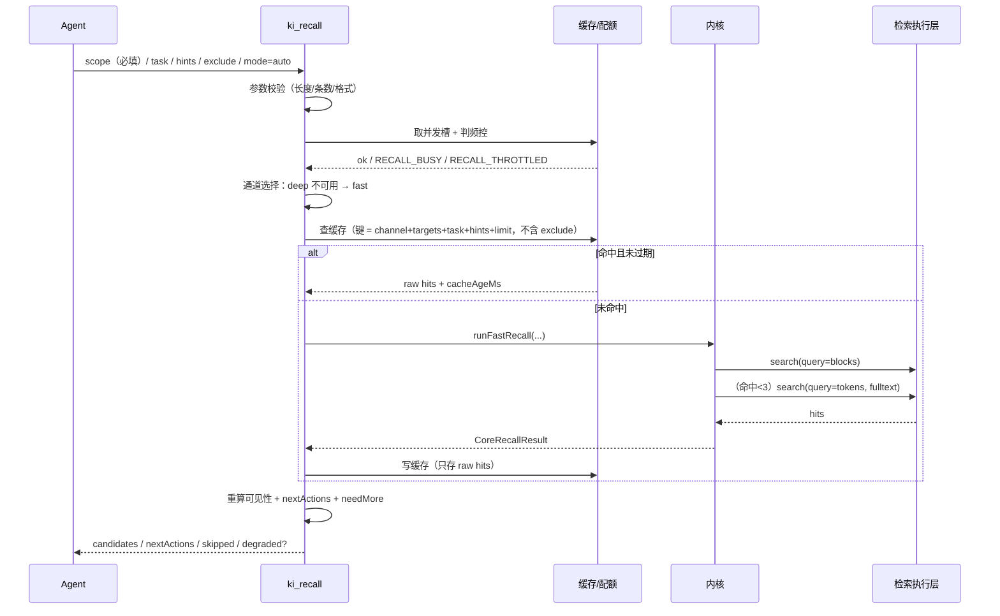

# S-02 ki_recall MCP 工具（契约 · 通道 · 缓存 · 配额 · 准入）

父文档：`DESIGN.md`｜依赖：S-01（内核）｜被依赖：S-03、S-04

## 1. 术语

| 术语 | 定义 |
|---|---|
| auto 通道 | 首选 `deep`，不可用时降级 `fast` 并如实回报；一期 `deep` 未实现 ⇒ `auto` 恒为 `fast` |
| 降级矩阵 | 四类门禁（外发未确认 / 模型未配置 / 无 tool 能力 / 工具全关）各自的降级与回报规则。**二期生效**：一期无降级路径（D-02-7） |
| 缓存键 | `sha1(scope + mode + query)` —— **检索三元组**，不是「任务文本指纹」（见 D-02-8）；也不含 `exclude`（D-02-6） |
| 原始命中（raw hits） | 缓存内容 = 检索适配器的原始返回（`{group,name,score}` 列表）；**不含**可见性与理由，**不含 exclude 过滤** |

## 2. 现状（AS-IS）

| 事实 | 位置 |
|---|---|
| 工具注册分两块：读工具恒注册，写工具与 `ki_ask` 在 `if (!readOnly)` 内 | `src/lib/mcp-server-factory.ts:57-95` |
| 只读 Token 双层闸门：注册层不给 + `tools/call` 侧白名单拦截 | `src/lib/mcp-tools/tool-access.ts:30-41,112-114` |
| 模型消耗型工具单列一张名单与专用错误码 | `src/lib/mcp-tools/tool-access.ts:82-109` |
| `ki_ask` 的入参校验 / scope 形态 / 外发闸门 / 限流四段式写法可参照 | `src/lib/mcp-tools/ask.ts:141-225` |
| 配置层已有 fail-loud 校验与 deprecated 名单机制 | `src/lib/config.ts`、`src/lib/config-schema.ts` |

**缺口**：工具面 23 个中没有任何「任务 → 文档清单」形态；跨库与视图在 `ki_ask` 侧被显式拒绝。

## 3. 方案（TO-BE）

```
src/lib/mcp-tools/recall.ts        [新增] 工具注册 + 参数校验 + 通道选择 + 装配对外形状
src/lib/recall/limits.ts           [新增] 检索结果缓存（LRU+TTL）、并发槽、频控、预算默认值
src/lib/recall/log.ts              [新增] 单行结构化审计日志
src/lib/recall/engine-search.ts    [新增] 生产检索适配器（需透传 mode，故不复用 refs-search 的）
src/lib/auth/tool-permissions.ts   [修改] TOOL_CAPABILITIES += ki_recall（能力表，漏了会挂能力覆盖测试）
src/lib/config.ts                  [修改] 新增 recall 段读取与默认值
src/lib/config-schema.ts           [修改] recall 段校验（非法 fail-loud，一次性报全）
src/lib/mcp-server-factory.ts      [修改] 在 !readOnly 块内注册
src/lib/mcp-tools/tool-access.ts   [修改] MODEL_CONSUMING_TOOL_NAMES += ki_recall；
                                          拒绝文案按工具名分模板（ki_ask 原文逐字不变）
src/lib/mcp-http.ts                [修改] SCOPE_LESS 无变化；确认 tools/call 拦截走新文案
```

### 3.1 执行时序（auto + 缓存）



### 3.2 配置项（`config.yaml`）

新增顶层 `recall` 段；**不进 Web 设置页**（一期无界面），非法值在启动与每次读取时 fail-loud。

> **本段不含检索范围**：范围只由调用方 `scope` 决定（D-02-1），服务端不提供默认库，也不做任何隐式兜底 —— 这样「查了哪个库」永远能从入参上复盘。

| 键 | 类型 | 默认 | 约束 | 说明 |
|---|---|---|---|---|
| `recall.cacheTtlSec` | `number` | `600` | 0~3600（0 = 关闭） | 结果缓存有效期 |
| `recall.maxCandidates` | `number` | `8` | 1~20 | 缺省候选数上限（调用方 `limit` 不得突破该值） |
| `recall.maxConcurrent` | `number` | `4` | 1~8 | 跨进程内并发槽，满了直接 `RECALL_BUSY`（不排队） |
| `recall.throttlePerMinute` | `number` | `20` | 1~120 | 按调用方键（tokenId / `local`）计 |
| `recall.hardTimeoutMs` | `number` | `20000` | 1000~45000 | fast 通道内部硬超时；超过有候选给 `partial`，无候选报 `RECALL_TIMEOUT` |

> 一期**不新增** `prompt-config.json` 的 `recall` 域：确定性通道不读提示词，加了就是「改了没反应」的配置项。提示词随 S-03 一起加。

## 4. 接口设计

### 4.1 工具 schema

```ts
server.tool('ki_recall', TOOL_DESCRIPTION, {
  task: z.string().min(1).max(2000)
    .describe('任务画像（2-3 句）：要做什么 / 涉及哪个模块或页面 / 什么现象 / 期望什么。不是提问，不要写成问题句'),
  scope: z.union([z.string().min(1), z.array(z.string().min(1)).min(1).max(8)])
    .describe('检索范围（必填）：库名或知识视图名，可多个。不确定有哪些库时先调 ki_scope_list / ki_view_list。'
      + '不传会直接报错并返回当前 Token 可用的库与视图清单，不会自动挑库'),
  hints: z.array(z.string().max(200)).max(10).optional()
    .describe('强线索：文件路径 / 报错码 / 模块名 / 接口名（能唯一指向位置的最好）'),
  exclude: z.array(z.string().max(300)).max(50).optional()
    .describe('已读清单："scope::group::name" 或 "group::name"（省略 scope 表示任意库）'),
  limit: z.number().int().min(1).max(20).optional(),
  mode: z.enum(['auto', 'fast', 'deep']).optional().describe('缺省 auto：能深度就深度，否则确定性命中'),
});
```

**工具描述（TOOL_DESCRIPTION）**，四要素缺一不可：

> 拿到新任务 / 需求 / bug、还不知道该读哪些文档时调用：给一段任务描述 + **必填的 `scope`（库名或知识视图，可多个）**，返回值得先读的文档清单（含理由与建议阅读顺序）。**工具不会替你挑库**：不知道有哪些库就先调 `ki_scope_list` / `ki_view_list`，漏传会直接报错并回可用清单。单次调用、不提问、不写任何数据。要精确读全文用 `ki_get_module_info`；已知关键词要片段用 `ki_search`；读完要综合结论用 `ki_ask`。默认只返回文档清单与理由，不返回正文。

### 4.2 返回契约

```ts
interface RecallToolResponse {
  ok: true;
  targets: string[];                // 实际参与检索的 target（视图保留视图名，已去重、≤6）
  channel: 'fast' | 'deep';
  degraded?: boolean;               // 发生降级
  degradedReason?: string;          // 人话原因（含出路）
  query: string;                    // 实际使用的检索 query（过程可复核）
  candidates: Array<{
    scope: string; group: string; name: string;
    score: number; rankInScope: number; why: string;
    alsoIn?: string[];                // 其他库里存在同名文档（只提示，不合并）
    visibility: 'full' | 'fts-only' | 'hidden'; weak: boolean;
  }>;
  nextActions: Array<{ tool: 'ki_get_module_info'; args: Record<string, unknown>; why: string }>;
  needMore: Array<{ field: 'symptom' | 'errorCode' | 'module'; hint: string }>;
  skipped: Array<{ name: string; reason: 'forbidden' | 'missing' | 'view-members-changed' | 'truncated' }>;
  excludedHidden?: number;          // 因 hidden 被剔除的候选数（只给数，不给名字）
  ignoredExclude?: number;          // 格式非法被忽略的条目数
  cached?: boolean; cacheAgeMs?: number;
  partial?: boolean;                // 超时但有部分候选
  durationMs: number;
  truncated?: boolean;              // 候选被 limit 截断
}
```

失败形状（展平，便于 MCP 客户端直接读）：

```ts
interface RecallToolError { ok: false; code: string; message: string; retryable: boolean; retryAfterSec?: number }
```

### 4.3 Demo 返回示例（仅示意格式）

```json
{
  "ok": true,
  "targets": ["kisearch-memory"],
  "channel": "fast",
  "query": "事件参考文档上传失败 报错 422 上传文件",
  "candidates": [
    {
      "scope": "kisearch-memory",
      "group": "错误库/Web前端界面",
      "name": "上传通道的 wiki 回写口径",
      "score": 0.87,
      "rankInScope": 1,
      "why": "命中：上传 · 回写 · 422 · 本库第 1",
      "visibility": "full",
      "weak": false
    }
  ],
  "nextActions": [
    {
      "tool": "ki_get_module_info",
      "args": { "scope": "kisearch-memory", "group": "错误库/Web前端界面", "relation": "上传通道的 wiki 回写口径", "max_chars": 8000 },
      "why": "库内第 1 且命中 3 个线索，先读它最可能省时间"
    }
  ],
  "needMore": [],
  "skipped": [],
  "durationMs": 412
}
```

### 4.4 错误码表

| 码 | 触发 | retryable | 文案要点（原因 + 出路） |
|---|---|---|---|
| `RECALL_TASK_INVALID` | task 为空 / 全空白 / >2000 字 | false | 说明上限，要求压到 2-3 句；长材料先自行摘 |
| `RECALL_HINTS_INVALID` | hints 超 10 条或单条 >200 字 | false | 说明只是「强线索」，不是材料 |
| `RECALL_SCOPE_REQUIRED` | 未传 `scope`（必填） | false | **在同一条响应里返回该 Token 可用的库与视图清单**（≤20 项，超出提示用 `ki_scope_list`），让调用方一次自愈；并明确「本工具不会自动挑库」 |
| `RECALL_SCOPE_UNKNOWN` | 传入的 scope 既不是库也不是视图 | false | 回显非法项 + 给出 `ki_scope_list` / `ki_view_list` |
| `RECALL_SCOPE_FORBIDDEN` | 传入的 scope 存在但无授权 | false | 说明需管理员授权，或改传有权的库；附上本次被拒的项 |
| `RECALL_TARGETS_EMPTY` | 全部 target 被剔除（权限/缺失/超限） | false | 列出每个被剔除项与原因 |
| `RECALL_MODE_UNAVAILABLE` | `mode:'deep'` 且服务端无深度通道（一期） | false | 改用 `auto` / `fast`；深度通道随二期提供 |
| `RECALL_BUSY` | 并发槽已满 | true | 带 `retryAfterSec`，并建议暂用 `ki_search` |
| `RECALL_THROTTLED` | 每分钟超配额 | true | 带 `retryAfterSec` |
| `RECALL_TIMEOUT` | 超过硬超时且 0 候选 | true | 建议补线索或缩小 scope |
| `TOKEN_MODEL_FORBIDDEN` | 只读 Token 调用 | false | 专用文案（见 3.3） |
| `RECALL_INTERNAL` | 未预期异常 | true | 不泄露堆栈，指引看服务端日志 |

### 4.5 准入（只读 Token）

`ki_recall` 加入 `MODEL_CONSUMING_TOOL_NAMES`：一期虽只跑确定性通道，但工具**按配置可能触发模型调用**，准入按「可能消耗」而非「本次是否消耗」判定。为避免文案错指（说成"写入工具"），在 `tool-access.ts` 增加按工具名的文案模板：

| 工具 | 文案模板要点 |
|---|---|
| `ki_ask` | **保持原文逐字不变**（既有测试与文档引用它） |
| `ki_recall` | 「该工具会按服务端配置自动选择检索通道，可能触发上游模型调用并外发知识库内容，故只读 Token 不可用」+ 换读写 Token 的出路 |

> 语义说明（写进 `tool-access.ts` 注释，避免后续误读）：`MODEL_CONSUMING_TOOL_NAMES` 表达的是**准入维度**「可能消耗模型」，不是**计量维度**「本次真的消耗了」。一期 recall 只跑确定性通道，按本名单统计成本会偏高 —— 成本统计请以审计日志的 `channel` 字段为准。

## 5. 数据模型

| 结构 | 字段 | 存放 |
|---|---|---|
| 缓存条目 | `key / value（原始检索返回） / at` | 进程内 Map + LRU（500 条，读命中即移到队尾） |
| 配额计数 | `principalKey → { count, windowStart }` | 进程内 Map，按分钟窗口重置 |
| 并发槽 | `active: number` | 进程内计数 |

**缓存只存 raw hits**（不含可见性与理由）：命中缓存后仍重算可见性。理由见 D-02-2（事件 `#37` 的 hidden 泄漏事故正是「缓存/索引与实态漂移」类问题）。

## 6. 异常处理

| 场景 | 行为 | 是否对外暴露 |
|---|---|---|
| 一期（服务端无 deep 通道）且 `mode='auto'` | 走 `fast` 执行，**不标 `degraded`** ——「服务端就没这个通道」不是本次降级，标了会让每次调用都带 noise（D-02-3） | 否 |
| 二期 deep 已存在，但门禁四分支之一命中 | 走 `fast` 执行 + `degraded:true` + 人话原因 | 是 |
| `mode:'deep'` 但深度通道不存在 | `RECALL_MODE_UNAVAILABLE`（fail-loud，不静默降级） | 是 |
| 缓存键命中但 TTL 已过 | 视为未命中，重新检索并覆盖 | 否 |
| 缓存命中且原文档已 hidden | 重算可见性时剔除，候选数减少，不回退检索 | 计数体现 |
| exclude 条目格式非法 | 忽略该条，`ignoredExclude` 计数 | 是（可见但不报错） |
| 检索内部异常 | `RECALL_INTERNAL`，日志带 requestId | 是（不含堆栈） |
| 客户端断开 | 中止检索，不写缓存，不占槽 | 否 |

## 7. 影响范围（5 处清单同步）

| 位置 | 改动 | 风险 |
|---|---|---|
| `src/lib/mcp-server-factory.ts` | `!readOnly` 块内注册 `registerRecallTool(server, ...)` | 漏放会暴露给只读 Token |
| `src/lib/mcp-tools/tool-access.ts` | `MODEL_CONSUMING_TOOL_NAMES += 'ki_recall'` + 按工具名分文案模板 | 改文案函数须保 `ki_ask` 逐字不变 |
| `src/lib/auth/tool-permissions.ts` | `TOOL_CAPABILITIES += ki_recall: 'knowledge.ask'` | **实现期实际踩到**：漏登记会直接挂 `capability-coverage`（24≠25）与 `mcp-token-readonly`（注册数≠清单）两个测试 —— 这条起初不在清单里，是测试抓出来的 |
| `test/mcp-token-readonly.test.ts` · `test/recall-tool.test.ts` | 非只读清单补 `ki_recall`；新增工具层单测 11 例 | — |
| `docs/mcp-tools.md:3` | 工具数 23 → 24；「读」表加一行；Agent 动作表加「预取」 | 主文档，其余 4 处跟随 |
| `docs/architecture.md:33` | 「暴露 23 个工具（… 检索 / 读取 / 治理 / 写入 / 组织 / 删除 / 问答）」→ 24 并补「预取」 | 已 grep 确认存在 |
| `docs/cli.md:1897` | 「23 个工具及参数」→ 24 | 已 grep 确认存在 |
| `docs/README.md:34` | 「23 个 MCP 工具及参数」→ 24 | 已 grep 确认存在 |
| `README.md:234` | 「MCP 共暴露 **23 个工具**」→ 24 | 已 grep 确认存在 |
| `docs/agent-integration.md` | 增加「开工前预取」一节 | — |

> 已实测：仓库内**没有**断言工具「数量」的自动化测试（`grep "=== 23 / toHaveLength(23)" test web/test` 无命中），改文档不会挂测试；`test/chat/prompt-config-routes.test.ts:115` 的「总数 = 真实注册工具数」注释指对话工具分组，与本工具面无关。

## 8. 关键决策点

| # | 决策 | 被否决方案 | 否决理由 | 重新评估触发条件 |
|---|---|---|---|---|
| D-02-1 | **`scope` 必填**，支持库名与视图、可多个 | ① 与 `ki_ask` 一致要求必填但只吃单库；② `scope` 可选 + 服务端 `defaultScopes` 兜底 | ① 单库逼调用方自己拆多次调用，跨库场景退化为多轮；② **范围有两个来源 ⇒ AI 容易查错库**（用户 2026-11-18 拍板否决）：后台可能有多个库，服务端默认范围与调用方心里想的不是一个，出错还查不出是"传错了"还是"默认选错了" | 出现「同一次会话内必须换库」频率 ≥30%（说明 scope 粒度太粗） |
| D-02-2 | 缓存只存 raw hits，每次重算可见性 | 缓存最终响应（含 visibility/why） | hidden 状态会变；事件 `#37` 的泄漏正是漂移类问题 | 可见性重算耗时 > 10ms（实测阈值） |
| D-02-3 | 二期 deep 门禁未过时 `fast` **降级继续**并标 `degraded`（一期不标，见 D-02-7） | 照抄 find 抛 `FIND_DISCLOSURE_REQUIRED` 等错误 | find 是用户主动点的按钮，报错合理；recall 是开工前的一步，报错会拦住 Agent | 试点 10 个任务中出现 ≥2 次「Agent 未核实降级结果就下结论」 |
| D-02-4 | 并发满直接拒绝、不排队（与 find 的排队 20s 相反） | 复刻 find 的排队 | 开工前预取等 20s 等于阻塞开发；重试成本低于等待 | 试点出现「拒绝后 Agent 直接放弃预取」比例 > 20% |
| D-02-5 | 一期不新增 `recall` 提示词配置域 | 先建空配置域占位 | 用户明确反对「改了没反应」的配置项 | S-03 落地时一并新增 |
| D-02-6 | 缓存键不含 `exclude`，排除在装配阶段做 | 把 `exclude` 放进缓存键 | 已读清单一变就必然 miss，缓存命中率趋零；而且 raw hits 本来就不做排除 | 装配阶段排除成本 > 检索成本（实测） |
| D-02-7 | 一期 `auto` 不标 `degraded` | 统一标 degraded 以提示「深度未上线」 | 100% 调用带降级标记 = 信号噪声化，真正降级时反而看不见 | 出现「Agent 问为什么不完整」的反馈 |
| D-02-8 | 缓存**下沉到检索层**，键 = `scope + mode + query` | 按「任务文本指纹」缓存整次响应 | 指纹命中率极低（同一件事换个说法就 miss）；而底层 query 才是真正重复的部分。且只缓存原始命中，可见性每次重算（安全优先） | 出现「同一 query 结果应随文档更新而变」的诉求 |

## 9. 验收项

| # | 验收项 | 方法 | 期望 |
|---|---|---|---|
| V1 | 错误码全覆盖 | **12 个码**（11 个 `RECALL_*` + `TOKEN_MODEL_FORBIDDEN`）各构造一例 | 码与文案、`retryable` 与 §4.4 一致；不出现未定义码 |
| V2 | 降级矩阵 | 四分支（外发未确认 / 模型未配 / 无 tool / 工具全关）各一例 + 一期 `auto` | 一期 `auto` **不标** `degraded`；显式 `mode:'deep'` 报 `RECALL_MODE_UNAVAILABLE`；二期四分支走 fast 并标 `degraded` |
| V3 | 缓存语义 | 同 key 连调 2 次；再改 `exclude` 调 1 次 | 第 2 次 `cached:true` 且不发起检索；改 `exclude` **仍命中**（键不含 exclude） |
| V4 | 配额与并发 | 并发 5 个；60s 内调 21 次 | 分别返回 `RECALL_BUSY` / `RECALL_THROTTLED`，均带 `retryAfterSec` |
| **V5** | **候选有用性（质量）** | 按 `reference/recall-corpus.md` 的 10 例（命中 5 / 未命中 5）各调一次，只看 top3 | 命中组 top3 含目标 ≥4/5；未命中组 top3 中「确实相关」≤1 条（不硬凑）≥4/5；**合计 ≥7/10** |
| V6 | 同名提示 | 构造同名文档分布两个库 | 两条候选各带 `alsoIn`，reason 含「同名文档还出现在」；**不合并** |
| V7 | 不漏名 | hidden 文档 / 无权限库 | 不出现在 `candidates` 也不出现在 `alsoIn`；hidden 只计入 `excludedHidden` |

> V5 是本需求唯一的质量验收项：前六项只证明「能返回」，V5 证明「返回的东西有用」。R0 试点语料必须在 S-02 开工前备好（IMPL_PLAN 前置 P6），否则 V5 无法执行。
> **标注人不能是 S-01/S-02 的实现者**（或至少双人独立标注取交集）—— 自己标注自己的召回结果必然偏宽。

## 10. 待定问题

| # | 问题 | 影响 | 结论来源 |
|---|---|---|---|
| 1 | 调用方每次都要自己拼 scope 列表，是否需要「预设组合别名」（如把三个库打包成 `@proj`） | 多库部署时调用方每次重复传同样三个库 | 一期不做：先看试点里 scope 重复传是否成为摩擦；若需要，别名只能做**显式展开**写在工具层，不得变成服务端默认 |
