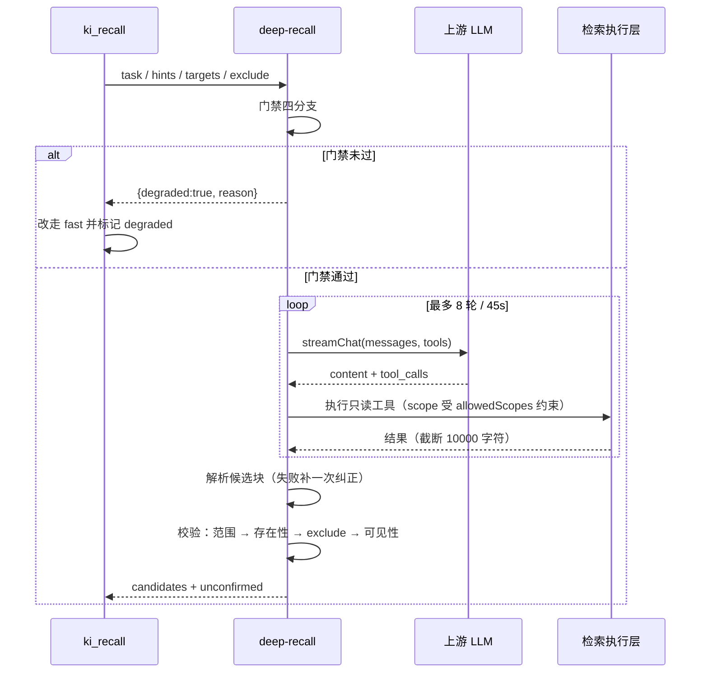

# S-03 深度通道（模型多轮检索 · 提示词 · 门禁降级）

父文档：`DESIGN.md`｜依赖：S-02｜被依赖：无（二期交付）

## 1. 术语

| 术语 | 定义 |
|---|---|
| 深度通道（deep） | 由上游模型在给定范围内多轮调用只读检索工具，最后输出候选块 |
| 候选块 | 模型输出的 JSON 数组：`{sourceScope, group, name, reason}` |
| 门禁四分支 | 外发未确认 / 模型未启用 / 无 tool 能力 / 工具全关 |
| 精简循环 | 本子需求自实现的 tool-call 循环（不含 find 的 steps、并发排队、事件上下文） |

## 2. 现状（AS-IS）

| 事实 | 位置 |
|---|---|
| find 的深度执行器：门禁 → 并发排队 → 组装事件上下文 → 工具定义 → 轮次不限循环 → 解析 + 重试 → 三重校验 → 装配 | `src/lib/events/find-runner.ts:364-1000` |
| 候选块解析（代码块 / 裸数组都收）已导出，可复用 | `src/lib/events/find-runner.ts:335-362` |
| 门禁四分支与错误码 | `src/lib/events/find-runner.ts:381-398` |
| 提示词 = 用户可编辑正文 + skill 目录 + 安全尾块 | `src/lib/events/find-runner.ts:598-606` |
| 默认提示词正文 | `src/lib/chat/prompt-config.ts:639-647` |
| 45s 硬超时、单条工具结果 10000 字符 | `src/lib/events/find-runner.ts:47-55` |

**缺口**：find 的循环读 `event.typeId / stageKey / collectMembers / readRefs`，任务预取没有这些；且 find 的门禁是「抛错」，对开工前的一步不合适。

## 3. 方案（TO-BE）

```
src/lib/recall/deep-recall.ts        [新增] 精简工具循环 + 门禁降级 + 校验装配
src/lib/chat/prompt-config.ts        [修改] 新增 recall 域（prompt / skills / tools）+ DEFAULT_RECALL_PROMPT
src/lib/mcp-tools/recall.ts          [修改] auto/deep 分支接 deep-recall
src/lib/recall/limits.ts             [修改] 深度通道共用并发槽，硬超时 45s
```

**不复用 `runDeepFind`，也不抽公共 core**（D-01-3）。两份循环在文件头互相注明：

```
// ⚠️ 本文件与 src/lib/events/find-runner.ts 各有一份 tool-call 循环：
//    find 侧带事件上下文（阶段/关联文档/参考文档）与并发排队；
//    recall 侧只带任务画像与范围，且门禁降级而非抛错。
//    任一侧修改「工具结果截断 / 轮次终止条件 / 强制作答」时，必须同步检查另一侧。
```

### 3.1 循环骨架

```
① 门禁：resolveLlmStatus → 四分支任一命中 ⇒ 返回 { degraded: true, reason } 交给 S-02 走 fast
② 组装上下文：任务画像（≤2000）+ hints + 范围说明 + exclude 清单（只给名字）
③ 工具集：按 recall.tools 开关生成 ki_search / ki_get_module_info / ki_group_list / ki_tag_list
④ while(true)：streamChat(tools) → 累积 content/thinking → 若 tool_calls 则逐个执行并回填 → 否则 break
   终止条件：模型不再要工具 / 45s 硬超时 / 达到轮次上限（默认 8，可配）
⑤ 解析候选块（复用 parseCandidateBlock）；失败补一次纠正提示后重试一次
⑥ 校验：范围 → 存在性 → 未在 exclude → 可见性；不过的进 unconfirmed
⑦ 装配：rankInScope（按 hitScores 库内降序）+ reason + nextActions
```

### 3.2 作用域注入（唯一越权面）

模型传入的 `scope` 一律不可信：

| 情况 | 处理 |
|---|---|
| 不在 `allowedScopes`（targets ∪ 视图成员） | 回一条**给模型看**的纠错，不抛给调用方 |
| 指向视图名（视图不是物理库） | 回纠错并列出成员库 |
| 空值 | 用 `targets[0]` |

`ki_search` 的 scope 强制覆盖为 `targets.join(',')`（与 find 同策略）。

### 3.3 提示词

新增 `DEFAULT_RECALL_PROMPT`（`prompt-config.ts`），与 find 的差异：

| 维度 | find | recall |
|---|---|---|
| 输入 | 事件标题/描述/阶段/关联文档/参考文档 | 任务画像 + 强线索 + 范围说明 |
| 排除项 | 已作为关联/参考文档的 | `exclude`（Agent 已读） |
| 输出 | 候选 + 一句话理由 | 同上，且理由需说明「为什么这会帮上这个任务」 |

正文骨架：

```
你在帮一个即将开工的开发任务预取上下文。输入是任务画像（他不是在提问），你要挑出值得先读的文档。
步骤：
1. 从任务画像提炼有区分度的线索（报错原文、错误码、接口名、组件名、路径），去掉「排查 / 问题 / 记录 / 看一下」这类词。
2. 在给定范围内检索；命中不足时换 2-3 组同义表达，不要重复同一 query。必要时读正文确认相关性。
3. 按相关性从高到低给候选，每条一句话理由，说明它对这个任务有什么帮助；无法确认写「仅语义相近」。
约束：只读；不臆造检索结果里未出现的 group 与文档名；不回答任务本身怎么做，只给该读什么。
```

硬规则（工具协议、输出格式、安全尾块）由代码追加，用户改正文不会改坏协议。

## 4. 接口设计

```ts
// src/lib/recall/deep-recall.ts
export interface DeepRecallDeps {
  targets: string[];
  tokenScopes: string[] | null;
  exclude: string[];
  limit: number;
  config: RecallConfig;          // prompt-config 的 recall 域
  kiConfig: KiConfig;            // config.yaml 快照
  signal?: AbortSignal;
  viewMembers: (name: string) => string[] | null;
  /** 门禁注入点（测试用），缺省走 resolveLlmStatus */
  llm?: { status: (cfg: KiConfig) => LlmStatus };
  hardTimeoutMs?: number;        // 缺省 45_000
}

export async function runDeepRecall(
  req: { task: string; hints: string[] },
  deps: DeepRecallDeps,
): Promise<
  | { ok: true; result: CoreRecallResult; steps: RecallStep[] }
  | { ok: false; degraded: true; reason: string }      // 门禁未过 ⇒ 交 S-02 走 fast
>;
```

`recall` 提示词配置域（随本子需求新增，一期不存在）：

| 键 | 类型 | 默认 | 说明 |
|---|---|---|---|
| `recall.prompt` | `{content, at}` | `DEFAULT_RECALL_PROMPT` | 深度通道检索定位提示词 |
| `recall.skills` | `PromptSkill[]` | `[]` | 可选，与 find 的 skill 结构同构 |
| `recall.tools` | `Record<string, boolean>` | 四个只读工具全开 | 全关 ⇒ 门禁第四分支 |
| `recall.reasoningEffort` | `string?` | 未设 | 覆盖 `llm.reasoningEffort` |

## 5. 时序



## 6. 异常处理

| 场景 | 行为 | 是否对外暴露 |
|---|---|---|
| 外发未确认 / 模型未启用 / 无 tool / 工具全关 | 降级 fast，`degraded:true` + 人话原因 | 是 |
| 模型输出不可解析（两次） | 返回 `partial:true` + 空候选 + `needMore`，不冒充「没有相关文档」 | 是 |
| 模型超出范围给候选 | 进 `unconfirmed`（不返回给调用方） | 否 |
| 模型要读范围外的库 | 回纠错给模型，本轮不执行 | 否 |
| 45s 硬超时 | 有候选 ⇒ `partial:true`；0 候选 ⇒ `RECALL_TIMEOUT` | 是 |
| 调用方断开 | 中止上游请求，释放并发槽（finally） | 否 |
| 工具结果超长 | 单条截断 10000 字符，末尾标注「已截断」 | 是（模型可见） |

## 7. 性能安全

| 项 | 取值 |
|---|---|
| 轮次上限 | 8（可配 1~12，越界 fail-loud） |
| 硬超时 | 45s（与 find 一致，不可配） |
| 并发 | 共用 `recall.maxConcurrent`（默认 4） |
| 单条工具结果 | 10000 字符 |
| 思考展示 | 2000 字符（按 `THINKING_MAX_CHARS` 同源常量） |
| 成本 | 单次通常 5~30s、1~8 轮；缓存命中时 0 模型调用 |

## 8. 影响范围

| 文件 | 类型 | 影响面 | 回归要求 |
|---|---|---|---|
| `src/lib/recall/deep-recall.ts` | 新增 | 无既有调用方 | 新增单测（门禁四分支 / 超时 / 解析失败） |
| `src/lib/chat/prompt-config.ts` | 修改（新增 `recall` 域 + `DEFAULT_RECALL_PROMPT` + 校验） | **对话 / 分析 / 查找三块配置共用同一份 `prompt-config.json`** | `normalizePromptConfig` 新增字段必须缺失即默认、非法即 issue 整份回退；跑 `test/chat/prompt-config-*` 全量 |
| `src/lib/mcp-tools/recall.ts` | 修改（接 `auto` / `deep`） | S-02 的一期分支要改为分流 | 一期既有契约测试保持绿 |
| `src/lib/recall/limits.ts` | 修改（deep 共用并发槽与 45s 硬超时） | S-02 的配额语义不变 | 配额测试 |

**会被波及的既有功能**：`prompt-config.json` 是四块能力共用的单文件，读写路径共享（`prompt-config.ts:727`）。任何"整份回退默认"的校验问题都会同时影响对话与分析 —— 因此 `recall` 域必须做到「缺字段=用默认、不报 issue」，只有**类型错误**才 issue。

**不受影响**：`find-runner.ts` / `find-service.ts`（不抽公共 core，D-03-2）。

## 9. 关键决策点

| # | 决策 | 被否决方案 | 否决理由 | 重新评估触发条件 |
|---|---|---|---|---|
| D-03-1 | 门禁未过 ⇒ 降级 fast | 照抄 find 抛错 | 开工前预取被拦住会让 Agent 直接不预取（价值归零） | 出现「降级结果被当权威」的误用 |
| D-03-2 | 自实现精简循环，不抽公共 core | 抽 `tool-loop-core.ts` 供 find 与 recall 共用 | find 900 行含排队/steps/事件上下文，抽取代价与回归风险高 | 两份循环出现第 2 次需同步修改 |
| D-03-3 | 轮次上限 8（可配） | 与 find 一致不限轮次 | recall 有 45s 硬顶但无「用户能点停止」的界面；不限轮次更易打满预算 | 试点出现「8 轮不够」的样本 ≥20% |
| D-03-4 | 提示词单独一层 `recall.prompt` | 复用 `find.prompt` | find 的正文写死「为当前事件」「事件阶段」，语义冲突 | 无 |

## 10. 待定问题

| # | 问题 | 影响 | 结论来源 |
|---|---|---|---|
| 1 | 是否需要给 Web 设置页加 `recall` 配置面板 | 一期无界面；二期若深度的提示词要可调，就需要界面 | 二期评估 |
| 2 | 深度通道与 fast 的候选差异是否需要「差异对比」能力 | 影响是否值得长期维护两条通道 | 二期真机对比后定 |
