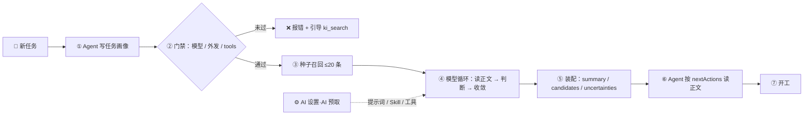
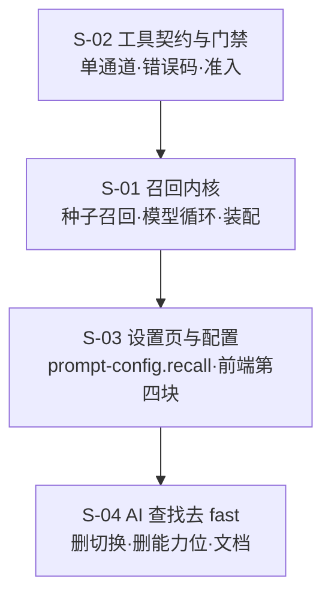

# 设计：AI 预取与查找统一走模型通道

- 需求：REQ-20261118-004
- 前置需求：REQ-20261118-003（`ki_recall` 确定性通道版本，已交付并提交）
- 日期：2026-11-18

## 1. 需求背景 & 目标

**背景**：`ki_recall` 与「AI 查找」当前各有两条通道 —— 确定性 fast（不调模型）与 deep（模型工具循环）。fast 做的事（抽关键词 + 调检索）调用方 agent 自己就能做且做得更好；保留它会让「AI 查找」名不副实（默认就是 fast）。

**目标**：两条通道**只保留模型通道**——服务端用一份专用提示词 + 一组受限工具，替主 agent 把「该读哪几篇」查完，只带回清单与结论；同时把 recall 的提示词 / Skill / 工具搬进 AI 设置，使三块配置真正有消费方。

> **「同构」的准确含义**：只同构**门禁与错误语义**（同一段判定函数、同一套 `ki_search` 引导），**内核各自独立** —— 「AI 查找」沿用 `find-runner` 的事件上下文循环，`ki_recall` 新建任务画像循环。两条循环差异大（事件 vs 任务画像、已关联排除 vs 已读清单），硬抽公共 core 会让两边都变复杂（S-04 D-04-5）。

**不在范围内**：检索算法本身（`executeSearch`）、召回结果的 Web 可视化、模型接入层改造。

## 2. 关键环节一览图

## 3. 总体方案设计

**共享术语速查**（定义归属见括号内子文档，此处不重复定义）

| 术语 | 一句话 | 归属 |
|---|---|---|
| 种子召回（seed） | 模型循环开始前，用确定性检索先取 ≤20 条候选给模型当起点（**仅 `ki_recall` 有**；「AI 查找」不引入） | S-01 |
| 候选（candidate） | 被判定「对任务有用」的文档，每个必须能说出用途 | S-01 |
| 结论（summary） | ≤3 句的整体判断，必须可追溯到候选或正文 | S-01 |
| 不确定点（uncertainties） | 模型判断不了的事，与 `needMore`（要调用方补的信息）分开 | S-01 |
| 证据级别（evidence） | `full` = 读全了正文（`ki_get_module_info` 且未截断）；`snippet` = 只有片段 | S-01 |
| 门禁三态 | 模型未配 / 外发未确认 / 不支持 tools，任一未过即不可用 | S-02 |
| 锁定工具 | `ki_get_module_info`，在设置页不可取消勾选 | S-03 |

## 4. 全局风险 & 跨子需求依赖

| 风险 | 影响 | 应对 |
|---|---|---|
| 无模型环境失去「AI 查找」 | 功能破坏（已有用户习惯） | 明确错误码 + `ki_search` 引导；上线说明 |
| 时延从秒级变 5~45s | 体验降级，用户以为卡死 | 前端 loading 与阶段提示；45s 硬顶 + `partial` |
| 模型只凭标题猜（不读正文） | 预取质量归零，退化成第二个 `ki_search` | 提示词硬规则 + 验收抽查（R3） |
| `prompt-config.json` 单文件四块共用 | 新域写坏会连累对话与分析 | 缺字段=默认、只对类型错误 issue（S-03） |
| 旧数据 `origin:'fast'` | 历史候选渲染不出来 | 枚举保留，只停止产生新值（S-04） |

**跨子需求接口索引**（签名定义在子文档，此处只登记边界）

| 签名 | 定义处 | 调用方 | 契约要点 |
|---|---|---|---|
| `runRecall(req, deps): Promise<RecallResult>` | S-01 §4 | S-02 | 不抛业务错误码；门禁由调用方先判 |
| `RecallResult`（含 `summary`/`uncertainties`） | S-01 §5 | S-02 | 字段增改须两边同改 |
| `RecallConfig`（prompt-config 域） | S-03 §5 | S-01 | 提示词 / 工具集 / 轮次上限的读取来源 |
| `recallToolGroups`（工具白名单） | S-03 §4 | S-01、S-04 | 两条通道共用同一份工具集定义 |
