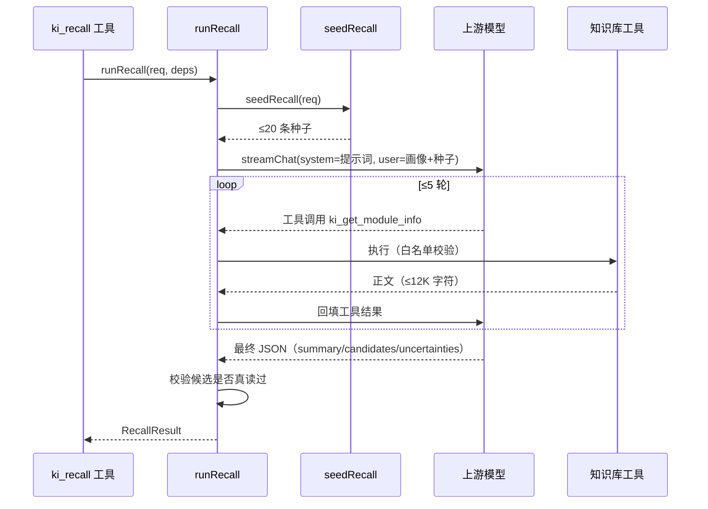

# S-01 召回内核：种子召回 + 模型循环 + 装配

## 1. 术语

| 术语 | 含义 |
|---|---|
| 种子召回（seed） | 循环开始前的确定性检索，用现有 `executeSearch` 取 ≤20 条，只做「给模型一个起点」，**不是**对外的通道 |
| 轮次（round） | 模型一次「发起工具调用 → 拿到结果」的往返，上限 6 |
| 候选（candidate） | 判定为有用的文档；**必须**由模型读过正文后确认 |
| 结论（summary） | ≤3 句整体判断，须可追溯到候选或正文 |
| 不确定点（uncertainties） | 模型判断不了的事实（两篇冲突 / 模块是否废弃），与 `needMore`（要调用方补信息）分开 |

## 2. 现状（AS-IS）

| 现状 | 位置 | 问题 |
|---|---|---|
| 确定性召回五步（范围→关键词→检索→归一化→装配） | `src/lib/recall/fast-recall.ts` 全文 | 不调模型，与 agent 自行检索重复 |
| 模型工具循环（find 版） | `src/lib/events/find-runner.ts:739-847`，`streamChat` 于 `:633` | 与事件强耦合（`eventId`、已关联/已参考排除），不能直接复用 |
| 会话工具循环 | `src/lib/chat/retrieval/tool-loop.ts:79`（`ToolLoopInput` 需 `ConversationFile`） | 绑定会话文件，recall 没有会话 |
| 提示词装配 | `find-runner.ts:297-327`（`buildFindContext`） | 以事件为输入 |

**结论**：循环骨架要**照 find-runner 的模式自建**（`streamChat` + `ToolDef` + `serializeToolResponse`），不能复用 `tool-loop.ts`（它要求 `ConversationFile`）。

## 3. 方案（TO-BE）

```
runRecall(req, deps)
 ├─ ⓪ 读配置：提示词 / 工具集 / 轮次上限（来自 S-03 的 RecallConfig）
 ├─ ① 种子召回：seedRecall(req) → ≤20 条 {scope,group,name,score}
 ├─ ② 组装 messages：system=提示词，user=任务画像+线索+范围+种子清单+已读清单
 ├─ ③ 循环（≤5 轮）
 │     ├─ streamChat → 文本 / 工具调用
 │     ├─ 工具调用 → 白名单校验 → 执行 → serializeToolResponse 回填
 │     └─ 无工具调用 → 认为模型给出结论，退出
 ├─ ④ 解析：严格 JSON（summary / candidates / uncertainties / needMore）
 ├─ ⑤ 校验：候选必须 ∈ 本次真实读过的文档集合（防编造），并按「读全 / 只读片段」分级（见 §5 `evidence`）
 └─ ⑥ 装配：nextActions（前 3 条）+ skipped + partial + rounds + durationMs
```

**三条硬规则（写进提示词，见 §4.3）**：

1. **必须先读正文才允许产出候选** —— 实现上用 ⑤ 的校验兜底：`candidates` 里出现「本次没读过正文」的文档 → 直接剔除并计入 `dropped`。
2. **宁少勿滥** —— 0 候选合法，但 `summary` 必须说明查了什么。
3. **读到的不符要主动排除并说明** —— 写进 `summary`，不留在候选里。

## 4. 接口设计

### 4.1 入口

```ts
// src/lib/recall/run-recall.ts [新增]
export interface RecallRequest {
  scope: string[];        // 必填，库名或视图（S-02 已归一化为数组）
  task: string;           // 任务画像 ≤2000 字
  hints?: string[];       // 强线索
  exclude?: string[];     // 已读清单："scope::group::name" 或 "group::name"
  limit: number;          // 候选上限 1..20
}

export interface RecallDeps {
  /** 模型（生产 = streamChat；测试注入 fake） */
  stream: typeof streamChat;
  /** 配置快照（含 recall 域；缺省 loadConfig） */
  config: KiConfig;
  /** 种子检索（生产 = seedRecall；测试注入） */
  seed?: (req: RecallRequest) => Promise<SeedHit[]>;
  /** 工具执行（生产 = 知识库只读工具；测试注入） */
  runTool?: (name: string, args: Record<string, unknown>) => Promise<string>;
  now?: () => number;
}

export async function runRecall(req: RecallRequest, deps: RecallDeps): Promise<RecallResult>;
```

> **门禁不在本函数内**：模型是否可用由 S-02 在调用前判定（S-01 只管"有模型时怎么跑"），这样内核单测不需要构造配置门禁。

### 4.2 种子召回（原 fast 通道改造）

```ts
// src/lib/recall/seed-recall.ts [由 fast-recall.ts 改造]
export interface SeedHit { scope: string; group: string; name: string; score: number }
export function seedRecall(req: RecallRequest, deps: { search: RecallSearchFn; cachesOf; resolveVisibility? }): Promise<SeedHit[]>
```

- 保留原有：中文线索抽取（`keywords.ts`）、字面+语义双路交替合并、可见性过滤、每库配额
- **删除**：`tier` 分级、`alsoIn`（模型自己会判断，不需要服务端提示）、`why` 生成（改由模型写）
- **上限**：种子 ≤**10** 条（`SEED_TOP_K = 10`），**不进候选**，只进 user 消息
- **只带标识，不带内容**：每条仅 `scope`/`group`/`name`，**不含片段与正文**。`find-runner` 无种子也能工作，种子的价值只在"给个起点"，多带就等于把 token 预算花在模型本来也会做的事上

**token 预算估算**（C1 质疑的正面回答）

| 组成 | 约值 |
|---|---|
| 10 条种子的 group+name | 10 × 30 字 ≈ 300 字（≈ 200 token） |
| 提示词 | ≈ 600 字（≈ 400 token） |
| 工具结果 5 次 × 8K 字符 | 40K 字符 ≈ 27K token |
| 说明：种子占比 <1%，**真正的大头是工具结果**，所以预算控制点在 `toolResponseChars` 而不是种子条数 | |

### 4.3 提示词骨架（全文由 S-03 的配置域承载）

```
【角色】你是这台知识库的检索助手，服务一次「开发任务开工前的资料预取」。

【输入】任务画像 / 强线索 / 检索范围 / 已读清单 / 种子候选（系统已给你一份初筛）

【硬规则 —— 违反任意一条即视为失败】
1. 你必须至少**读全**一篇正文（ki_get_module_info，且结果未被截断）才能下结论；
   只凭标题、或只看到片段（ki_search / 被截断的正文）就猜的文档，一律不得进入 candidates。
   若确实只能拿到片段，必须在该候选的 why 末尾标注「（仅片段）」，系统会据此把整体标为不完整。
2. 每篇进入 candidates 的文档，都要写清「它对任务的哪一部分有用」，写不出的一律不放。
3. 宁少勿滥：3 篇讲得清用途 > 8 篇看起来都沾边。0 篇是合法结论，
   但 summary 必须说明你查了什么、为什么没有。
4. 读到的内容与任务背景不符时，主动排除并在 summary 里说明。
5. 判断不了的事写进 uncertainties，不许猜成结论。
6. 不要复述正文，只给判断与指向。

【输出】严格 JSON：{ summary, candidates[], uncertainties[], needMore[] }
```

### 4.4 时序图



## 5. 数据模型

```ts
export interface RecallCandidate {
  scope: string;                    // 物理库（视图已展开）
  group: string;
  name: string;
  why: string;                      // 模型写的「对任务哪部分有用」
  evidence: 'full' | 'snippet';     // 见下方「读全」判据
}

/**
 * 「读全」判据（C2 质疑的定稿）：
 *   full    = 本次调用过 `ki_get_module_info` 且返回**未被 max_chars 截断**
 *             （响应里带截断标记即为未读全）
 *   snippet = 只调过 `ki_search`，或 `ki_get_module_info` 被截断
 *
 * 取舍规则（保持「宁少勿滥」）：
 *   1. 只要存在 full 候选 → 只返回 full，snippet 一律不进；
 *   2. 一条 full 都没有 → 最多返回 2 条 snippet 候选，且整体 `partial: true`，
 *      `summary` 必须写明「只读到片段」；
 *   3. 连 snippet 都没有 → `candidates: []` + `summary` 说明查了什么。
 */

export interface RecallResult {
  summary: string;              // ≤3 句
  candidates: RecallCandidate[];
  uncertainties: string[];      // 判断不了的点
  needMore: NeedMoreItem[];     // 要调用方补的信息
  nextActions: NextAction[];    // 前 3 条候选的可执行参数
  skipped: RecallSkipped[];     // 范围剔除（权限/缺失/超限）
  dropped: number;              // 编造/失效被剔除的条数
  rounds: number;               // 实际轮次
  partial?: boolean;            // 超时但有结论
  durationMs: number;
}
```

## 6. 异常处理

| 场景 | 行为 | 是否对外暴露 |
|---|---|---|
| 模型输出非 JSON | 重试 1 次（追加"只输出 JSON"提示）；仍失败 → 把纯文本塞进 `summary`、`candidates: []`、`partial: true` | 是（`partial`） |
| 候选不在「已读集合」里 | 剔除 + `dropped += 1`，不报错 | 是（`dropped`） |
| 正文读取被 `max_chars` 截断 | 该候选降级为 `evidence:'snippet'`；若无 full 候选则整体 `partial: true` | 是（`evidence`/`partial`） |
| 5 轮用完仍无结论 | 用已有正文强行收口：`summary` 说明"轮次耗尽"，候选取已读且模型提过的 | 是（`partial`） |
| 工具报错（库不可用） | 该次工具结果回填错误文本，让模型自行换路；连续 3 次失败 → 提前收口 | 是（`skipped`） |
| 种子召回 0 条 | 照常跑循环（模型自己搜），`summary` 会体现 | 否 |
| 45s 超时 | 由工具层（S-02）中断，内核返回已得内容 | 是（`partial`） |

## 7. 影响范围

| 文件 | 类型 | 影响面 |
|---|---|---|
| `src/lib/recall/run-recall.ts` | 新增 | 无既有调用方 |
| `src/lib/recall/seed-recall.ts` | 由 `fast-recall.ts` 改造 | 原 `runFastRecall` 的对外行为消失（S-02 同步改） |
| `src/lib/recall/keywords.ts` | 保留 | 供种子召回使用 |
| `src/lib/recall/assemble.ts` | 改造 | `buildWhy` 由模型替代；保留 `buildNextActions`/`buildNeedMore` |
| `src/lib/recall/fast-recall.ts` | **删除或改名** | 同 seed-recall |
| `test/recall-kernel.test.ts` | 重写 | 原 16 例里与 fast 相关的全部作废 |

**回归要求**：种子召回改造后，`refs-multi-scope`（范围解析）必须保持全绿。

## 8. 关键决策点

| # | 决策 | 被否决方案 | 理由 | 重新评估触发条件 |
|---|---|---|---|---|
| D-01-1 | 循环骨架照 `find-runner` 自建，不复用 `tool-loop.ts` | 复用会话工具循环 | `ToolLoopInput` 要求 `ConversationFile`，recall 没有会话；硬塞会造出假会话 | 两处循环出现第 3 次同步修改时抽公共 core |
| D-01-2 | 候选必须「本次读过正文」才保留 | 信任模型输出 | 不校验就必然出现"只凭标题猜"的候选，提示词管不住 | 校验误杀率 >10% |
| D-01-3 | 种子只进 user 消息，不进候选 | 把种子直接当候选 | 种子是"可能的起点"，不是"有用的结论"，混进去等于回到 fast | 无 |
| D-01-4 | 删除 tier/alsoIn/why 的服务端计算 | 保留 | 模型自己会判断；服务端再给一份会与模型结论打架 | 模型明显忽略同名文档时再补 `alsoIn` |
| D-01-5 | 轮次上限 **5**、工具结果 ≤**8K** 字符 | 不限轮次 / 12K | 45s 硬顶 ÷ 5 轮 ≈ 9s/轮（含上游首字延迟）才跑得完；8K ≈ 一篇常规正文，12K 时 5 轮就是 60K 字符，超时率会很高（C3 质疑） | 试点 P95 超 40s 或"轮次不够"占比 >20% |
| D-01-6 | **接受 `partial` 为常见状态**，但必须在 `summary` 里写明"只读到片段/轮次耗尽" | 超时就报错 | 报错会让 agent 完全拿不到资料；`partial` + 显式说明至少能用，且用户知道不完整 | 无 |
| D-01-7 | 「读过」按 `evidence: full / snippet` 两级判定 | 只判"调过工具" | 只看片段就等同于"凭标题猜"，必须区分开；但一刀切只收 full 会让"只有片段"的场景直接空手 | 片段候选占比 >50% |
