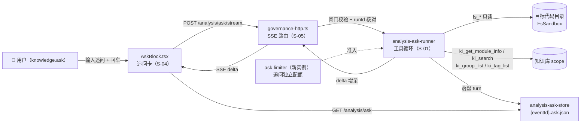
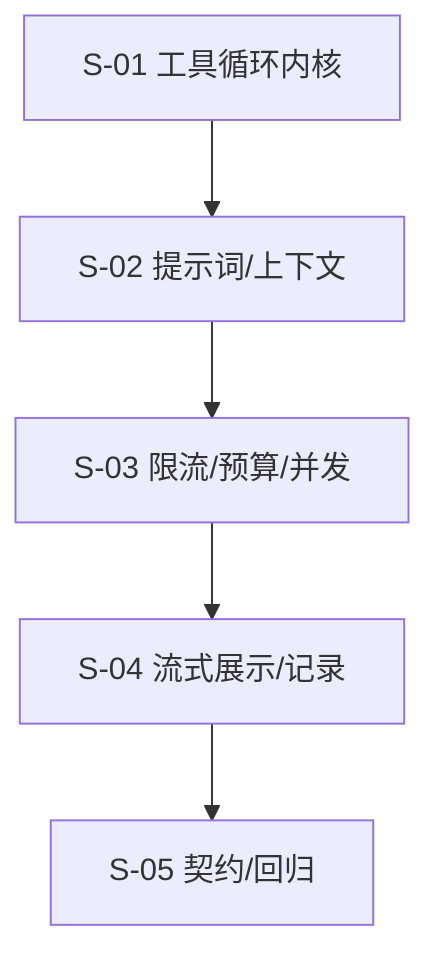

# 追问带工具再调查 · 设计文档

> 范围：把事件详情「追问这次分析」从「基于定稿结果答疑、不给工具」升级为「可带源码/知识库只读工具再调查」。
> 基线：commit `dcff934`；scope 机制沿用现有 `kisearch-memory` 等。
> 本次未挂 REQ-ID（新需求），文档落盘但不执行 `req update` 注册。

## 1. 需求背景 & 目标

**背景**：现状追问在 `analysis-ask-runner.ts` 明示「不给工具、不读仓库」，只把结论/候选/已确认拼成上下文问答。用户观察到两点落差：① 想针对疑点让 AI 重新取证时无法调工具；② AI 分析本身会挂参考文档却跳过不读（独立 Bug，另案定位，见 `.debug/analysis-skip-ref-doc-20261119/`）。

**目标**：追问可带着事件上下文 + 已有分析结论，调用与分析同款的只读工具面（`fs_*` + KB 四件套）再调查，回答可引用工具证据；保持流式输出、权限闸门、记录持久化不变。

**不在范围内**：
- 不加 `ki_recall` / `ki_ask`（编排层工具，递归风险，已拍板，见 ki 决策记录）
- 不改 `ki_ask` 自身的递归防护与限流语义
- 不改 AI 分析主链路的提示词/skill（漏读参考文档另案）
- 不改 `/analysis/ask`、`/ask/stream`、`/refs` 的对外 URL 与既有字段（只追加可选字段）

## 2. 关键环节一览图

子需求节点：**S-01** 工具循环内核 → **S-02** 提示词与上下文 → **S-03** 限流/预算/并发 → **S-04** 流式展示与记录 → **S-05** 契约与回归。

**非功能性需求默认假设**（无用户明确指标，按此设计）：单机低量级（daemon 单进程）、单用户对单个事件低频追问，不承诺多租户高并发；工具只读语义依赖现有 sandbox，不新增权限面。若需扩展请在设计评审前确认。

## 3. 总体方案设计

以现有 `analysis-runner` 的工具循环为模板，在 `analysis-ask-runner` 内复刻一份**轻量版**（复用 `createFsToolEntries` / `buildKbReadToolEntries`，不复用分析主流程的 AbortController/steps 落盘）。追问仍是"一次问答一条 turn"的形状，只是把原来的一次 `streamChat` 升级为"工具循环 + 最终作答"。

**共享术语**：
- **turn**：一次追问 = 一条 `AnalysisAskTurn`（question/answer/context/usage），落 `{eventId}.ask.json`。
- **工具面**：本次可用工具集合 = `ANALYSIS_TOOL_NAMES` ∩ 用户在「AI 分析」设置里开启的项（与 AI 分析共用配置）。
- **工具循环**：模型调用工具 → 结果作为 `tool` 消息回填 → 再调模型，直到不再调工具或触达轮次上限，最后产出 answer。

## 4. 全局风险 & 跨子需求依赖

| 风险 | 级别 | 缓解 |
|---|---|---|
| 工具循环 token 膨胀（分析实测 8 轮 15 万 token） | 高 | 追问设轮次上限（建议 5）+ 工具响应字符上限（复用 `ANALYSIS_TOOL_RESPONSE_CHARS=10000`）；预算走 S-03 |
| SSE 流中工具阶段无文本、前端长时间静止 | 中 | 工具调用阶段推送 `type:'tool'` 事件（可选字段，旧前端忽略），AskBlock 显示"正在查证据…" |
| 与分析主流程共享工具入口导致配置耦合 | 中 | 只读工具工厂保持纯函数、各自传 `FsSandboxContext` / `scope`，无共享可变状态 |
| 权限绕过：viewer 有 `knowledge.ask` 但无源码目录读权限 | 低 | 源码目录由服务端配置（`targetDirs.byScope`），工具沙箱与 AI 分析同一套，不新开口子 |
| 追问与其他问答互相挤占额度 | 中 | S-03 追问独立限流实例，配额见子文档 |

**接口契约变化风险**：SSE 新增 `type:'tool'` 事件、turn 新增可选 `toolCalls` 字段——均为追加，旧前端/旧 daemon 忽略即可，不破坏现有消费者。

---

## 子文档清单

- `S01_工具循环内核_DESIGN.md`
- `S02_提示词与上下文_DESIGN.md`
- `S03_限流预算与并发_DESIGN.md`
- `S04_流式展示与记录_DESIGN.md`
- `S05_契约与回归_DESIGN.md`
