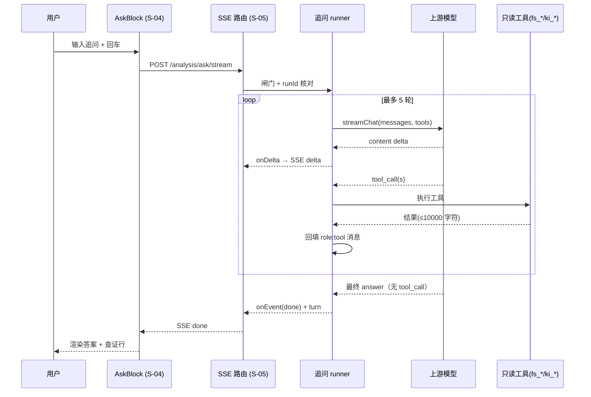

# S-01 工具循环内核

## 术语

- **工具条目 `AnalysisToolEntry`**：`{name, def: ToolDef, describe, run}`，现有 `analysis-runner.ts` 内部类型。
- **工具循环**：`streamChat(messages, {tools})` → 收 `tool_call` → 执行 → 以 `role:'tool'` 回填 → 再调模型，直到无调用或达上限。

## 现状（AS-IS）

`src/lib/events/analysis-ask-runner.ts::askEventAnalysis`（line 177-215）：单次 `streamChat`，无 `tools`，system 明确"只能用给定上下文回答"。

## 方案（TO-BE）

### 改动 1：工具装配（新增函数，复用现有工厂）

在 `analysis-ask-runner.ts` 新增 `buildAskToolEntries(scope, cfg, deps, question)`：

```
fsCtx = { rawRoot: targetDir, realRoot: targetDir, filesRead: new Set(), signal }
entries = [...createFsToolEntries(fsCtx), ...buildKbReadToolEntries(scope, cfg, deps)]
  .filter(e => askCfg.tools[e.name] !== false)
```

- `targetDir` **调用现成的 `resolveAnalysisTargetDir(cfg.analysis.targetDirs, scope)`**（`prompt-config.ts:884-893`）：scope 精确映射优先、未命中回退 `defaultDir`、都没有返回 `null`。不要自己取 `byScope[scope]`（会漏掉 defaultDir 回退）。返回 `null` 时不注册 `fs_*`，只留 KB 工具，并在 system 说明"当前未配置源码目录"。
- `cfg` 与工具的只读执行沿用分析的 `runWithConfigSnapshot` / `OperationCoordinator`，不新造执行通道。
- **新增文件**：无（在 `analysis-ask-runner.ts` 内新增函数）；若 reuse 需要把 `buildKbReadToolEntries` 提升为 export（当前 `createFsToolEntries` 已 export）——见 S-05 影响面。

### 改动 2：循环主体（替换原单次 streamChat）

```
while (turns < ASK_TOOL_MAX_ROUNDS) {
  stream = streamChat(messages, { tools: toolDefs, signal, llm, requestTimeoutMs, firstByteTimeoutMs })
  for await part:
    content → answer += text; onDelta(text)
    reasoning → （可选）onEvent({type:'thinking', text})，不落盘
    usage → 累加 token
  if 无 tool_calls: break
  逐个执行 tool_call → 序列化响应（复用 serializeToolResponse，上限 10000）
  追加 role:'assistant' + role:'tool' 消息
  turns++
  若 turns 达上限：移除 tools 后再调一次强制作答
  （★ DSML 兜底提示在 `src/lib/chat/retrieval/tool-loop.ts`（grep DSML 唯一命中处），
    不在 analysis-runner；从那里提取"模型输出 <｜｜DSML｜｜invoke> 标记时引回正常作答"
    的那条 system 提示复用，或在本模块写同义提示 —— 不要声称复用 analysis-runner 的）
  ★ 每轮开头复查 runId：若 analysis.draft.runId 已变（分析被重跑），终止循环并回
    REVISION_CONFLICT，避免用新代码回答老结论
}
```

- `onDelta` 语义不变（只吐最终 answer 的增量），SSE `delta` 不被工具响应污染。
- 工具执行阶段通过新增 `onEvent?: (e) => void` 回调推 `type:'tool'` 事件（SSE 层转发，见 S-04）。

### 时序图



### 数据模型

无 schema 变更；`AnalysisAskTurn` 追加可选字段见 S-04。

### 性能 & 安全

- 轮次上限 5 + 工具响应 10000 字符上限 → 单次最坏约 5×N 轮 token，需真机抽样确认不超模型上下文。
- 工具执行受 `FsSandbox` 目录约束 + KB scope 只读，不新增写/删能力；`onEvent` 只传工具名不传响应正文。

## 异常处理

| 场景 | 行为 | 对外暴露 |
|---|---|---|
| 工具不在白名单 / 参数非法 | 回 `{error}` 作为 tool 消息继续循环（与分析同口径） | 否 |
| 工具执行抛错 | 回 `{error}`，不中断循环 | 否 |
| 模型只调工具不作答，达轮次上限 | 移除 tools 强制作答；仍无内容 → `ANALYSIS_ASK_TIMEOUT` | 是 |
| 用户取消（未来 SSE abort） | AbortController.abort → 保留已累积内容 | 是 |
| 循环中途分析被重跑（runId 变） | 每轮开头复查 draft.runId → 变则终止并回 `REVISION_CONFLICT`（新增检查点，SSE 与普通 POST 同口径） | 是 |
| 用户切换事件，旧追问 SSE 仍在推 | 前端 `seqRef + eventId` 双重校验丢弃晚到增量（AskBlock 现有 H-13 机制，`onEvent` 转发时沿用同一 seq 判断） | 否 |

## 关键决策点

| 决策 | 采纳 | 被否方案 | 否决理由 |
|---|---|---|---|
| 复用分析工具工厂 vs 重写 | 复用 `createFsToolEntries` / `buildKbReadToolEntries` | 在追问里重写一套 | 两套实现必然漂移，且 KB 工具含 scope 注入与超时细节 |
| 轮次上限值 | 5 | 不设限 | token 膨胀不可控；分析 8 轮已 15 万 token |
| 达上限行为 | 移除 tools 强制作答 | 直接截断 | 用户拿到半截答案更难用 |

## 影响范围

`src/lib/events/analysis-ask-runner.ts`（主要）、`src/lib/events/analysis-runner.ts`（导出 `buildKbReadToolEntries`）、`src/lib/chat/retrieval/tool-loop.ts`（DSML 兜底提示——提取或镜像同义提示，不改其源码）、`src/lib/chat/prompt-config.ts`（复用 `resolveAnalysisTargetDir`，无需改）、`src/lib/chat/ask/ask-contract.ts`（新增轮次常量）。
