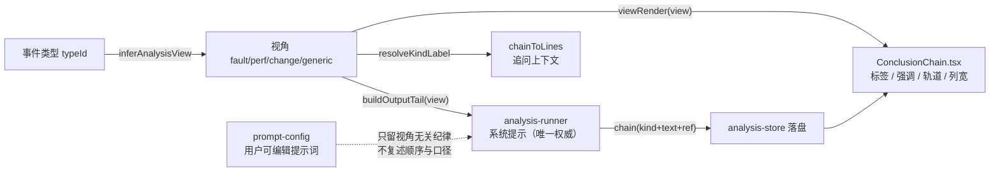

# 设计：AI 分析结论按事件类型分视角

- 需求：REQ-20261120-002（方案与 UI 于 2026-11-20 经用户确认）
- 修订：**r2（2026-11-20）** —— 按 `design-review.md` 修订：补第二处骨架定义（🔴1）、统一 labels 类型（🔴2）、补 `chainToLines` 与前端签名（疑似 S1）、补强调点生成规则（疑似 S2）、补「不在范围内 / 影响范围」与可观测触发条件（🟡）。
- UI 基线：`demo/ui/analysis-view-profiles/index.html`（md5 `d105739f6ac890151b4059ef69ee886`，代码版本 `9059f2f`，demo 未提交）
- 拆分判定：走**单文档**。理由：同一份结论契约的渲染与生成口径改造，拆子需求会切出无独立触发场景的假边界。

---

## 1. 需求背景 & 目标

结论链原先只有一套故障骨架（现象 → 直接原因 → 根本原因 → 影响面 → 建议），而事件类型有 `bug 排查 / 性能优化 / 需求实现` 及用户自建类型。非 bug 类事件没有「现象」「根本原因」这两个对象，模型为凑满骨架会**编造**不存在的故障与成因；前端又把「根因」做成全块唯一高亮，进一步暗示因果。

目标：按事件类型切「分析视角」，同一结论用该类型读得通的词与形态呈现；**结论数据结构与历史文件不变**。

**不在范围内**：

- 事件类型的编辑页不新增「分析视角」选择（自建类型一律 generic，见 D5）
- 不新增 HTTP / MCP 字段，不改契约 DTO 值域
- 不改结论节点结构（kind 仍五值）、不改归一白名单、不改代码位置胶囊与浮层
- 不改 AI 查找 / 预取链路（只有追问上下文随视角换词）

---

## 2. 术语表

| 术语 | 含义 |
|---|---|
| 视角（view） | 结论的阅读骨架：`fault` 故障 / `perf` 性能 / `change` 变更 / `generic` 通用 |
| 槽位（kind） | 结论节点类型，仍是 `symptom / cause / root / impact / fix`，语义中性 |
| 强调点 | 全块唯一的高亮节点（紫菱形 + 清标），按视角指定，可为空 |
| 轨道 | 节点左侧竖线 + 节点间流向箭头，表达因果；`rail=false` 时退化为分点 |
| 唯一权威 | chain 顺序、节点用词、conclusion 口径只认 `buildOutputTail`，用户提示词不再复述 |

---

## 3. 现状分析（AS-IS）

- 节点类型写死五值：`src/lib/events/types.ts` 的 `ConclusionNodeKind`。
- **骨架存在两处定义**（评审新增）：
  1. `src/lib/events/analysis-runner.ts` 的 `SYSTEM_OUTPUT_TAIL`（第 5 条 JSON 示例 + 第 6 条 chain 写法 + 「软件问题…成因」定位语），代码常量，用户不可编辑；
  2. `src/lib/chat/prompt-config.ts` 的 `DEFAULT_ANALYSIS_PROMPT`（「五、输出前自检」里那句「chain 顺序是 现象 → 直接原因 → 根本原因 → 影响面 → 建议」+ 开头定位语），**用户可编辑**。
- 非法 kind 静默丢弃：`conclusion-chain.ts` 的 `normalizeChain` 白名单。
- 契约 DTO 写死五值：`src/lib/governance-contract.ts`；前端另有副本 `web/src/api/governanceContract.ts`。
- 标签两份：后端 `CONCLUSION_KIND_LABELS`（`conclusion-chain.ts`）与前端 `KIND_LABELS`（`ConclusionChain.tsx`）。
- 强调点绑死 `root`：`web/src/styles/governance.css` 的 `.gov-chain__node--root` + 组件里 `← 根因` 清标。
- 类型侧无视角字段：`builtin-types.ts` 只有 3 个内置类型（`et_1/et_2/et_3`），`type-service.ts` 的 `EventTypeRecord` 无 `analysisView`。
- 分析上下文已把类型名传给模型，但输出格式不随之变。

---

## 4. 方案设计（TO-BE）

**新增 `src/lib/events/analysis-view.ts`（视角单一真源）**

- `AnalysisView`、`ANALYSIS_VIEWS`、`BASE_KIND_LABELS`（中性词，= fault 词表）
- `VIEW_LABELS: Record<AnalysisView, Partial<Record<ConclusionNodeKind, string>>>` —— **部分映射**，缺项由 `resolveKindLabel` 回退中性词（模型给出骨架外 kind 时不丢节点、也不显示成错视角的词）
- `PROFILES` 每视角：`name / skeleton / emphasize / flag / rail / wide / summaryGuide / locateGuide`
- `inferAnalysisView(typeId)`：内置按 **id** 映射；**缺 typeId → fault**（历史行为不变）；有 id 但不在表 → generic

**`analysis-runner.ts`：输出规范函数化**

`SYSTEM_OUTPUT_TAIL` → `buildOutputTail(view)`，调用点用 `inferAnalysisView(event.typeId)`。四条不变：

- 第 1~4 条（防注入、禁臆造、空 candidates 合法、confidence 口径）**逐字不动**
- 第 7 条（反引号路径）逐字不动
- 新增第 0 条：**本节是输出格式的唯一权威**，与上文（可编辑提示词）冲突时以本节为准 —— 用来压住旧配置里残留的固定顺序句（`edited` 机制下这些配置不会被自动升级）
- 第 5/6 条按 `skeleton` + `labels` 生成；`rail=false` 的视角追加「并列要点，不要为了凑骨架编造现象/根本因」

**`prompt-config.ts`：默认提示词去双源**

- 定位语中性化（「软件问题…成因」→「事件…代码位置与依据」，并声明视角与格式在系统提示里）
- 删掉固定 chain 顺序那句，改为「按系统提示里的【系统输出与安全规范】执行」
- 证据门槛三问的措辞中性化（「怎么导致」→「为什么是它（因果/瓶颈/落点）」）

**`conclusion-chain.ts`**

- 词表定义搬到 `analysis-view.ts`，`CONCLUSION_KIND_LABELS` 保留为 `BASE_KIND_LABELS` 的别名
- `chainToLines(chain, view = 'fault')`：追问上下文措辞随视角，避免卡面「差距与成因」而喂给模型「根本原因」

**前端**

- 新增 `web/src/lib/analysisView.ts`：渲染所需的 `VIEW_LABELS`（与后端逐字一致，契约测试比对）+ `viewRender(view)`（emphasize / flag / rail / wide）+ `inferAnalysisView`
- `ConclusionChain.tsx`：新增**可选** `view`（缺省 fault）；标签走 `kindLabel`；`ol` 按 `rail/wide` 加 `is-flat/is-wide`；节点按 `emphasize` 加 `is-emph` 并渲染 `← {flag}`；**不改**位置胶囊与代码浮层
- `EventAnalysisCard.tsx` / `AiAnalyzePanel.tsx`：按 `event.typeId` 传 view
- `governance.css`：`.gov-chain__node--root` 的强调规则改挂 `.gov-chain__node.is-emph`（强调点不再绑死 root）；`--gov-kind-col` 变量化（58 → `.is-wide` 88）；`is-flat` 去轨道与箭头

---

## 5. 关键决策点

| # | 决策 | 选定 | 被否决方案 | 否决理由 | 重新评估触发条件 |
|---|---|---|---|---|---|
| D1 | 视角从哪来 | 由 `typeId` 实时推断，chain 不落 view | 分析时把 view 写进 `AnalysisDraft` | 需迁移历史文件；事件改类型后旧结论会与新类型不一致 | 出现「同一类型不同事件需不同视角」的真实诉求 |
| D2 | 是否新增 kind | 不加，复用五槽 | 新增 `goal`（需求类目标单列） | 改 types + 契约两份 + 归一器 + 两张词表，收益不足 | change 类结论中 ≥30% 把目标与差距挤在同一节点、且该节点触达 200 字上限 |
| D3 | 骨架写哪 | `buildOutputTail`（代码侧） | 只写进用户可编辑的 `DEFAULT_ANALYSIS_PROMPT` | 用户一改（或历史配置等于旧默认）视角说明就丢 | 无 |
| D4 | 非因果视角是否保留轨道 | `change/generic` 去轨 | 四视角统一保留竖轨 | 并列信息画成因果链，读者会误读为 A 导致 B | 用户反馈分点列表信息密度不足 |
| D5 | 类型是否加 `analysisView` | 一期不加 | 一期就在类型编辑页开放视角选择 | 改契约与类型服务，自建类型占比未知 | 自建类型占事件总量 >30% |
| D6 | labels 类型 | `Partial` + 中性兜底 | 全量 `Record`（5 键必备） | 全量映射会把 change 视角的 root 显示成「根本原因」，把错配放回来 | 无 |

---

## 6. 架构图 / 流程图



---

## 7. 模块/类设计（含影响范围）

```text
src/lib/events/
├── analysis-view.ts      # [新增] 视角类型 / 内置映射 / 词表 / 4 份 PROFILE
├── analysis-runner.ts    # [修改] SYSTEM_OUTPUT_TAIL → buildOutputTail(view) + 调用点
└── conclusion-chain.ts   # [修改] 词表别名 + chainToLines(chain, view)

src/lib/chat/
└── prompt-config.ts      # [修改] 默认提示词：定位语中性化、删固定顺序句

src/lib/events/
└── analysis-ask-runner.ts # [修改] AskTargetEvent 增可选 typeId，上下文按视角取词

web/src/
├── lib/analysisView.ts                                  # [新增] 渲染侧词表 + viewRender
├── components/governance/event-detail/ConclusionChain.tsx  # [修改] view prop / is-emph / is-flat / is-wide
├── components/governance/event-detail/EventAnalysisCard.tsx # [修改] 传 view
├── components/governance/AiAnalyzePanel.tsx                 # [修改] 传 view
└── styles/governance.css                                    # [修改] 强调改挂 .is-emph，新增 .is-flat / .is-wide

test/
├── events/analysis-view.test.ts   # [新增] 视角推断 / 表完整性 / tail 关键词 / 追问措辞
└── governance-contract.test.ts    # [修改] 增「视角词表前后端一致」
```

**影响范围**

| 面 | 影响 | 程度 |
|---|---|---|
| 事件详情「分析结论」卡 / AI 分析面板最终结论 | 标签、强调点、轨道形态随类型变化 | 降级（可见变化，交互不变） |
| 追问上下文（喂模型） | 标签词随类型变化 | 无感 / 改善 |
| 历史分析文件 | 只存 kind，不存 view；fault 词表与改动前逐字一致 | 无感（零迁移） |
| 用户已自定义的分析提示词 | 旧顺序句失效（tail 声明为唯一权威），内容不被覆盖 | 降级（需在设置页文案说明） |
| 契约门禁 | 新增一组词表一致性用例 | 无破坏 |
| MCP / 对外接口 | 未发现 chain 消费方 | 无（待外部确认） |

---

## 8. 接口设计

无新增 HTTP / MCP 接口，无 DTO 字段变更。内部签名：

```ts
// 后端 src/lib/events/analysis-view.ts
export type AnalysisView = 'fault' | 'perf' | 'change' | 'generic';
export const ANALYSIS_VIEWS: readonly AnalysisView[];
export const BASE_KIND_LABELS: Record<ConclusionNodeKind, string>;
export const VIEW_LABELS: Record<AnalysisView, Partial<Record<ConclusionNodeKind, string>>>;
export interface ViewProfile {
  name: string;
  labels: Partial<Record<ConclusionNodeKind, string>>;
  skeleton: readonly ConclusionNodeKind[];
  emphasize: ConclusionNodeKind | null;
  flag: string;            // '' = 不清标
  rail: boolean;
  wide: boolean;           // 类型列是否加宽
  summaryGuide: string;    // conclusion 一句话口径
  locateGuide: string;     // 定位语
}
export function inferAnalysisView(typeId: string | null | undefined): AnalysisView;
export function viewProfile(view: AnalysisView): ViewProfile;
export function resolveKindLabel(view: AnalysisView, kind: ConclusionNodeKind): string;

// 后端 src/lib/events/analysis-runner.ts
export function buildOutputTail(view: AnalysisView): string;

// 后端 src/lib/events/conclusion-chain.ts
export function chainToLines(chain: ConclusionNode[], view?: AnalysisView): string[]; // 缺省 fault

// 前端 web/src/lib/analysisView.ts
export type AnalysisView = 'fault' | 'perf' | 'change' | 'generic';
export const BASE_KIND_LABELS: Record<Kind, string>;
export const VIEW_LABELS: Record<AnalysisView, Partial<Record<Kind, string>>>;
export interface ViewRender { emphasize: Kind | null; flag: string; rail: boolean; wide: boolean }
export function inferAnalysisView(typeId: string | null | undefined): AnalysisView;
export function viewRender(view: AnalysisView): ViewRender;
export function kindLabel(view: AnalysisView, kind: Kind): string;
```

Demo 返回示例（说明 `chain` 形状不变，只换 kind 组合）：

```json
// 需求实现事件（view=change）的 draft.chain —— 仅示意形状
{
  "conclusion": "改动落在事件服务与列表接口两处，并连带影响列表 DTO、筛选口径与前端分区渲染",
  "chain": [
    { "kind": "symptom", "text": "列表只能按时间/阶段排，目标是能人工指定优先级" },
    { "kind": "cause", "text": "排序逻辑分散在服务端与前端两处", "ref": "web/src/pages/EventsPage.tsx:1" },
    { "kind": "impact", "text": "事件列表接口 + 列表 DTO + 前端分区渲染" },
    { "kind": "fix", "text": "`pinnedAt` 入库 → 排序下沉服务端 → 前端只做分区展示" }
  ]
}
```

---

## 9. 数据模型

不涉及持久化结构变更：`ConclusionNode.kind` 取值域不变，`chain` 不新增字段，无迁移、无版本号变更。

`EventTypeRecord` 一期不新增字段（D5）。若二期加 `analysisView?: AnalysisView`，缺省 `undefined` 时按 `inferAnalysisView` 兜底，仍无需迁移。

---

## 10. 关键流程时序图

无需时序图：视角在渲染与组提示词时同步推断，无异步、无跨服务调用。

---

## 11. 异常处理 & 边界情况

| 场景 | 行为 | 是否对外暴露 |
|---|---|---|
| 缺 `typeId`（历史片段 / 调用方未传） | 回退 `fault`，即改动前原模板 | 否 |
| `typeId` 不在内置表（自建 / 已删） | 落 `generic` | 否 |
| 模型给出白名单外 kind | 沿用现行：`normalizeChain` 丢弃该节点 | 否 |
| 模型给出该视角骨架外的 kind（如 change 给 root） | **保留节点**，词回退中性（「根本原因」），不丢内容 | 否 |
| 强调槽位在该视角无内容 | 不渲染清标与菱形，其余照常 | 否 |
| 旧分析文件（无 view） | 按 `event.typeId` 推断；fault 词表与改动前逐字一致 | 否 |
| 用户已自定义过分析提示词（含旧固定顺序句） | tail 第 0 条声明为唯一权威，旧句不生效；用户内容不被覆盖 | 否（设置页需说明格式由系统追加） |

---

## 12. 性能 & 安全考虑

无性能压力：视角表是模块级常量，推断为一次对象查找，不增加请求与渲染节点数。无安全面变更：不新增输入、不入库、不外发；提示词改动只影响输出格式，证据门槛（空 candidates 合法、confidence 口径、反引号路径）逐字保留。

---

## 13. 测试方案

| 层 | 用例 | 状态 |
|---|---|---|
| 后端单测（新） | `test/events/analysis-view.test.ts`：视角推断（含缺 typeId 回退 fault）、表完整性（skeleton 合法 / 强调点在骨架内 / 词表兜底）、四视角 tail 关键词、三条证据门槛逐字保留、非因果视角禁止编造句、追问措辞随视角 —— **18 例** | ✅ 已通过 |
| 契约测试 | `test/governance-contract.test.ts` ⑥：前后端 `VIEW_LABELS` 逐字一致 + 内置映射逐行一致 —— **27 例全绿** | ✅ 已通过 |
| 回归 | `node scripts/run-tests.mjs test/events`（8 文件）+ `test/chat/prompt-config*.test.ts` | ✅ 全绿 |
| 类型 / 构建 | 后端 `tsc -p tsconfig.json` 仅既有 7 处无关错误；web `vite build` ✓（web `tsc` 仅既有 `EventsPage.viewNotices` 未使用） | ✅ |
| 真机 | 三类内置事件各跑一次分析，检查结论卡形态与追问措辞；自建类型落 generic | ⏳ 待做（需重启 daemon） |
| 待补 | 自定义提示词场景（tail 仍含视角骨架）、generic/change 无轨道无清标的 DOM 断言 | ⏳ 与真机同批 |

---

## 14. 风险 & 待定问题

- **R1** 标签变长挤压正文：`change` 的「现状与目标差距」58px 放不下 → `wide` 视角列宽 88px（demo 已验）。
- **R2** 两份词表副本漂移：**已闭合** —— 契约测试 ⑥ 逐字比对，改一处漏另一处必红。
- **R3** 模型不服从视角：generic/change 若不遵守「不要编造现象」，需真机抽样（建议 3 条）；必要时把禁忌句提前到 tail 第 1 条。
- **R4** 旧配置残留固定顺序句：依赖 tail 第 0 条的权威声明兜住；若真机发现模型仍按旧顺序输出，改为「装配时剥离已知旧句」。
- **待定**：D2（`goal` kind）与 D5（`analysisView` 字段）留二期，触发条件见第 5 章。
