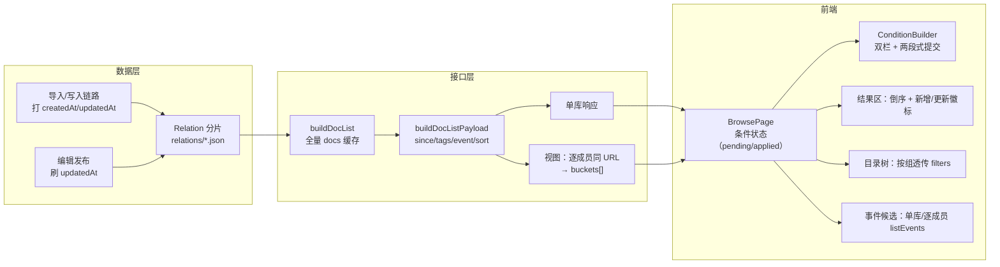
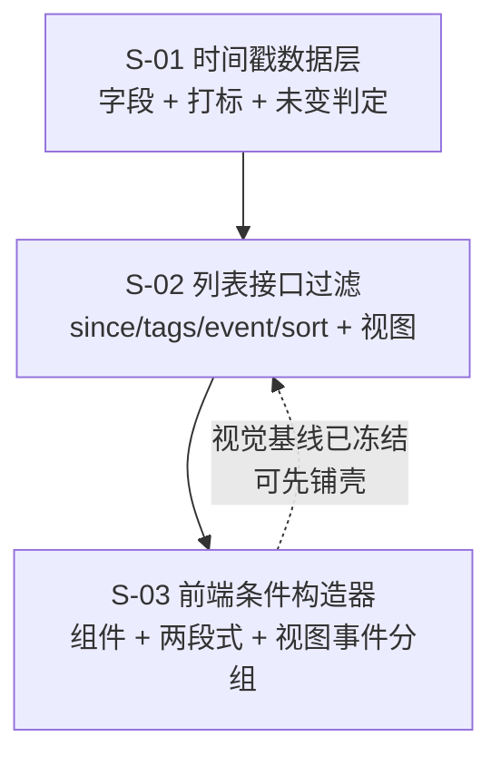

# 浏览页筛选改造（时间 / 标签 / 事件 · 条件构造器）· 技术设计

> 需求输入：PM 报告（2026-11-20）+ 已定稿视觉 demo `demo/browse-filter-builder/index.html`
> 子文档：`S01_timestamp_DESIGN.md`、`S02_doclist-filter_DESIGN.md`、`S03_condition-builder_DESIGN.md`

## 1. 需求背景 & 目标

浏览页（`web/src/pages/BrowsePage.tsx`）现有筛选只有「全部标签」下拉与搜索框，且两者各自独立。用户需要按「最近 N 小时内**新增或修改**的文档」过滤，并顺手查看某个事件沉淀了哪些文档。**关键约束：筛选必须支持视图（一个视图 = 多个成员库）。**

现状硬约束：`Relation` 与 doc list 均无创建/修改时间（`src/lib/scoring.ts:23-76`、`src/lib/mcp-http-api.ts:581-593`），因此本需求**必须先补数据层**，不是纯前端改造。

目标：
1. 文档具备 `createdAt` / `updatedAt`，且**内容未变的重复导入不刷新**（否则一次全目录重导会把全库刷成"刚刚更新"）。
2. `/api/doc/list` 支持 `since` / `tags` / `event` / `sort`，**逐成员生效**，单库与视图同口径。
3. 浏览页把两个筛选器合并为单一入口「+ 添加条件」，两段式提交（Enter 确认本条 / Ctrl+Enter 应用全部）。

**不在范围内**：MCP 工具（`ki_search` / `ki_event_list`）增加时间过滤参数；"只看新增"与"只看修改"分开过滤；自定义时间区间；筛选进 URL 深链；事件**参考文档**（`refs.json`）过滤。

## 2. 关键环节一览图

## 3. 总体方案设计

**共享术语速查**

| 术语 | 定义 | 权威位置 |
|---|---|---|
| `createdAt` | 文档**首次进入本库**的毫秒时间戳；老数据缺省 = 未知（不臆造） | S-01 §4 |
| `updatedAt` | 文档**正文内容**最近一次变更的毫秒时间戳；元数据变更（分类/期限/可见性/事件绑定/置顶）**不刷新** | S-01 §5 |
| 内容未变 | 覆盖导入时新正文与库内正文等价（复用 `isContentUnchanged`，含 tags/分片/scope 口径） | S-01 §3.2 |
| `since` | 时间窗口枚举 `1h/6h/24h/7d`，命中判据 = `max(createdAt, updatedAt) ≥ now - 窗口` | S-02 §3.2 |
| 事件成员 | `Relation.eventId` 指向的文档（仅 `lifecycle='event'`）；**不含** `refs.json` 里的参考文档 | S-02 §3.4 |
| 视图逐成员 | 视图请求对每个成员库用**同一个 URL** 各跑一次过滤，结果按成员分桶 | S-02 §5 |
| 已确认 / 已生效 | 面板内累积的条件（Enter 写入） / 真正参与请求的条件（Ctrl+Enter 应用） | S-03 §3.2 |

## 4. 全局风险 & 跨子需求依赖

### 4.1 跨子需求共享契约（本节为权威，子文档引用不得改写）

**数据字段（S-01 产出，S-02/S-03 消费）**

| 契约项 | 定义 |
|---|---|
| `Relation.createdAt?: number` | 首次进入本库的毫秒时间戳；老数据缺省 = 未知 |
| `Relation.updatedAt?: number` | 正文最近变更的毫秒时间戳；元数据变更不刷新 |

**接口（S-02 产出，S-03 消费）**

| 契约项 | 定义 |
|---|---|
| `GET /api/doc/list` 参数 | `tags`（逗号 OR）、`since`（`1h/6h/24h/7d`）、`event`（`evt_xxx` \| `none`）、`sort`（`default` \| `recent`）；非法 `since`/`sort` → 400 |
| `docs[]` 字段 | 增 `createdAt?` / `updatedAt?` / `eventId?`，其余字段与排序语义不变 |
| `undatedExcluded?: number` | 仅 `since` 存在时返回；视图下**按桶**返回，前端累加 |
| 视图响应 | `{ ok, view, members, buckets[], tags }` 结构不变；过滤逐成员生效 |

| # | 风险 | 影响 | 缓解 |
|---|---|---|---|
| R1 | **写路径漏打标** | 该路径新增的文档永远不出现在时间筛选里，且无报错 | S-01 §5 打标矩阵逐条实现 + 每条一个单测；`writeGroupCache` 的 copy 路径加"保留两字段"断言 |
| R2 | 元数据写覆盖时间字段 | 用户点一次分类/置顶就把文档顶成"最近更新" | 所有 `writeGroupCache` 调用点用 spread 保留原值；`trash-service` 恢复保留原时间 |
| R3 | 视图下事件候选 N 次请求 | 成员多时慢/部分失败 | 并发上限 4、单成员失败只禁该库选项并提示 |
| R4 | 老数据无时间 | 上线首日筛出 0 篇，被误认为文档丢失 | 结果区与空态显式写「另有 N 篇历史文档无时间记录，已排除」 |

**依赖与验收映射**

| 子需求 | 依赖 | 承接验收项（可执行） |
|---|---|---|
| S-01 | 无 | 连导两次 `updatedAt` 不变；改一字重导仅该篇变；改分类/置顶不变；老文档字段保持缺省 |
| S-02 | S-01 | 单库 `since=6h` 条数 = 构造数据期望值；`tags=a,b` 为 OR；视图 buckets 各桶独立过滤且 `total` 为过滤后计数 |
| S-03 | S-02 | demo 8 态 + 键盘 6 步复现；视图下事件值按库分组；切库后失效事件 chip 标红 |
