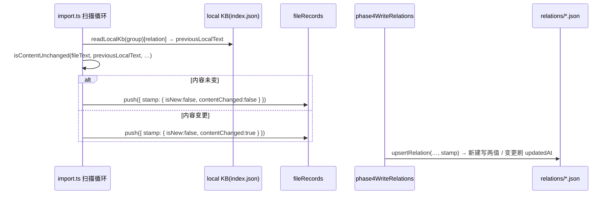

# S-01 时间戳数据层

> 父文档：`DESIGN.md` ｜ 依赖：无 ｜ 被依赖：S-02

## 1. 术语

| 术语 | 定义 |
|---|---|
| `createdAt` | 文档**首次进入本库**的毫秒时间戳。老数据缺省 = 未知，**不臆造、不回填** |
| `updatedAt` | 文档**正文内容**最近一次变更的毫秒时间戳 |
| 内容变更 | 新正文与库内正文不等价（判定见 §3.2），含 tags 变更 |
| 元数据变更 | 分类 / 期限 / 可见性 / 事件绑定 / 置顶 / 回收站状态等，**不刷新** `updatedAt` |
| 未知时间 | `createdAt` / `updatedAt` 均为 `undefined` 的老数据 |

## 2. 现状（AS-IS）

| 事实 | 位置 |
|---|---|
| `Relation` 有 `lastUsedTime`（最近被**读取**）与 temp 的 `expiresAt`，**无 created/updated** | `src/lib/scoring.ts:23-76` |
| doc list 装配只透出 `name/group/path/tags/vectorized/fullTextIndexed/groupSource` | `src/lib/mcp-http-api.ts:581-593` |
| `GroupCacheDoc.updatedAt` 是**组级**字段且恒写 `null`（不可复用） | `src/lib/group-cache.ts:106-112`、`:428/:499/:679/:724` |
| 正文按组存单文件 `index.json`（`relation → content` 字典），**无文档级文件**，取不到 FS mtime | `src/lib/scope.ts:115-118` |
| 导入已具备 created/modified 记账，且已有内容等价判定 `isContentUnchanged` | `src/lib/import.ts:1108-1114`、`:1398-1420`、`:1421-1427` |
| 关系元数据落盘 chokepoint = `phase4WriteRelations` → `upsertRelation` | `src/lib/import.ts:2784-2810`、`:2579-2633` |
| 其他新建/写入点 | `src/sync-relation.ts:241`、`src/lib/store.ts:176`、`src/lib/relation-edit-publish.ts:264`、`src/lib/trash-service.ts:218-219` |

**结论**：必须先补字段，且必须解决"覆盖导入不许无条件刷新时间"否则功能自废（一次全目录重导 = 全库"刚刚更新"）。

## 3. 方案（TO-BE）

### 3.1 字段定义

`src/lib/scoring.ts` 的 `Relation` 追加（可选、毫秒）：

```ts
/**
 * 首次进入本库的毫秒时间戳（REQ-20261120-001）。
 * 老数据缺省 = 未知：读取侧不得兜底成 0 / now，`since` 过滤时一律不命中。
 */
createdAt?: number;
/**
 * 正文内容最近一次变更的毫秒时间戳。
 * **元数据变更不刷新**（分类 / 期限 / 可见性 / 事件绑定 / 置顶 / 回收站恢复），
 * 否则用户点一次治理操作就把文档顶成"最近更新"，噪音压掉真实变更。
 */
updatedAt?: number;
```

### 3.2 覆盖判定：复用现成的内容比较

现状 `isContentUnchanged()` 只在 `conflictMode === 'incremental' && vector` 时才调用（`import.ts:1400`），默认覆盖模式**不比内容**。

改造：在扫描循环的 `overwrite` 分支**无条件先判一次**（同一 helper、同一入参口径：`fileText` / `previousLocalText` / `previousRelationSnapshot` / `entries` / `customTags` / `scope`），结果随记录下传：

```ts
const contentUnchanged = resolution.action === 'overwrite'
  ? isContentUnchanged({ fileText, previousLocalText, previousRelation: previousRelationSnapshot, entries, tags: customTags, scope })
  : false;
// 传给 fileRecords / phase4
const stamp = {
  isNew: resolution.action === 'create' || resolution.action === 'suffix',
  contentChanged: resolution.action === 'overwrite' && !contentUnchanged,
};
```

- 增量模式既有的 `continue`（`:1408-1419`）保持不变：不落库 ⇒ 自然不刷时间。
- `resolution.action === 'skip'` 的文件已在更早处 `continue`，不参与打标。

### 3.3 落盘打标（`upsertRelation`）

```ts
function upsertRelation(cache, groupPath, relationText, memoryIds, sourcePath, tags, identity, stamp) {
  const now = Date.now();
  if (!rel) {
    rel = { ..., createdAt: now, updatedAt: now };
  } else {
    if (stamp?.isNew) { /* 不会发生：新建走上面分支 */ }
    if (stamp?.contentChanged) {
      rel.updatedAt = now;
      if (rel.createdAt === undefined) rel.createdAt = now; // 首次具备时间能力时补锚点
    }
    // 内容未变：两个字段一概不写（缺省保持缺省）
  }
}
```

> `createdAt` 缺失且发生内容变更时补 `now`：该文档"从这一刻起时间可知"，语义是**下限而非真实创建时间**；展示侧不区分（新增/更新徽标按 `updatedAt - createdAt` 判定，补锚点后会被判为"更新"，符合事实）。

### 3.4 打标矩阵（实现与验收共用）

| 写路径 | 位置 | 新建 | 覆盖·内容变 | 覆盖·未变 | 元数据变更 |
|---|---|---|---|---|---|
| 文件导入 | `src/lib/import.ts:1311-1314 / 1421-1427 / 2784-2810` | 两值 = now | 只刷 `updatedAt` | **不动** | — |
| MCP `ki_sync_relation` | `src/sync-relation.ts:241` 及覆盖分支 | 两值 = now | 只刷 `updatedAt`（内容必然变） | — | — |
| `ki_store` / bulk | `src/lib/store.ts:176` | 两值 = now | — | — | — |
| 编辑器发布 | `src/lib/relation-edit-publish.ts:264` | 两值 = now | 保留 `createdAt`，刷 `updatedAt` | — | — |
| 回收站恢复 | `src/lib/trash-service.ts:218-219` | 原样保留 | 原样保留 | 原样保留 | — |
| 分类 / 期限 | `src/lib/relation-lifecycle.ts:282` | 保留 | 保留 | 保留 | **不刷新** |
| 可见性摘/挂索引 | `src/lib/visibility-queue.ts:111`、`src/lib/visibility-index.ts:345` | 保留 | 保留 | 保留 | **不刷新** |
| 事件成员绑定/解绑 | `src/lib/events/members.ts:266 / 329`、`event-service.ts:643 / 770` | 保留 | 保留 | 保留 | **不刷新** |
| 置顶 / 阶段流转 | `src/lib/events/event-service.ts` | 保留 | 保留 | 保留 | **不刷新** |

**硬要求**：以上"保留"路径全部走 `{ ...rel, ...patch }` 展开；若某处重新构造 Relation 对象，必须显式带上两字段。S-01 需为 `writeGroupCache` 家族补一条"元数据写不改变时间字段"的单测。

## 4. 数据模型

`Relation`（存于 `<dataDir>/<scope>/relations/<group>.json` 分片，JSON 无 schema 迁移）：

| 字段 | 类型 | 必填 | 含义 | 老数据 |
|---|---|---|---|---|
| `createdAt` | `number`（ms） | 否 | 首次进入本库 | 缺省 = 未知 |
| `updatedAt` | `number`（ms） | 否 | 正文最近变更 | 缺省 = 未知 |

**迁移策略**：无脚本、无回填。分片 JSON 直接多两个可选键；读取侧（`readGroupCache` / `buildDocList`）原样透传 `undefined`，不做兜底。

## 5. 关键时序（覆盖导入）



## 6. 关键决策

| # | 决策 | 被否决方案 | 否决理由 | 重新评估触发条件 |
|---|---|---|---|---|
| D1 | 时间 = 写入本库 / 内容变更时刻 | 用源文件 mtime | 目录整体同步会把全库群刷成"刚刚新增"；正文按组存单文件，取不到文档级 mtime | 若日后改为**文档级文件存储**（一文档一文件），可改读 mtime 作为 `createdAt` 近似 |
| D2 | 复用 `isContentUnchanged` 做覆盖判定 | 新增 `contentHash` 字段 | 现成比较已覆盖 tags/分片/scope 口径；新增 hash 需要老数据二次迁移且无收益 | 单篇正文 > 5MB 且比较耗时实测 > 50ms/篇时再引入 hash |
| D3 | 未知时间不命中 `since`，且不兜底 | 缺省按 `now` 视为"最近" | 会把 208 篇老文档一次性判为最近，噪音且误导 | 若用户明确要求"历史文档也参与"，改为一次性回填并在 UI 标注"近似" |

## 7. 异常处理

| 场景 | 行为 | 是否对外暴露 |
|---|---|---|
| `index.json` 读取失败 / 内容缺失 | 视为"内容变更"，正常刷 `updatedAt`，记 `logWarn` | 否（日志） |
| `previousLocalText` 缺失（老数据 / rebuild） | 视为变更 | 否 |
| 时间字段为未来值（时钟回拨 / 迁移） | 原样保留，不做纠正；过滤判定仍用 `max()`，会命中 | 否 |
| 同批多文件命中同一 relation（冲突策略链） | stamp 合并：`isNew` 取首个生效项，`contentChanged` 取 OR；被顶掉的记录按现有逻辑撤销 | 否 |
| 进程在 `phase4` 前中断 | 时间未写 → 下次导入按"内容未变"处理（不刷新），无脏数据 | 否 |

## 8. 影响范围

```
src/
├── lib/
│   ├── scoring.ts                 [修改] Relation 增 createdAt / updatedAt
│   ├── import.ts                  [修改] 内容未变判定下沉到 overwrite 分支；fileRecords 带 stamp；phase4 透传
│   ├── group-cache.ts             [只读校验] 确认元数据 copy 保留两字段
│   ├── relation-lifecycle.ts      [校验] 不刷新时间
│   ├── relation-edit-publish.ts   [修改] 发布刷 updatedAt
│   ├── trash-service.ts           [校验] 恢复保留原值
│   ├── visibility-queue.ts        [校验]
│   ├── visibility-index.ts        [校验]
│   └── events/{members,event-service}.ts [校验]
├── sync-relation.ts               [修改] 新建写两值；覆盖刷 updatedAt
└── lib/store.ts                   [修改] ki_store 新建写两值
test/
└── timestamp-stamp.test.ts        [新增] 打标矩阵 9 条 + 覆盖未变回归
```

## 9. 验收标准（可执行）

1. 同一目录连续导入两次：第二次所有文档 `updatedAt` 与 `createdAt` **不变**。
2. 修改 1 个文件一字后重导：仅该篇 `updatedAt` 变化，其余不变。
3. 对文档改分类 / 置顶 / 绑事件 / 摘挂可见性：两个时间字段**均不变**。
4. 回收站恢复：两字段与删除前一致。
5. 老数据（无字段）经一次内容变更后：`createdAt` = 变更时刻、`updatedAt` = 变更时刻；内容未变的覆盖**不补字段**。

## 10. 待定

无。（`GroupCacheDoc.updatedAt`（组级、恒 `null`）本期**不动**，避免把"组级"与"文档级"两个语义混在一个改动里。）
