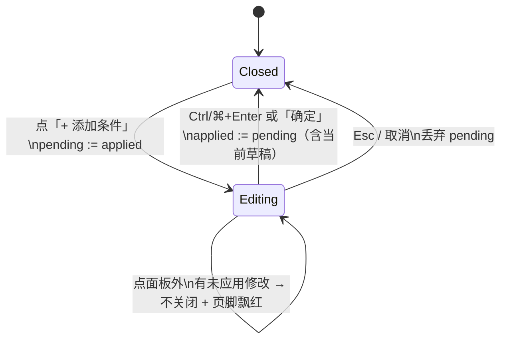

# S-03 前端条件构造器（两段式提交 · 视图事件候选）

> 父文档：`DESIGN.md` ｜ 依赖：S-02 契约 ｜ 视觉基线：`demo/browse-filter-builder/index.html`（已确认）

## 1. 术语

| 术语 | 定义 |
|---|---|
| 条件（filters） | `{ since?, tags: string[], event? }`，即真正参与请求的筛选集合 |
| 草稿（draft） | 当前字段正在编辑、尚未按 Enter 的选择 |
| 已确认（pending） | 面板内「已确认 N」条累积的条件，**尚未生效** |
| 已生效（applied） | `BrowsePage` 持有的条件，参与请求与结果展示 |
| 两段式提交 | Enter = 确认本条（写入 pending，面板不关、结果不刷）；Ctrl/⌘+Enter 或「确定」= 应用全部（pending → applied，关闭 + 刷新） |

## 2. 现状（AS-IS）

| 事实 | 位置 |
|---|---|
| 工具栏 = `TagSelect` + 搜索框 + 清空 + 宽度切换 | `web/src/pages/BrowsePage.tsx:1615-1659` |
| 标签下拉是单值选择（点选即生效并收起） | `web/src/components/TagSelect.tsx:54-57`、`:108-133` |
| 筛选状态**不进 URL**，URL 只承载阅读位置 | `web/src/lib/browseUrl.ts:19-33` |
| 阅读态整行工具栏让位给查看器头部（再叠一行会永久吃掉正文高度） | `BrowsePage.tsx:1607-1613`、`ki.css:1929-1939` |
| 目录树计数**刻意不随筛选变**，叶子按 `useGroupDocs(scope, group, tag)` 取数 | `BrowsePage.tsx:808-817`、`hooks.ts:199-207` |
| 结果区复用搜索面板容器（`ki-browse-fulltext__row` 等），无独立"最近变更"列表 | `BrowsePage.tsx:1032-1063` |
| 事件候选接口按**单库**查询（治理端点无视图逻辑） | `web/src/api/governanceApi.ts:213-225` |

## 3. 方案（TO-BE）

### 3.1 文件与职责

```
web/src/
├── components/
│   ├── ConditionBuilder.tsx   [新增] 双栏面板 + 键盘 + 两段式状态机
│   └── ConditionChips.tsx     [新增] 已生效条件行 / 阅读态「筛选 · N」徽标
├── lib/
│   ├── browseFilters.ts       [新增] BrowseFilters 类型 / 归一化 / 判空 / query 参数组装
│   └── useEventOptions.ts     [新增] 事件候选（单库 1 次 / 视图逐成员合并）
├── pages/BrowsePage.tsx       [修改] 持有 applied 条件、结果区、树透传、阅读态折叠
├── api/httpApi.ts             [修改] DocItem 字段 + getDocList 参数
├── lib/hooks.ts               [修改] useGroupDocs 参数与 queryKey
└── styles/ki.css              [修改] 新增 `.ki-cond-*` 段（token 全用既有 --ki-*）
```

### 3.2 状态机



**关键规则**（与 demo 逐条一致）：

1. `pending` 初始 = `applied` 的副本；面板关闭后丢弃。
2. Enter 只写 `pending`，**不动 applied、不刷新结果**。
3. 应用时**接管当前字段尚未 Enter 的草稿**（保证"看到什么就应用什么"）。
4. 单选字段（时间/事件）首次确认后自动跳到下一个未确认字段；多选（标签）留在原地继续勾。
5. `pendingDirty()` = pending 与 applied 差异 **或** 当前字段草稿与 pending 差异。

### 3.3 键盘

| 键 | 字段栏 | 取值栏 |
|---|---|---|
| `↑` / `↓` | 切换字段（右侧取值同步） | 换选项（循环） |
| `←` / `→` | → 进入取值栏 | ← 回到字段栏 |
| `Enter` | 进入取值栏 | **打钩高亮项（幂等）+ 确认本条** |
| `空格` | — | 只选中 / 切换勾选，不确认 |
| `Ctrl/⌘+Enter` | 应用全部 | 应用全部 |
| `Esc` | 取消并关闭，焦点回「添加条件」 | 同 |

> DOM 焦点常驻面板搜索框（可继续打字过滤字段/取值），高亮用 `.is-focused` + `aria-activedescendant` 表达。

### 3.4 结果区 / 目录树 / 计数

| 区域 | 行为 |
|---|---|
| 结果区 | 条件非空时展示「最近变更」平铺列表：按 `sort=recent` 倒序，行内「新增 / 更新」徽标 + 相对时间 + 事件徽标；头部 `命中 N 篇 · 新增 X / 更新 Y`；`undatedExcluded > 0` 时追加「另有 N 篇历史文档无时间记录，已排除」 |
| 目录树 | `useGroupDocs(scope, group, filters)` —— 叶子随条件减少；**计数不变**（既有口径，视图各桶同理） |
| 空态 | 列出生效条件 chips + 「放宽到 24 小时」（时间非 24h 时）+「清空全部条件」 |
| 阅读态 | 条件行不渲染，工具栏折成 `筛选 · N` 徽标（点开回落结果态） |
| URL | 本期**不写入**（与现有 `q`/`tag` 行为一致） |

### 3.5 视图支持（事件候选）

```
事件候选来源
├─ 单库：listEvents(scope, { status:'all', limit:100 })
└─ 视图：成员列表来自 /api/doc/list 响应 members（或视图成员 API）
   ├─ 并发上限 4，逐成员 listEvents(member, …)
   ├─ 按成员库分组渲染：`kisearch-memory · 未收口` / `kisearch-xperts · 未收口` / 已收口
   └─ 单成员失败 → 该组显示「该库事件加载失败」，不禁用其余库
```

- `event` 条件在切换库/视图后若不在任一成员集合 → **chip 标红**（`aria-label` 与 tooltip 说明"该事件不属于当前库"），条件**不自动清除**，结果为空时由空态解释。
- `event=none`（未关联任何事件）作为固定项，任何模式下都可用。

### 3.6 与接口的对接

```ts
// browseFilters.ts
export interface BrowseFilters { since?: '1h'|'6h'|'24h'|'7d'; tags: string[]; event?: string }
export const EMPTY_FILTERS: BrowseFilters = { tags: [] };
export function toDocListParams(f: BrowseFilters): { since?: string; tags?: string; event?: string; sort?: 'recent' };
export function isFilterEmpty(f: BrowseFilters): boolean;

// hooks.ts
export function useGroupDocs(scope: string, group: string | null, filters: BrowseFilters) {
  return useQuery({
    queryKey: ['docList', scope, 'group', group ?? '', filters.since ?? '', filters.tags.join(','), filters.event ?? ''],
    queryFn: () => fetchGroupDocsAll(scope, group ?? '', filters),
    enabled: !!group,
    staleTime: 30_000,
  });
}
```

> 条件 → queryKey 必须**完整参与**，否则切换条件不会重新取数（视图与单库同病）。

## 4. 界面（已确认，原图内嵌）

```
┌─ 文档内容 ────────────────────────────────────────────────────────────────┐
│ [+ 添加条件]  [🔍 搜索全库文档…                                  ✕] [清空] [居中|铺满] │
│ 时间: 最近 6 小时 ×    标签: api ×    事件: #48 事件页改版 ×                │
│ ───────────────────────────────────────────────────────────────────────── │
│ 命中 12 篇 · 新增 5 / 更新 7                                               │
│ ① 收尾汇报定为四要素固定格式             新增 · 2 小时前 · #48          ⧉ │
│ ② 事件页左列表改版                       更新 · 5 小时前 · #48          ⧉ │
│ 另有 196 篇历史文档无时间记录，已排除 ⓘ                                     │
└───────────────────────────────────────────────────────────────────────────┘

  点「+ 添加条件」→ 双栏面板
   ┌──────────────────────── 添加条件 ─────────────────────────────────────┐
   │ ⌕ 请输入关键字（过滤字段与取值）                                      │
   ├──────────────────────┬───────────────────────────────────────────────┤
   │ ● 时间       单选    │ ○ 不限（移除该条件）                          │
   │ ● 标签       多选    │ ○ 最近 1 小时                                 │
   │ ○ 事件       单选    │ ● 最近 6 小时        已生效                   │
   │                      │ ○ 最近 24 小时 / 7 天                          │
   ├──────────────────────┴───────────────────────────────────────────────┤
   │ 已确认 3   时间: 最近 6 小时 ×   标签: api ×   事件: #48 … ×           │
   ├──────────────────────────────────────────────────────────────────────┤
   │ Enter 确认本条  Ctrl/⌘+Enter 应用全部  Esc 取消      [取消] [确定 Ctrl↵] │
   └──────────────────────────────────────────────────────────────────────┘
```

（字段圆点 = 已确认；`已确认 N` 条可单条 × 移除；阅读态折叠为「筛选 · N」徽标。）

## 5. 异常处理

| 场景 | 行为 | 是否对外暴露 |
|---|---|---|
| 事件候选加载失败（单库/某成员） | 事件字段置灰 + 原因；标签与时间仍可用 | 是 |
| 当前库无事件 | 「事件」字段置灰 + 「当前库暂无事件」 | 是 |
| `event` 指向的事件已不属于当前库/视图 | chip 标红 + tooltip；条件保留 | 是 |
| 有未应用修改时点面板外 | 不关闭 + 页脚飘红「还有未应用的修改：Ctrl/⌘+Enter 应用全部，Esc 放弃」 | 是 |
| 应用后后端返回 400（理论不可达，取值由前端枚举控制） | 保留 `applied` 不变 + 顶部错误提示，不静默降级 | 是 |
| 结果为空 | 空态列出生效条件 + 放宽/清空入口 | 是 |
| 应用时正文已打开（阅读态） | 保持阅读态，条件生效只影响背后结果集；徽标数字更新 | 否 |

## 6. 关键决策

| # | 决策 | 被否决方案 | 否决理由 | 重新评估触发条件 |
|---|---|---|---|---|
| D9 | 焦点常驻搜索框 + `is-focused` 高亮（命令面板模式） | DOM 焦点真实移动到各选项 | 真实移动会让"边导航边打字过滤"失效（输入法/焦点丢失），且需自行重建 Tab 顺序 | 需要完整屏幕阅读器支持（实际焦点遍历）时改用 listbox 焦点模型 |
| D10 | 有未应用修改时**点外部不关闭** | 点外部 = 静默丢弃 | 用户按若干次 Enter 后手一碰外面全丢，属不可恢复的数据丢失 | 引入草稿持久化（localStorage）后可改回"关闭保留草稿" |
| D11 | 标签多选、时间/事件单选 | 全部多选 | 两个时间窗 OR/AND 语义不明（"6 小时 或 24 小时"=24 小时，无意义） | 无 |
| D12 | 本期筛选不进 URL | 条件进 URL 便于分享 | 与现有 `q`/`tag` 口径不一致；`browseUrl` 只承载阅读位置，混入筛选会引发深链接回放冲突 | 用户明确要求分享筛选链接时，扩展 `browseUrl` 白名单并回归深链接 |

## 7. 影响范围

```
web/src/
├── components/ConditionBuilder.tsx   [新增] 约 320 行（面板 + 键盘 + 状态机）
├── components/ConditionChips.tsx     [新增] 约 90 行
├── lib/browseFilters.ts              [新增] 约 60 行
├── lib/useEventOptions.ts            [新增] 约 80 行（逐成员并发 + 合并）
├── lib/hooks.ts                      [修改] useGroupDocs 签名与 queryKey
├── api/httpApi.ts                    [修改] DocItem 三字段 + getDocList 四参数
├── pages/BrowsePage.tsx              [修改] 条件状态、结果区、树、阅读态、清空
└── styles/ki.css                     [修改] 新增 `.ki-cond-*`（约 120 行，token 化）
web/test/
├── condition-builder.test.mjs        [新增] 状态机 / 键盘 / 两段式（≥ 10 例）
└── browse-filters.test.mjs           [新增] 归一化 / 参数组装 / 失效判定（≥ 6 例）
```

## 8. 验收标准（可执行）

1. demo 的 8 个状态在真实页面复现（默认 / 结果 / 面板三字段 / 空态 / 阅读态 / 视图分组 / 暗色 / 375 窄屏）。
2. 键盘：打开 → `↓↓ Enter` 只改变「已确认」，页面条件与结果不变；`Ctrl+Enter` 后才变；`Esc` 放弃；有未应用修改点外部不关闭。
3. 视图：事件取值按成员库分组；某成员事件接口失败只禁用该组。
4. 切换 scope：条件保留；失效事件 chip 标红；目录树计数不变、叶子按条件减少。
5. 老数据：选时间条件后结果区显示「另有 N 篇历史文档无时间记录，已排除」，`N` 与接口 `undatedExcluded` 累加值一致。
