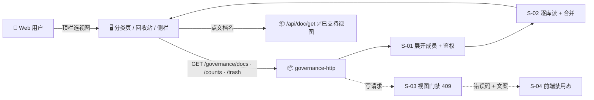
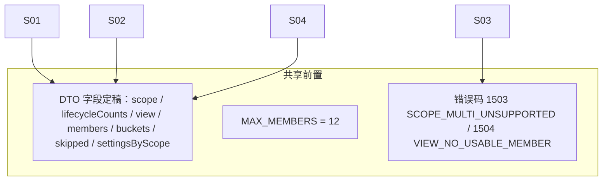

# 治理页视图聚合 · 父设计文档

- 需求：REQ-20261120-001
- 状态：草案（布局图已按用户「直接给出全部设计文档」授权代定并视为确认）
- 子文档：S01 / S02 / S03 / S04（本目录）
- 实施计划：`IMPL_PLAN.md`

## 1. 需求背景 & 目标

顶栏 `ScopeSelect` 允许把「知识视图」当成 scope 选中（`web/src/components/ScopeSelect.tsx:37`），但知识治理的读接口从未接视图展开：`src/lib/governance-http.ts` 全文零视图逻辑，`scopeFromQuery()`（`:472-476`）把视图名原样返回，下游 `readAllGroupCaches` / `readAllEvents` / `listTrash` 按物理目录读 → 恒为空且不报错。表现为分类页四档计数全 0、侧栏「分类/事件/回收站」全 0。

**目标**：视图下分类页、侧栏计数、回收站页**只读合并**展示各成员库数据；写操作一律禁用并给出可执行提示；成员库部分不可用时如实暴露。

**不在范围内**：事件页合并（待定，shortId 口径先记为 `#3 · 库名`）、MCP 事件工具、`/governance/docs/search`、`/governance/diagnostics`、视图内任何写操作。

## 2. 关键环节一览图

## 3. 总体方案设计

**共享术语速查**（各子文档不重复定义）

| 术语 | 定义 | 权威位置 |
|---|---|---|
| 视图（view） | 命名的有序 scope 列表，只在读路径上充当 scope，不落盘 | `src/lib/scope-view.ts:4-11` |
| 成员库（member） | 视图展开后的物理 scope，一切 IO 只能落在它上面 | `scope-view.ts:844` |
| 桶（bucket） | 单个成员库的读取结果摘要 `{scope,total,error?}`，用于失败隔离与截断提示 | 本需求 S02 |
| 条目 scope | 文档/回收站条目所属的物理库名，视图响应的每条必带 | 本需求 S02 |
| 条目键 | `scope\0group\0name` 三段复合键，替代原 `group\0name` | 本需求 S04 |
| 单库响应 | `view` 缺省的响应结构，语义与改造前一致（仅新增字段） | 本需求 S02 |
| 合并分页 | 视图下 `limit/offset` 作用于合并后的列表，各库先各取 `limit` 条 | 本需求 S02 |
| 只读聚合 | 视图不可写；写请求统一 409 `VIEW_NOT_WRITABLE` | `src/lib/scope-policy.ts:279-291` |

## 4. 全局风险 & 跨子需求依赖

| 风险 | 说明 | 缓解 |
|---|---|---|
| **鉴权升级是安全红线** | 现 `assertScope` 只比名字（`governance-http.ts:466-470`）；合并后若沿用，token 授权视图名即可读未授权成员库 | S-01 统一走 `isScopeAccessAllowed`（视图 ∧ 全成员），失败 403 |
| **响应兼容** | 前端可能连旧 daemon（无新字段） | 新增字段全部可选；单库响应语义不变；前端缺失即回退 |
| **跨库同名** | `group+name` 不再唯一（浏览页已踩过，见 `viewBuckets.ts:1-11`） | 条目加 `scope`；前端键改三段 |
| **截断失真** | 列表 200 上限，分档计数若用 `docs.length` 会偏低 | 服务端新增 `lifecycleCounts`（全量统计） |
| **性能** | N 个成员库各一次 `readAllGroupCaches` | 成员 ≤12；未实测前不设时间预算，实测后按需补 |
| **两处裸写** | presets / trash-settings 不经写锁，`walWrite` 会 `mkdirSync` 建出视图名目录 | S-03 补 `assertNotScopeView` |

**子需求依赖**：S-01 → S-02 → S-04；S-03 独立但与 S-02 同文件（`governance-http.ts`）→ 只能串行。
