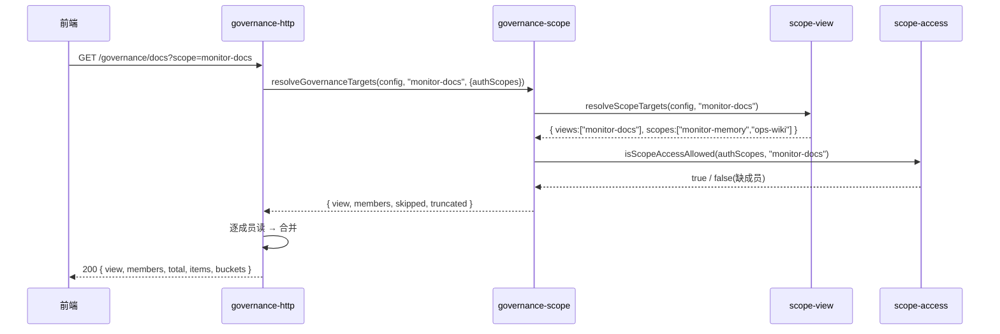

# S-01 视图范围解析与鉴权

父文档：`DESIGN.md` ｜ 依赖：无（根子需求）

## 1. 术语

| 术语 | 定义 |
|---|---|
| 请求值 | 治理端点收到的 `scope` 原始字符串，可能是库名或视图名 |
| 展开 | 用 `resolveScopeTargets` 把视图名换成成员库列表，只在读路径发生 |
| 多段请求 | `scope=a,b` 形式；治理页无此 UI 语义，本期直接拒绝 |

## 2. 现状（AS-IS）

`src/lib/governance-http.ts:465-489`：

```ts
const assertScope = (scope: string): void => {
  if (ctx.authScopes && !ctx.authScopes.includes(scope)) {
    throw new GovernanceError('FORBIDDEN_SCOPE', `无权访问 scope「${scope}」`, { scope });
  }
};
const scopeFromQuery = (): string => {
  const scope = str(q.get('scope')) ?? 'default';
  assertScope(scope);
  return scope;            // ← 原样返回，视图名不展开
};
```

**问题**：

1. 视图名被当物理库名传给 `readAllGroupCaches` / `readAllEvents` / `listTrash` / `readGovernance` → 空；
2. `assertScope` 只做**名字比对**：token 被授权视图名时放行，但成员库可能未授权 —— 一旦合并读发生即越权（`src/lib/scope-access.ts:4-19` 记录过同一坑）。

## 3. 方案（TO-BE）

新增 `src/lib/governance-scope.ts`，作为治理域**唯一**的范围解析入口：

```ts
import { loadConfig, type KiConfig } from './config.js';
import { resolveScopeTargets, isViewRequest } from './scope-view.js';
import { isScopeAccessAllowed, missingViewMembers } from './scope-access.js';
import { GovernanceError } from './governance-errors.js';

/** 单次合并的成员库上限（与 recall 的 MAX_PHYSICAL 同口径） */
export const MAX_MEMBERS = 12;

export interface GovernanceTargets {
  requested: string;
  view: string | null;
  members: string[];
  skipped: { scope: string; reason: string }[];
  truncated: boolean;
}

export function resolveGovernanceTargets(
  config: KiConfig,
  raw: string | undefined,
  opts: { authScopes: string[] | null },
): GovernanceTargets;
```

**行为表**

| 输入 | 输出 / 行为 |
|---|---|
| 空 / 未传 | `requested='default'`、`view=null`、`members=['default']` |
| 真实库名 | `view=null`、`members=[库名]`；沿用现有 `assertScope` 语义 |
| 视图名 | `view=视图名`、`members=展开后的成员库`、鉴权走 `isScopeAccessAllowed` |
| 多段（含逗号） | 抛 `SCOPE_MULTI_UNSUPPORTED`（400） |
| 视图成员为空 | `resolveScopeTargets` 抛 `ViewError('VIEW_EMPTY')` → 调用方映射 400 |
| 成员全被 strict 跳过 | 抛 `VIEW_NO_USABLE_MEMBER`（400），`details.skipped` 给原因 |
| 成员 > 12 | 取前 12，`truncated=true`，其余进 `skipped`（`reason` 含「超出单次合并上限 12」） |
| 鉴权不足 | 抛 `FORBIDDEN_SCOPE`（403），`details.missingViewMembers` 给缺的成员 |

**为什么在治理域单开一个模块**（不直接改 `scopeFromQuery`）：治理端点有 12 个，其中写端点必须**保持**拿到真实库名（视图名要让写锁去拦，不能在这里被展开成成员库 —— 否则「视图下写操作」会静默落到第一个成员库）。读端点显式调用本模块，写端点维持原样。

### 关键决策点

| 决策 | 被否决方案 | 否决理由 |
|---|---|---|
| 读端点显式调 `resolveGovernanceTargets`，写端点不动 | 把 `scopeFromQuery` 全局改成展开 | 写端点会被展开成成员库 → 视图下写操作静默落到第一个成员库（数据写错库，比报错严重得多） |
| 多段 scope 直接 400 | 支持 `scope=a,view` 混排 | 治理页无此入口；支持等于同时引入「部分库 + 视图」的合并语义与鉴权混合，收益为零 |
| 成员上限 12 | 不设上限 | 成员 13 的视图（本机 `just-test`）会让一次分类页请求产生 13 次全量分片读；上限 + 显式截断提示可预期 |

## 4. 接口设计

### 4.1 内部函数

```ts
resolveGovernanceTargets(config: KiConfig, raw: string | undefined, opts: { authScopes: string[] | null }): GovernanceTargets
```

异常：

| 异常 | code | status | details |
|---|---|---|---|
| 多段请求 | `SCOPE_MULTI_UNSUPPORTED` | 400 | `{ scope: raw }` |
| 视图无可用成员 | `VIEW_NO_USABLE_MEMBER` | 400 | `{ view, skipped }` |
| 鉴权不足 | `FORBIDDEN_SCOPE` | 403 | `{ scope: view, missingViewMembers }` |
| 空视图 | `VIEW_EMPTY`（ViewError） | 400 | `{ members: [] }` |
| 视图文件损坏 | `VIEWS_CORRUPT`（ViewError） | 500 | — |

错误码登记（`src/lib/governance-errors.ts`，**新开 1700-1799 段**）：

```ts
SCOPE_MULTI_UNSUPPORTED: 1701,   // 多段 scope → 400
VIEW_NO_USABLE_MEMBER: 1702,     // 成员全被跳过 → 400
VIEW_EMPTY: 1703,                // 视图没有成员 → 400
VIEWS_CORRUPT: 1704,             // views.json 损坏 → 500
```

⚠ **不能塞进 1500-1599**：`test/governance-contract.test.ts` 断言「15xx 只放传输层错误（`DOC_NOT_FOUND` / `FORBIDDEN_SCOPE`）」，往该段加业务码会直接红。本次实施时先按 1503/1504 写、被该测试拦下后改为 17xx，并同步把契约测试的号段上限从 1699 扩到 1799。

`HTTP_STATUS` 只为 `VIEWS_CORRUPT: 500` 新增条目（其余三个默认 400，`httpStatusFor` 已兜底）。

### 4.2 调用时序



## 5. 异常处理

| 场景 | 行为 | 是否对外暴露 |
|---|---|---|
| `views.json` 损坏 | `ViewError('VIEWS_CORRUPT')` → 500，文案指路「修复或删除该文件」 | 是（不含成员清单） |
| 视图成员为 0 | 400 `VIEW_EMPTY` + 执行提示 `ki view add` | 是 |
| strict 下成员全未注册 | 400 `VIEW_NO_USABLE_MEMBER` + `details.skipped` | 是 |
| token 未授权某成员 | 403 `FORBIDDEN_SCOPE` + `details.missingViewMembers` | 是（只给名字，不给内容） |
| 成员数超上限 | 200 + `truncated:true` + `skipped` 说明 | 是 |

## 6. 待定问题

无。

> 已知边界（不进待定）：视图成员被管理员移除后，前端可能仍持有旧 `members` 展示文案 —— 每次请求都重新展开且不缓存，因此不会读到已移除成员的数据；页面刷新即自愈。
