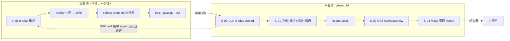
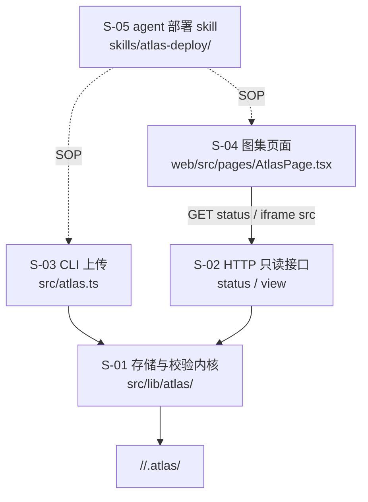
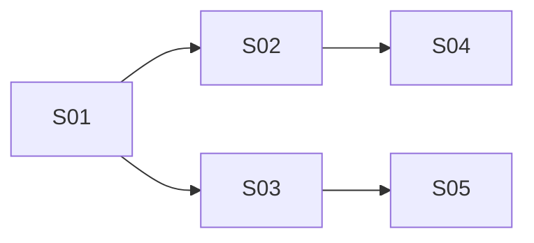

# 知识地图图集 · 技术设计（父文档）

> 需求基线：`requirement.md` v5 ｜ 验证基线：`demo/verify/verify-report.md`（19/19 通过）
> 一期范围：**CLI 上传 → 只读浏览**（用户拍板：`ki atlas upload` 验证通过后再做页面上传）

## 1. 需求背景 & 目标

**背景**：知识库回答得了「已知要找什么」，回答不了「这套系统大概长什么样」。图集由本地 `project-atlas` skill 生成（archify 出图 + 快照抽取 + 单文件烘焙），平台只负责**存、鉴权下发、嵌入浏览**。

**目标（可判定）**

| # | 目标 | 判定 |
|---|---|---|
| G1 | 一条命令把图集装进某个库 | `ki atlas upload --scope X --file pkg.zip` 退出码 0，`ki atlas status` 显示 exists |
| G2 | 浏览器能看到该库的图集 | `/atlas` 内 iframe 渲染出图，节点可点开代码快照 |
| G3 | 平台侧零渲染实现 | 新增代码只有：内核 + 2 个 GET + 1 个页面 + 1 个 CLI |

**不在范围内**：页面上传（二期）、平台内 IR→SVG 渲染、图集文字入检索、深链、暗色主题、MCP 工具。

## 2. 关键环节一览图

## 3. 总体方案设计

**共享术语速查**

| 术语 | 含义 |
|---|---|
| 部署包 | `.zip`，根目录含唯一 `.html`（entry）与可选 `meta.json` |
| entry | 包内被解出并下发的那一个 html |
| 基线 | 生成时的 `branch@commit`，与生成时间一起展示，用于判断过期 |
| 快照 | entry 内嵌的代码片段（生成时抓取，不代表 HEAD） |
| 内核 | `src/lib/atlas/`，所有读写能力的唯一实现 |

## 4. 全局风险 & 跨子需求依赖

**关键决策点**

| # | 决策 | 被否决方案 | 否决理由 | 重新评估触发条件 |
|---|---|---|---|---|
| D1 | 部署包用 **zip** | 单个 `.html` | 未来要带多文件（多语言/关联图/README），单文件无法承载 | 包内永远只有 1 个文件时 |
| D2 | zip 解析 **零依赖自研** | 引入 `yauzl` / `adm-zip` | 项目零 zip 依赖；只需读不需写；能力面只有「取根目录那一个 html」。已实测 Node `zlib.inflateRawSync` 可解 Python `zipfile` 产物（249 KB → 108 KB，sha 一致） | 需要 zip64 / 加密 / 流式解压超大包时 |
| D3 | CLI **直连内核** | CLI 调本地 HTTP | 要求 daemon 常驻；失败时用户要区分「daemon 没起」与「包不合法」 | 需要在远程机器上传时（届时用二期 HTTP 写接口） |
| D4 | 一期 **CLI 先上、页面上传后置** | 一次做完 | 页面上传要额外做分片交互/进度/校验预览，而 CLI 已能验证整条链路；先验证价值再投入 UI | `ki atlas upload` 真机验证通过后 |
| D5 | 存储 **解包 html + 留原包** | ① 只存 zip，每次请求解包 ② 只存 html，不留档 | ① 每次浏览都付解包成本且引入解包失败面 ② 无法回滚/审计 | zip 单包超过 50 MB 时（需改为按需解包 + 缓存） |
| D6 | 失败态 **归外层** | iframe 直接吃接口响应 | 接口失败回 JSON，iframe 会把裸 JSON 渲染成一屏文字（验证报告 A3 实测） | 接口改为回 HTML 错误页时 |

**接口契约速查**（唯一权威在 S-02，此处仅作跨子需求对齐用）

| 方法 | 路径 | 能力 | 成功 | 主要失败 |
|---|---|---|---|---|
| GET | `/api/atlas/status?scope=` | `knowledge.read` | `200 {ok, exists, ...AtlasMeta}` | 403 `SCOPE_FORBIDDEN` |
| GET | `/api/atlas/view?scope=` | `knowledge.read` | `200 text/html`（+CSP/`frame-ancestors 'self'`） | 404 `ATLAS_NOT_FOUND`(1405)、500 `ATLAS_CORRUPTED`(1406) |

> 写接口（`POST /api/atlas/package`、`DELETE`）**一期不做**，随二期页面上传落地；一期的写入口只有 `ki atlas upload`（S-03）。

**错误码段**：`14xx`（1401 包不合法 / 1402 无 entry / 1403 超限 / 1404 条目不安全 / 1405 未上传 / 1406 损坏 / 1407 不支持的 zip），定义在 `src/lib/atlas/errors.ts`。

**跨子需求依赖**

- **S-01 是根**：S-02/S-03 都只做入口，一切读写都进内核，禁止各自实现校验（D11 的教训）。
- **S-05 无代码依赖**：只依赖 S-03 的命令形状与 S-02 的端点形状，可与其他子需求并行编写。
- **二期（不在本设计展开）**：`POST /api/atlas/package` + `DELETE` + 页面上传弹窗 + MCP `ki_atlas_upload`。

**全局风险**

| 风险 | 影响 | 缓解 |
|---|---|---|
| zip 自研解析有边界样本缺失（zip64/加密/奇怪编码） | 解析失败或错误解包 | 只接受 STORE/DEFLATE、非加密、非 zip64；其余显式报 `ATLAS_UNSUPPORTED_ZIP` |
| 压缩包带来 zip slip / bomb 攻击面 | 写出目录外文件 / 撑爆磁盘 | 条目路径校验 + 解压总量上限 + 条目数上限（见 S-01） |
| 图集内容随源码漂移 | 读者看到过期结论 | 状态栏恒显基线 commit + 「生成时快照」声明（不再假装实时） |
| iframe 内图集是第三方产物 | 可能含恶意脚本 | `sandbox` 四件套 + `frame-ancestors 'self'`；图集被视为**可信内部产物**（由本仓 skill 生成） |
