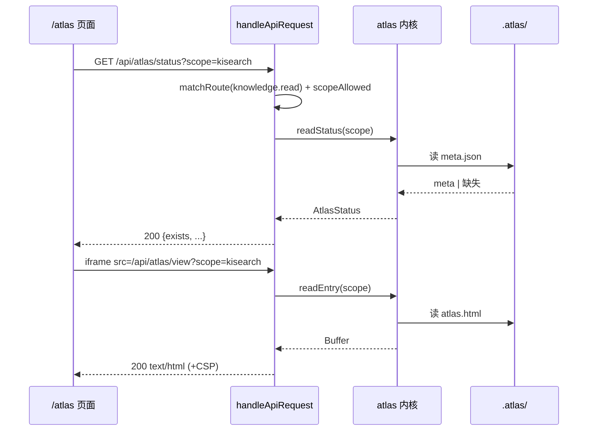

# S-02 HTTP 只读接口

> 一期只有 2 个 GET。写接口（`POST`/`DELETE`）随二期页面上传一起做。

## 1. 术语

| 术语 | 定义 |
|---|---|
| read 车道 | `operation-coordinator` 的读操作白名单，登记后不被导入任务阻塞 |

## 2. 现状（AS-IS）

- 路由分发是 **if-else 链**：`handleApiRequest`（`src/lib/mcp-http-api.ts:1029`），路径前缀分组见 `:1507-1765`。
- 权限是**两处**：`matchRoute`（`src/lib/auth/route-permissions.ts:36+` 的 `RULES`）未登记即 404；带 `scope` 的 GET 还要进硬编码白名单（`src/lib/mcp-http-api.ts:1100-1108`）。
- 500 错误用 `sendJson`；治理域错误码在 `src/lib/governance-errors.ts`（1001~1312 已占）。

## 3. 方案（TO-BE）

### 3.1 接口清单

| 方法 | 路径 | 能力 | 车道 |
|---|---|---|---|
| GET | `/api/atlas/status` | `knowledge.read` | read |
| GET | `/api/atlas/view` | `knowledge.read` | read |

### 3.2 `GET /api/atlas/status?scope=<s>`

**契约**

```
Query:  scope?: string   // 缺省 'default'
200:    { ok: true, exists: boolean, ...AtlasMeta? }
401:    { ok: false, code: 'UNAUTHENTICATED' }                    // 既有全局鉴权
403:    { ok: false, code: 'SCOPE_FORBIDDEN', scope: string }     // 既有越权出口
```

**Demo 返回**

```json
{
  "ok": true,
  "exists": true,
  "title": "kisearch 知识地图",
  "branch": "master",
  "baseline": "1c3dabf",
  "generatedAt": "2026-11-24T11:45:00+08:00",
  "viewCount": 4,
  "size": 254753,
  "packageSize": 108195,
  "sha256": "9bad814a…",
  "uploadedAt": "2026-11-24T15:30:12.000Z",
  "uploadedBy": "cli:root"
}
```

### 3.3 `GET /api/atlas/view?scope=<s>`

**契约**

```
Query:  scope?: string
200:    text/html; charset=utf-8
        X-Frame-Options: SAMEORIGIN
        Content-Security-Policy: frame-ancestors 'self'
        Cache-Control: no-cache
404:    { ok: false, code: 'ATLAS_NOT_FOUND', scope }       // 未上传
500:    { ok: false, code: 'ATLAS_CORRUPTED' }              // 文件存在但 0 字节
403:    { ok: false, code: 'SCOPE_FORBIDDEN' }
```

**Demo 失败返回**（`/atlas` 页面据此渲染错误态，**不允许 iframe 直接吃**）

```json
{ "ok": false, "code": "ATLAS_NOT_FOUND", "scope": "kisearch", "error": "kisearch 还没有上传图集" }
```

### 3.4 错误码

定义在 `src/lib/atlas/errors.ts`，占用 **14xx** 段（1001~1011 生命周期、1101~1122 事件、1201~1202 可见性、1301~1312 回收站，14xx 空闲）：

| 码 | 常量 | HTTP | 含义 |
|---|---|---|---|
| 1401 | `ATLAS_PACKAGE_INVALID` | 400 | zip 结构 / 非 HTML / 缺 baked / 含外链 |
| 1402 | `ATLAS_ENTRY_NOT_FOUND` | 400 | 包内根目录无 `.html` 或有多个 |
| 1403 | `ATLAS_TOO_LARGE` | 413 | zip>20MB / 解压总量>50MB / entry>10MB |
| 1404 | `ATLAS_UNSAFE_ENTRY` | 400 | 条目路径含 `..`、绝对路径、符号链接 |
| 1405 | `ATLAS_NOT_FOUND` | 404 | 该 scope 未上传 |
| 1406 | `ATLAS_CORRUPTED` | 500 | 文件缺失或 0 字节 |
| 1407 | `ATLAS_UNSUPPORTED_ZIP` | 400 | zip64 / 加密 / 非 STORE-DEFLATE |

### 3.5 路由登记（4 处，漏一处即失效）

| # | 文件 | 改动 |
|---|---|---|
| 1 | `src/lib/mcp-http-api.ts`（`:1526` `/doc/*` 附近） | 加 2 条 `if (p === '/atlas/status' && req.method === 'GET') …` |
| 2 | `src/lib/auth/route-permissions.ts`（`RULES` 知识读段） | `exact('GET','/atlas/status','permission','knowledge.read')`、同 `view` |
| 3 | `src/lib/mcp-http-api.ts:1100-1108` | 越权字面量列表加 `/atlas/status`、`/atlas/view` |
| 4 | `src/lib/operation-coordinator.ts:44` `READ_OPERATIONS` | 加 `atlas-status-api`、`atlas-view-api`（并调用处显式传 `'read'`） |

> `route-permissions.ts:9` 的注释写明「覆盖率测试会枚举 handler 路由字面量并断言覆盖」——漏登记的后果是 404 + 单测转红。

### 3.6 时序



## 4. 影响范围

| 文件 | 改动 |
|---|---|
| `src/lib/mcp-http-api.ts` | +2 分支、+2 越权白名单项 |
| `src/lib/auth/route-permissions.ts` | +2 条 RULES |
| `src/lib/operation-coordinator.ts` | +2 个 read operation |
| `test/*` | 路由覆盖率测试需同步（否则红） |

## 5. 待定问题

| # | 问题 | 暂定 |
|---|---|---|
| 1 | 是否允许只读 Token 访问 view | 是（`knowledge.read` 已覆盖）；如需限制在二期写接口时统一处理 |
