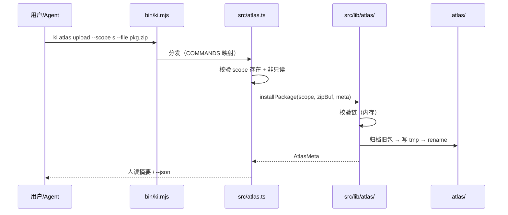

# S-03 CLI 上传（`ki atlas`）

> 一期唯一写入口。**直连内核**，不依赖 daemon 常驻。

## 1. 术语

| 术语 | 定义 |
|---|---|
| CLI 通道 | `bin/ki.mjs` → `src/atlas.ts` → `src/lib/atlas/`，进程内直写本地 KB |

## 2. 现状（AS-IS）

- CLI 命令表是映射：`bin/ki.mjs:31` `COMMANDS = { 'import': 'src/import.ts', … }`，一个命令一个入口文件。
- 既有 CLI（如 `ki import`）直连本地逻辑层，不经 HTTP；`/api/import/run` 是另一条入口但**共用同一逻辑**——本设计沿用这个形态。

## 3. 方案（TO-BE）

### 3.1 命令族

```
ki atlas upload  --scope <s> --file <pkg.zip> [--title <t>] [--json]
ki atlas status  --scope <s> [--json]
ki atlas remove  --scope <s> [--yes]
```

| 命令 | 行为 | 退出码 |
|---|---|---|
| `upload` | 读文件 → `installPackage()` → 打印体积/基线/路径 | 0 成功；1 校验失败；2 库不存在或只读；3 文件不存在 |
| `status` | `readStatus()` → 打印 exists / 标题 / 基线 / 体积 / 上传时间 | 0 |
| `remove` | 二次确认（`--yes` 跳过）→ 删 `atlas.html` + `meta.json`，`archive/` 保留 | 0 / 2 |

### 3.2 注册

`bin/ki.mjs` `COMMANDS` 增一行：

```js
'atlas': 'src/atlas.ts',
```

### 3.3 输出示例（人读）

```
$ ki atlas upload --scope kisearch --file dist/atlas.zip
校验通过：2 个条目 · entry atlas.html 249 KB
已安装到 kisearch/.atlas/
  标题   kisearch 知识地图
  基线   master@1c3dabf（生成 2026-11-24）
  体积   249 KB（zip 108 KB）
  sha    9bad814a
上一版已归档到 archive/
```

`--json` 输出与 `GET /api/atlas/status` 同构（便于脚本消费与 agent 判定）：

```json
{ "ok": true, "scope": "kisearch", "exists": true, "size": 254753, "packageSize": 108195,
  "sha256": "9bad814a…", "baseline": "1c3dabf", "archived": true }
```

### 3.4 失败输出（给 agent 可判定的形状）

```
$ ki atlas upload --scope kisearch --file bad.zip
错误：包内根目录没有 .html（ATLAS_ENTRY_NOT_FOUND · 1402）
包内条目：README.md, assets/a.svg
→ 用 pack_atlas.py <图集目录> dist/ --zip 重新打包
```

要求：**每条错误都给「错误码 + 下一步怎么办」**，不要只打一行 `Error`。

### 3.5 与需求的一致性

| 需求条目 | 落点 |
|---|---|
| R-01 整包上传（语义） | 一期以 CLI 实现；HTTP 写接口二期 |
| R-07 CLI 命令 | 本子需求 |
| 只读库拒绝 | 复用 `rejectIfScopeReadonly` 的判据（`resolveScope(loadConfig(), scope).readonly`） |
| 不落半成品 | 内核 `installPackage` 原子替换保证 |

### 3.6 时序



## 4. 影响范围

| 文件 | 改动 |
|---|---|
| `bin/ki.mjs` | `COMMANDS` +1 行 |
| `src/atlas.ts` | 新增（CLI 参数解析 + 输出） |
| `src/lib/atlas/` | 依赖 S-01 |
| `docs/cli.md`（若存在命令清单） | 补 `ki atlas` 三条 |

## 5. 待定问题

| # | 问题 | 暂定 |
|---|---|---|
| 1 | 是否需要 `--dry-run`（只校验不落盘） | 二期；一期用 `status` + 本地先跑 `pack_atlas.py` 的 check 替代 |
| 2 | 是否打印可直接点开的 URL | 是：`http://127.0.0.1:<port>/atlas#scope=<s>`（端口从 config 读，读不到则只打印路径） |
