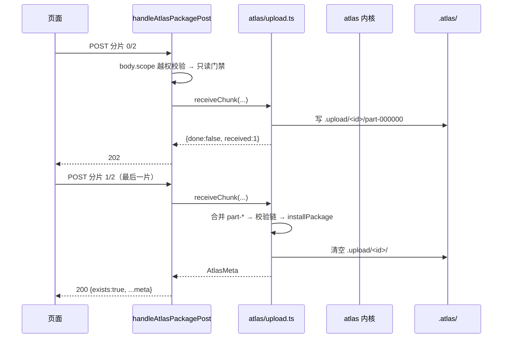

# S-06 页面上传与 HTTP 写接口（二期）

> 前置已满足：`ki atlas upload` 一期验证通过（15 例单测 + 8 场景 CLI + 真机三态），按需求拍板进入页面上传。

## 1. 术语

| 术语 | 定义 |
|---|---|
| 分片上传 | 把 zip 按固定大小切片，逐片 POST，最后一片到达才合并落盘 |
| 暂存 | `<scope>/.atlas/.upload/<uploadId>/part-NNNNNN`，未合并前不是有效图集 |

## 2. 现状（AS-IS）

- 一期只有 CLI 写入口（`src/atlas.ts` → `installPackage`），HTTP 只有 2 个 GET。
- 既有分片范式可参照：`POST /api/import/upload`（`mcp-http-api.ts` 的 `processImportUpload`，body 为 `{scope, uploadId, batchIndex, batchCount, files:[{name,content}]}`，content 为 base64）。
- 写锁：`withScopeWriteLock(scope, op, run)`（`src/lib/scope-write-lock.ts:123`），只读门禁在取锁**之前**判定。
- 只读拒绝：`rejectIfScopeReadonly(res, scope, action)`（`mcp-http-api.ts:487`）→ 409 + `scopeReadonlyBody`。

## 3. 方案（TO-BE）

### 3.1 新增接口

| 方法 | 路径 | 能力 | 车道 |
|---|---|---|---|
| POST | `/api/atlas/package` | `knowledge.write` | write（套 `withScopeWriteLock`） |
| DELETE | `/api/atlas/package?scope=` | `knowledge.write` | write（套同一把锁） |

### 3.2 `POST /api/atlas/package`

**请求**

```jsonc
{
  "scope": "kisearch",          // 必填语义：缺省 'default'；**权限校验用它的值，不从 query 取**
  "uploadId": "u-ab12cd",       // 客户端生成，仅允许 [a-zA-Z0-9_-]
  "batchIndex": 0,              // 0 基
  "batchCount": 2,
  "meta": { "title": "…" },     // 可选兜底（包内 meta.json 优先）
  "files": [{ "name": "part-0", "content": "<base64>" }]
}
```

**响应**

```
202 { ok: true, received: 1, of: 2 }                 // 未收完
200 { ok: true, exists: true, ...AtlasMeta }          // 收完并安装成功
400 { ok:false, code:'ATLAS_PACKAGE_INVALID'|…, error, hint }
403 { ok:false, code:'SCOPE_FORBIDDEN' }              // 无写权限/越权
409 { ok:false, code:'SCOPE_READONLY' }               // 只读库（复用 scopeReadonlyBody）
413 { ok:false, code:'ATLAS_TOO_LARGE' }
```

**流程**



**硬约束**

| # | 约束 | 来源 |
|---|---|---|
| 1 | scope 从 **body** 取，越权校验在读 body 之后 | 验证报告 A1（原型首版从 query 取 → 只读库写入用错权限通过） |
| 2 | 最后一片才合并；未收完不产生 `atlas.html` | 需求 N4 |
| 3 | 合并失败（校验不过）清空该 `uploadId` 暂存 | 不留垃圾 |
| 4 | 上传前惰性清理 >24h 的 `.upload/*` | 需求 N11 |
| 5 | 写操作套 `withScopeWriteLock(scope,'atlas-upload',…)` | auto-review 质疑（并发写会互相覆盖归档） |
| 6 | 单请求体上限沿用服务端 `uploadMaxBytes`，单片 base64 ≤ 2 MB（客户端切） | 与 import/upload 同口径 |

### 3.3 `DELETE /api/atlas/package?scope=`

```
200 { ok: true, removed: true }        // 删了当前版本（archive/ 保留）
200 { ok: true, removed: false }       // 本来就没有
403 / 409 同上
```

### 3.4 前端上传弹窗（同一子需求）

```
┌──────────────────────────────────────────────┐
│ 上传图集包                              ×    │
├──────────────────────────────────────────────┤
│ 文件：kisearch-atlas.zip  108 KB  [选择文件]  │
│ 包内条目：atlas.html 249 KB · meta.json 137 B │
│ ▓▓▓▓▓▓▓▓▓░░░░░  分片 1/2 上传中…             │
│ 会覆盖当前版本，上一版进 archive/             │
│                           [取消]  [开始上传] │
└──────────────────────────────────────────────┘
```

| 行为 | 判据 |
|---|---|
| 只接 `.zip` | `accept=".zip"` + 前端校验扩展名 |
| 本地预览 | 选完即显示体积；上传成功后用响应里的 `entries` 回显条目 |
| 分片 | 2 MB/片，逐片 POST，显示 `batchIndex+1 / batchCount` |
| 失败 | 显示 `code` + `hint`，允许重试同一 `uploadId` |
| 成功后 | 关闭弹窗 + 刷新 status（不整页跳转） |

### 3.5 数据模型

复用 `AtlasMeta`，不新增字段。暂存目录结构：

```
.atlas/.upload/<uploadId>/
├── part-000000
└── part-000001
```

## 4. 影响范围

| 文件 | 改动 |
|---|---|
| `src/lib/atlas/upload.ts` | 新增：分片接收、合并、暂存清理 |
| `src/lib/atlas/index.ts` | 导出 upload 能力 |
| `src/lib/mcp-http-api.ts` | +2 分支、+3 handler（POST/DELETE/统一错误出口复用 `sendAtlasError`） |
| `src/lib/auth/route-permissions.ts` | +2 条（POST/DELETE `knowledge.write`） |
| `web/src/pages/AtlasPage.tsx` + `styles/atlas.css` | 上传弹窗 + 卸载按钮 |
| `web/src/api/httpApi.ts` | +`uploadAtlasPackage`（分片封装）、+`deleteAtlasPackage` |
| `test/atlas-upload.test.ts` | 新增：分片合并 / 中断不落盘 / 暂存清理 / 排序正确性 |

> 写接口的 scope 来自 body，**不进** `mcp-http-api.ts:1100` 的 query 越权白名单（那份列表只覆盖 GET）。

## 5. 异常处理

| 场景 | 行为 | 对外暴露 |
|---|---|---|
| 分片乱序到达 | 按 `batchIndex` 命名落盘，合并时按序号排序（零填充 6 位，避免 part-10 排到 part-2 前） | 否 |
| 重复到达同一片 | 覆盖同名 part（幂等） | 否 |
| 合并时缺片 | 按实际片数 < batchCount 判定，返回 `202` 而不是合并 | 是（提示还缺片） |
| 校验失败 | 清空暂存 + 400 + `hint` | 是 |
| 只读库 | 409 `SCOPE_READONLY` | 是 |
| 越权 scope | 403 `SCOPE_FORBIDDEN` | 是 |
| 暂存超 24h | 下次上传前惰性删除 | 否 |

## 6. 待定问题

| # | 问题 | 暂定 |
|---|---|---|
| 1 | 是否支持断点续传（中断后同 uploadId 继续） | 支持（按 batchIndex 落盘天然可续），但前端一期只做「重传整包」 |
| 2 | 是否需要上传进度百分比 | 按片数显示即可（片大小固定） |
