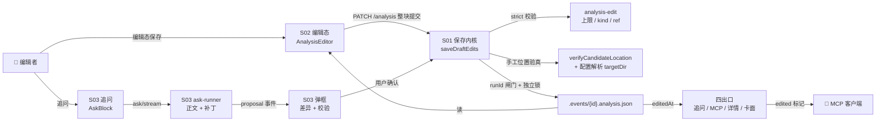
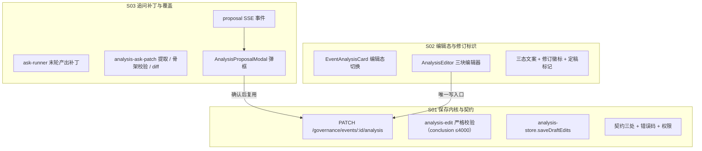

# 设计：AI 分析产物人工校正

- 需求：`REQ-20261123-001` **v4**（H1~H11 已拍板；v4 并入「追问补丁覆盖结论」并统一 4000 字长度口径）
- 交互：`design/interaction-design.md`（Q1~Q4 已拍板）｜界面：`requirement.md` §6（阅读/编辑态已确认，弹框待确认）
- 拆分判定：**走多文档（父 + 3 子）**。理由：v4 起有三段可独立验证的能力——写内核（curl/单测）、卡面编辑态（组件测试/截图）、追问补丁链路（SSE + 弹框）。各自触发场景与验证方式不同，合并会让"缺口在写面还是在呈现面"无法定位；再细拆则切出无独立场景的假边界（如"修订标识"横跨两端）。
- 子文档：`S01_保存内核与契约_DESIGN.md`、`S02_编辑态与修订标识_DESIGN.md`、`S03_追问补丁与覆盖_DESIGN.md`
- 修订：**r2（2026-11-23）** —— 并入 S03（追问补丁）、长度口径统一为硬上限 4000（原 120/400 软限制取消）

---

## 1. 需求背景 & 目标

AI 分析的三块产物（结论 summary+chain、未确认点、已确认位置）原本全只读，且**追问只读**：追问再多也无法改写结论（`analysis-ask-runner` 全文不写草稿）。

目标两条：
1. 三块产物人工可改、一次整块保存、改完即事实来源（追问 / MCP / 详情 / 卡面四处读到新值），且**能看出这是人改的**；
2. **追问末端能产出可覆盖结论的补丁**，服务端按事件类型模板校验，前端弹框由用户确认后才覆盖。

**不在范围内**：

- 节点 `ref` 选择器与根因分支编辑（推二期，见需求 §3.3）
- AI 原稿快照与撤回（H2：不留）
- 多人协同编辑（A3）、未确认点"标记已解决"（待验证）
- 补丁覆盖**未确认点 / 已确认位置**（本期只覆盖结论）
- 重跑 / 续跑的内核重构（归 `REQ-20261123-002`）

---

## 2. 关键环节一览图

## 3. 总体方案设计

**共享术语速查**（各子文档不重复定义）：

| 术语 | 含义 | 归属 |
|---|---|---|
| 整块提交 | 一次请求携带三块目标值 + `expectedRunId`，无分块接口 | S01 |
| 严格校验 | 与 `normalizeChain` 口径一致，但**超限报错而非静默丢弃** | S01 |
| `editedAt` | 人工修订时间戳，落 `AnalysisDraft`；存在即"被人工改过" | S01 |
| 长度口径 | **无软限制，硬上限 4000 字**（结论 summary 与追问回答同一口径），超限截断 | S01 |
| 已人工清空 / 已人工定稿 | 卡面三态中的两态 | S02 |
| 补丁（proposal） | 追问末端产出的 `conclusion` + `chain` + 理由 | S03 |
| 模板校验 | 按视角骨架（fault/perf 5 槽；change/generic 4 槽）校验补丁，**不约束人工编辑** | S03 |

## 4. 全局风险 & 跨子需求依赖

| 风险 | 说明 | 处理 |
|---|---|---|
| 契约三处漂移 | `governance-contract.ts`（`AnalysisDraftDto` / `AnalysisDraftSummaryDto` / `AnalysisAskTurnDto`）+ web 副本 | 加字段必须三处同改，契约门禁 28 例兜底 |
| 与「重置分析」抢同一张卡 | 重置已上线（卡头按钮） | 交互已定；走查后经拍板**维持现状**（S02 §8） |
| 写盘路径与 002 冲突 | 002 会重写分析循环，同样动 `analysis-store` | 顺序：先本需求、后 002 |
| **骨架校验误伤人工编辑** | 校验若加进 `validateDraftEdit`，需求类事件就加不了「根本原因」 | 骨架校验只放 S03 的补丁路径（S03 D2） |
| **模型 schema 稳定性未知** | 同一末轮同时出正文 + JSON，成功率未验证（🔴） | 失败即降级纯文本 + `step` 记录；实测 <60% 改二次调用（S03 D1 触发条件） |
| 长度口径变更影响存量 | 旧用例按 120/400 写（`analysis-edit.test.ts` 的 120/121） | 需求 §10 列了 6 处需同步的代码与用例 |
| `A1` 枚举与实际不符 | 需求 A1 原写"只有 ready/partial"，但 R-17 要求补齐 `NO_RESULT`（落盘即 `failed`） | 已放宽为**除 `running` 外均可编辑**（S01 D1） |

**跨子需求依赖**：S02 → S01（PATCH 契约与错误码）；S03 → S01（复用写入口）+ S02（卡面回流 `onUpdated`、`gov-modal` 家族）。实施顺序 S01 → S02 → S03。
